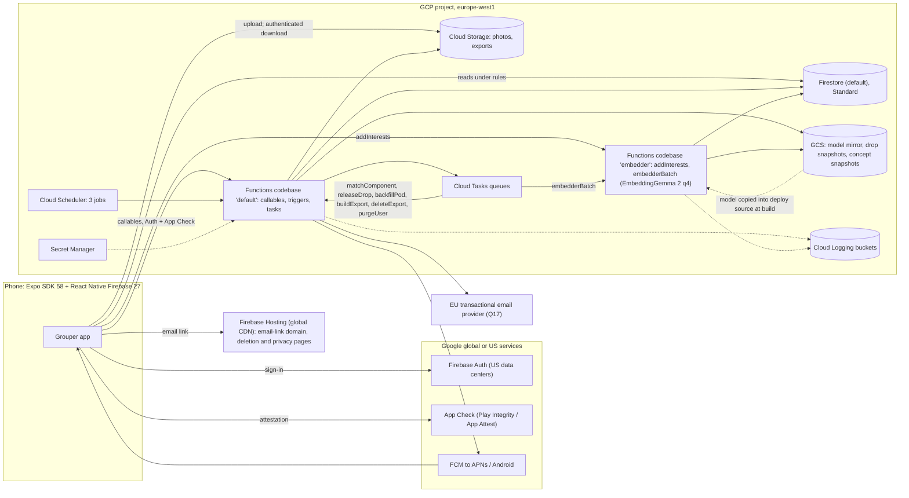

# Grouper: product and technical design

| | |
|---|---|
| Status | Draft for founder review (phase: design doc + scaffold) |
| Date | 2026-11-04 |
| Companion | [PRIVACY.md](./PRIVACY.md) (GDPR design) |
| Market | Denmark (Aarhus, Copenhagen), 18+, Danish + English |

**Evidence tags.** Every number is tagged with its source:

| Tag | Source |
|---|---|
| [EXP] | First embedding calibration experiment (measured in sandbox, EmbeddingGemma-300m ONNX, v1) |
| [CAL] | v1 vs v2 re-calibration with the same test set and code, reproducible in [`research/embedding-calibration/`](../research/embedding-calibration/README.md) |
| [SRV] | EmbeddingGemma serving research |
| [FBX] | Firebase + Expo SDK 58 infrastructure research |
| [GDPR] | GDPR / Danish data protection analysis |
| [MAT] | Matching algorithm and product rules research |
| [SIM] | Thin-market simulation and n = 20k benchmark of the scaffold's matcher, [`research/thin-market-sim.md`](../research/thin-market-sim.md) (synthetic behaviour) |
| [A] | Architect's assumption, to be validated |

Where reports conflict, the resolution is stated inline and summarized in §2.3. Measured numbers from [CAL] and [EXP] win over estimates; [CAL] supersedes [EXP] for every model-specific threshold.

---

## 1. Summary and glossary

Grouper is "friendship dating" for groups. Users describe themselves with free-form **Interests** in their own words ("madlavning", "on paternity leave", "Fortnite"). Every Thursday evening a batch job (the **Drop**) forms new **Pods** of 4–6 nearby strangers who share an interest. Members accept or decline. Once at least 4 accept, the pod is confirmed, first names are revealed, photos are revealed (in sensitive-themed pods only for members who opt in, §6.1 S6), and the pod uses a **meetup planner** (propose 2–3 options, vote). There is no free-form chat. Sensitive interests (GDPR Art. 9, e.g. pregnancy, religion) are allowed with explicit consent and are only ever revealed inside a pod formed around that interest.

The stack is an Expo SDK 58 app on React Native Firebase, with Firestore, Cloud Functions 2nd gen and Cloud Storage in **europe-west1**. A self-hosted **EmbeddingGemma** model runs on CPU in a scale-to-zero Cloud Function. Estimated infrastructure cost: about $1/month at 1k MAU, $3–5 at 10k, $49–63 at 100k (§12).

| Term | Meaning |
|---|---|
| **Interest** | A free-form tag (max 40 characters), stored as typed and normalized. |
| **Sensitive interest** | An interest that may reveal Art. 9 data (health incl. pregnancy, beliefs, sexual orientation, politics, ethnic origin, union membership). Stored separately; needs explicit consent. |
| **Concept** | An internal cluster of interests that mean the same thing ("cooking", "madlavning"). Has a centroid, a frozen medoid, a sensitivity flag and labels. Never shown as a catalog. |
| **Holding** | A user's link to a concept through one of their interests. A user has at most 20. Sensitivity is decided **per holding**: a holding the user marked "Keep this private" is sensitive even if the tag is ordinary, and it points at a concept in the sensitive partition (§5.2 (5)). |
| **Pod** | 4–6 users grouped around one Theme. States: proposed → planning (from confirmation) → scheduled → happened → archived, or dissolved (§4.6). |
| **Theme** | The concept a pod is formed around. Every member holds it and sees it only in their own wording. Shared pod documents carry the concept ID, never a label. |
| **Drop** | The weekly batch (compute Thursday 16:00, release 18:00, Europe/Copenhagen), keyed by ISO week, e.g. `2026-W46`. |
| **Cell** | A geohash-5 cell (about 2.7 × 4.9 km at 56°N [GDPR][MAT]). The only location we store. |
| **Launch area** | A static, versioned list of geohash-5 cells with a stable ID (`aarhus`, `copenhagen`) and status waitlist, beta or live (§6.4). Only users whose home cell lies in a live area are matched. Chips and waitlist counters are per launch area. |
| **Matching component** | Computed per drop only: opted-in cells inside live areas, linked when ≤ 25 km apart. It only partitions the compute into tasks and is never stored on users. |
| **Option** | A proposed meetup time and place that members vote on. |

---

## 2. Decisions log and open questions

### 2.1 Founder decisions (interview, 2026-11-04)

| # | Decision | Rationale |
|---|---|---|
| F1 | Groups, not individuals; vocabulary "Interests" and "Pods" | Lower pressure than 1:1; conversation tops out around 4 people [MAT]. |
| F2 | Free-form interest tags; EmbeddingGemma similarity; no curated catalog | Users speak in their own words (da/en); the model links "madlavning" to "cooking". |
| F3 | The app forms new pods of 4–6 strangers; users accept/decline | No empty-room problem; every member opts in. |
| F4 | In-person, local only, radius around approximate location | Friendships need repeated in-person time (about 50 h to casual friend [MAT]). |
| F5 | Weekly drops, Thursday evening, Europe/Copenhagen | Better global matches, anticipation, cheap batch compute. |
| F6 | Meetup planner only, no chat; public-place safety tips | Smaller harassment and moderation surface. |
| F7 | Sensitive (Art. 9) interests allowed with separate explicit consent; never public; revealed only inside a pod formed around that interest; automatic detection plus self-flagging | Headline use cases (pregnancy, faith, recovery) are Art. 9; free text needs automatic detection. |
| F8 | Pod preferences: age range + optional same-gender pod (gender collected only for that) | Comfort and safety with minimal data. |
| F9 | Optional single profile photo, visible only to fellow members after confirmation | Recognition at the meetup without appearance-based matching. |
| F10 | Sign-in: Apple, Google, email magic link; no SMS | SMS costs money and needs a phone number. |
| F11 | Denmark first (Aarhus, Copenhagen); Danish + English; i18n-ready; 18+ | Dense home market; meeting strangers justifies 18+. |
| F12 | Free MVP, no monetization | Focus on liquidity and safety first. |
| F13 | Expo/React Native + Firebase; EU data residency; inexpensive infrastructure | One language (TypeScript), pay-per-use. |
| F14 | GDPR compliant; Danish controller; Datatilsynet | Legal requirement; Art. 9 data is core to the product. |
| F15 | This phase delivers a design doc + scaffold for review before features | De-risk architecture and privacy before building. |

### 2.2 Architect decisions beyond the brief (need founder sign-off)

| # | Decision | Why |
|---|---|---|
| A1 | Model: **EmbeddingGemma 2** ONNX **q4**, text-only, pinned `daa72c51…` (v1 300m q4 kept as the calibrated fallback) | Passed the M0 gate [CAL]: merge recall at precision ≥ 0.95 rises 0.26 → 0.42 (paired bootstrap +0.16, 90% CI +0.03 to +0.32), detector no worse, Danish surface-form bias gone, Apache-2.0 instead of the Gemma Terms |
| A2 | 768-d vectors for tags and concepts; 128-d only in the matching profile | Thresholds were measured at 768-d [CAL] |
| A3 | `sentence similarity` prompt for both tags and the detector, so one embedding per tag | For v2 the STS prompt gives fewer detector false flags at 100% recall than `classification` (paired Δ −0.14, CI −0.245 to −0.032) [CAL] |
| A4 | Embedder in its own Functions codebase: 1 GiB, scale to zero, model inside the deploy source | Cloud Run price, with Auth and App Check built in [SRV][EXP] |
| A5 | Layered sensitivity, seed review, review queue; never merge across sensitivity | Detector: 100% recall, about 49% false flags (55 of 112 ordinary tags), mostly Danish [CAL] |
| A6 | Soft themes only through confirmed links | Cosine "related" thresholds fail [EXP] |
| A7 | Clients only read; every write is a callable | One validation layer; simple rules |
| A8 | Compute at 16:00, release at 18:00 | Retry slack |
| A9 | New inputs: meetup language (hard) and availability (6-bit) | Acceptance and planning [MAT] (Q2) |
| A10 | Participate every week by default; auto-pause after 3 declines / 2 ignored | Dense pools without ghost invites |
| A11 | Max 2 active pods per user | Commitment; room for newcomers |
| A12 | Postcode or coarse location → geohash-5 on the device; radius 5/10/15/25 km | Minimisation [GDPR]; cells span up to 5.6 km [MAT] |
| A13 | Never show distances; show the area and the user's own radius | Reveals nothing new |
| A14 | FCM direct, generic payloads; no Expo push, EAS Update, analytics or Crashlytics | One processor; no consent banner [FBX][GDPR] |
| A15 | No Identity Platform; claim `onb` set by a callable | Avoids +$275/month at 100k MAU [FBX] |
| A16 | europe-west1 for everything that can be pinned | About 45% cheaper than eur3 [FBX] |
| A17 | Admin through a CLI (IAM) until M3 | No exposed admin surface |
| A18 | HMAC pod IDs and pair history (26 weeks) | Idempotent, no exposed IDs |
| A19 | JPEG only; EXIF stripped on the server; authenticated downloads only; grants removed at every pod exit; `max-age` 1 h; device caches cleared on revocation events; soft delete off | Revocable on the server at once, on devices at the next app open (§9 Photos) |
| A20 | Pod retention from [MAT]: archive after 30 idle days, delete 90 days later | Shorter than [GDPR]'s proposal |
| A21 | Interests 2–40 characters, max 20, max 3 starred, min 3 | Less identifying text |
| A22 | About 150 internal bilingual seed concepts | Counters fragmentation [EXP] |
| A23 | React Native Firebase 27 in the app (the JS SDK 13 only in tests and tools) | Native App Check, FCM and sign-in; JS SDK App Check is web-only [FBX] |
| A24 | Static launch areas (stable IDs, versioned in git) instead of computed regions; per-drop matching components only partition compute | Union-find over occupied cells chains across Jutland, Funen and Zealand (Great Belt link ≈ 18 km), so computed regions cannot express "Aarhus live, Copenhagen waitlist" |
| A25 | Sensitive-theme safeguards against infiltration: eligibility gate, per-account sensitive caps, photo opt-in, "not a genuine member" report (§6.1 S5–S7) | Sign-up is free and unverified (PRIVACY.md R15) |
| A26 | An alpha configuration profile for thin markets (§6.10) | 50–150 testers cannot fill pods under the launch defaults |
| A27 | Erasure ledger for every erasure-relevant event, replayed after any restore | A 7-day restore must not bring back withdrawn Art. 9 data |

### 2.3 Conflicts between research reports and how they were resolved

Measured results win over estimates.

| Conflict | Resolution |
|---|---|
| Model and quantization: [SRV] proposed v2 q8; [EXP] calibrated v1 | v2 **q4** (A1), after [CAL] re-ran the calibration on v2. q8 is not better for matching and is about 5× slower per tag on CPU [CAL]; v1 q8 peaks at 1.6 GB [EXP]. |
| Vector size: [SRV] 256-d; [EXP] 768-d | 768-d (A2) |
| Detector prompt: [SRV] STS; [EXP] classification (v1) | STS for v2 (A3) [CAL] |
| Embedder memory: [SRV] 2 GiB; [EXP] 1 GiB | 1 GiB |
| Node runtime: [SRV] 22; [FBX] 24 | Node 24 (rules tests need 24.12 or newer). transformers.js on Node 24 must be verified in M0. nodejs24 is 2nd gen only (https://docs.cloud.google.com/functions/1stgendocs/runtime-support), so the design has no 1st-gen functions (§10.3). |
| Drop time: [FBX] 18:00; [MAT] 16:00 | Compute at 16:00, release at 18:00 (A8) |
| Distances: [MAT] shows them; [GDPR] never | Never shown (A13) |
| Pod retention: [MAT] vs [GDPR] | [MAT]'s shorter windows (A20) |
| Tag length: [SRV] 60; [MAT] 40 | 40 (A21) |
| Soft themes: [MAT] cos ≥ 0.80; [EXP] shows such thresholds fail | Confirmed links only (A6) |
| Firestore location: [GDPR] eur3 or europe-west1; [FBX] europe-west1 | europe-west1 (A16) |
| Functions free tier: Firebase page 200k CPU-s / 400k GB-s; Cloud Run page 180k / 360k | The lower Cloud Run figures, re-checked on cloud.google.com/run/pricing: per billing account, with 100 ms rounding |

### 2.4 Open questions for the founder

| # | Question | Default if no answer |
|---|---|---|
| Q1 | ~~EmbeddingGemma v1 or v2?~~ **Answered by the M0 gate [CAL]: v2 q4.** Founder can still veto (v2 is about 4 weeks old). | v2 q4. v1 stays documented as the fallback; switching back means re-embedding with v1's thresholds (§5.1). |
| Q2 | Add meetup language and availability as inputs (A9)? | Yes, both. |
| Q3 | Participation: default every week (A10) or explicit weekly opt-in? | Every week. |
| Q4 | Who reviews flagged tags, and how often? | Founder, weekly, before each drop. |
| Q5 | Avoid a lone woman or man in mixed pods? (Requires everyone's gender.) | No; revisit after alpha. |
| Q6 | Minimum density before a sensitive concept can be a theme | 12 eligible consenting holders within 25 km of the pod's cells [A] (§6.1 S1). |
| Q7 | Max 2 active pods (A11) and the "Keep pod" loop? | Yes. |
| Q8 | Must first names be real, and photos show a face? | No; a face photo is recommended. |
| Q9 | Sign in with Apple on Android (web flow) or Google/email only? | Google/email only on Android. |
| Q10 | Legal entity, privacy lead, lawyer budget | Needed before alpha (PRIVACY.md). |
| Q11 | Launch-area go-live at 200 opted-in users in the area and predicted match rate ≥ 50% for 2 weeks [MAT]? | Yes. The goal lives in one place, `areas/{areaId}.goal`. |
| Q12 | Opt-in "open to meet anyone" fallback theme? | Yes, opt-in only (on by default in the alpha profile, §6.10). |
| Q13 | Skip drops in holiday weeks (e.g. week 52)? | Configurable skip list, empty by default. |
| Q14 | Later: canonicalize tags with an EU-hosted LLM under a DPA [EXP]? | Not in MVP. |
| Q15 | Sensitive-theme eligibility gate (§6.1 S5): account ≥ 14 days old and ≥ 1 attended meetup? This delays a new user's first pregnancy or faith pod by several weeks. | Yes [A]; revisit with alpha data. |
| Q16 | Same-gender pods for non-binary users: "non-binary only" or also "women + non-binary" / "men + non-binary"? | "Same gender" only in MVP; the app tells non-binary users when the pool is too small (`GENDER_POOL`). |
| Q17 | Transactional email provider for inactivity warnings and Art. 34 notices (PRIVACY.md §9) | An EU provider with a DPA, chosen in M1 [A]. |
| Q18 | Run the sensitivity detector on the device so that possibly-Art. 9 text leaves the phone only after consent (§5.2 (5))? Costs about 175 MB of model download (v2 q4). | Lexicon on the device in M1; on-device model decided at the M0 gate with counsel. |
| Q19 | **Thin-market levers for the alpha.** The simulation [SIM] says the planned 50–150 testers cannot fill pods: at n = 100 about half the testers get no confirmed pod in 12 weeks. Even n = 300 with 5 seed-theme cohorts reaches only 35% confirmation and a first pod after a median 4.3 weeks, because most proposals have only 4 invitees and need all 4 to accept. Which levers do we pull? (a) recruit ≥ 300 testers in Aarhus into ≤ 5 seed-theme cohorts; (b) invite 5–6 whenever the pool allows; (c) a wider default age range in the alpha; (d) let an alpha pod confirm at 3 accepts (changes F3). | (a) and (b), tested in `tools/sim` before M1; (c) and (d) only with founder sign-off. |

---

## 3. User journeys

### 3.1 Onboarding (including consent steps)
1. **Welcome**: the UI language follows the device (da/en, switchable). Copy: "Small groups. Real meetups. 18+."
2. **Sign in**: Apple (iOS), Google or email magic link. Firebase Auth stores the provider UID and email. With Google, Firebase Auth also copies the Google display name and photo URL; `completeOnboarding` clears the top-level `displayName` and `photoURL` with Admin `updateUser({displayName: null, photoURL: null})`. The `google.com` entry in `providerData` may keep them, and they are refreshed at each Google sign-in [verify in M0]. That residual is disclosed (PRIVACY.md §9).
3. **Terms and privacy notice**: the user accepts the Terms (contract). The layered privacy notice is information, not consent. Versions are recorded.
4. **Date of birth**, entered on the device.
5. **First name**: visible only to confirmed pod members.
6. **Area**: postcode (default, no permission needed) or approximate location (coarse permission). The device converts either one to geohash-5 with the bundled postcode table (`packages/core/src/geo/dk-postcodes.json`) and discards the postcode and coordinates. The server receives only `gh5`.
   - The app then calls `completeOnboarding` with steps 3–6.
   - The server checks 18+, keeps only `birthYear` [GDPR], resolves the launch area from `gh5`, creates the profile with default preferences, and sets the claim `onb`.
   - **Under 18:** the server deletes the Firebase Auth user at once (`auth.deleteUser`) and stores nothing about the person except 30-day markers in `underageMarkers`, keyed on `HMAC(email)` when the token has an email and on `HMAC(provider, provider uid)` for each federated identity (Apple sign-in usually carries no email). A retry with the same email or sign-in identity inside 30 days gets the same answer without a new date-of-birth check. The marker is disclosed in the privacy notice (PRIVACY.md §11).
7. **Interests**:
   - free text, with a permanent notice about sensitive interests;
   - launch-area chips (non-sensitive concepts with ≥ 10 holders in the area) to help start;
   - the device runs the deterministic lexicon (§5.2 (5)) before sending anything. A lexicon hit opens the consent sheet before the text leaves the phone;
   - if the server returns `needsConsent`, the **explicit consent sheet** opens (PRIVACY.md §3): unticked checkbox, "Add" disabled until it is ticked, "Don't add" discards the tag;
   - nothing is stored or logged before consent;
   - minimum 3 interests, nudged towards 5 [MAT].
8. **Preferences**: age range (default own age ±7, min width 5 years [A]; the alpha profile uses ±10, §6.10), radius (default 10 km, shown as "about"), meetup languages, availability (weekday/Saturday/Sunday × day/evening). Turning on "same-gender pods" opens a gender picker with its own consent checkbox. The consent copy says that members of a same-gender pod will know that everyone in it shares their gender (PRIVACY.md §3.6).
9. **Photo** (optional): "Only people in a confirmed pod with you can see it. In pods about a sensitive interest, you choose per pod whether to show it."
10. **Notifications** permission, then the **safety pledge** checkbox.
11. **Done**: in a live launch area, "Your first drop is Thursday at 18:00". In a waitlist area, bucketed progress from `areas/{areaId}` ("Aarhus: 150+ signed up. We open at 200."). Outside every launch area: "Grouper isn't in your area yet."

### 3.2 Weekly drop
- **Timeline:**
  - Monday 10:00: nudge for users on manual participation;
  - Thursday 12:00: opt-in cutoff (manual users opting in for this week). Pausing or skipping takes effect immediately at any time (§10.1 `setParticipation`);
  - Thursday 16:00: compute;
  - Thursday 18:00: release after revalidation (§10.3 `releaseDrop`), with the push "Your weekly drop is here" (never a theme or name). Pushes are staggered over 15 minutes.
- **Home** then shows either a **proposal card** or "No pod this week", with a reason and a tip ("add a few interests", "try 15 km"). If a setting makes the user structurally unmatchable (for example a same-gender pool that is too small), the reason names that setting (§6.7).
- **The card shows:**
  - the theme in the viewer's own wording (lock icon if sensitive);
  - size and area ("near Aarhus C");
  - "everyone lives about 10 km or less from you" (H2 compares cell centroids, so distances are approximate);
  - age span (ordinary themes only);
  - up to 3 non-sensitive interests the viewer also shares (ordinary themes only);
  - the deadline.
- **Sensitive themes:** before confirmation, invitees are not yet members, and some will decline. The card therefore omits the age span and the shared interests (`ALSO_SHARE`), which together could narrow down who the local holders are. The consent text names invitees as recipients of the theme (PRIVACY.md §3.3).
- **The card never shows** names, photos, IDs, gender or who has accepted [MAT].
- **"Why this pod"** renders server reason codes (§6.7).

### 3.3 Accept or decline
- **Accept** calls `respondToPod`; the card then shows "3 of 5 accepted".
- **Decline** takes an optional reason chip, used for aggregate metrics only.
- **Auto-pause:** 3 declines or 2 ignored proposals in a row pause participation, with a prompt [MAT][A].

### 3.4 Confirmation reveal
- At 4 accepts the pod is confirmed and enters `planning` (§4.6). Pending invitees can still join until the accept deadline, up to 6. Late joiners see the current options and can vote; if an option has already locked, they see the plan and confirm attendance.
- Push: "Your pod is confirmed".
- **The pod screen shows:**
  - first names;
  - photos (through grants). In sensitive-themed pods a member's photo is shown only after that member taps "Show my photo to this pod" (S6);
  - the theme, in the viewer's own wording (from their pod card; the shared pod doc carries no label);
  - "pod interests": non-sensitive concepts held through ordinary (not self-flagged) holdings by ≥ 2 members, not attributed to anyone.
- The safety tips sheet opens, and the 72-hour planning window starts.

### 3.5 Meetup planning and voting
- **Proposing.** The planner asks for 2–3 options (max 3 per pod, max 2 per member) and keeps asking for a second option until one exists. Voting opens with the first. A single option can still win, so a quiet pod is not dissolved for proposing too little. Each option has:
  - a time within 14 days, between 08:00 and 22:00;
  - a place of at most 120 characters;
  - an optional Google Maps, Apple Maps or OpenStreetMap link;
  - a mandatory "public place" tick.
- **Checks.** Text that looks like a home address triggers a warning. Phone numbers and handles are rejected.
- **Voting.** Members vote yes/no on each option.
  - If every current member says yes to one option, it locks early.
  - At the planning deadline, the option with the most yes votes (at least 3) wins; ties go to the earlier time.
  - With no winner, a pod that has never met dissolves and its members get priority next week; a pod in the Keep loop is archived (§4.6).

### 3.6 Meetup and feedback
- **T−24 h**: "Still coming?" plus the safety tips. Members who do not answer count as coming.
- **Attendance check** (at T−6 h, or as soon as a cancellation leaves fewer than 3 coming): if fewer than 3 are still coming, the pod gets one 48-hour reschedule round (back to `planning`). If that round produces no winner, or attendance falls below 3 again, the meetup is cancelled and the pod is archived (or dissolved if it never met). With 3 or more coming, the meetup goes ahead.
- **T−2 h**: reminder.
- **T+2 h** (open for 7 days), "Did you meet?":
  - attendance for each member;
  - a private "would meet again" for each person;
  - a 1–5 rating;
  - **Keep pod** / **Not for me**.
- When feedback closes: if at least 3 chose Keep, the pod goes back to `planning` with those members only and a new 72-hour deadline. The others leave the pod (roster, `memberUids` and photo grants are updated). Otherwise it is archived.

### 3.7 Block and report
Both are available from a member's sheet in a confirmed pod (current or past, while the pod record exists).
- **Block**:
  - immediate and two-way;
  - photo grants revoked in both directions;
  - the two are never matched again.
  - **Inside an active pod** (proposed, planning or scheduled), Firestore rules cannot hide one member's fields from another, so the two cannot stay in the same pod. By default the **blocked** member is removed. The others, including the blocked person, see only the generic "The pod changed" / "A member left". The blocker can choose to leave instead. If the removal takes the pod below its minimum, the normal rules apply (§4.6).
  - If the meetup was already scheduled, the blocked person knows the plan. The blocker is offered "Re-plan the meetup", which reopens planning with a 48-hour deadline and deletes the old options.
  - `blockUser` accepts only a uid that shares or shared a pod with the caller (checked against `podState`). The stored `firstName` is the name the caller saw in that pod's roster; it is empty if the pod was never confirmed.
- **Report**:
  - categories: harassment, safety, no-show, content, suspected under 18, and, in sensitive-themed pods, "not a genuine member" (S7);
  - optional text (max 500 characters), with a warning not to include sensitive details;
  - the reporter is never revealed;
  - safety reports show "call 112 in an emergency".
- **Automated pauses** (temporary, each with an immediate statement of reasons and human review on request; listed on "How matching works"): two independent reports within 30 days, or one safety report, pause the reported user from drops until a human reviews [MAT]. The other automated pauses are the no-show pause (§4.4), the suspected-under-18 pause, and the sensitive-theme hold after a "not a genuine member" report (S7). Permanent sanctions are decided only by humans.

### 3.8 Leave pod
From the pod menu. The others see "A member left". Below 3 members the pod is dissolved (never met) or archived (has met) (§4.6). Photo grants for that pod are removed in both directions.

### 3.9 Export data
Settings → Privacy → "Download my data" asks the user to re-authenticate, then calls `exportData`. A background task builds a JSON file, and the user gets a notice when it is ready. The download is authenticated (no public URL). The file is available for 24 h: a Cloud Task deletes it at +24 h, and the Storage lifecycle rule is a backstop that can take up to about another day, so the notice says "deleted within 48 hours". Contents: PRIVACY.md §6.

### 3.10 Delete account
1. Settings → Delete account explains what is deleted, plus the backup (7 days) and Auth (up to 180 days, Google) windows.
2. The user re-authenticates. On iOS with Apple sign-in, the device gets a fresh `authorizationCode` and calls RNFirebase `revokeToken(authorizationCode)` before step 3. This needs the Apple provider's code-flow fields (Services ID, Team ID, key ID, private key) configured in the Firebase console, so no Apple key material lives in our Secret Manager. A failed revocation is retried once and does not block deletion.
3. `deleteAccount` runs; the device then signs out, calls Firestore `terminate()` + `clearPersistence()`, clears the expo-image memory and disk caches, and shows a confirmation.
4. The purge continues in the background (§10).

---

## 4. Product rules

### 4.1 Drop schedule (Europe/Copenhagen; Cloud Scheduler handles DST)

| When | Event | Mechanism |
|---|---|---|
| Mon 10:00 | "In this week?" nudge (manual-participation users) | `hourlySweeper` |
| Thu 12:00 | Opt-in cutoff for this week's drop (pause and skip apply immediately at any time) | `setParticipation` rule |
| Thu 16:00 | Freeze inputs (snapshot to GCS), then one `matchComponent` task per matching component | `dropOrchestrator` cron `0 16 * * 4` |
| Thu 18:00 | Release: revalidate every member, write `podState` and proposal cards, send push (staggered over 15 min) | `releaseDrop` task, scheduled by the orchestrator |
| Sat 18:00 | Accept deadline (+48 h) [MAT] | `hourlySweeper` |
| min(backfill start + 24 h, Sun 18:00) | Backfill deadline (once per pod) | `hourlySweeper` |
| Planning entry + 72 h (48 h for a reschedule or re-plan round) | Planning deadline | `hourlySweeper` |
| Meetup T−24 h / T−6 h / T−2 h / T+2 h | "Still coming?", attendance check, reminder, feedback | `hourlySweeper` |
| Feedback + 7 days | Feedback closes; Keep-loop decision | `hourlySweeper` |

Timers are absolute timestamps in `podState.timers`, computed in Europe/Copenhagen. The hourly sweeper runs at :05, so a deadline is processed up to 65 minutes after it passes; copy says "around 18:00". The full state machine is §4.6.

### 4.2 Pod rules

| Rule | Value | Source |
|---|---|---|
| Pod size | min 4, target 5, max 6 | [MAT] |
| Overbooking | 6th seat when expected attendance of the five (Σ r) < 4.0 (alpha profile: 6 whenever 6 are compatible, §6.10) | [MAT] |
| Confirmation | ≥ 4 accepted | [MAT] |
| Backfill | Triggered at the accept deadline with exactly 3 accepted, or on a decline when accepted + pending < 4. Runs as a `backfillPod` task over the server-only pool of this week's unmatched users (`matchProfiles.lastDrop`, §8.2). Each candidate is claimed in a transaction on `matchProfiles/{uid}` (`weekClaim != weekId`, `activePods < 2`), and all constraints (H1–H6, S1–S7, consent references) are re-checked before inviting. Once per pod; deadline min(start + 24 h, Sun 18:00). | [MAT] |
| New pods per user per drop | ≤ 1, enforced by `matchProfiles.weekClaim` (set at release and at each backfill claim) | [MAT] |
| Active pods per user | ≤ 2 (planning or scheduled); at most 1 of them sensitive-themed (S5) | A11 |
| Re-match block | Not co-members within 26 weeks; not co-proposed within 4 weeks (alpha: 8 and 2 weeks) | [MAT] |
| Archive | From `happened` without Keep, a failed Keep-loop or reschedule round, or < 3 members after the pod has met (§4.6); deleted 90 days after archive | [MAT] |
| Dissolved | Not confirmed, no winner in the first planning round, or < 3 members before the pod has met. Members who accepted get priority next week; the pod is deleted after 30 days | [MAT] |

### 4.3 Limits

| Item | Limit | Source |
|---|---|---|
| Interest length | 2–40 characters after normalization | [MAT], A21 |
| Interests per user | max 20 (sensitive included); min 3 to be matched; nudge to 5 | [MAT] |
| Starred interests | max 3 (s = 1.0 instead of 0.8) | [MAT] |
| Interest adds | 30/hour, 100/day per user | [A] |
| First name | 1–30 characters | [A] |
| Options | 2–3 per pod (the planner asks for 2–3; max 3; brief; a single option can still win, §3.5), ≤ 2 per member ([MAT] allowed 6 per pod), within 14 days, 08–22, place ≤ 120 characters | brief, [MAT] |
| Report text | ≤ 500 characters | [A] |
| Radius | 5 / 10 / 15 / 25 km (default 10) | A12 |
| Age range | min 18; width ≥ 5 years | [A] |
| Data export | 1 per 24 h | [A] |
| Sensitive interest adds | ≤ 3 per 7 days per account (S5) | [A] |
| Embedder | Per uid 30 calls/hour (warm-ups included); accounts younger than 24 h half that; per-instance in-memory per-IP bucket (never stored or logged); global daily budget of embed misses with a circuit breaker (§9) | [A] |
| Photo uploads | One pending object per uid (fixed name); ≤ 5 processed uploads per uid per day | [A] |

### 4.4 No-show policy [MAT]
- Cancelling ≥ 24 h before the meetup costs nothing. A late cancel counts as 0.5 no-show; a no-show counts as 1.
- A no-show needs a majority of the other responders and no cancellation. The accused member can dispute it, which sends it to review (a guard against cliques).
- 2 no-show weight within 8 weeks → automated 2-week pause plus a re-commit pledge, with a statement of reasons and human review on request. 3 within 8 weeks → manual review. The windows are computed from `matchProfiles.noShowEvents` (the last 8 dated events, each `{weekId, w}` with w = 1 or 0.5, kept ≤ 26 weeks).
- Users see their own record ("4/4 attended"). Reliability r(u) = (attended + 4)/(attended + noShowW + 5), where noShowW = noShows + 0.5 · lateCancels (lifetime counters). It feeds matching (new users start at 0.8) and is never shown to others.

### 4.5 Safety tips (shown at confirmation and T−24 h)
Meet in a public place in daytime or early evening. Arrange your own transport. Tell a friend where you are going. You can leave at any time. Drink responsibly; there is no pressure to drink. Never share your home address. Use Report if something feels wrong; call 112 in an emergency.

### 4.6 Pod state machine

Every transition runs in a transaction on `podState/{podId}` with a `version` compare-and-set, so callables and the sweeper can race safely. Timers are absolute timestamps (Europe/Copenhagen) in `podState.timers`. Any transition that adds or keeps members first drops members whose account is `deleting`, `suspended` or paused.

| State | Entry and entry action | Timer | Exits | Owner | Card / notice |
|---|---|---|---|---|---|
| `proposed` | `releaseDrop` (after revalidation) or a `backfillPod` invite. Creates `podState` and one card per invitee | `acceptBy` = release + 48 h (Sat 18:00). Backfill invitees: min(backfill start + 24 h, Sun 18:00). Decision time = the later of the two | 4th accept → `planning`. A decline that leaves accepted + pending < 4 starts backfill if unused. At `acceptBy` with exactly 3 accepted and backfill unused → backfill. At decision time with < 4 accepted → `dissolved` | `respondToPod`, `backfillPod`, `hourlySweeper` | "3 of 5 accepted"; dissolve notice "This pod didn't come together" |
| `planning` | (a) Confirmation: creates `pods/{podId}` with roster, photo grants (S6 opt-in for sensitive themes), push. (b) Keep loop. (c) Reschedule round. (d) Re-plan after a block. (b)–(d) delete the old options | `planDeadline` = entry + 72 h; 48 h for (c) and (d) | Unanimous yes from every current member → `scheduled`. At `planDeadline`: the option with the most yes votes (≥ 3; ties → earlier time; a single option may win) → `scheduled`. No winner → `dissolved` if the pod has never met, else `archived`. Members < 3 at any time → same rule | `voteOption`, `hourlySweeper`, `leavePod`, `blockUser` | Planner; "Pick a time by {deadline}" |
| `scheduled` | Winning option copied to `pods.planning` (`meetupAt`, place, map URL) | T−24 h "Still coming?"; T−6 h attendance check; T−2 h reminder; T+2 h → `happened` | Fewer than 3 coming (no answer counts as coming), at T−6 h or on a cancellation: first time → `planning` (c); second time → `dissolved` / `archived` as above. T+2 h → `happened` | `hourlySweeper`, `confirmAttendance` | Plan card; reminders |
| `happened` | Feedback prompt | `feedbackCloses` = entry + 7 days | At close: ≥ 3 Keep → `planning` (b) with the Keep members only (others leave: roster, `memberUids`, grants). Otherwise → `archived` | `hourlySweeper`, `submitFeedback` | "Did you meet?" |
| `archived` | `archivedAt`; options deleted; every photo grant entry for this pod removed; cards set to `archived` (read-only history) | Delete at `archivedAt` + 90 days | Deletion (recursive; cards and grants entries too) | `hourlySweeper`, `dailyMaintenance` | Past pod |
| `dissolved` | Photo grant entries removed; members who accepted get priority (+1 in f(u)) | Delete after 30 days | Deletion | `hourlySweeper`, `dailyMaintenance` | Notice; card TTL drop + 14 days |

"Has met" means the pod has passed through `happened` at least once.

---

## 5. Interest system

### 5.1 Model and serving parameters

| Parameter | Value | Source |
|---|---|---|
| Model | `onnx-community/embeddinggemma-2-ONNX` @ `daa72c51243991dfcaf9f9137d2c573d8f7790c0` (base `google/embeddinggemma-2` @ `f9972ac2…`, byte-identical tokenizer), Apache-2.0 | [CAL] |
| Variant | q4 (`onnx/model_q4.onnx` + `_data`, 174.5 MB), loaded **text-only**: `AutoConfig` → `vision_config = audio_config = null` → `AutoModel.from_pretrained(id, {config, dtype: 'q4'})`. Never fp16 or q4f16 (NaN risk) | [CAL] |
| Runtime | `@huggingface/transformers` 4.3.2 (onnxruntime-node 1.30.0), CPU | [CAL] |
| Output | `sentence_embedding`: mean-pooled, projected to 768-d and L2-normalized in-graph; re-normalize after any truncation | [CAL] |
| Prompt (tags, concepts, detector, prototypes) | `task: sentence similarity \| query: {norm}` | [CAL] |
| Never use | `task: clustering` (pair AUC 0.786 vs 0.870 for STS) | [CAL] |
| Latency | 25.5 ms/tag at 4 threads, 64.6 ms at 1 thread; batch-32 12.0 / 34.5 ms per tag (shared 4-vCPU sandbox, not Cloud Run) | [CAL] |
| Memory | 484 MB RSS after load; 680 MB peak (fits the 1 GiB embedder) | [CAL] |
| Cold start (Cloud Run) | about 4–10 s, estimated; tokenizer load (about 1.2 s) dominates model load (about 0.2 s) | [SRV] est., [CAL] |
| `modelId` in cache key | `eg2-q4@daa72c5` | — |

**v2 scores sit in a narrow, high band** (p05–p95: unrelated pairs 0.78–0.85, same-concept pairs 0.80–0.95) [CAL], so every threshold below is specific to v2 q4/768 and **none of v1's transfer**. **Fallback:** v1 (`onnx-community/embeddinggemma-300m-ONNX` @ `5090578d…`, Gemma Terms) stays calibrated in [CAL] with merge 0.86, did-you-mean 0.78–0.86 and the `classification` detector prompt. `modelId` in every cache key prevents mixing vectors.

### 5.2 Pipeline

```
client text
  → (0) on device          normalizeTag() + PII patterns + Art. 9 lexicon  → consent sheet before sending
  → (1) normalize          packages/core normalizeTag()
  → (2) moderation         lexicons + PII + third-party patterns  → rejected + reason code (not persisted)
  → (3) cache lookup       LRU (persisted tags only) → Firestore getAll(tags/*)
  → (4) embed misses       one batched STS call (the same vector serves matching and detection)
  → (5) sensitivity        per holding: reviewed > lexicon > self-flag > detector
        sensitive && no valid consent → needsConsent (NOTHING persisted, cached or logged)
  → (6) concept            nearest concept within the HOLDING's sensitivity partition
  → (7) persist            one transaction: tag, holding, consent event, concept sum, matchProfile
  → (8) maintenance        weekly: labels, holder counts, snapshot, drift report, review queue
```

**(0) On the device.** The app ships the same `normalizeTag()`, PII patterns and the high-precision Art. 9 lexicon (`packages/core/src/interests/lexicon.ts`). A lexicon hit opens the consent sheet before the text is sent, so the clearest Art. 9 text reaches the server only with a consent payload. The server repeats every check and never trusts the client. Running the embedding detector on the device too (EmbeddingGemma is designed for on-device use, https://developers.googleblog.com/en/introducing-embeddinggemma/) would mean no possibly-Art. 9 text leaves the phone before consent. It costs about 175 MB of download (v2 q4) and needs the thresholds re-verified on the mobile ONNX runtime, so it is an M0 spike and decision (Q18).

**(1) Normalize.** Shared by client and server (`packages/core/src/interests/normalize.ts`):
1. NFKC.
2. Trim and collapse whitespace.
3. Remove emoji.
4. `toLowerCase()`.
5. Strip leading/trailing punctuation, but keep `+ # &` (so "C++" and "D&D" survive).
6. Require 2–40 characters. Reject, never truncate.

Never strip diacritics ("får" ≠ "far") [SRV]. Lowercasing is safe: cased vs lowercase cosine averages 0.977 [EXP]. The typed wording (`display`) is kept for the user's own view and for the theme label on the user's own pod card.

**(2) Moderation**, before any model call:
- **Blocklists.** Da/en (slurs, sexual solicitation, drugs, violence, spam, minors), checked on a leetspeak-folded copy.
- **PII.** Patterns for phone, email, URL, @handle and CPR-like numbers. Rejected.
- **Third parties.** Possessive kinship patterns ("min datters…", "my son's…", "min mands…"). If the tag is also sensitive or suspected at step (5), it is **refused** with reason code `THIRD_PARTY_SENSITIVE` and a rewording hint about the user's own situation ("forælder til et barn med autisme" / "parent of an autistic child"). The user's own consent cannot cover a family member's Art. 9 data (PRIVACY.md §4.3). Counsel must confirm that the reworded form is acceptable. An ordinary third-party tag ("min datters fodbold") gets the warning "only add interests about yourself" and is stored as ordinary. Refusals count in the moderation counters.
- **Statements of reasons.** Every rejection carries a reason code. For rejections at input time, the client renders the DSA Art. 17 statement of reasons from the code, and nothing is persisted. Persisted notices (`users/{uid}/notices`, for later decisions such as a removed option or a pause) hold a reason code and non-textual params only, never tag or option text.
- **Abuse similarity.** Comparison against abuse prototypes (reject ≥ 0.80, hold 0.65–0.80 [MAT]) is uncalibrated, so it runs in shadow mode with aggregate counters only. Nothing is held in MVP. If holds are enabled later, they apply only after step (5), so a held tag has already passed the consent gate.

**(3) Cache.** `tagKey = sha256(modelId|768|sts|norm)`. Lookup is in-memory LRU (10k [SRV]) → one `getAll()` for the misses. The LRU holds only tags that exist in `tags` (persisted). Vectors computed in a request that ends in `needsConsent`, `rejected` or an error are discarded when the request ends and never enter the LRU. Cache docs never hold a uid.

**(4) Embed.** One STS call covers all misses in the request; vectors are re-normalized after any truncation. Prototype vectors (Art. 9, abuse, hobby anchors) are precomputed at build time into `prototypes.bin`.

**(5) Sensitivity** (first match wins). Rows 1, 2 and 4 decide the **tag's** sensitivity (shared, no uid). Row 3 makes one **holding** sensitive. A holding is sensitive if its tag is sensitive or the user self-flagged it:

| Order | Signal | Effect |
|---|---|---|
| 1 | Human review decision on this exact `norm` | sensitive or not |
| 2 | High-precision lexicon (parties and unions such as 3F, HK, FOA; diagnoses; AA, IVF; religions) | sensitive |
| 3 | User self-flag ("Keep this private"), at add time or later, always through `addInterests` with `selfFlag` + consent (§10.2) | sensitive for this holding only |
| 4 | Detector margin ≥ −0.03 (v2 q4, STS, 768-d) | suspected: treated as sensitive, queued for review |
| 5 | Otherwise | not sensitive |

**Holding-level sensitivity is the partition key everywhere.**
- A sensitive holding (tag-sensitive or self-flagged) lives in `users/{uid}/sensitiveInterests`, needs a `consentEventId`, and points at a concept in the **sensitive** partition. For a self-flagged ordinary tag, step (6) runs a second assignment, restricted to the sensitive partition, and stores the result on the holding (`sensitiveInterests/{id}.conceptId`). The shared tag doc keeps its ordinary `conceptId` for other users, plus a server-only cache of the sensitive-partition assignment (`privateAssign: {conceptId, refCount}`, no uid) so that repeat self-flags of the same text reuse one sensitive concept.
- Only ordinary holdings (`users/{uid}/interests`) feed `secondary`, `ALSO_SHARE`, `podInterests`, holder counts, labels and chips. A self-flagged holding therefore never adds to the ordinary concept's counts or label.
- **Types enforce this on the holding, not the concept:** `OrdinaryHolding` and `SensitiveHolding` are distinct branded types produced only by the repository layer that reads the two subcollections. `MatchUser.secondary` is built only from `OrdinaryHolding[]` (as `NonSensitiveConceptId[]`), and `MatchUser.themes` from both, with a `consentRef` required on every `SensitiveHolding`.
- **Tests:** an emulator test self-flags "board games" for user A, then asserts that no other user's pod card, no `pods` doc (`podInterests`), no chip, no `holderCount` and no reason code includes A's holding, and that A's holding is matched only as a theme.

**Detector margin** = max cosine to Art. 9 prototypes (108 da/en phrases) − max cosine to hobby anchors (32 phrases) [CAL]. Margin AUC 0.955 (v1: 0.957).

| Margin threshold | Recall (71 sensitive) | Precision | False flags (of 112 ordinary) |
|---|---|---|---|
| **−0.03 (chosen)** | 100% (the last clear sensitive tag sits at −0.024; the 0.006 buffer lifts out-of-bag recall from about 0.976 to about 0.99) | 0.56 | 55 |
| ≥ 95% recall point | ≥ 95% | — | 33 |

All figures [CAL]. False flags fall mostly on Danish hobby words: 64% of Danish vs 16% of English ordinary tags at 100% recall. Better Danish anchor and prototype phrases are the next lever (M0).

**Known gaps:**
- **v1 misses** "Pride parade volunteering" and "diabetes-friendly baking" are in the lexicon regardless of model [EXP].
- **Hardest true positives for v2** are Danish: ufrivilligt barnløs, iftar under ramadanen, døv, bøsse [CAL]. They set the threshold, so the lexicon covers them too.
- **Typical false flags** are ordinary Danish hobby words (korsang, surdejsbrød, vandring, madlavning, brætspil in v1 [EXP]; the same pattern in v2 [CAL]), which the pre-launch seed review pins as ordinary.

**Mitigations:**
- **Seed review before launch.** The founder reviews detector flags on about 1,000 common da/en hobby tags [A]. The decisions become pinned `tags` docs, so nobody is asked to consent for "madlavning".
- **No category guessing.** The detector's category guess was right only about 80% of the time with v1 [EXP] and is not re-measured for v2, so the consent sheet names all Art. 9 categories, and the user can optionally pick one.
- **Review queue.** A suspected tag is queued (text only, no uid) once someone consents to it.
  - "Not sensitive" removes the consent step for **future adds only**. Existing holdings stay sensitive. Their holders get a notice: "This interest no longer needs special consent. Treat it as an ordinary interest?" Only an explicit "Treat as ordinary" moves a holding to `interests` (and then the consent event is closed as `superseded`). No answer means the holding stays sensitive, under its original consent.
  - "Sensitive" changes nothing.

**JIT consent before persisting.**
- Without valid consent the result is `needsConsent`. No tag doc, holding, vector, LRU entry or log line is written: not the text, and not a uid-bearing event either.
- The consent-prompt and detector-flag metrics are in-memory counters per instance, flushed every 60 s (and on SIGTERM) as one uid-free `metric` log entry (`{kind: 'embedder', needsConsent: n, flagged: n, added: n}`). The log-based metrics read only those entries (§13).
- The client then shows the sheet and repeats the call with `consent: {textVersion, textSha256, checked: true}`.
- The server matches both values against the versioned texts in `packages/core/src/legal/`, so the record proves what was shown.
- The server re-classifies the tag rather than trusting the client (about 25–65 ms).
- **Legal position.** The server-side classification before consent is the residual issue in PRIVACY.md §3.8 (risk R5, open until counsel decides). The device lexicon (step 0) and the optional on-device detector (Q18) shrink it.
- **Tests:** the embedder test suite asserts that a `needsConsent` request writes no document, leaves the LRU unchanged, and emits no log entry containing the uidH, the text or the request body.

**(6) Concept assignment** runs in the **holding's** partition (`partition = holdingSensitive`).

Firestore vector search is flat only and bills one read per 100 index entries scanned (https://firebase.google.com/docs/firestore/pricing, https://docs.cloud.google.com/firestore/native/docs/vector-search). With about 73% fragmentation (§5.3), concepts number about 0.73 × tags, so `findNearest` over all concepts costs about 1,800 reads per cache miss at 180k concepts (250k tags). That is $11–55/month at 20k–90k new tags per month, growing with misses × concepts. Two stages:
- **Up to about 20k active concepts (M1–M3):** `findNearest` over `concepts` prefiltered by `sensitive == partition AND status == 'active'`, `DOT_PRODUCT`, limit 3. This needs a composite flat vector index (`sensitive`, `status` + `centroid`; §8 Indexes) [SRV][FBX]. At 20k concepts a miss costs about 200 reads.
- **Above 20k active concepts** (Wednesday maintenance reports the active-concept count and alerts at 15k): an in-memory shortlist. Weekly maintenance writes a snapshot of every active concept as a 256-d int8 vector (truncated, re-normalized, quantized; about 46 MB at 180k concepts) to `gs://grouper-<env>-snapshots/concepts-{gen}.bin`. The embedder loads it lazily on the first miss. A miss then (a) takes the top 20 from the snapshot in the right partition, (b) runs `findNearest` only over concepts created since the snapshot (`gen == currentGen`, a few thousand at most), and (c) rescores the union exactly at 768-d, using the centroids from `getAll` (≤ 25 reads). Thresholds stay at 768-d. Firestore remains the source of truth.

Never run `findNearest` over `tags` on the hot path: that would cost about $124/month at 100k users [SRV]. Merged concepts (`status: 'merged'`) are excluded by the prefilter and the snapshot.

| Tag vs best centroid c* (v2 q4/768) | Action | Basis [CAL] |
|---|---|---|
| Other sensitivity partition | Never compared (prefilter) | Mixed clusters appeared without this (2.2 per run) |
| Non-sensitive, cos ≥ **0.93** and cos to c*'s medoid ≥ 0.91 [A] | Merge | P 0.986 / R 0.378; out-of-bag P 0.955 / R 0.40. Never use < 0.925: precision falls off a cliff (0.892 at 0.92) |
| Non-sensitive, 0.90–0.93 | New concept + candidate link; "Did you mean *cooking*?" if c* has ≥ 10 holders | Band precision 0.66; 38% of new tags get a suggestion; total recall 0.65 if accepted |
| Sensitive, cos ≥ **0.95** [A] | Merge | v1's sensitive margin (+0.04 above its merge threshold) mapped onto v2's band; confirm on the M0 labelled set |
| Sensitive, 0.93–0.95 [A] | New concept + merge proposal for review | Conservative |
| Otherwise | New concept (medoid = this tag) | Singletons start new: 0.94 |

Other measured points (v2 q4/768) [CAL]:

| Threshold | Precision / recall |
|---|---|
| 0.885 (best F1) | 0.75 / 0.76 |
| 0.92 | 0.89 / 0.47 |
| 0.925 | 0.95 / 0.42 |
| 0.93 | 0.99 / 0.38 |

At 256-d use 0.935 for the same precision.

**Do not lower τ.** Online clustering with v2 collapses at low thresholds: at τ ≤ 0.86 the test set forms only 1–12 clusters, and each 0.01 step between 0.90 and 0.87 merges 23–38 clusters, because tags sit close to a shared direction and a drifting centroid starts attracting everything [CAL]. Never go below 0.90 anywhere, keep the frozen-medoid guard, and alert on any concept whose membership grows unusually fast (drift report, step 8).

**"Did you mean" never blocks.** "Yes" calls `confirmSuggestion`, which re-points the holding and records an alias vote. Once 3 distinct users confirm an alias, that text maps to the concept for everyone (non-sensitive only) [A].

**(7) Persist** in one Firestore **transaction**, after the `findNearest` reads (vector queries run outside the transaction). The transaction reads `tags/{tagKey}` and the target concept, then writes:
- `tags` create-if-absent or update. `refCount` counts ordinary holdings and `privateAssign.refCount` counts self-flagged ones (`FieldValue.increment`);
- the holding;
- a consent event, if the holding is sensitive;
- the concept `sum`, `c128` and centroid, when a new text joins a concept. Read-modify-write is safe inside the transaction, because `sum` is Bytes and cannot use `increment`;
- `matchProfiles` (concept IDs only).

If the tag doc appeared since the cache lookup (another user added the same text concurrently), the transaction uses that doc's assignment instead of its own. New concept IDs are derived deterministically (`c_` + `tagKey[0..20]`, plus `_p` for the private partition), so two racing creators produce the same concept. Contention is low, because a concept's `sum` changes only when a new distinct text joins it, not for each holder. Weekly maintenance recomputes every changed concept's `sum` from its member tags, which removes any drift.

**(8) Maintenance:**
- **Vectors.** Centroid = normalize(Σ member vectors). Σ is stored as `sum`, so removals are O(d), and a 128-d float32 copy `c128` (512 bytes) is kept for matching (§6.4). The medoid is frozen at creation, as a drift guard [EXP]. A tag's vector is in a concept's `sum` only while that partition's count (`refCount` or `privateAssign.refCount`) is above 0.
- **Labels and counts (non-sensitive concepts only).** Each locale's label is the most common `norm` among ordinary holders with that language hint. Labels and holder counts (`count()` over `interests`) are recomputed every Wednesday, and per launch area for chips. Outside a confirmed pod, a label is shown only if its concept has ≥ 10 holders [GDPR]. Labels are used for chips and "Did you mean". They are never written to any pod doc.
- **Sensitive concepts have no derived label** and no holder counts outside the matcher. Seed concepts keep their internal seed label for review tooling only. A sensitive theme is always rendered from each viewer's own wording (§6.7).
- **Concept snapshot.** Once the shortlist stage is active (step 6), Wednesday maintenance writes the next `concepts-{gen}.bin` and bumps `gen`. Snapshots older than 14 days are deleted (lifecycle).
- **Drift report.** An in-memory batch job in `embedderBatch(maintenance)`, per sensitivity partition. It covers only concepts whose membership changed this week. Each changed concept is compared with its medoid and with its neighbours in the int8 snapshot matrix; nothing calls `findNearest` per concept. It costs one projected read per changed concept and is benchmarked in M0 (budget ≤ 10 minutes). Merge or split proposals go to the review queue. Nothing is auto-applied, because re-clustering is untested [EXP]. Merges set `status: 'merged'` and `mergedInto`, which the matcher resolves at load time.
- **Erasure.** When both counts reach 0, the tag doc is deleted, its vector is subtracted from the concept `sum`, and empty non-seed concepts are deleted. Rare tags and singleton centroids can be personal or Art. 9 data [SRV][GDPR].
- **Rescan.** When prototypes or lexicons change, `embedderBatch` re-classifies the stored tags. On a new suspected hit, immediately:
  1. the tag leaves its non-sensitive concept: its vector is subtracted from `sum`, the concept's label and counts are recomputed now (not on Wednesday), and chips that showed it are regenerated. The tag's `conceptId` is cleared; the first holder who consents assigns it in the sensitive partition;
  2. every ordinary holding of that tag is set to `state: 'pendingConsent'`, removed from `matchProfiles.secondary`, and the `podInterests` of every pod that holder is in are recomputed without it;
  3. the holder is asked at the next app open to consent (the holding moves to `sensitiveInterests`) or remove it.

  A pending holding is excluded from everything, including the holder's own pod cards. It is deleted after 14 days without consent. This is processing of possibly-Art. 9 data without a 9(2) basis, limited to secure storage, so counsel must approve the hold (PRIVACY.md §4.3).
- **Model upgrade.** Recalibrate, then re-embed in batch (about 250k tags ≈ $0.30 [SRV]), keeping concept IDs.
- **Seed concepts** (about 150, A22). Bilingual medoids such as "pregnant / gravid" and "på barsel / on parental leave".

### 5.3 Caveats
- The test set is small (211 tags, 68 concepts) and self-labelled, and the thresholds were tuned on the same data. A 500-resample bootstrap puts the v2 merge threshold for P ≥ 0.95 between 0.925 and 0.945 [CAL]; expect real tags to move it.
- **Danish surface-form bias is largely gone in v2.** Unrelated-pair means are 0.817 (da–da) vs 0.816 (en–en); v1 had 0.664 vs 0.597 [CAL]. Look-alikes remain but stay below 0.93 (havearbejde ~ frivilligt arbejde 0.896, sprogcafé ~ strikkecafé 0.904).
- **Translations are much closer:** mean 0.907, weakest 0.822 (v1: 0.783 / 0.621) [CAL]. Seed concepts and alias votes are still useful for the 0.90–0.93 band.
- **Cross-sensitivity look-alikes still score high** in v2: Christiania ~ christian 0.944, kirkekor ~ kirkegænger 0.936, baking ~ diabetes-friendly baking 0.929, yoga ~ graviditetsyoga 0.924 [CAL]. The partition rule (never compare across sensitivity) is what keeps them apart; with it, no cluster leaks.
- **Fragmentation:** at τ = 0.93, 211 tags made about 163 clusters for 68 true concepts (B³ P 0.989 / R 0.451) [CAL]. This could starve thin markets (§16).
- M0 builds a labelled set of ≥ 200 Danish/English pairs plus Art. 9 examples, and the calibration harness becomes a CI gate (§13).
- **Labelled sets never contain user tags.** Everything under `services/embedder/calibration/labelled/` (in git, so on GitHub) is synthetic or written by the founder. Recalibration against real wording (§16) uses review-queue decisions only for tags reviewed as **not** sensitive (6(1)(f), PRIVACY.md P19). The sample is kept in the EU snapshots bucket under the Google DPA, without uid, for at most 12 months, and never in GitHub. Missed sensitive tags are added to the labelled set only as paraphrases written by the founder, not as the user's wording.

---

## 6. Matching algorithm

### 6.1 Hard constraints (pairwise `compat(a,b)`) [MAT]

| # | Constraint |
|---|---|
| H1 | Mutual age: each user's age (drop year − birthYear) is inside the other's range |
| H2 | Haversine distance between cell centroids ≤ min(maxKm_a, maxKm_b). Cells span up to 5.6 km, so true distances can exceed the radius by a few km; the UI says "about" (§3.2). A conservative test (centroid distance + both half-diagonals) would make the 5 km radius unusable |
| H3 | If either user wants same-gender pods: both have declared the same gender |
| H4 | No block in either direction; no open report between them |
| H5 | Not co-members in the last 26 weeks; not co-proposed in the last 4 weeks |
| H6 | Share at least one meetup language (A9) |

Pod-level constraints:
- every pair is compatible;
- size 4–6;
- every member holds the theme;
- the AND of availability masks is non-zero;
- each user is in ≤ 1 new pod per drop (`weekClaim`);
- members have fewer than 2 active pods.

Sensitive-interest rules [MAT]:
- **S1.** A sensitive theme needs every member to hold it with explicit consent, plus ≥ 12 eligible consenting holders whose cells lie within 25 km of the pod's centroid cell (Q6). Density is measured locally around the pod, never per launch area or component, so holders 100 km away do not count.
- **S2.** Sensitive **holdings** (tag-sensitive or self-flagged) are used **only** as themes. They never feed secondary scoring, tie-breaks, specificity, explanations, chips or statistics. Types enforce this on the holding (`MatchUser.secondary` is built only from `OrdinaryHolding`, §5.2 (5)).
- **S3.** Defensive filter: drop any sensitive holding without a valid consent reference.
- **S4.** No theme or name in any notification.
- **S5. Eligibility for sensitive themes** (anti-infiltration, PRIVACY.md R15). A user can be placed in a sensitive-themed pod only if all of these hold:
  - the account is ≥ 14 days old (Q15);
  - the user has ≥ 1 attended meetup in any pod, confirmed by ≥ 2 co-members' attendance (alpha: waived for founder-invited testers);
  - there are no open reports against the user, and no sensitive-theme hold (S7);
  - the user has no other active sensitive-themed pod, and ≤ 3 sensitive-themed proposals in the last 12 weeks;
  - the user holds ≤ 5 sensitive interests, has added ≤ 3 in the last 7 days, and has no anomaly hold. Holding sensitive interests far apart (≥ 3 sensitive concepts with pairwise centroid cosine < 0.5) puts the account in the review queue (`kind: 'sensitiveAnomaly'`, with uid) before it becomes eligible again.
  Ineligible users get the reason code `SENSITIVE_ELIGIBILITY` and the matcher considers their ordinary themes.
- **S6. Photos in sensitive-themed pods** are opt-in per member and per pod ("Show my photo to this pod"). They are never revealed by confirmation alone. First names are revealed at confirmation as usual.
- **S7. "Not a genuine member" report** (sensitive-themed pods only). One such report puts the reported user on a sensitive-theme hold (excluded from S5) until a human reviews it. Two such reports against one account, or several new accounts reported in one area within 30 days, alert the privacy lead. A sign-up velocity alert per launch area (several new accounts adding the same sensitive concept within 7 days) feeds the same review. It is an internal alert to the privacy lead under P13, computed in memory and never stored in `drops` or any other aggregate.

Per-device limits were considered: App Check proves that a request comes from a genuine app on a genuine device, but it does not give our backend a stable device identifier. Play Integrity "device recall" is evaluated in M2 [A, verify]. The residual risk of a determined attacker with several devices is accepted, mitigated by S5–S7, and disclosed in the consent text (PRIVACY.md §3.3).

User-set constraints are never relaxed. Only system preferences relax, and only for people who have waited.

### 6.2 Scoring [MAT]

```
J = Σ_pods V(P, t)
V(P,t)   = Σ_{u∈P} [ B + wT·q(t)·s(u,t) + wF·f(u) + wR·r(u) + wP·avg_{v∈P\u} pair(u,v) ] − sizePen(|P|)
pair(u,v)= 0.6·sec(u,v) + 0.2·exp(−|age_u−age_v|/6) + 0.2·(1 − d_uv/min(maxKm_u,maxKm_v)) − 0.5·[co-members 8–26 weeks ago]
sec(u,v) = 0.5·relu((cos(p_u,p_v) − τ)/(1 − τ)) + 0.5·min(1, |A_u ∩ A_v|/3)
```

| Symbol | Definition | Default |
|---|---|---|
| `A_u` | the concepts of u's ordinary holdings (≤ 20) | — |
| `p_u` | normalize(Σ `c128` of A_u) | τ ≈ 0.85 [A], **uncalibrated**: v2 cosines between unrelated vectors already sit around 0.78–0.85 [CAL], so τ must be inside that band; set in simulation |
| `s(u,t)` | 1.0 starred, 0.8 held, 0.8·cos for a confirmed soft link (Phase 3) | — |
| `q(t)` | clamp(1 − ln(holders_t)/ln(n), 0.3, 1): specific themes score higher | — |
| `f(u)` | min(weeksWaiting, 4)/4, +1 if their last pod dissolved through no fault of theirs | — |
| `r(u)` | (attended + 4)/(attended + noShowW + 5), noShowW = noShows + 0.5 · lateCancels | new user 0.8 |
| `[co-members 8–26 weeks ago]` | Only reachable after the Phase 3 relaxation of H5 to 8 weeks; pair history is not kept beyond 26 weeks | — |
| Weights | B = 1, wT = 0.3, wF = 0.3, wR = 0.15, wP = 0.6; sizePen {4: 0.5, 5: 0, 6: 0.2} (alpha: {4: 0.5, 5: 0.1, 6: 0}) | [MAT] |

Because B dominates, a valid pod of 4 always beats leaving people unmatched. `weeksWaiting` is derived from `waitingSinceWeek`, so it needs no counter. Release writes `matchProfiles.lastDrop` for every opted-in user (one write per user per drop), because backfill needs the outcome. The same write prunes expired `recentH` entries. Profiles that are not written in a drop (paused users) are pruned by `dailyMaintenance` through the `recentMinUntil` field (§8.2).

### 6.3 Pseudocode (pure function in `packages/core/src/matching/`) [MAT]

```ts
function matchComponent(users, concepts, p, seed): { pods, unmatched, stats } {
  const U = users.filter(eligible).sort(byId);      // input is the frozen snapshot; never rely on Firestore order
  derive(U);       // age, themes (S1/S3/S5), secondary (ordinary holdings only), p_u, excl set, tie=xxhash32(seed+':'+uid)
  const bucket = indexByThemeAndCell(U);            // conceptId -> cell -> int[]
  const q = specificity(bucket, U.length);
  // Phase 1: seed-and-grow, longest-waiting and hardest-to-place first
  for (const i of order(U, u => [-f(u), feasibleThemeCount(u), tie(u)])) {
    if (assigned(i)) continue;
    let best = null;
    for (const t of topThemes(i, 5)) {                         // by s(i,t)*q(t)
      let C = unassignedHolders(t, cellsWithin(i)).filter(c => compat(i, c));
      if (C.length < p.minSize - 1) continue;
      C = topK(C, 60, c => pair(i, c) + self(c), tie);
      const P = grow(i, t, C);                                 // greedy; keeps AND(avail) ≠ 0
      if (P.length >= p.minSize && (!best || V(P, t) > best.v)) best = { P, t, v: V(P, t) };
    }
    if (best) commit(best);
  }
  // Phase 2: local search; first improvement; valid moves only;
  // stop at Δ ≤ 1e-9, 4 passes or p.moveBudget evaluated moves (default 2e7). Never a wall-clock limit,
  // so a retry on another instance produces the same pods.
  localSearch([insertLeftover, swapInLeftover /* only if f(u) > f(w) */,
               swapBetweenNearbyPods /* 20 nearest */, moveMember], p.moveBudget);
  // Phase 3: unmatched with weeksWaiting ≥ 2: confirmed soft links (non-sensitive only),
  //          H5 co-member window 26 → 8 weeks, opt-in "open to anyone" theme (q = 0.3); Phase 2 again
  assertAllConstraints(pods, U);   // fail closed: throw, write nothing, alert
  return { pods, unmatched: reasonCodes(U), stats };
}
```

`grow` adds the candidate with the best `self(c) + wT·q(t)·s(c,t) + wP·avgPair(c, P)`. It drops candidates as soon as they are incompatible with a new member. It targets 5, or 6 when Σ r < 4.0 [MAT].

### 6.4 Complexity, sharding, runtime [MAT]
- Index build is O(n·k). `compat` is O(1) with hash sets. `pair` is O(128 + k), with no memo.
- **Memory.** The p_u vectors take about 10 MB at n = 20k, but the inputs dominate. A 20k-user component can hold 20–40k distinct concepts. Full concept docs (centroid, medoid, `sum`: about 15–18 KB each) would need 300–700 MB. The matcher therefore never loads full concept docs. The input snapshot (§6.5) carries, per concept, only `{id, c128 (512 B), sensitive, status, mergedInto}`, read with a `select()` projection: about 25 MB for 40k concepts. The 20k profiles with `blockedH`/`recentH` add about 40 MB.
- **Greedy:** O(seeds·T·(b + K·s)), about 3×10⁷ `pair` calls at n = 20k.
- **Local search:** about 10⁷ calls per pass.
- **Estimate:** under 2 minutes at 1 vCPU / 1 GiB, against a 1,800 s limit. To be confirmed by the n = 20k benchmark in M0, with realistic concept and profile doc sizes, recording peak RSS.

**Launch areas** (static, A24):
- `packages/core/src/geo/areas.json` (versioned in git, mirrored to `areas/{areaId}` by the admin CLI) lists each area's stable ID, label, cells (geohash-5, drawn from municipality boundaries plus a margin), status and `goal`.
- A user's `areaId` is set when their cell is set. A cell outside every area gives `areaId: null` ("not here yet").
- Only users in **live** areas are matched. Beta areas run dry-runs. Waitlist areas only count sign-ups. "Aarhus live, Copenhagen waitlist" is a config change.
- Go-live (Q11), chips and the bucketed waitlist counter are per launch area.

**Matching components** (per drop, never persisted on users):
- Union-find over the opted-in cells of all live areas links cells whose centroids are ≤ 25 km apart. 25 km is the maximum radius, so no compatible pair can be split across components.
- `componentId` = the lowest geohash in the component. It is deterministic for the frozen input and used only inside that week's drop (`drops/{weekId}/components/{componentId}`).
- Each component is one task. Launch areas are bounded (a metro area plus margin), so components stay at metro size even when Jutland chains end to end.

**Sharding** (only if a component exceeds about 30k opted-in users; expected for Copenhagen near 100k MAU):
- Shard by geohash-4 prefix. The processing order is rotated by `xxhash32(weekId)`, so no part of the city is systematically last to pick its border partners.
- Each shard pool = home users (who can seed pods) plus a halo of unassigned users within the shard's largest radius (who can only be added).
- **Leftover pass.** After all shards: Phase 1 seeding over all unassigned users of the component, then Phase 2 restricted to `insertLeftover` and `swapInLeftover` with existing pods frozen, within the same move budget.
- Shards run sequentially inside one 1,800 s task. M0 benchmarks a 50k-user component; if it does not fit, shards become separate tasks and the leftover pass a final task.

### 6.5 Determinism and idempotency
- **Frozen inputs.** At 16:00 `dropOrchestrator` reads the opted-in profiles of live areas once and writes one gzipped input snapshot per component to `gs://grouper-<env>-drops/{weekId}/{componentId}.input.json.gz`: profiles plus the projected concepts (§6.4). It records `inputHash = sha256(file)`. Retries read the same file, never live Firestore, so interests, preferences, blocks and deletions that change after 16:00 cannot change the result. They are handled by revalidation at release (§10.3).
- **No RNG state.** Ties break on `xxhash32(weekId:uid)`; all iteration runs over arrays sorted by ID; local search stops on a move budget, not a clock.
- `podId = base32(HMAC-SHA256(POD_ID_KEY, weekId|sortedUids))[0..20]` (A18), computed from the member set in the result, before release revalidation, so a retried release finds the same IDs. Each user is in at most one new pod per drop, so the sorted uids identify the pod.
- **Single result object.** `matchComponent` writes nothing to Firestore except stats. It writes its whole result to `…/{componentId}.result.{inputHash}.json`, then flips one pointer, `drops/{weekId}/components/{componentId}.computed = {inputHash, path}`, with create-if-absent. A retry that finds the pointer stops. A partial attempt leaves at most an unreferenced object, which is never read.
- **Release.** `releaseDrop` reads only the referenced result. It creates each pod's `podState` and cards with `create()` (a retry skips pods that already exist), so no user can end up in two new pods from one drop. `drops/{weekId}/components/{componentId}.status` (computed → released) guards the stages.
- After a successful release, the input and result objects are deleted. A 2-day lifecycle rule is the backstop.

### 6.6 Fairness
- Waiting priority f(u) and seed ordering favour users who were left out.
- Ties use hashed order, not uid order, so there is no systematic bias.
- Photos, inferred traits and reliability are never used for anything except the documented r(u) term.
- Each drop reports match rate by age band, launch area and language, and for users with the same-gender option on as one group. **Gender is not used in metrics**: the gender consent covers same-gender pods only (PRIVACY.md §3.6). An alert fires if any band's match rate falls more than 20 percentage points below the area mean [A].
- **Small-count suppression.** Every aggregate cell in `drops` with fewer than 10 users is stored as `"<10"`, never as the exact count.

### 6.7 "Why this pod" reason codes [MAT]
- **Codes:** `THEME{yourWording}`, `ALSO_SHARE{≤3}` (ordinary themes only), `AREA{label}`, `NEAR_YOU{km}` ("about {km} km or less"), `AGE_SPAN{min,max}` (ordinary themes only), `PRIORITY{weeks}` (that user only), `SOFT_THEME{yourTag, podTheme}`, `OPEN_TO_ANYONE`.
- **`THEME` carries only the viewer's own wording** (their holding's `display`), filled per viewer when their card is written. It never contains other members' wording, a concept label or a count of others.
- **Labels:** always the viewer's own wording. No shared document contains the label of a sensitive concept (enforced by a test over `pods`, `podState` and every card).
- **Never mentioned:** sensitive concepts other than the theme, and reliability.
- **Unmatched reason codes:** `NO_THEME_BUCKET`, `RADIUS`, `AGE`, `GENDER`, `GENDER_POOL` (same-gender pool too small), `LANGUAGE`, `AVAILABILITY`, `MAX_ACTIVE_PODS`, `TOO_FEW_INTERESTS`, `SENSITIVE_ELIGIBILITY`, `SENSITIVE_DENSITY`, `AREA_WAITLIST`, `OUTSIDE_AREAS`. When a user has been unmatched for 3 drops with the same user-set constraint as the cause, Home names the setting ("Your age range is narrow for your area").

### 6.8 Metrics [MAT]
Per drop and launch area, written as aggregates to `drops/{weekId}` (nothing per user; small-count suppression as in §6.6):
- **Funnel:** match rate (proposed ÷ opted in), invite acceptance, confirmation rate, planning success, meetup-happened rate, attendance (target no-shows < 20%; the free-event benchmark is 28%), pairwise would-meet-again.
- **North star:** pod continuation, i.e. a second meetup within 4 weeks.
- **Also:** weeks to first pod (P50/P90), unmatched-reason histogram, reports per 1,000 meetups, runtime.

### 6.9 Simulation harness (`tools/sim`) [MAT]
- **Synthetic city:** Gaussian-mixture locations; Danish age distribution; Zipf interests over about 2k concepts, with da/en variants and about 5% sensitive; radii 5–25 km; 10% same-gender; random blocks.
- **Behaviour:** accept = logistic(score, distance); show-up = r(u); meet-again = f(sec, age closeness) + noise.
- **Runs:** 12 simulated weeks with backfill, history and reliability updates. Weight sweeps maximise match rate × meet-again.
- **Tests:** property tests (fast-check) for no constraint violations, same seed → same output, ≤ 1 pod per user, sizes 4–6 and S1/S2/S5. Golden snapshots catch regressions.
- **Cold start:** the harness estimates how many users a launch area needs. A theme held by 5% of users needs about 400 users on its own [MAT].
- **Thin-market runs** (in CI): n = 100, 200 and 300 over 12 simulated weeks, with both the launch and the alpha profile (§6.10). They report weeks-to-first-pod (P50/P90), the share never matched in 12 weeks ("permanently starved", split by cause: same-gender, sensitive-only, age, language), and confirmation rate. With independent acceptance p, P(≥ 4 of 5 accept) is 34% at p = 0.6 and 53% at p = 0.7; P(≥ 4 of 6) is 54% and 74%. The M1 exit criterion uses these numbers (§15).

### 6.10 Alpha configuration profile (A26)
A named parameter set in `packages/core/src/matching/profiles.ts`, selected per launch area. The launch defaults stay as documented above.

| Parameter | Launch | Alpha |
|---|---|---|
| Recruiting | Open | Cohorts around 4–6 seed themes (e.g. board games, running, new parents, cooking) |
| "Open to anyone" (Q12) | Opt-in | On by default, opt-out |
| Default age range | Own age ±7 | Own age ±10 (min width 5 unchanged) |
| H5 windows | 26 weeks co-member, 4 weeks co-proposed | 8 and 2 weeks |
| Proposal size | 5, or 6 when Σ r < 4.0 | 6 whenever 6 are compatible |
| Confirmation | ≥ 4 | ≥ 4 (the brief's minimum) |
| S1 density | 12 | 12 (privacy guard, never relaxed) |
| S5 activity gate | ≥ 1 attended meetup | Waived for founder-invited testers; account age still applies |

User-set constraints are still never relaxed. Sensitive themes may be unavailable in the alpha because of S1; the app says so.

---

## 7. Architecture



| Component | Choice | Notes |
|---|---|---|
| Mobile app | Expo SDK 58 (expo 58.0.23, RN 0.88.1), dev builds only | RNFirebase cannot run in Expo Go [FBX] |
| Auth | Firebase Auth (no Identity Platform): Apple, Google, email link | Email link 25,000/day on Blaze; runs only in US data centers [FBX] |
| Database | Firestore Standard, (default) DB, europe-west1 | Only the default DB gets free quota; Storage rules can read only (default) [FBX] |
| Functions | 2nd gen, Node 24, firebase-functions 7.4.0, firebase-admin 14.5.0, firebase-tools 15.34.2 | nodejs24 decommission 2028-10-31 [FBX] |
| Main codebase defaults | `region: europe-west1`, `memory: 256MiB`, `cpu: 'gcf_gen1'`, `concurrency: 1`, `maxInstances: 10`, `minInstances: 0` | gcf_gen1 is the cost lever (§12) for rare callables; heavy tasks override to 1 vCPU / 1 GiB |
| Hot callables | `respondToPod`, `voteOption`, `registerPushToken`, `confirmAttendance`: `cpu: 1`, `memory: 512MiB`, `concurrency: 40`, `maxInstances: 20` | Cloud Run allows concurrency > 1 only with ≥ 1 vCPU. One instance absorbs the Thursday 18:00 burst instead of 10 single-request instances. M0 measures gcf_gen1 cold starts; any callable whose P95 cold start exceeds 3 s moves to this profile [A] |
| Embedder | Separate codebase `embedder` with exactly two functions, `addInterests` and `embedderBatch`: `memory: 1GiB`, `cpu: 1`, `concurrency: 4`, `minInstances: 0`, `maxInstances: 5`, model files copied from the GCS mirror in predeploy; `env.allowRemoteModels = false`. The model loads lazily on the first request that has passed Auth, App Check and the rate limit | In 2nd gen each function is its own Cloud Run service with its own image (https://firebase.google.com/docs/functions/version-comparison), so the model ships twice (about 0.6 GB in Artifact Registry, about $0.10/month) and one function cannot warm another [SRV] |
| Embedder fallback | Cloud Run service + Cloud Run job from one container image (option b), if deploys, image size or cold starts are bad | Same compute price; the model ships once; an extra hop [SRV] |
| Scheduler | 3 jobs: `dropOrchestrator`, `hourlySweeper`, `dailyMaintenance` | 3 free per billing account [FBX] |
| Cloud Tasks | Queues `matchComponent`, `releaseDrop`, `backfillPod`, `buildExport`, `deleteExport`, `purgeUser`, `embedderBatch`, each with an explicit `retryConfig` and `rateLimits`. Long tasks are enqueued with `dispatchDeadlineSeconds: 1800` (the Cloud Tasks default is 10 minutes, the maximum 30) and deterministic task IDs (e.g. `${weekId}-${componentId}`) | 1M ops/month free [FBX] |
| Storage | Bucket `grouper-prod.firebasestorage.app` in europe-west1 (photos, uploads, exports). Server-only buckets `grouper-<env>-drops` (lifecycle 2 days), `grouper-<env>-snapshots` (14 days) and `grouper-<env>-models` | EU buckets are billed from the first byte [FBX] |
| Hosting | Firebase Hosting: the default domain serves the email-link handler (`/__/auth/links`) and two static pages (account deletion for Google Play, privacy notice) | Global CDN; receives IP addresses and one-time codes (PRIVACY.md §9) |
| Email | An EU transactional email provider with a DPA (Q17), for inactivity warnings and Art. 34 notices only | Firebase Auth emails cannot carry custom messages |
| App Check | RNFirebase provider: Play Integrity, App Attest with DeviceCheck fallback, debug in dev | JS SDK providers are web-only [FBX] |
| Push | `@react-native-firebase/messaging` + Admin `sendEach()` | Generic payloads only [FBX] |
| Secrets | Secret Manager via `defineSecret`: `POD_ID_KEY`, `UID_HMAC_KEY` (domain-separated uses: `uidH`, `interestId`, email and ban hashes) | Apple revocation keys live in the Firebase console's Apple provider, not here (§3.10) |

**Cloud regions:**
- **Pinned to europe-west1:** Firestore, Functions (both codebases), Cloud Tasks, Scheduler, Storage and the server-only buckets, Artifact Registry, Secret Manager replication (user-managed, europe-west1), and **Cloud Logging buckets**.
- **Logging location.** Cloud Logging creates `_Default` and `_Required` in the `global` location, and a bucket's location cannot be changed afterwards (https://docs.cloud.google.com/logging/docs/default-settings, https://docs.cloud.google.com/logging/docs/region-support). Therefore, **before** `grouper-staging` and `grouper-prod` are created:
  1. create a Cloud Identity Free organization for the company domain (it is also needed for organization policies);
  2. run `gcloud logging settings update --organization=ORG_ID --storage-location=europe-west1`;
  3. set the organization policy `gcp.resourceLocations` to `in:eu-locations`.
  If a project already exists with global buckets, create a user-defined bucket in europe-west1, point the `_Default` sink at it, and disable the `_Default` bucket. `_Required` (Admin Activity and System Event audit logs: principals and resource names, no end-user data) stays global, and this is disclosed.
- **Error Reporting** analyses logs in non-global buckets when the sink is in the same project (Error Reporting release notes, 16 Aug 2024: https://docs.cloud.google.com/error-reporting/docs/release-notes). This is verified in M0 on staging.
- **Not pinnable:** Firebase Auth (US), FCM, App Check and Firebase Hosting (global) [FBX]. Their minimisation and transfer basis are covered in PRIVACY.md §9.

---

## 8. Data model

Conventions:
- `Timestamp` is a Firestore timestamp.
- **TTL:** every collection that expires uses one TTL field, `expiresAt`, configured per collection group. TTL deletes typically happen within 24 h, are billed as deletes and do not delete subcollections [FBX].
- **Writes:** "server" means Admin SDK in Functions. Clients write nothing to Firestore.
- **Hashes:** `uidH` = `base32(HMAC-SHA256(UID_HMAC_KEY, 'uid'|uid))[0..20]`. We hold the key, so `uidH` is pseudonymous personal data, not anonymous data.

### 8.1 Client-readable (minimal)

| Path | Key fields | Read | Retention |
|---|---|---|---|
| `users/{uid}` | `firstName: string`, `locale: 'da'\|'en'`, `birthYear: int`, `area: {gh5, label, areaId: string\|null}`, `prefs: {ageMin, ageMax, maxKm: 5\|10\|15\|25, languages: ('da'\|'en')[], availability: int6, sameGenderOnly: bool}`, `gender: 'woman'\|'man'\|'nonbinary'\|null`, `participation: {mode: 'auto'\|'manual', pausedUntil?, pauseReason?, skipWeekId?}`, `photo: {v: int} \| null`, `stats: {attended, noShows, lateCancels}`, `status: 'active'\|'paused'\|'suspended'\|'deleting'`, `lastDrop: {weekId, outcome, reason?}` (the user's own outcome, for display), `legal: {terms, privacy, genderConsentAt?}`, `interestCount`, `createdAt`, `lastActiveAt` | owner | until deletion; inactive 12 months → warning (in-app, push and email), deleted 30 days later |
| `users/{uid}/interests/{interestId}` (ordinary holdings) | `display`, `norm`, `conceptId` (ordinary partition), `starred`, `state: 'active'\|'pendingConsent'`, `pendingUntil?`, `createdAt`. `interestId = base32(HMAC(UID_HMAC_KEY, 'interest'\|uid\|norm))[0..16]`: stable for one user and text, different across users, and not reversible by a dictionary attack without the key | owner | until removed; `pendingConsent` (rescan hit) 14 days |
| `users/{uid}/sensitiveInterests/{interestId}` (sensitive holdings) | `display`, `norm`, `conceptId` (sensitive partition; for a self-flagged ordinary tag, the private assignment), `selfFlagged: bool`, `categoryConfirmed?`, `source: 'lexicon'\|'model'\|'self'\|'review'`, `consentEventId` (required), `consentTextVersion`, `consentedAt` | owner | deleted immediately on withdrawal |
| `users/{uid}/pods/{podId}` (pod card) | `state`, `myStatus: 'invited'\|'accepted'\|'declined'\|'left'`, `themeLabel` (the viewer's own wording), `themeSensitive`, `sizeTarget`, `acceptedCount`, `acceptBy`, `reasons: ReasonCode[]`, `areaLabel`, `ageSpan?` (ordinary themes only), `photoShared?` (S6), `expiresAt?` | owner | declined/dissolved: drop + 14 days (TTL); otherwise deleted with the pod; deleted at once when the user withdraws consent for the theme or deletes the interest |
| `users/{uid}/blocks/{blockedUid}` | `firstName` (as shown in the shared pod's roster, empty if the pod was never confirmed), `podId`, `since` | owner | until unblock or either account is deleted |
| `users/{uid}/notices/{id}` | `type` (statementOfReasons, system), `code`, `params` (IDs, dates and counts only; never tag, option or report text), `createdAt`, `readAt?`, `expiresAt` | owner | 12 months (TTL) |
| `users/{uid}/exports/{exportId}` | `status`, `path?`, `expiresAt` | owner | 1 day (TTL) |
| `pods/{podId}` (shared; only after confirmation) | `state`, `weekId`, `areaLabel`, `theme: {conceptId, sensitive}` (**no label**: each member renders their own `themeLabel`), `memberUids: string[]` (current confirmed members only), `roster: {[uid]: {firstName, photoV: int\|null}}` (`photoV` is null in sensitive-themed pods until that member opts in, S6), `podInterests: {da: string[], en: string[]}` (≤ 5; concepts held through ordinary holdings by ≥ 2 members), `planning: {deadline, winningOptionId?, meetupAt?, placeText?, mapUrl?}`, `confirmedAt`, `archivedAt?` | uid in `memberUids` | deleted 90 days after archive by `dailyMaintenance` (recursive) |
| `pods/{podId}/options/{optionId}` | `authorUid`, `startsAt`, `placeText`, `mapUrl\|null`, `publicPlace: true`, `votes: {[uid]: 'yes'\|'no'}`, `createdAt` | pod members (rules `get` on parent) | deleted at archive, at a re-plan, or 30 days after the meetup |
| `areas/{areaId}` (launch areas) | `label`, `status: 'waitlist'\|'beta'\|'live'`, `optedInBucket: '<50'\|'50+'\|'100+'\|…`, `goal`, `chips: [{conceptId, da, en}]` (≤ 30, non-sensitive, ≥ 10 ordinary holders in the area), `configVersion` | onboarded users | chips and bucket overwritten weekly; the rest from `areas.json` |
| `config/app` | `minAppVersion`, `legalVersions`, `skipWeeks`, `features` (including the kill switches `embedder` and `uploads`, §9) | anyone | — |

### 8.2 Server-only

| Path | Key fields | Retention |
|---|---|---|
| `matchProfiles/{uid}` | `status`, `areaId`, `gh5`, `birthYear`, `ageMin`, `ageMax`, `maxKm`, `sameGenderOnly`, `gender?`, `languages`, `availability`, `themes: [{c, starred, sens, consentRef?}]`, `themeIds: conceptId[]` (for the backfill query), `secondary: conceptId[]` (ordinary holdings only), `blockedH: string[]` (uidH, both directions; also holds pairs with an open report, removed at resolution unless a block exists), `recentH: {[uidH]: untilWeek}` (26-week co-member / 4-week co-proposed), `recentMinUntil`, `reliability`, `noShowEvents: [{weekId, w}]` (≤ 8, ≤ 26 weeks), `waitingSinceWeek`, `declinesInRow`, `ignoredInRow`, `activePods`, `activeSensitivePods`, `sensitiveProposals: weekId[]` (last 12 weeks), `sensitiveHold?: {reason, since}`, `weekClaim?: weekId`, `lastDrop: {weekId, outcome: 'proposed'\|'unmatched'\|'excluded', podId?}`, `createdAt`, `updatedAt` | deleted with the account; `recentH` entries removed after `untilWeek` (at the weekly write, or by `dailyMaintenance` via `recentMinUntil`) |
| `tags/{tagKey}` | `norm`, `vec: Vector(768)`, `modelId`, `sens: {suspected, margin, lexiconHit, categoryGuess, rulesVersion, reviewed?: 'sensitive'\|'not', reviewedAt?}`, `moderation: {status, rulesVersion}`, `conceptId` (the tag's own partition), `assign: {cos, method}`, `privateAssign?: {conceptId, refCount}` (sensitive-partition assignment shared by self-flagged holdings; no uid), `aliasVotes: {[conceptId]: int}`, `refCount` (ordinary holdings), `langHints: {da, en}`, `pinned?` (seed), `createdAt` | deleted when `refCount` and `privateAssign.refCount` both reach 0 (unless pinned) |
| `concepts/{conceptId}` | `centroid: Vector(768)` (indexed), `c128: Bytes` (128-d float32), `medoid: Vector(768)`, `sum: Bytes`, `n`, `sensitive: bool`, `category?`, `labels: {da?, en?}` (non-sensitive only), `holderCount` (non-sensitive only), `status: 'active'\|'merged'`, `mergedInto?`, `gen`, `seed?`, `createdAt`, `updatedAt` | deleted when empty (unless seed) |
| `conceptLinks/{a}__{b}` | `cos`, `status: 'candidate'\|'confirmed'\|'rejected'`, `votes` | with the concepts |
| `podState/{podId}` | `weekId`, `componentId`, `state`, `timers: {acceptBy, backfillUntil?, planDeadline?, meetupAt?, feedbackCloses?}`, `memberList: uid[]` (everyone ever invited; for erasure queries), `members: {[uid]: {status, invitedAt, respondedAt?, viaBackfill, themeInterestId, reasons}}`, `hasMet`, `rescheduled`, `score`, `backfill: {used, until?}`, `version` | with the pod |
| `podFeedback/{podId}_{uid}` | `met`, `attendance: {[uid]: 'came'\|'noShow'}`, `meetAgain: {[uid]: bool}`, `rating?`, `keep`, `disputes?` | with the pod (counters stay in `matchProfiles`); entries about a user are deleted when that user is erased or withdraws from the pod's theme |
| `drops/{weekId}` and `/components/{componentId}` | stage status, `inputHash`, result path, timings, aggregate funnel and reason histograms per launch area (counts only; any cell under 10 stored as `"<10"`) | 24 months [A] |
| `consentEvents/{id}` | `uid` (→ `uidH` after deletion), `scope: 'art9'\|'gender'`, `interestId?` and `category?` (both removed on withdrawal), `action: 'grant'\|'withdraw'\|'superseded'`, `textVersion`, `textSha256`, `locale`, `appVersion`, `method: 'checkbox+button'`, `createdAt`, `redactedAt?`, `expiresAt?` | Append-only except for minimisation on withdrawal and deletion, which sets `redactedAt`. `expiresAt` = withdrawal/deletion + 3 years (TTL) [GDPR] |
| `blocks/{a}_{b}` | `blocker`, `blocked`, `podId`, `createdAt` | until unblock or account deletion |
| `reports/{id}` | `reporterUid` (→ `reporterH` when the reporter is erased), `targetUid` (→ `targetH` when the target is erased), `podId`, `category`, `text?`, `status`, `decision?`, `decidedBy?`, `createdAt`, `resolvedAt?`, `expiresAt` | `expiresAt` = creation + 12 months (backstop for unresolved reports), moved to resolution + 12 months on resolution (TTL) |
| `sanctions/{uid}`, `bans/{HMAC(email)}` | `type`, `until?`, `reasonCode`, `noticeId` / `expiresAt` | sanction: deleted with the account; ban hash 24 months (TTL) |
| `reviewQueue/{id}` | `kind: 'tagSensitivity'\|'conceptMerge'\|'abuseHold'\|'report'\|'sensitiveAnomaly'`, `ref`, `text?` (normalized; tag kinds only, no uid), `uid?` (`report` and `sensitiveAnomaly` only), `status`, `decision?`, `expiresAt?` | decision + 30 days (TTL) [A] |
| `photoGrants/{owner}_{viewer}` | `pods: string[]`, `createdAt` | a podId is removed at leave, block, Keep-loop exclusion, dissolve, archive, pod deletion, sensitive withdrawal and photo deletion; the doc is deleted when `pods` is empty |
| `pushTokens/{uid}` | `tokens: [{token, platform, updatedAt}]` | stale > 60 days pruned [A]; deleted with the account |
| `rateLimits/{uid}_{bucket}`, `rateLimits/global_{bucket}_{day}` | `count`, `windowStart`, `expiresAt` | 1 day (TTL) |
| `erasureLedger/{id}` | `uidH`, `kind: 'account'\|'interest'\|'consentWithdrawal'\|'gender'\|'photo'\|'block'\|'unblock'`, `ref?` (`interestId`, the other party's `uidH`, or photo version), `at`, `expiresAt` | 35 days (TTL), longer than the 7-day PITR and backup windows [A] |
| `underageMarkers/{HMAC(email) or HMAC(provider, provider uid)}` | `createdAt`, `expiresAt` | 30 days (TTL) |

**Storage paths:**
- `uploads/{uid}/pending.jpg` and `pending_256.jpg`: fixed names, so at most one pending pair per uid. Owner create or overwrite only, ≤ 2 MB, `image/jpeg`. Deleted after processing; lifecycle 1 day as a backstop.
- `photos/{uid}/{v}.jpg` and `{v}_256.jpg`: read by the owner or a grantee; server writes; `cacheControl: private, max-age=3600`. Only the current version exists: `onPhotoUploaded` deletes earlier versions.
- `exports/{uid}/{id}.json`: owner read; deleted by a `deleteExport` task at +24 h; lifecycle 1 day as a backstop.
- `gs://grouper-<env>-drops/{weekId}/…` (server only): drop input and result snapshots; deleted after release; lifecycle 2 days.
- `gs://grouper-<env>-snapshots/` (server only): concept snapshots (14 days) and recalibration samples of tags reviewed as not sensitive (no uid; 12 months).

**Indexes (`firestore.indexes.json`):**
- Two composite vector indexes on `concepts`: `sensitive` ASC + `status` ASC + `centroid`, and `sensitive` ASC + `status` ASC + `gen` ASC + `centroid`, both `{dimension: 768, flat: {}}` [SRV].
- A collection-group single-field index on `interests.conceptId` and `sensitiveInterests.conceptId` (for merges and rescans).
- `matchProfiles`: composite `themeIds` (array-contains) + `lastDrop.weekId` + `lastDrop.outcome` for the backfill pool; single-field on `recentMinUntil`. `blockedH` (array) and the `recentH` map keys keep their automatic indexes, because erasure queries them.
- `podState.memberList` (array-contains) for erasure and withdrawal.
- `fieldOverrides` to disable automatic indexing on `tags.vec`, `concepts.medoid`, `concepts.sum`, `concepts.c128`, `podState.members` and `pods.roster`. Check that the vector index is unaffected [SRV].
- **TTL policies** are `fieldOverrides` entries `{collectionGroup, fieldPath: 'expiresAt', ttl: true, indexes: []}` in the same file, deployed by `firebase deploy --only firestore:indexes` (https://firebase.google.com/docs/reference/firestore/indexes). There is no separate TTL script.

---

## 9. Security model

**Firestore rules (deny by default; no client writes):**

```
rules_version = '2';
service cloud.firestore {
  match /databases/{db}/documents {
    function signedIn()  { return request.auth != null; }
    function onboarded() { return signedIn() && request.auth.token.onb == true; }
    match /users/{uid}/{doc=**} { allow read: if signedIn() && request.auth.uid == uid; }
    match /users/{uid}          { allow read: if signedIn() && request.auth.uid == uid; }
    match /pods/{podId} {
      allow read: if onboarded() && request.auth.uid in resource.data.memberUids;
      match /options/{optionId} {
        allow read: if onboarded() &&
          request.auth.uid in get(/databases/$(db)/documents/pods/$(podId)).data.memberUids;
      }
    }
    match /areas/{areaId}     { allow read: if onboarded(); }
    match /config/app        { allow read: if true; }
  }
}
```

`memberUids` is filled only at confirmation. Before that, invitees read only their own pod card, so pending members cannot see each other's IDs. Rules cannot hide fields from one member, so anyone who must not see a pod's roster, options or votes (a blocked member, a member who withdrew from the theme) is removed from `memberUids` (§3.7, PRIVACY.md §3.5).

**Storage rules:**
- `uploads/{uid}/{file}`: create or overwrite only if `request.auth.uid == uid`, the file name is exactly `pending.jpg` or `pending_256.jpg`, `request.resource.size < 2 * 1024 * 1024`, and `contentType == 'image/jpeg'`. The fixed names cap stored uploads at one pending pair per uid.
- `photos/{owner}/{file}`: `get` if owner, or `firestore.exists(/databases/(default)/documents/photoGrants/$(owner + '_' + request.auth.uid))` (one billed read [FBX]).
- `exports/{uid}/{file}`: `get` if owner.
- Everything else is denied.

**Photos:**
- Downloads use an authenticated REST request (`Authorization: Firebase <idToken>` plus the App Check header) through expo-image `headers`. The app never calls `getDownloadURL()`, because token URLs bypass revocation [A, verify in M0].
- Server-written photos carry no download tokens. `cacheControl: private, max-age=3600` (was 7 days), so an HTTP-level cache cannot outlive a revocation by more than an hour.
- `onPhotoUploaded` checks the per-uid daily limit (over the limit it deletes the upload unprocessed), parses the JPEG, drops APP1–APP15 and COM segments (EXIF and GPS), checks the dimensions, writes `photos/{uid}/{v+1}*.jpg`, bumps `users.photo.v` and every roster `photoV` where the photo is shared, deletes all earlier versions, and deletes the upload.
- **Grant lifecycle.** A pod's ID is added to `photoGrants/{owner}_{viewer}` at confirmation (for sensitive-themed pods only after the owner opts in, S6). It is removed in both directions at leave, block, Keep-loop exclusion, dissolve, archive, pod deletion, sensitive withdrawal for that theme, and photo deletion. A grant doc with an empty `pods` list is deleted. Each removal path has a functions test.
- **Device caches.** expo-image uses `cachePolicy: 'memory-disk'` with the cache key `{owner}:{v}`. The app clears the expo-image memory and disk caches (`Image.clearMemoryCache()`, `Image.clearDiskCache()`) on sign-out, on account deletion, and at the first app open after one of its pods leaves the active list (left, dissolved, archived, or a block). On sign-out and deletion it also calls Firestore `terminate()` then `clearPersistence()`, so cached `sensitiveInterests` and pod docs leave the device. Residual window, stated in the notice: a revoked photo or a withdrawn interest can stay in a device cache until that device next opens the app.

**App Check:**
- `enforceAppCheck: true` on every callable, and enforcement on Firestore and Storage before public launch.
- **Replay protection** on `report`, `deleteAccount` and `exportData`: the function sets `consumeAppCheckToken: true`, the client calls with `httpsCallable(functions, 'report', {limitedUseAppCheckTokens: true})` (RNFirebase 27 `HttpsCallableOptions`), and the handler rejects with `failed-precondition/APP_CHECK_REPLAY` when `request.app?.alreadyConsumed` is true. A consumed token is not rejected automatically (https://firebase.google.com/docs/reference/functions/2nd-gen/node/firebase-functions.https.callableoptions). Tests cover the client option and the handler check. `sa-api@` needs the Firebase App Check Token Verifier role.
- **Token TTL 1 h** (shortened from 6–12 h) so that one attested token cannot be replayed from a script for long. Limited-use tokens are not used on `addInterests`, because each one costs a fresh attestation; per-uid and global limits cover it instead (below). App Attest entitlement `production`. The Play Integrity quota increase (default 10k/day) is requested before about 15k MAU, because a 1 h TTL means about one attestation per active device-hour [A].

**Auth hardening:** email enumeration protection; one account per email; claim `onb` (boolean, no PII); `deleteAccount` and `exportData` require `auth_time` within 5 minutes (`failed-precondition/RECENT_LOGIN`).

**IAM:**
- Each codebase runs as its own service account (`serviceAccount` global option). There are no 1st-gen functions, so no function runs as the App Engine default service account.
- `sa-api@` gets:
  - `roles/datastore.user`;
  - `roles/storage.objectAdmin` on the user bucket and the drops bucket;
  - `roles/cloudtasks.enqueuer`;
  - `roles/iam.serviceAccountUser` on itself (the task functions' identity), because the enqueuer must be able to act as the task's service account (https://firebase.google.com/docs/functions/task-functions);
  - `roles/run.invoker` on the task functions it enqueues;
  - Firebase App Check Token Verifier (for `consumeAppCheckToken`);
  - secret accessor on its two secrets.
- `sa-embedder@` gets `roles/datastore.user`, enqueue on `embedderBatch`, `roles/iam.serviceAccountUser` on itself and invoker on `embedderBatch`, and object read/write on the snapshots bucket only. The model ships in the image, and only CI reads the model bucket.
- Firestore IAM cannot be scoped to collections, so code review and tests guard that boundary.
- Remove Editor from the default compute service account and, if it exists, the App Engine default service account. Keep the organization policy `iam.automaticIamGrantsForDefaultServiceAccounts` enforced. `deploy.yml` fails if any deployed Cloud Run service runs as a default service account.
- The embedder **never returns vectors**, only statuses: embeddings of sensitive tags are Art. 9 data and can be partly inverted (PRIVACY.md §4.2). (With the v1 fallback this also keeps us clear of "offering the model as a service" under the Gemma Terms [SRV].)

**Admin access:**
- Two named admins in a Google Group, on passkeys or hardware keys [GDPR].
- No service-account keys; CI deploys through Workload Identity Federation.
- Admin work (reviews, sanctions, launch-area status) goes through `tools/admin` with ADC, and each run records a reason.
- Data Access audit logs are on for Firestore and Storage for human principals; function service accounts are exempted.

**Rate limits and abuse ceilings:**
- A token bucket per uid in `rateLimits` on every callable that writes or wakes the embedder, `addInterests` warm-ups included (§4.3), with in-memory pre-checks per instance. Accounts younger than 24 h get half the embedder allowance, because new email-link accounts are free to create.
- The embedder also keeps an in-memory per-IP bucket per instance (never stored or logged; generous, because of carrier-grade NAT).
- **Global daily embed budget.** `rateLimits/global_embedMiss_{day}` counts cache misses (default 20k/day [A]). Above it, `addInterests` returns `unavailable/EMBED_BUDGET` for new texts (cached texts still work) and alerts.
- **Kill switches.** A budget alert on Pub/Sub triggers a small function that sets `config/app.features.embedder` and `.uploads` to `false`. The embedder and `onPhotoUploaded` check these flags before any work. This is not a billing cut-off, but it stops the two expensive paths.
- **Worst case.** All 5 embedder instances busy for a whole month: 5 × 2.59M s × ($0.000024 + $0.0000025) ≈ **$345/month** before free tier. An alert fires when embedder instance-seconds exceed 3× the 4-week average. Each default-codebase function at gcf_gen1 with 10 instances has a ceiling of about $120/month, and each hot callable at 20 × 1 vCPU / 512 MiB about $1,300/month; the same instance-seconds alert covers them. Budgets do not stop spending (§12).

---

## 10. Backend API

All callables:
- region europe-west1;
- `enforceAppCheck: true`;
- auth required and `onb` required (except `completeOnboarding`);
- input validated with zod schemas from `packages/core/src/schemas`;
- errors are `HttpsError` with `details.code` (app code) for the client's i18n.

### 10.1 Callables, codebase `default`

| Name | Input | Output | Side effects | Errors |
|---|---|---|---|---|
| `completeOnboarding` | `{firstName, dob: 'YYYY-MM-DD', locale, area: {gh5}, prefs?, legal: {terms, privacy}}` (the postcode is converted on the device and never sent) | `{areaStatus}` | Creates `users` + `matchProfiles` (default prefs, or the alpha profile's defaults if the area uses it); keeps `birthYear` only; resolves `areaId`; clears Google `displayName`/`photoURL` on the Auth user; sets claim `onb`. Under 18: deletes the Auth user and writes `underageMarkers` | `invalid-argument`, `failed-precondition/UNDERAGE`, `already-exists` |
| `updateProfile` | partial `{firstName, locale, area: {gh5}, prefs, gender?, genderConsent?}` | `{ok}` | Atomic update of `users` + `matchProfiles`; an area change re-resolves `areaId`. Turning off `sameGenderOnly` deletes `gender` everywhere, appends a gender `withdraw` consent event and an erasure-ledger entry | `invalid-argument`, `failed-precondition/GENDER_CONSENT` |
| `setParticipation` | `{mode: 'auto'\|'manual'\|'skipNext'\|'pause', until?}` | `{effectiveWeekId}` | `pause` and `skipNext` take effect immediately: before Thu 16:00 the user is left out of the snapshot, and after it release revalidation drops them from unreleased pods (§10.3). Opting in (`auto`, or manual for this week) after Thu 12:00 applies from next week | `invalid-argument` |
| `removeInterest` | `{interestId}` | `{ok}` | Ordinary: deletes the holding; `refCount`−1 (and GC); updates concept `sum`; updates `matchProfiles`; recomputes `podInterests` of the user's active pods; erasure-ledger entry. Sensitive: runs the full withdrawal of `withdrawSensitive` for that holding | `not-found` |
| `updateInterest` | `{interestId, starred}` | `{ok}` | Max 3 starred. Making an existing interest private ("Keep this private") goes through `addInterests` with `selfFlag` and consent (§10.2), never through this callable | `failed-precondition/STAR_LIMIT` |
| `confirmSuggestion` | `{interestId, conceptId}` | `{ok}` | Re-points an ordinary holding; alias vote | `failed-precondition` |
| `withdrawSensitive` | `{interestId?}` (none = all) | `{removed}` | The full withdrawal for one or all sensitive holdings (PRIVACY.md §3.5): holding and tag GC; pod cards; membership of every pod on that theme, archived ones included (`memberUids`, roster, `podState.members`/`memberList`, options and votes, feedback entries about the user); photo grants for those pods; open invitations; this week's unreleased pods and the backfill pool; `matchProfiles.themes`/`themeIds`; consent-event redaction; erasure ledger | — |
| `respondToPod` | `{podId, accept: bool, reason?}` | `{state, acceptedCount}` | Transaction on `podState` (§4.6), updates all cards. At 4 accepts: confirm (`pods` doc without a theme label, roster, photo grants except where S6 needs an opt-in, push). On a decline: enqueues `backfillPod` if the rule applies. Updates the decline counters | `not-found`, `failed-precondition/DEADLINE\|NOT_INVITED` |
| `setPhotoSharing` | `{podId, share: bool}` | `{ok}` | S6, sensitive-themed pods: adds or removes this pod in the caller's outgoing grants and sets the roster `photoV` | `failed-precondition/STATE` |
| `leavePod` | `{podId, reason?}` | `{ok}` | Removes the caller from `memberUids`/roster; removes the pod from photo grants in both directions; deletes the caller's open options and votes; dissolves or archives below 3 (§4.6); generic notice | `not-found` |
| `proposeOption` | `{podId, startsAt, placeText, mapUrl?, publicPlace: true, ackWarnings?}` | `{optionId}` or `{warnings}` | Validates the window, limits and the map-URL allowlist (expands `maps.app.goo.gl` server-side, at most 3 hops, allowlisted final host); home-address heuristics | `failed-precondition/LIMIT\|WINDOW\|STATE`, `invalid-argument/URL\|CONTACT_INFO` |
| `voteOption` | `{podId, optionId, vote: 'yes'\|'no'\|null}` | `{tally}` | Transaction; locks early when every current member says yes | `failed-precondition/STATE` |
| `confirmAttendance` | `{podId, coming: bool}` | `{ok}` | Late-cancel accounting (`noShowEvents`); a cancellation that leaves fewer than 3 coming runs the attendance check (§4.6) | `failed-precondition` |
| `submitFeedback` | `{podId, met, attendance, meetAgain, rating?, keep}` | `{ok}` | Reliability counters, Keep-pod loop, disputes go to review | `failed-precondition/WINDOW` |
| `blockUser` / `unblockUser` | `{podId, uid, leave?}` / `{uid}` | `{ok}` | The target must share or have shared `podId` with the caller (`podState.memberList`). Writes `blocks`, `blockedH` on both profiles and the owner list (`firstName` only if the caller saw it in that roster); removes grants in both directions; in an active pod removes the blocked member (or the caller, if `leave`) and offers a re-plan (§3.7); erasure-ledger entry. `unblockUser` also writes a ledger entry | `not-found`, `permission-denied/NOT_CO_MEMBER` |
| `report` | `{target: {type: 'user'\|'option'\|'interest', podId, uid?, optionId?}, category, text?}` (`notGenuine` only in sensitive-themed pods) | `{reportId}` | `reports` (`expiresAt` +12 months); adds the pair to both profiles' `blockedH` while open (H4); automated pause and sensitive-theme hold rules (§3.7, S7); acknowledgement notice. Replay-protected App Check (§9) | `resource-exhausted`, `failed-precondition/APP_CHECK_REPLAY` |
| `registerPushToken` | `{token, platform}` | `{ok}` | Upserts `pushTokens` | — |
| `deletePhoto` | `{}` | `{ok}` | Deletes every `photos/{uid}/*` version and any pending upload; clears `users.photo` and every roster `photoV`; deletes the caller's outgoing grants; erasure-ledger entry (`photo`) | — |
| `exportData` | `{}` | `{exportId}` | Requires `auth_time` within 5 minutes; replay-protected App Check; enqueues `buildExport`; 1 per 24 h | `resource-exhausted`, `failed-precondition/RECENT_LOGIN\|APP_CHECK_REPLAY` |
| `deleteAccount` | `{}` | `{ok}` | Requires `auth_time` within 5 minutes; replay-protected App Check; `status: deleting`; enqueues `purgeUser`; `auth.deleteUser(uid)`. Apple token revocation happens on the device first (§3.10) | `failed-precondition/RECENT_LOGIN\|APP_CHECK_REPLAY` |

### 10.2 Codebase `embedder`

| Name | Type | Input → Output | Notes |
|---|---|---|---|
| `addInterests` | callable | `{items: [{text, selfFlag?, consent?: {textVersion, textSha256, checked: true}, category?}]}` (0–10) → `{results: [{status: 'added'\|'madePrivate'\|'needsConsent'\|'rejected'\|'duplicate'\|'limit', interestId?, suggestion?: {conceptId, label}, reasonCode?}]}` | §5.2. **`items: []` is the warm-up**: it passes Auth, App Check and the per-uid limit, then waits for the model load and returns. The app sends it when the interests screen opens, so the same service that will embed is the one that warms up. An item with `selfFlag: true` and consent whose text matches an existing ordinary holding converts it ("Keep this private"): in one transaction it moves the holding to `sensitiveInterests`, assigns it in the sensitive partition, writes the consent event, moves the tag's count from `refCount` to `privateAssign.refCount`, moves the concept from `secondary` to `themes`, and recomputes the `podInterests` of the user's active pods. Without consent it returns `needsConsent` and changes nothing. Logs only uid-free counters and timings, never text |
| `embedderBatch` | task | `{op: 'rescan'\|'reembed'\|'maintenance'\|'seed', cursor?}` | Enqueued with `dispatchDeadlineSeconds: 1800` and a deterministic task ID. Each run stops after about 20 minutes of work and re-enqueues itself with a cursor, so no dispatch reaches the 30-minute limit. `maintenance` covers labels, counts, `sum` recompute, the concept snapshot and the drift report (§5.2 (8)) |

There is no separate warm-up function: in 2nd gen each function is its own Cloud Run service, so a `warmEmbedder` function would only warm itself and would load the model a second time.

### 10.3 Scheduled, task and event functions (codebase `default`)

| Name | Trigger | What it does |
|---|---|---|
| `dropOrchestrator` | `onSchedule('0 16 * * 4', tz Europe/Copenhagen, retryCount 1)`, 1 vCPU / 1 GiB, 1,800 s | Skips listed weeks. Reads the opted-in profiles of live areas and the active concepts (`select(c128, sensitive, status, mergedInto)`); union-find into matching components; writes one input snapshot per component (create-if-absent, so a retry reuses it, §6.5); enqueues one `matchComponent` task per component (ID `${weekId}-${componentId}`, `dispatchDeadlineSeconds: 1800`), as dry-runs for beta areas; schedules `releaseDrop` for 18:00. Updates `areas/*` chips and buckets |
| `matchComponent` | task, 1 vCPU / 1 GiB, 1,800 s, retry 1, dispatch deadline 1,800 s | Reads the input snapshot; runs `matchComponent()`; writes the result object and flips the `computed` pointer (§6.5); stats to `drops`. Writes nothing on assertion failure |
| `releaseDrop` | task, Thu 18:00, 1 vCPU / 1 GiB, 1,800 s, dispatch deadline 1,800 s | Per component and pod, **revalidates every member against current state**: the account exists with `status: 'active'`; not paused or skipping this week; no new block or report between members (H4); the theme is still held with a valid `consentRef`; S5 eligibility. Failing members are removed. A pod left below 4 is not proposed, and its remaining members join the backfill pool. Then one batch per pod: `create()` `podState` and the cards, and update each member's `matchProfiles` (`weekClaim`, `lastDrop`, pruned `recentH`) with a `lastUpdateTime` precondition taken from the revalidation read. Every change that revalidation checks (deletion, pause or skip, block, report, consent withdrawal) also writes `matchProfiles/{uid}`, so a concurrent change fails the batch, and the pod is revalidated again. `users/{uid}.lastDrop` is written with `update()`, never `set()`, so a deleted user's subtree is never recreated. Writes `lastDrop` for unmatched users. Sends push in batches of 500, staggered over 15 minutes. Deletes the snapshot objects when done |
| `backfillPod` | task | Queries the pool (`themeIds` array-contains the theme, `lastDrop.weekId == W`, `lastDrop.outcome == 'unmatched'`), filters with H1–H6, S1–S7 and the pod's availability, claims each candidate in a transaction on `matchProfiles/{uid}` (`weekClaim != W`, `activePods < 2`, the sensitive caps), and writes the invitations (§4.2) |
| `hourlySweeper` | `onSchedule('5 * * * *')` | Processes due `podState.timers` (§4.6): accept deadline (confirm, backfill or dissolve), backfill deadline, planning deadline, attendance check, reminders T−24/T−6/T−2/T+2, feedback close and Keep loop, archive; Monday 10:00 nudge. Every transition drops members whose account is deleting, suspended or paused. Idempotent through `podState.version` |
| `dailyMaintenance` | `onSchedule('17 3 * * *')` | Deletes archived pods after 90 days and dissolved pods after 30 (`recursiveDelete`, plus their cards and grant entries); deletes `pendingConsent` holdings after 14 days; prunes expired `recentH` entries (via `recentMinUntil`); inactive-account warnings (in-app, push, email) and deletions. **Auth reconciliation**: pages through Admin `listUsers()` and diffs it against `users` and `erasureLedger`. An Auth user with no `users` doc after 7 days (an abandoned sign-up) is deleted; a `users` doc with no Auth user is enqueued for `purgeUser`. On Wednesdays enqueues `embedderBatch(maintenance)` |
| `buildExport` | task | Assembles the JSON (PRIVACY.md §6) into `exports/`; writes a notice; enqueues `deleteExport` for +24 h |
| `deleteExport` | task | Deletes the export object and its doc |
| `purgeUser` | task, retries 5 | PRIVACY.md §6 erasure steps; writes `erasureLedger` |
| `onPhotoUploaded` | `onObjectFinalized` (`uploads/`) | Checks the `uploads` kill switch and the per-uid daily limit; strips EXIF, validates, writes the next version to `photos/`, bumps `users.photo.v` and the shared roster `photoV`, deletes earlier versions and the upload |
| `onBudgetAlert` | Pub/Sub (billing budget topic) | Sets the kill-switch flags (§9) |

There is no `auth.user().onDelete` trigger. That trigger exists only in 1st gen, nodejs24 is 2nd gen only, and 2nd-gen blocking functions need Identity Platform (A15). The daily Auth reconciliation replaces it, and also removes abandoned sign-ups.

---

## 11. Client app

**Stack:**

| Area | Choice |
|---|---|
| Framework | Expo SDK 58 (expo 58.0.23, RN 0.88.1, New Architecture), created with `npx create-expo-app --template default@sdk-58`; dev builds via `expo-dev-client` [FBX] |
| Navigation | expo-router (typed routes). `+native-intent.tsx` rewrites incoming email-link URLs to `/auth/complete` |
| Firebase | RNFirebase 27.1.0, modular API: `app`, `auth`, `firestore`, `functions` (region europe-west1), `storage`, `messaging`, `app-check`. Needs `expo-build-properties` `ios.useFrameworks: 'dynamic'`, Android minSdk 24 and Kotlin 2.4.0 [FBX] |
| Auth | `expo-apple-authentication` 58.0.2 (iOS; name/email not requested; `revokeToken` before deletion, §3.10). `@react-native-google-signin/google-signin` 17.0.0, requesting the smallest scopes the SDK allows (M0 checks whether the ID token still carries name and picture); test the iOS SPM build in week 1, fall back to `react-native-nitro-google-signin` [FBX]. Email link via `ActionCodeSettings.linkDomain` (Hosting domain, `/__/auth/links`), email kept in `expo-secure-store` [FBX]. Dynamic Links shut down on 25 Aug 2025, so the link needs App Links / Universal Links on the Hosting domain (https://firebase.google.com/docs/auth/web/email-link-auth) |
| Email-link plumbing (per `APP_ENV`) | `app.config.ts` sets `ios.associatedDomains: ['applinks:<projectId>.firebaseapp.com']` (https://firebase.google.com/docs/auth/ios/email-link-auth) and `android.intentFilters: [{action: 'VIEW', autoVerify: true, data: [{scheme: 'https', host: '<projectId>.firebaseapp.com', pathPrefix: '/__/auth/links'}], category: ['BROWSABLE', 'DEFAULT']}]`, with `<projectId>` = `grouper-staging` or `grouper-prod`. Firebase console, per project (M0 checklist): Apple Team ID and bundle ID on the iOS app; SHA-256 fingerprints of the EAS upload key and the Play app-signing key on the Android app; the Hosting domain in Auth authorized domains |
| i18n | `i18next` + `react-i18next` + `expo-localization`; `src/i18n/{da,en}.json`; ICU plurals; Danish default for `da-*` locales. Legal and consent texts live in `packages/core/src/legal` (versioned, hashed) |
| Data | TanStack Query v5 for callables; small hooks that bridge Firestore `onSnapshot` into the query cache; RNFirebase offline cache on, and cleared on sign-out and deletion with `terminate()` + `clearPersistence()` (§9 Photos) |
| Forms | `react-hook-form` + zod resolvers using shared schemas |
| Media and location | `expo-image` (authenticated headers; `cachePolicy: 'memory-disk'`, cache key `{owner}:{v}`, caches cleared on revocation events, §9), `expo-image-manipulator` 58.0.16 (1080 px + 256 px JPEG, quality 0.7 [FBX]), `expo-location` (coarse only: Android `ACCESS_COARSE_LOCATION`, iOS reduced accuracy [GDPR]); postcode → geohash-5 on the device from `dk-postcodes.json` |
| On-device checks | `packages/core` normalization, PII patterns and the Art. 9 lexicon run before `addInterests` (§5.2 (0)) |
| Builds | EAS free plan (15+15 builds/month) or `eas build --local` [FBX]; no EAS Update in MVP |
| Privacy | `ios.privacyManifests` in `app.config.ts`; no analytics or ads SDKs |

**Screens (expo-router):**

| Route | Purpose |
|---|---|
| `(auth)/*`, `auth/complete` | Sign-in, email-link completion |
| `(onboarding)/*` | Onboarding steps (§3.1) |
| `(tabs)/index` | "This week": drop status, proposal card or no-pod reason, countdown |
| `(tabs)/pods` | Active and past pods |
| `(tabs)/interests` | Add/remove/star interests; "Keep this private" (with the consent sheet); sensitive section with lock icons and "Remove & withdraw"; notices for reviewed tags ("Treat as ordinary?") and rescan hits |
| `(tabs)/me` | Profile, preferences, participation, reliability record, and the setting that blocks matching, if any (§6.7) |
| `pod/[podId]/index` | Proposal → confirmed roster, theme (own wording), pod interests, safety tips; "Show my photo to this pod" in sensitive-themed pods (S6) |
| `pod/[podId]/plan` | Options, votes, propose-option form |
| `pod/[podId]/feedback` | Attendance, meet-again, rating, Keep pod |
| `pod/[podId]/member/[uid]` | Member sheet: block, report |
| `sheets/consent` | Art. 9 explicit consent sheet (modal) |
| `sheets/why-this-pod`, `sheets/report` | Explanations; reporting |
| `settings/*` | Privacy (consents, export, pause, delete), blocked users, notifications |
| `info/how-matching-works`, `info/safety`, `info/sensitive-interests`, `info/legal/[doc]` | Transparency pages (Art. 13/22). "How matching works" lists the inputs and every automated pause (§3.7, §4.4) |

---

## 12. Cost model

**Assumptions:**
- Per MAU per month [FBX]: 270 Firestore reads, 30 writes, 100 invocations, 50 KB of data, 200 KB of photos stored, 2 MB of photo egress.
- EU egress at about $0.12/GB (unconfirmed).
- Embedding path per [SRV]: about 3 saves per user per month, heavy cache reuse.
- Matching per [MAT]: about 2 reads per opted-in user per drop, plus 1 write (`lastDrop`, §6.2).
- Concept assignment: concepts ≈ 0.73 × distinct tags (§5.3); 20k–90k new distinct tags per month at 100k MAU; Firestore vector search bills 1 read per 100 index entries scanned (https://firebase.google.com/docs/firestore/pricing).
- Firestore egress to clients: about 0.5 MB per MAU per month; the first 10 GiB per month are free, then about $0.12/GB.

**Prices, europe-west1:**
- Firestore: $0.033 per 100k reads, $0.099 per 100k writes.
- Cloud Run: $0.000024/vCPU-s, $0.0000025/GiB-s.
- Free tier: 180k vCPU-s, 360k GiB-s and 2M requests per billing account per month [FBX][SRV].

| Line item (USD/month) | 1k MAU | 10k MAU | 100k MAU | Source |
|---|---|---|---|---|
| Firestore ops + storage (app) | $0 (free tier) | ~$0.40 | ~$11.50 | [FBX] |
| PITR + 7-day daily backups | ~$0 | ~$0.05 | ~$1.00 | [FBX], [A] |
| Functions: callables, triggers, sweeps (gcf_gen1 sizing; hot callables at 1 vCPU with concurrency 40) | $0 | $0 | ~$3–8 | [FBX] |
| Embedding path (list price $0.55 / $1.45 / $6.50) | ~$0 | ~$0 | ~$3–6.50 | [SRV] |
| Concept vector search (§5.2 (6)) | $0 | ~$0.15 | ~$1 with the in-memory shortlist (~$11–55 without it; grows with misses × concepts) | [A] |
| Firestore egress to clients | $0 | $0 (< 10 GiB) | ~$5–10 (40–80 GB) | [A] |
| Matching job (reads + writes + compute + GCS snapshots) | $0 | $0 | ~$0.75 | [MAT], [A] |
| Storage: photos + egress | ~$0.25 | ~$2.50 | ~$24 | [FBX] |
| Artifact Registry (two embedder images, about 0.6 GB) + model mirror + snapshot buckets | ~$0.30–0.70 | same | same | [SRV], [A] |
| Scheduler (prod 3 free; staging +$0.30 on the same billing account) | $0–0.30 | $0–0.30 | $0–0.30 | [FBX] |
| Auth (no Identity Platform), FCM, App Check, Cloud Tasks, Hosting, Logging (< 50 GiB; Cloud Run request logs excluded, §13), transactional email (free tier [A]) | $0 | $0 | $0 | [FBX], [A] |
| **Total** | **~$0.5–1** | **~$3–5** | **~$49–63** | |

**Abuse ceiling.** These are expected costs. The worst case under abuse is bounded by `maxInstances`, not by budgets: about $345/month for the embedder alone (§9). The kill switches and the instance-seconds alert exist for that case.

**Outside GCP:** Apple Developer Program about $99/year, Google Play $25 one-off, a domain about $15/year [A]. EAS Starter is $19/month, only if the free tier stops being enough [FBX].

**Cost levers:**
1. CPU sizing: `cpu: 'gcf_gen1'` at 256 MiB for light callables. At 256 MB, 2nd-gen defaults cost 5.3× more per ms [FBX], and billing rounds each request up to 100 ms.
2. No `minInstances`. A warm embedder costs about $20/month [SRV]; a warm 1-vCPU function about $8 [FBX].
3. Thumbnails, the app's disk cache (keyed by owner and version, §9) and JPEG quality 0.7, because photo egress dominates at scale. The server `max-age` is 1 h for revocation; M0 measures whether that raises egress [A].
4. Cache-first embedder. kNN over concepts only, never `findNearest` over tags; the in-memory shortlist once concepts pass 20k.
5. Clients read single aggregated docs (pod cards); at most one rules `get()` per evaluation.
6. No Identity Platform (+$275 at 100k MAU [FBX]); no Vertex endpoints (at least $56/month [SRV]).
7. Pause staging schedules. Free tiers are shared across projects on a billing account.
8. Soft delete off on the user bucket; Artifact Registry cleanup policy [FBX].

**Budget alerts:**
- Production budgets at €10, €25 and €50 [FBX]; staging at €5.
- Alerts go to email and Pub/Sub.
- Budgets do not stop spending [FBX]. An automatic billing kill switch is allowed on staging only. On production, the €25 alert triggers `onBudgetAlert`, which turns off the embedder and uploads through feature flags (§9).

**What gets expensive first:**
1. Photo egress (about $24 at 100k MAU).
2. Firestore reads, if listeners become chatty, and concept vector search if the shortlist is not built in time.
3. Firestore egress (about $5–10 at 100k MAU).
4. Functions compute, if callables run on full vCPUs.
5. Accidental always-on resources: `minInstances`, Vertex endpoints, Identity Platform.

---

## 13. Environments, CI/CD, testing, observability, backups

**Environments:**

| Env | Project | Use |
|---|---|---|
| local | Emulator Suite (auth 9099, firestore 8080, functions 5001, storage 9199, tasks 9499 [A], UI 4000); Java 21 or newer [FBX] | Daily development, all automated tests |
| staging | `grouper-staging` (Blaze, own budget) | Internal TestFlight / Play internal testing; schedules paused unless testing |
| prod | `grouper-prod` | Production |

The app picks its environment from `APP_ENV` in `app.config.ts`. Per-env `GoogleService-Info.plist` and `google-services.json` are kept as EAS file env vars.

**CI (GitHub Actions, Node 24):**
- **`ci.yml`, on every PR:**
  - typecheck and lint;
  - core unit and property tests;
  - rules tests (`@firebase/rules-unit-testing` 6.0.0, which needs Node 24.12 or newer [FBX]);
  - functions emulator tests;
  - a sim smoke test (n = 2k, 4 weeks) and the thin-market runs (n = 100/200/300, 12 weeks, launch and alpha profiles; §6.9);
  - embedder tests with a stub model;
  - a log-scrubbing test (below).
- **`calibration.yml`, nightly and on changes to the embedder or lexicons:**
  - pulls the pinned model from the GCS mirror via WIF and runs the labelled set;
  - fails if sensitive recall drops below 100%, merge precision at the configured threshold drops below 0.93, or false flags rise more than 5 points [A].
- **`deploy.yml`:** `main` deploys rules, indexes (including TTL policies) and `functions:default` to staging. Production needs a manual approval. `functions:embedder` deploys only when its directory changes. After each deploy a check fails the job if any Cloud Run service runs as a default service account (§9).
- **Mobile:** `eas build` (or `--local`) on tags. Store submission is manual.

**Testing:**

| Layer | What | Tool |
|---|---|---|
| core | normalization (diacritics, C++, emoji), geohash/haversine, zod schemas, scoring, constraints | vitest |
| matching | invariants H1–H6, S1–S7, determinism across retries (same input snapshot → same result, independent of CPU speed), sizes; golden snapshots; n = 20k and 50k benchmarks with realistic doc sizes and peak RSS | fast-check, `tools/sim` |
| rules | owner-only reads, pod-member reads, no client writes, photo grants, exports, fixed upload names | rules-unit-testing 6 (peer `firebase` 13.2.0) + emulator |
| functions | each callable's happy path and errors; idempotent sweeper, drop and release retries; **release revalidation** (a user deleted, paused, blocked or withdrawn between 16:00 and 18:00 gets no card and no subtree); **self-flag isolation** (§5.2 (5)); **no sensitive label in any shared doc**; **withdrawal completeness** (after `withdrawSensitive`, no doc references the uid together with that `interestId` or concept); **grant removal** on each path in §9; `deletePhoto` and photo replacement leave no earlier version; **block in an active pod** removes the blocked member; App Check replay rejection; **purge completeness**: no doc or object contains the uid or its `uidH`, except the documented pseudonymised records (`consentEvents`, `erasureLedger`, retained `reports`; PRIVACY.md §6 step 8) | emulator, Admin SDK |
| embedder | consent gate writes nothing, caches nothing and logs nothing; vectors never returned; cache keys include `modelId`; warm-up respects the rate limit | stub + nightly real model |
| logs | captures every log entry in the emulator suite, error paths included (zod failures, thrown errors), and asserts that no tag text, request body, token or IP address appears | vitest + emulator |
| restore | staging drill: restore a PITR copy, replay `erasureLedger`, assert that the replayed erasures hold | runbook, before M1 exit and then quarterly |
| client | components and flows | jest + RN Testing Library; Maestro E2E from M2 |

**Observability:**
- **Logs are pseudonymised, not anonymous.** They are structured JSON carrying `uidH` (an HMAC whose key we hold), never tag text, request bodies, tokens or IP addresses. The embedder logs uid-free counters, latency, cache hit rate and cold starts.
- **Log-scrubbing middleware** (`functions/src/lib/handler.ts`, shared by both codebases) wraps every handler. It catches every error and logs only the app error code, the zod issue **paths and codes** (never `message` or `received`, which can echo input) and a stack trace with no request data. It then throws an `HttpsError` carrying the code only. No handler logs `request.data`.
- **Cloud Run request logs.** 2nd-gen functions run on Cloud Run, which writes a request log for every call automatically, with `httpRequest.remoteIp` and `userAgent` (https://docs.cloud.google.com/run/docs/logging). An exclusion filter on the `_Default` sink drops them: `logName:"run.googleapis.com%2Frequests"`. Latency and status come from the middleware's own uid-free entry per call. If the exclusion is ever removed, IP logging must be disclosed (6(1)(f), 30 days).
- **Location:** log buckets in europe-west1 (§7 Cloud regions).
- **Log-based metrics:** drop duration and match rate, `matchComponent` assertion failures, consent-prompt rate and detector flag rate (only from the embedder's uid-free `metric` entries, §5.2 (5)), review-queue depth, callable error rates, embedder instance-seconds.
- **Alerting:** Cloud Monitoring alerts to email; Error Reporting (verified on a regional bucket in M0).
- **Client:** no crash SDK at launch.
- **Retention:** the `_Default` log bucket keeps 30 days [GDPR].

**Backups:**
- **Firestore:** PITR (7 days) [FBX] plus daily backups with 7-day retention [GDPR]. The restore runbook replays **every** `erasureLedger` entry (account deletions, interest removals, consent withdrawals, gender opt-outs, photo deletions, blocks and unblocks) before traffic resumes. Each kind is replayed by the same server code as the original action. The ledger is kept for 35 days, longer than both windows. A staging restore drill tests this before M1 exit.
- **Storage:** photos are not backed up (users can re-upload), and soft delete is off.
- **Configuration:** everything (rules, indexes and TTL policies, functions, launch areas) is in git.

---

## 14. Repository layout (scaffold)

**One explicit model.** The root is an npm workspace for `apps/*`, `packages/*`, `tools/*` and `tests/*`. The two functions source directories, `functions/` and `services/embedder/`, are **standalone npm projects, not workspaces**. Each has its own `package-lock.json` and real dependencies on `firebase-functions` and `firebase-admin` (and, for the embedder, `@huggingface/transformers`). Cloud Build reinstalls dependencies from the uploaded source folder (the long-standing monorepo issue firebase-tools #653), so each source folder must be installable on its own. With its own lockfile, that install is reproducible, and there are no hoisted `node_modules` to confuse function discovery. `packages/core` is resolved through a tsconfig `paths` alias and **bundled into `dist/index.js` with esbuild**. It never appears in either functions `package.json`. Dependencies that must stay external (`firebase-functions`, `firebase-admin`, `@huggingface/transformers`, `onnxruntime-node`) are marked external in esbuild.

```
grouper/
├── package.json                    # workspaces: apps/*, packages/*, tools/*, tests/*; engines node >=24.12
├── firebase.json                   # firestore, storage, hosting, emulators, functions: [default, embedder]
├── .firebaserc                     # staging / prod aliases
├── firestore.rules
├── firestore.indexes.json          # vector indexes on concepts, fieldOverrides, TTL policies
├── storage.rules
├── hosting/public/                 # delete-account.html, privacy.html (static; email-link handler is built in)
├── apps/mobile/
│   ├── app.config.ts  eas.json  package.json   # associatedDomains + intentFilters per APP_ENV (§11)
│   ├── app/                        # expo-router routes (§11)
│   └── src/{firebase,features,components,i18n/{da,en}.json,lib}/
├── functions/                      # codebase "default"; standalone npm project (own package-lock.json)
│   ├── package.json                # deps: firebase-functions 7.4.0, firebase-admin 14.5.0
│   ├── esbuild.config.mjs          # bundles src + @grouper/core (tsconfig paths) → dist/index.js
│   └── src/{index.ts,callables/,scheduled/,tasks/,triggers/,lib/handler.ts}  test/
├── services/embedder/              # codebase "embedder"; standalone npm project (own package-lock.json)
│   ├── package.json                # deps: @huggingface/transformers 4.3.2, firebase-*; "gcp-build": prune non-linux ORT binaries
│   ├── esbuild.config.mjs
│   ├── scripts/{fetch-model.mjs,build-prototypes.mjs}
│   ├── prototypes/{art9.da-en.json,anchors.json,abuse.json}   # the lexicon lives in packages/core (shared with the app)
│   ├── model/                      # gitignored; filled from gs://grouper-<env>-models/ in predeploy
│   ├── calibration/{testset.ts,run.ts,labelled/}  # synthetic / founder-written only, never user tags
│   └── src/{index.ts,model.ts,pipeline.ts,detect.ts,assign.ts}  test/
├── packages/core/
│   └── src/{schemas/,types/,interests/{normalize,lexicon,sensitivity,assign}.ts,
│            geo/{geohash,haversine,dk-postcodes.json,areas.json},
│            matching/{matchComponent,components,score,constraints,grow,localSearch,profiles}.ts,
│            time/{weekId,schedule}.ts,ids/podId.ts,legal/{consent-texts.ts,hashes.ts},reasons.ts}
├── tools/sim/                      # simulation harness (§6.9)
├── tools/admin/                    # CLI: review queue, sanctions, launch areas, restore runbook (ledger replay)
├── tests/rules/                    # firestore + storage rules tests; a workspace (own package.json)
├── docs/{DESIGN.md,PRIVACY.md}
└── .github/workflows/{ci.yml,calibration.yml,deploy.yml}
```

`firebase.json` sketch:
- `"functions": [{"source": "functions", "codebase": "default", "runtime": "nodejs24", "predeploy": ["npm --prefix functions ci", "npm --prefix functions run build"]}, {"source": "services/embedder", "codebase": "embedder", "runtime": "nodejs24", "predeploy": ["npm --prefix services/embedder ci", "npm --prefix services/embedder run fetch-model", "npm --prefix services/embedder run build"]}]`.
- `"hosting": {"public": "hosting/public", "ignore": ["**/.*"]}`. The default domain also serves `/__/auth/links` for email-link sign-in.
- `ignore` (functions) excludes `src`, `test` and `calibration`.
- CI installs the root workspace with `npm ci` at the root, and each functions project with `npm --prefix <dir> ci`.
- `dk-postcodes.json` (postcode → centroid) comes from Danish open address data (DAWA) [A: confirm licence].

---

## 15. Roadmap

| Milestone | Scope | Exit criteria |
|---|---|---|
| **M0 Scaffold** (2–3 weeks) | Cloud Identity organization and EU logging defaults **before** the projects are created (§7); repo layout, emulators, rules + tests, CI, three sign-in methods on iOS/Android dev builds (SPM check in week 1; email-link App Links / Universal Links, Team ID and SHA-256 registration per project), embedder spike on real Cloud Run (cold start with lazy load, image size, Node 24, gcf_gen1 cold starts), **model gate Q1**, on-device detector spike (Q18), labelled da/en set (synthetic), calibration harness, sim harness + n = 20k/50k benchmarks + thin-market runs, seed review of about 1,000 tags, DPIA draft, lawyer engaged | Founder signs off on this doc; gate results recorded |
| **M1 Private alpha, Aarhus** (6–8 weeks) | Onboarding with consents, interests pipeline, drop (dry-run, then live) on the alpha profile (§6.10), accept/decline/backfill, reveal, planner, feedback, block/report, export, delete, admin CLI, Danish/English copy, privacy notice, transactional email provider (Q17), staging restore drill ≥ 300 testers concentrated in Aarhus, in ≤ 5 seed-theme cohorts (Q19); the simulation with the scaffold's matcher predicts 35% confirmation and a first pod after a median 4.3 weeks at that size, against 30–37% and 9+ weeks at 100 testers [SIM]. Exit: confirmation rate within 10 points of the sim re-run on the real cohort; weeks-to-first-pod P50 ≤ 5; zero sensitive-data incidents; DPIA signed |
| **M2 Closed beta** (Aarhus live, Copenhagen waitlist) | App Check enforced, store listings and privacy labels, reschedule flow, metrics dashboard from `drops`, Maestro E2E, Play Integrity device recall evaluated (S5–S7) | Launch-area gate (Q11) met in Aarhus |
| **M3 Public launch, Denmark** | Copenhagen live, chips, alias votes, DSA processes, budget alerts and kill switches verified, minimal admin web UI; concept shortlist (§5.2 (6)) before 20k concepts | Continuation rate tracked weekly |
| **M4 Iterate** | Weight tuning from `drops` aggregates and simulation (per-user outcome data only after a DPIA update and a 6(1)(f) balancing test, with sensitive themes excluded; PRIVACY.md P19), canonicalization experiment, friend invites, new cities (Odense) as new launch areas | DPO reassessment triggers (PRIVACY.md §8) |

---

## 16. Risks

| Risk | Impact | Mitigation |
|---|---|---|
| Fragmentation of free-form tags and thin markets starve the alpha | Low match rate in Aarhus; the sim shows 69–97% of users unmatched for 12 weeks under the launch profile at n = 100–300 [SIM] | Seed concepts, "did you mean", alias votes, popular chips, "open to anyone", tight launch area, alpha profile and seed-theme cohorts (§6.10), thin-market simulation gate |
| Fake accounts infiltrate sensitive-themed pods | Outing or targeting of holders | S5–S7 (eligibility, caps, photo opt-in, "not a genuine member" reports, anomaly review); disclosed residual risk (PRIVACY.md R15) |
| Detector misses a sensitive tag (Russmedia duty) | Unconsented Art. 9 processing | Layered lexicon + recall-tuned margin + self-flag + rescan + reports; monitored by the CI gate |
| Detector over-flags ordinary Danish words | Consent fatigue | Pre-launch seed review; weekly review queue; reviewed "not" decisions |
| Wrong non-sensitive merges (look-alikes; centroid drift) | Odd pods | 0.93 threshold (never < 0.925) + medoid guard; drift alerts; feedback; review proposals |
| Inference of sensitive traits from pods | Art. 9 exposure | S1/S2 (holding-level), local density minimum, no sensitive labels or aggregates, card details withheld before confirmation, generic push |
| Physical harm at meetups | Safety, reputation | 18+, public-place rules, safety tips, report/block, pauses, police referral (DSA Art. 18) |
| EmbeddingGemma 2 is about 4 weeks old | Rework if a regression or licence change appears | Pinned revision; mirrored weights in our EU bucket; v1 calibrated as fallback [CAL]; nightly calibration gate |
| Embedder deploy or cold start is worse than estimated | Slow saves | Warm-up through `addInterests({items: []})` on the same service; Cloud Run fallback; v2 q4 tokenizer + model load is about 1.4 s on CPU [CAL] |
| Embedder or upload cost abuse | Bill shock, denial of service | Lazy model load after auth; per-uid, per-IP and global limits; 1 h App Check TTL; kill switches; instance-seconds alert; ceiling about $345/month (§9) |
| Firebase Auth US-only; DPF challenged at the CJEU (C-703/25 P) | Transfer basis | Minimal Auth data, SCC fallback, exit plan (PRIVACY.md §9) |
| Matching runtime or memory above estimates | Late drop | Benchmarks in M0 with realistic doc sizes; projected concept fields; 2 h slack; sharding |
| Thresholds drift on real tags (±0.02–0.03) | Quality or privacy | Nightly calibration; quarterly relabelling of review-queue samples reviewed as not sensitive (§5.3) |
| Founder bottleneck on reviews and reports | Delays | Queue SLAs; conservative defaults (treat as sensitive, pause on safety reports) |
| Self-declared age bypass | Minors on the platform | Auth user deleted on an under-18 answer plus a 30-day retry marker; store age ratings, report category, swift removal |

---

## 17. Scaffold status and reconciliation (M0)

The scaffold implements the structure of §14 and the security-critical paths; feature logic marked for M1 is stubbed. The root [README](../README.md#what-is-stubbed) lists every stub with its section here. Each stub keeps its final name, trigger, options and input validation, then fails loudly (`unimplemented`, `details.code: 'NOT_IMPLEMENTED'`), so nothing pretends to succeed.

**Implemented and tested:** the security rules (130 emulator tests), `completeOnboarding`, `updateProfile`, `setParticipation`, the `matchComponent` task, `addInterests` (pipeline steps 1–7, consent gate, self-flag, detector, on a stub model in CI), the matcher (Phases 1–2 partly, Phase 3 "open to anyone"; property tests for every hard constraint, determinism and permutation invariance), the simulator, and the app's onboarding, consent and interest flows.

**Safety gate.** `ART9_HOLDINGS_ENABLED = false` in `services/embedder/src/config.ts`: until `withdrawSensitive` and `removeInterest` exist, `addInterests` refuses sensitive holdings with `SENSITIVE_UNAVAILABLE` before asking for consent, because withdrawing must be as easy as consenting (Art. 7(3)). A test fails if the gate is on while either is a stub.

Where the code departs from this document it carries a `DESIGN-DEVIATION` comment. The deviations, to fold into the sections above at the next revision:

| Area | Deviation | Section |
|---|---|---|
| Normalization | Also strips invisible format characters (zero-width, bidi overrides, soft hyphens), so they cannot slip a sensitive word past the lexicon | §5.2 (1) |
| Concept IDs | `c_` + hex(HMAC(`UID_HMAC_KEY`, 'concept' \| tagKey (\| 'p')))[0..20] instead of a prefix of the unkeyed tagKey; still deterministic for racing creators, and a private concept's ID no longer reveals the ordinary concept of the same text | §5.2 (7) |
| Under-18 markers | Keyed on `HMAC(email)` and on `HMAC(provider, provider uid)`, because Apple sign-in usually has no email (already folded into §3.1, §8.2 and PRIVACY.md §5, §11) | §3.1 |
| Consent payload | Carries `appVersion`, which PRIVACY.md §3.4 records on every consent event | §10, PRIVACY.md §3.4 |
| `addInterests` | Results may carry `warning: 'THIRD_PARTY'` for ordinary third-party tags; new reason `SENSITIVE_UNAVAILABLE` for the safety gate | §10.2, §5.2 (2) |
| Reason codes | New `NO_FIT_THIS_WEEK`, for users with enough compatible people who were not placed, so blocks and pair history are never revealed as a reason. Stored aggregates fold the sensitive-only reasons into it | §6.7, §6.8 |
| Documents | `users.participation.optInWeekId` (manual weekly opt-in), `prefs.openToAnyone` (Q12), `sensitiveInterests.starred`, pod `theme` as `{kind: 'concept', …} \| {kind: 'openToAnyone'}`, and `matchProfiles` fields `attendedVerified`, `founderInvited`, `openReportCount`, `priority`, `openToAnyone` (inputs S5 and f(u) need) | §8 |
| Missing callable | No callable yet moves a reviewed-not-sensitive holding to `interests` ("Treat as ordinary"); to add in M1 | §5.2 (5), §10 |
| Danish copy | The non-binary addendum of the gender consent has no Danish text in the code yet (now drafted in PRIVACY.md §3.6); the app does not offer that case in Danish until it is added and hash-locked | PRIVACY.md §3.6 |
| Postcodes | DAWA (`api.dataforsyningen.dk`) answers 410 Gone; `dk-postcodes.json` comes from GeoNames DK (CC BY 4.0, 1,154 postcodes, attribution in the file) | §3.1, §14 |
| Launch areas | `areas.json` uses every geohash-5 cell within 20 km of each city centre (95 cells for Aarhus, 96 for Copenhagen) as an approximation; replace with municipality boundaries before go-live | §6.4 |
| Layout | `tests/rules` is a standalone npm project (own lockfile) like `functions/` and `services/embedder/`; the log scrubber lives in `packages/core/src/server/logSafe.ts` and each codebase keeps a thin handler | §13, §14 |
| Rules | One `match /users/{uid}/{doc=**}` block covers the profile and every subcollection (a recursive wildcard matches zero segments in rules v2) | §9 |
| Matching task | Keep 1 GiB with `NODE_OPTIONS=--max-old-space-size=512`: at n = 20k the snapshot decode, not matching, sets the 627–812 MB peak; matching itself takes about 2 s [SIM] | §6.4, §10.3 |
| i18n | i18next's CLDR plural keys instead of ICU message syntax | §11 |
| Native modules | `expo-screen-capture` and `expo-image-manipulator` ship no config plugin in SDK 58, so they are not in `plugins` | §11 |
| On-device code | `normalizeTag` uses Unicode property escapes and the schedule uses `Intl.DateTimeFormat` with `timeZone`; both must be verified on Hermes in M0 | §5.2 (0), §11 |

---

Source URLs for every tagged figure are listed in the research reports this document is based on.
