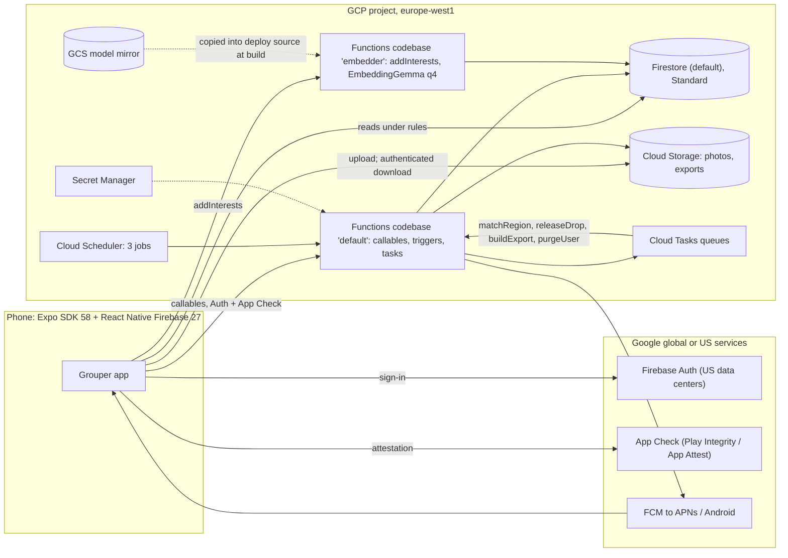

# Grouper: product and technical design

| | |
|---|---|
| Status | Draft for founder review (phase: design doc + scaffold) |
| Date | 2026-11-04 |
| Companion | [PRIVACY.md](./PRIVACY.md) (GDPR design) |
| Market | Denmark (Aarhus, Copenhagen), 18+, Danish + English |

**Evidence tags.** Every number is tagged with its source:

| Tag | Source |
|---|---|
| [EXP] | Embedding calibration experiment (measured in sandbox, EmbeddingGemma-300m ONNX) |
| [SRV] | EmbeddingGemma serving research |
| [FBX] | Firebase + Expo SDK 58 infrastructure research |
| [GDPR] | GDPR / Danish data protection analysis |
| [MAT] | Matching algorithm and product rules research |
| [A] | Architect's assumption, to be validated |

Where reports conflict, the resolution is stated inline and summarized in §2.3. Measured numbers from [EXP] win over estimates.

---

## 1. Summary and glossary

Grouper is "friendship dating" for groups. Users describe themselves with free-form **Interests** in their own words ("madlavning", "on paternity leave", "Fortnite"). Every Thursday evening a batch job (the **Drop**) forms new **Pods** of 4–6 nearby strangers who share an interest. Members accept or decline. Once at least 4 accept, the pod is confirmed, first names and photos are revealed, and the pod uses a **meetup planner** (propose 2–3 options, vote). There is no free-form chat. Sensitive interests (GDPR Art. 9, e.g. pregnancy, religion) are allowed with explicit consent and are only ever revealed inside a pod formed around that interest.

The stack is an Expo SDK 58 app on React Native Firebase, with Firestore, Cloud Functions 2nd gen and Cloud Storage in **europe-west1**. A self-hosted **EmbeddingGemma** model runs on CPU in a scale-to-zero Cloud Function. Estimated infrastructure cost: about $1/month at 1k MAU, $3–4 at 10k, $43–52 at 100k (§12).

| Term | Meaning |
|---|---|
| **Interest** | A free-form tag (max 40 characters), stored as typed and normalized. |
| **Sensitive interest** | An interest that may reveal Art. 9 data (health incl. pregnancy, beliefs, sexual orientation, politics, ethnic origin, union membership). Stored separately; needs explicit consent. |
| **Concept** | An internal cluster of interests that mean the same thing ("cooking", "madlavning"). Has a centroid, a frozen medoid, a sensitivity flag and labels. Never shown as a catalog. |
| **Holding** | A user's link to a concept through one of their interests. A user has at most 20. |
| **Pod** | 4–6 users grouped around one Theme: proposed → confirmed → planning → scheduled → happened → archived (or dissolved). |
| **Theme** | The concept a pod is formed around. Every member holds it and sees it in their own wording. |
| **Drop** | The weekly batch (compute Thursday 16:00, release 18:00, Europe/Copenhagen), keyed by ISO week, e.g. `2026-W46`. |
| **Cell** | A geohash-5 cell (about 2.7 × 4.9 km at 56°N [GDPR][MAT]). The only location we store. |
| **Region** | Connected occupied cells (links ≤ 25 km); the unit of matching; status waitlist, beta or live. |
| **Option** | A proposed meetup time and place that members vote on. |

---

## 2. Decisions log and open questions

### 2.1 Founder decisions (interview, 2026-11-04)

| # | Decision | Rationale |
|---|---|---|
| F1 | Groups, not individuals; vocabulary "Interests" and "Pods" | Lower pressure than 1:1; conversation tops out around 4 people [MAT]. |
| F2 | Free-form interest tags; EmbeddingGemma similarity; no curated catalog | Users speak in their own words (da/en); the model links "madlavning" to "cooking". |
| F3 | The app forms new pods of 4–6 strangers; users accept/decline | No empty-room problem; every member opts in. |
| F4 | In-person, local only, radius around approximate location | Friendships need repeated in-person time (about 50 h to casual friend [MAT]). |
| F5 | Weekly drops, Thursday evening, Europe/Copenhagen | Better global matches, anticipation, cheap batch compute. |
| F6 | Meetup planner only, no chat; public-place safety tips | Smaller harassment and moderation surface. |
| F7 | Sensitive (Art. 9) interests allowed with separate explicit consent; never public; revealed only inside a pod formed around that interest; automatic detection plus self-flagging | Headline use cases (pregnancy, faith, recovery) are Art. 9; free text needs automatic detection. |
| F8 | Pod preferences: age range + optional same-gender pod (gender collected only for that) | Comfort and safety with minimal data. |
| F9 | Optional single profile photo, visible only to fellow members after confirmation | Recognition at the meetup without appearance-based matching. |
| F10 | Sign-in: Apple, Google, email magic link; no SMS | SMS costs money and needs a phone number. |
| F11 | Denmark first (Aarhus, Copenhagen); Danish + English; i18n-ready; 18+ | Dense home market; meeting strangers justifies 18+. |
| F12 | Free MVP, no monetization | Focus on liquidity and safety first. |
| F13 | Expo/React Native + Firebase; EU data residency; inexpensive infrastructure | One language (TypeScript), pay-per-use. |
| F14 | GDPR compliant; Danish controller; Datatilsynet | Legal requirement; Art. 9 data is core to the product. |
| F15 | This phase delivers a design doc + scaffold for review before features | De-risk architecture and privacy before building. |

### 2.2 Architect decisions beyond the brief (need founder sign-off)

| # | Decision | Why |
|---|---|---|
| A1 | Model: EmbeddingGemma-300m ONNX **q4**, pinned `5090578d…`; EmbeddingGemma 2 only if it passes the M0 gate | The only calibrated variant [EXP]; v2 (Apache-2.0) is promising but uncalibrated [SRV] |
| A2 | 768-d vectors for tags and concepts; 128-d only in the matching profile | Thresholds were measured at 768-d [EXP] |
| A3 | `sentence similarity` prompt for tags; `classification` prompt for the detector | Best measured AUC per task [EXP] |
| A4 | Embedder in its own Functions codebase: 1 GiB, scale to zero, model inside the deploy source | Cloud Run price, with Auth and App Check built in [SRV][EXP] |
| A5 | Layered sensitivity, seed review, review queue; never merge across sensitivity | Detector: 100% recall, about 40% false flags [EXP] |
| A6 | Soft themes only through confirmed links | Cosine "related" thresholds fail [EXP] |
| A7 | Clients only read; every write is a callable | One validation layer; simple rules |
| A8 | Compute at 16:00, release at 18:00 | Retry slack |
| A9 | New inputs: meetup language (hard) and availability (6-bit) | Acceptance and planning [MAT] (Q2) |
| A10 | Participate every week by default; auto-pause after 3 declines / 2 ignored | Dense pools without ghost invites |
| A11 | Max 2 active pods per user | Commitment; room for newcomers |
| A12 | Postcode or coarse location → geohash-5 on the device; radius 5/10/15/25 km | Minimisation [GDPR]; cells span up to 5.6 km [MAT] |
| A13 | Never show distances; show the area and the user's own radius | Reveals nothing new |
| A14 | FCM direct, generic payloads; no Expo push, EAS Update, analytics or Crashlytics | One processor; no consent banner [FBX][GDPR] |
| A15 | No Identity Platform; claim `onb` set by a callable | Avoids +$275/month at 100k MAU [FBX] |
| A16 | europe-west1 for everything that can be pinned | About 45% cheaper than eur3 [FBX] |
| A17 | Admin through a CLI (IAM) until M3 | No exposed admin surface |
| A18 | HMAC pod IDs and pair history (26 weeks) | Idempotent, no exposed IDs |
| A19 | JPEG only; EXIF stripped on the server; authenticated downloads only; soft delete off | Revocable, fast erasure |
| A20 | Pod retention from [MAT]: archive after 30 idle days, delete 90 days later | Shorter than [GDPR]'s proposal |
| A21 | Interests 2–40 characters, max 20, max 3 starred, min 3 | Less identifying text |
| A22 | About 150 internal bilingual seed concepts | Counters fragmentation [EXP] |
| A23 | React Native Firebase 27 in the app (the JS SDK 13 only in tests and tools) | Native App Check, FCM and sign-in; JS SDK App Check is web-only [FBX] |

### 2.3 Conflicts between research reports and how they were resolved

Measured results win over estimates.

| Conflict | Resolution |
|---|---|
| Model and quantization: [SRV] proposed v2 q8; [EXP] calibrated v1 | v1 q4 (A1). v1 q8 takes 221 ms per call and peaks at 1.6 GB [EXP][SRV]. |
| Vector size: [SRV] 256-d; [EXP] 768-d | 768-d (A2) |
| Detector prompt: [SRV] STS; [EXP] classification | Classification (A3) |
| Embedder memory: [SRV] 2 GiB; [EXP] 1 GiB | 1 GiB |
| Node runtime: [SRV] 22; [FBX] 24 | Node 24 (rules tests need 24.12 or newer). transformers.js on Node 24 must be verified in M0. |
| Drop time: [FBX] 18:00; [MAT] 16:00 | Compute at 16:00, release at 18:00 (A8) |
| Distances: [MAT] shows them; [GDPR] never | Never shown (A13) |
| Pod retention: [MAT] vs [GDPR] | [MAT]'s shorter windows (A20) |
| Tag length: [SRV] 60; [MAT] 40 | 40 (A21) |
| Soft themes: [MAT] cos ≥ 0.80; [EXP] shows such thresholds fail | Confirmed links only (A6) |
| Firestore location: [GDPR] eur3 or europe-west1; [FBX] europe-west1 | europe-west1 (A16) |
| Functions free tier: Firebase page 200k CPU-s / 400k GB-s; Cloud Run page 180k / 360k | The lower Cloud Run figures, re-checked on cloud.google.com/run/pricing: per billing account, with 100 ms rounding |

### 2.4 Open questions for the founder

| # | Question | Default if no answer |
|---|---|---|
| Q1 | EmbeddingGemma v1 (Gemma Terms, calibrated) or v2 (Apache-2.0, 4 weeks old, uncalibrated)? | M0 gate: v2 only if it matches v1 on our labelled set; decide before any user data exists. |
| Q2 | Add meetup language and availability as inputs (A9)? | Yes, both. |
| Q3 | Participation: default every week (A10) or explicit weekly opt-in? | Every week. |
| Q4 | Who reviews flagged tags, and how often? | Founder, weekly, before each drop. |
| Q5 | Avoid a lone woman or man in mixed pods? (Requires everyone's gender.) | No; revisit after alpha. |
| Q6 | Minimum density before a sensitive concept can be a theme in a region | 12 consenting holders per region [A]. |
| Q7 | Max 2 active pods (A11) and the "Keep pod" loop? | Yes. |
| Q8 | Must first names be real, and photos show a face? | No; a face photo is recommended. |
| Q9 | Sign in with Apple on Android (web flow) or Google/email only? | Google/email only on Android. |
| Q10 | Legal entity, privacy lead, lawyer budget | Needed before alpha (PRIVACY.md). |
| Q11 | Region go-live at 200 opted-in and predicted match rate ≥ 50% for 2 weeks [MAT]? | Yes. |
| Q12 | Opt-in "open to meet anyone" fallback theme? | Yes, opt-in only. |
| Q13 | Skip drops in holiday weeks (e.g. week 52)? | Configurable skip list, empty by default. |
| Q14 | Later: canonicalize tags with an EU-hosted LLM under a DPA [EXP]? | Not in MVP. |

---

## 3. User journeys

### 3.1 Onboarding (including consent steps)
1. **Welcome**: the UI language follows the device (da/en, switchable). Copy: "Small groups. Real meetups. 18+."
2. **Sign in**: Apple (iOS), Google or email magic link. Firebase Auth stores only the provider ID and email.
3. **Terms and privacy notice**: the user accepts the Terms (contract). The layered privacy notice is information, not consent. Versions are recorded.
4. **Date of birth**, entered on the device.
5. **First name**: visible only to confirmed pod members.
6. **Area**: postcode (default, no permission needed) or approximate location (coarse permission). The device converts it to geohash-5 and discards the coordinates.
   - The app then calls `completeOnboarding` with steps 3–6.
   - The server checks 18+, keeps only `birthYear` [GDPR], creates the profile with default preferences, and sets the claim `onb`.
   - Under 18 → stop, and nothing is kept.
7. **Interests**:
   - free text, with a permanent notice about sensitive interests;
   - regional chips (non-sensitive concepts with ≥ 10 holders) to help start;
   - if the server returns `needsConsent`, the **explicit consent sheet** opens (PRIVACY.md §3): unticked checkbox, "Add" disabled until it is ticked, "Don't add" discards the tag;
   - nothing is stored before consent;
   - minimum 3 interests, nudged towards 5 [MAT].
8. **Preferences**: age range (default own age ±7, min width 5 years [A]), radius (default 10 km), meetup languages, availability (weekday/Saturday/Sunday × day/evening). Turning on "same-gender pods" opens a gender picker with its own consent checkbox.
9. **Photo** (optional): "Only people in a confirmed pod with you can see it."
10. **Notifications** permission, then the **safety pledge** checkbox.
11. **Done**: in a live region, "Your first drop is Thursday at 18:00". In a waitlist region, progress ("Aarhus 212/300").

### 3.2 Weekly drop
- **Timeline:**
  - Monday 10:00: nudge for users on manual participation;
  - Thursday 12:00: participation cutoff;
  - Thursday 16:00: compute;
  - Thursday 18:00: release, with the push "Your weekly drop is here" (never a theme or name).
- **Home** then shows either a **proposal card** or "No pod this week", with a reason and a tip ("add a few interests", "try 15 km").
- **The card shows:**
  - the theme in the viewer's own wording (lock icon if sensitive);
  - size and area ("near Aarhus C");
  - "everyone is within your 10 km";
  - age span;
  - up to 3 non-sensitive interests the viewer also shares;
  - the deadline.
- **The card never shows** names, photos, IDs, gender or who has accepted [MAT].
- **"Why this pod"** renders server reason codes (§6.7).

### 3.3 Accept or decline
- **Accept** calls `respondToPod`; the card then shows "3 of 5 accepted".
- **Decline** takes an optional reason chip, used for aggregate metrics only.
- **Auto-pause:** 3 declines or 2 ignored proposals in a row pause participation, with a prompt [MAT][A].

### 3.4 Confirmation reveal
- At 4 accepts the pod is `confirmed`. Pending invitees can still join until the deadline, up to 6.
- Push: "Your pod is confirmed".
- **The pod screen shows:**
  - first names;
  - photos (through grants);
  - the theme;
  - "pod interests": non-sensitive concepts held by ≥ 2 members, not attributed to anyone.
- The safety tips sheet opens, and the 72-hour planning window starts.

### 3.5 Meetup planning and voting
- **Proposing.** The pod collects 2–3 options (max 3 per pod, max 2 per member); voting opens with the first. Each option has:
  - a time within 14 days, between 08:00 and 22:00;
  - a place of at most 120 characters;
  - an optional Google Maps, Apple Maps or OpenStreetMap link;
  - a mandatory "public place" tick.
- **Checks.** Text that looks like a home address triggers a warning. Phone numbers and handles are rejected.
- **Voting.** Members vote yes/no on each option.
  - If everyone says yes to one option, it locks early.
  - At the deadline, the option with the most yes votes (at least 3) wins; ties go to the earlier time.
  - With no winner, the pod dissolves and its members get priority next week.

### 3.6 Meetup and feedback
- **T−24 h**: "Still coming?" plus the safety tips. If fewer than 3 are still coming, the pod gets one 48-hour reschedule round; otherwise the meetup is cancelled.
- **T−2 h**: reminder.
- **T+2 h** (open for 7 days), "Did you meet?":
  - attendance for each member;
  - a private "would meet again" for each person;
  - a 1–5 rating;
  - **Keep pod** / **Not for me**.
- If at least 3 choose Keep, the pod goes back to planning with those members. Otherwise it is archived.

### 3.7 Block and report
Both are available from a member's sheet in a confirmed pod.
- **Block**:
  - immediate and two-way;
  - optional silent leave;
  - photo grants revoked;
  - the two are never matched again.
- **Report**:
  - categories: harassment, safety, no-show, content, suspected under 18;
  - optional text (max 500 characters), with a warning not to include sensitive details;
  - the reporter is never revealed;
  - safety reports show "call 112 in an emergency".
- **Auto-pause:** two independent reports within 30 days, or one safety report, pause the reported user from drops until a human reviews [MAT].

### 3.8 Leave pod
From the pod menu. The others see "A member left". Below 3 members the pod is archived. Photo grants are revoked.

### 3.9 Export data
Settings → Privacy → "Download my data" calls `exportData`. A background task builds a JSON file, and the user gets a notice when it is ready. The download is authenticated (no public URL), and the file is deleted after 24 h. Contents: PRIVACY.md §6.

### 3.10 Delete account
1. Settings → Delete account explains what is deleted, plus the backup (7 days) and Auth (up to 180 days, Google) windows.
2. The user re-authenticates. Apple supplies a fresh `authorizationCode` for token revocation [FBX].
3. `deleteAccount` runs; the user is signed out and sees a confirmation.
4. The purge continues in the background (§10).

---

## 4. Product rules

### 4.1 Drop schedule (Europe/Copenhagen; Cloud Scheduler handles DST)

| When | Event | Mechanism |
|---|---|---|
| Mon 10:00 | "In this week?" nudge (manual-participation users) | `hourlySweeper` |
| Thu 12:00 | Participation cutoff for this week's drop | `setParticipation` rule |
| Thu 16:00 | Compute: regions → one `matchRegion` task each | `dropOrchestrator` cron `0 16 * * 4` |
| Thu 18:00 | Release: write proposal cards, send push | `releaseDrop` task, scheduled by the orchestrator |
| Sat 18:00 | Accept deadline (+48 h) [MAT] | `hourlySweeper` |
| Sun 18:00 | Backfill deadline (+24 h, once) | `hourlySweeper` |
| Confirmation + 72 h | Planning deadline | `hourlySweeper` |
| Meetup T−24 h / T−2 h / T+2 h | Reminders, then feedback | `hourlySweeper` |
| Feedback + 7 days | Feedback closes | `hourlySweeper` |

### 4.2 Pod rules

| Rule | Value | Source |
|---|---|---|
| Pod size | min 4, target 5, max 6 | [MAT] |
| Overbooking | 6th seat when expected attendance of the five (Σ r) < 4.0 | [MAT] |
| Confirmation | ≥ 4 accepted | [MAT] |
| Backfill | Triggered at the deadline with exactly 3 accepted, or on a decline when accepted + pending < 4. Invites compatible theme-holders from this week's unmatched users. 24 h, once. | [MAT] |
| New pods per user per drop | ≤ 1 | [MAT] |
| Active pods per user | ≤ 2 (confirmed, planning or scheduled) | A11 |
| Re-match block | Not co-members within 26 weeks; not co-proposed within 4 weeks | [MAT] |
| Archive | 30 days with no plan, or < 3 members; deleted 90 days after archive | [MAT] |
| Dissolved | Members who accepted get priority next week; the pod is deleted after 30 days | [MAT] |

### 4.3 Limits

| Item | Limit | Source |
|---|---|---|
| Interest length | 2–40 characters after normalization | [MAT], A21 |
| Interests per user | max 20 (sensitive included); min 3 to be matched; nudge to 5 | [MAT] |
| Starred interests | max 3 (s = 1.0 instead of 0.8) | [MAT] |
| Interest adds | 30/hour, 100/day per user | [A] |
| First name | 1–30 characters | [A] |
| Options | 2–3 per pod (max 3; brief), ≤ 2 per member ([MAT] allowed 6 per pod), within 14 days, 08–22, place ≤ 120 characters | brief, [MAT] |
| Report text | ≤ 500 characters | [A] |
| Radius | 5 / 10 / 15 / 25 km (default 10) | A12 |
| Age range | min 18; width ≥ 5 years | [A] |
| Data export | 1 per 24 h | [A] |

### 4.4 No-show policy [MAT]
- Cancelling ≥ 24 h before the meetup costs nothing. A late cancel counts as 0.5 no-show; a no-show counts as 1.
- A no-show needs a majority of the other responders and no cancellation. The accused member can dispute it, which sends it to review (a guard against cliques).
- 2 no-shows within 8 weeks → 2-week pause plus a re-commit pledge. 3 → manual review.
- Users see their own record ("4/4 attended"). Reliability r(u) = (attended + 4)/(attended + noShows + 5) feeds matching (new users start at 0.8). It is never shown to others.

### 4.5 Safety tips (shown at confirmation and T−24 h)
Meet in a public place in daytime or early evening. Arrange your own transport. Tell a friend where you are going. You can leave at any time. Drink responsibly; there is no pressure to drink. Never share your home address. Use Report if something feels wrong; call 112 in an emergency.

---

## 5. Interest system

### 5.1 Model and serving parameters

| Parameter | Value | Source |
|---|---|---|
| Model | `onnx-community/embeddinggemma-300m-ONNX` @ `5090578d9565bb06545b4552f76e6bc2c93e4a66` | [EXP] |
| Variant | q4 (`onnx/model_q4.onnx`, weights 196.7 MB; tokenizer 20.3 MB) | [EXP] |
| Runtime | `@huggingface/transformers` 4.3.2 (onnxruntime-node 1.30.0), CPU | [EXP] |
| Output | 768-d, L2-normalized in-graph (pooling + dense + normalize) | [EXP] |
| Tag/concept prompt | `task: sentence similarity \| query: {norm}` | [EXP] |
| Detector prompt | `task: classification \| query: {norm}` (prototypes use the same prompt) | [EXP] |
| Never use | `task: clustering` (compresses similarities to about 0.85–0.92) | [EXP] |
| Latency | about 31 ms/tag at 1 thread; batch-32 about 32 ms/tag at 1 thread | [EXP] |
| Memory | 458–467 MB RSS after load; 532–578 MB peak | [EXP] |
| Cold start (Cloud Run) | about 4–10 s, estimated; tokenizer load (about 1.25 s) dominates model load (0.3–0.7 s) | [SRV] est., [EXP] |
| `modelId` in cache key | `eg300m-q4@5090578` | — |

Candidate EmbeddingGemma 2 (text-only, 270M, Apache-2.0): q4 74 ms, 544 MB; scores in a narrow high band (unrelated 0.81–0.85, related 0.88–0.94) [SRV], so **none of the thresholds below transfer**. `modelId` in every cache key prevents mixing vectors.

### 5.2 Pipeline

```
client text
  → (1) normalize          packages/core normalizeTag()
  → (2) moderation         lexicons + PII patterns              → rejected + statement of reasons
  → (3) cache lookup       LRU → Firestore getAll(tags/*)
  → (4) embed misses       STS + classification, one batched call per prompt
  → (5) sensitivity        reviewed > lexicon > self-flag > detector
        sensitive && no valid consent → needsConsent (NOTHING persisted or logged)
  → (6) concept            findNearest(concepts) within the same sensitivity partition
  → (7) persist            one batch: tag, holding, consent event, concept sum, matchProfile
  → (8) maintenance        weekly: labels, holder counts, drift report, review queue
```

**(1) Normalize.** Shared by client and server (`packages/core/src/interests/normalize.ts`):
1. NFKC.
2. Trim and collapse whitespace.
3. Remove emoji.
4. `toLowerCase()`.
5. Strip leading/trailing punctuation, but keep `+ # &` (so "C++" and "D&D" survive).
6. Require 2–40 characters. Reject, never truncate.

Never strip diacritics ("får" ≠ "far") [SRV]. Lowercasing is safe: cased vs lowercase cosine averages 0.977 [EXP]. The typed wording (`display`) is kept for the user's own view and theme label.

**(2) Moderation**, before any model call:
- **Blocklists.** Da/en (slurs, sexual solicitation, drugs, violence, spam, minors), checked on a leetspeak-folded copy.
- **PII.** Patterns for phone, email, URL, @handle and CPR-like numbers. Rejected.
- **Third parties.** Phrases about someone else ("min datters…") get the warning "only add interests about yourself". If the user keeps the tag, it is treated as sensitive [GDPR].
- **Statements of reasons.** Every rejection carries a reason code, which the client renders as a DSA Art. 17 statement of reasons.
- **Abuse similarity.** Comparison against abuse prototypes (reject ≥ 0.80, hold 0.65–0.80 [MAT]) is uncalibrated, so it runs in shadow mode with aggregate counters only.

**(3) Cache.** `tagKey = sha256(modelId|768|sts|norm)`. Lookup is in-memory LRU (10k [SRV]) → one `getAll()` for the misses. Cache docs never hold a uid.

**(4) Embed.** One call per prompt covers all misses in the request; vectors are re-normalized after any truncation. Prototype vectors (Art. 9, abuse, hobby anchors) are precomputed at build time into `prototypes.bin`.

**(5) Sensitivity** (first match wins):

| Order | Signal | Effect |
|---|---|---|
| 1 | Human review decision on this exact `norm` | sensitive or not |
| 2 | High-precision lexicon (parties and unions such as 3F, HK, FOA; diagnoses; AA, IVF; religions) | sensitive |
| 3 | User self-flag ("Keep this private") | sensitive for this holding |
| 4 | Detector margin ≥ −0.03 (q4, classification, 768-d) | suspected: treated as sensitive, queued for review |
| 5 | Otherwise | not sensitive |

**Detector margin** = max cosine to Art. 9 prototypes (108 da/en phrases) − max cosine to hobby anchors (32 phrases) [EXP].

| Margin threshold | Recall (71 sensitive) | Precision | False flags (of 112 ordinary) |
|---|---|---|---|
| **−0.03 (chosen)** | 100% | 0.62 | 44 |
| 0.01 | ≥ 95% | 0.74 | 24 |

All figures [EXP].

**Known gaps** [EXP]:
- **Missed entirely:** "Pride parade volunteering" (−0.098) and "diabetes-friendly baking" (−0.078). Both are now in the lexicon.
- **Near-misses,** all Danish compounds: brystkræft −0.028, kørestolsbruger −0.013.
- **Typical false flags:** korsang, surdejsbrød, vandring, madlavning, brætspil.

**Mitigations:**
- **Seed review before launch.** The founder reviews detector flags on about 1,000 common da/en hobby tags [A]. The decisions become pinned `tags` docs, so nobody is asked to consent for "madlavning".
- **No category guessing.** The detector's category guess is right only about 80% of the time [EXP], so the consent sheet names all Art. 9 categories, and the user can optionally pick one.
- **Review queue.** A suspected tag is queued (text only, no uid) once someone consents to it.
  - "Not sensitive" removes the consent step for future adds. It also downgrades existing holdings that were not self-flagged, with a one-tap "Keep private" notice; the consent event is closed as `superseded`.
  - "Sensitive" changes nothing.

**JIT consent before persisting.**
- Without valid consent the result is `needsConsent`, and no tag doc, holding, vector or log line with the text is written.
- The client then shows the sheet and repeats the call with `consent: {textVersion, textSha256, checked: true}`.
- The server matches both values against the versioned texts in `packages/core/src/legal/`, so the record proves what was shown.
- The server re-classifies the tag rather than trusting the client (about 31 ms).

**(6) Concept assignment.** `findNearest` over `concepts`, prefiltered by `sensitive == tagSensitive`, `DOT_PRODUCT`, limit 3. This needs a composite flat vector index [SRV][FBX]. Never run `findNearest` over `tags` on the hot path: that would cost about $124/month at 100k users [SRV].

| Tag vs best centroid c* (q4/768) | Action | Basis [EXP] |
|---|---|---|
| Other sensitivity partition | Never compared (prefilter) | Mixed clusters appeared without this (2.2 per run) |
| Non-sensitive, cos ≥ **0.86** and cos to c*'s medoid ≥ 0.82 [A] | Merge | P 0.95 / R 0.31 |
| Non-sensitive, 0.78–0.86 | New concept + candidate link; "Did you mean *cooking*?" if c* has ≥ 10 holders | Merging here would drop precision to 0.76–0.88 |
| Sensitive, cos ≥ **0.90** | Merge | P 1.00 / R 0.12 |
| Sensitive, 0.86–0.90 | New concept + merge proposal for review | Conservative |
| Otherwise | New concept (medoid = this tag) | Singletons start new: 1.00 |

Other measured points (q4/768) [EXP]:

| Threshold | Precision / recall |
|---|---|
| 0.80 | 0.76 / 0.57 |
| 0.85 | 0.88 / 0.35 |
| 0.88 | 0.98 / 0.21 |

At 256-d, about +0.02–0.03 is needed for the same precision.

**"Did you mean" never blocks.** "Yes" calls `confirmSuggestion`, which re-points the holding and records an alias vote. Once 3 distinct users confirm an alias, that text maps to the concept for everyone (non-sensitive only) [A].

**(7) Persist** in one batch:
- `tags` upsert (`refCount` +1);
- the holding;
- a consent event, if sensitive;
- the concept `sum` and centroid, when a new text merges;
- `matchProfiles` (concept IDs only).

**(8) Maintenance:**
- **Vectors.** Centroid = normalize(Σ member vectors). Σ is stored as `sum`, so removals are O(d). The medoid is frozen at creation, as a drift guard [EXP].
- **Labels and counts.** Each locale's label is the most common `norm` among holders with that language hint. Labels and holder counts (`count()`) are recomputed every Wednesday. Outside a confirmed pod, a label is shown only if its concept has ≥ 10 holders [GDPR].
- **Drift report.** Built per sensitivity partition; merge or split proposals go to the review queue. Nothing is auto-applied, because re-clustering is untested [EXP]. Merges set `mergedInto`, which the matcher resolves at load time.
- **Erasure.** When `refCount` reaches 0, the tag doc is deleted, its vector is subtracted from the concept `sum`, and empty non-seed concepts are deleted. Rare tags and singleton centroids can be personal or Art. 9 data [SRV][GDPR].
- **Rescan.** When prototypes or lexicons change, `embedderBatch` re-classifies the stored tags. Newly suspected holdings are quarantined (excluded from matching), and the user is asked to consent or remove them. They are deleted after 30 days [GDPR].
- **Model upgrade.** Recalibrate, then re-embed in batch (about 250k tags ≈ $0.30 [SRV]), keeping concept IDs.
- **Seed concepts** (about 150, A22). Bilingual medoids such as "pregnant / gravid" and "på barsel / on parental leave".

### 5.3 Caveats
- The test set is small (211 tags, 68 concepts) and self-labelled, and the thresholds were tuned on the same data. Expect ±0.02–0.03 on real tags [EXP].
- **Danish surface-form bias.** Unrelated Danish–Danish pairs average 0.640, against 0.569 for English–English. False pairs reach 0.89 (vinsmagning ~ ølsmagning; havearbejde ~ frivilligt arbejde 0.870) [EXP]. Expect some wrong non-sensitive merges; feedback exposes them.
- Direct translations can score low (healthy eating ~ sund kost 0.587; gay ~ bøsse 0.631) [EXP], hence seed concepts and alias votes.
- **Fragmentation:** at precision ≈ 0.95, 211 tags made about 155 clusters [EXP]. This could starve thin markets (§16).
- M0 builds a labelled set of ≥ 200 Danish/English pairs plus Art. 9 examples, and the calibration harness becomes a CI gate (§13).

---

## 6. Matching algorithm

### 6.1 Hard constraints (pairwise `compat(a,b)`) [MAT]

| # | Constraint |
|---|---|
| H1 | Mutual age: each user's age (drop year − birthYear) is inside the other's range |
| H2 | Haversine distance between cell centroids ≤ min(maxKm_a, maxKm_b) |
| H3 | If either user wants same-gender pods: both have declared the same gender |
| H4 | No block in either direction; no open report between them |
| H5 | Not co-members in the last 26 weeks; not co-proposed in the last 4 weeks |
| H6 | Share at least one meetup language (A9) |

Pod-level constraints:
- every pair is compatible;
- size 4–6;
- every member holds the theme;
- the AND of availability masks is non-zero;
- each user is in ≤ 1 new pod per drop;
- members have fewer than 2 active pods.

Sensitive-interest rules [MAT]:
- **S1.** A sensitive theme needs every member to hold it with explicit consent, plus ≥ 12 consenting holders in the region (Q6).
- **S2.** Sensitive concepts are used **only** as themes. They never feed secondary scoring, tie-breaks, specificity, explanations, chips or statistics. Types enforce this: `MatchUser.secondary: NonSensitiveConceptId[]`.
- **S3.** Defensive filter: drop any sensitive holding without a consent reference.
- **S4.** No theme or name in any notification.

User-set constraints are never relaxed. Only system preferences relax, and only for people who have waited.

### 6.2 Scoring [MAT]

```
J = Σ_pods V(P, t)
V(P,t)   = Σ_{u∈P} [ B + wT·q(t)·s(u,t) + wF·f(u) + wR·r(u) + wP·avg_{v∈P\u} pair(u,v) ] − sizePen(|P|)
pair(u,v)= 0.6·sec(u,v) + 0.2·exp(−|age_u−age_v|/6) + 0.2·(1 − d_uv/min(maxKm_u,maxKm_v)) − 0.5·[ever co-members]
sec(u,v) = 0.5·relu((cos(p_u,p_v) − τ)/(1 − τ)) + 0.5·min(1, |A_u ∩ A_v|/3)
```

| Symbol | Definition | Default |
|---|---|---|
| `A_u` | u's non-sensitive concepts (≤ 20) | — |
| `p_u` | normalize(Σ 128-d truncated centroids of A_u) | τ ≈ 0.3, **uncalibrated**; set in simulation |
| `s(u,t)` | 1.0 starred, 0.8 held, 0.8·cos for a confirmed soft link (Phase 3) | — |
| `q(t)` | clamp(1 − ln(holders_t)/ln(n), 0.3, 1): specific themes score higher | — |
| `f(u)` | min(weeksWaiting, 4)/4, +1 if their last pod dissolved through no fault of theirs | — |
| `r(u)` | (attended + 4)/(attended + noShows + 5) | new user 0.8 |
| Weights | B = 1, wT = 0.3, wF = 0.3, wR = 0.15, wP = 0.6; sizePen {4: 0.5, 5: 0, 6: 0.2} | [MAT] |

Because B dominates, a valid pod of 4 always beats leaving people unmatched. `weeksWaiting` is derived from `waitingSinceWeek`, so unmatched users need no weekly write.

### 6.3 Pseudocode (pure function in `packages/core/src/matching/`) [MAT]

```ts
function matchRegion(users, concepts, p, seed): { pods, unmatched, stats } {
  const U = users.filter(eligible).sort(byId);      // never rely on Firestore order
  derive(U);       // age, themes (S1/S3), secondary (non-sensitive), p_u, excl set, tie=xxhash32(seed+':'+uid)
  const bucket = indexByThemeAndCell(U);            // conceptId -> cell -> int[]
  const q = specificity(bucket, U.length);
  // Phase 1: seed-and-grow, longest-waiting and hardest-to-place first
  for (const i of order(U, u => [-f(u), feasibleThemeCount(u), tie(u)])) {
    if (assigned(i)) continue;
    let best = null;
    for (const t of topThemes(i, 5)) {                         // by s(i,t)*q(t)
      let C = unassignedHolders(t, cellsWithin(i)).filter(c => compat(i, c));
      if (C.length < p.minSize - 1) continue;
      C = topK(C, 60, c => pair(i, c) + self(c), tie);
      const P = grow(i, t, C);                                 // greedy; keeps AND(avail) ≠ 0
      if (P.length >= p.minSize && (!best || V(P, t) > best.v)) best = { P, t, v: V(P, t) };
    }
    if (best) commit(best);
  }
  // Phase 2: local search; first improvement; valid moves only; stop at Δ ≤ 1e-9, 4 passes or 120 s
  localSearch([insertLeftover, swapInLeftover /* only if f(u) > f(w) */,
               swapBetweenNearbyPods /* 20 nearest */, moveMember]);
  // Phase 3: unmatched with weeksWaiting ≥ 2: confirmed soft links (non-sensitive only),
  //          H5 co-member window 26 → 8 weeks, opt-in "open to anyone" theme (q = 0.3); Phase 2 again
  assertAllConstraints(pods, U);   // fail closed: throw, write nothing, alert
  return { pods, unmatched: reasonCodes(U), stats };
}
```

`grow` adds the candidate with the best `self(c) + wT·q(t)·s(c,t) + wP·avgPair(c, P)`. It drops candidates as soon as they are incompatible with a new member. It targets 5, or 6 when Σ r < 4.0 [MAT].

### 6.4 Complexity, sharding, runtime [MAT]
- Index build is O(n·k). `compat` is O(1) with hash sets. `pair` is O(128 + k), with no memo.
- Memory is about 10 MB at n = 20k.
- **Greedy:** O(seeds·T·(b + K·s)), about 3×10⁷ `pair` calls at n = 20k.
- **Local search:** about 10⁷ calls per pass.
- **Estimate:** under 2 minutes at 1 vCPU / 1 GiB, against a 1,800 s limit. To be confirmed by the n = 20k benchmark in M0.

**Regions:**
- Union-find over occupied cells links cells whose centroids are ≤ 25 km apart.
- 25 km is the maximum radius, so no compatible pair can be split across regions.
- Each region is one task.

**Sharding:**
- Only if a region exceeds about 30k users: shard by geohash-4 prefix, in sorted order.
- Each shard pool = home users (who can seed pods) plus a halo of unassigned users within the shard's largest radius (who can only be added).
- A final pass runs over leftovers [MAT].

### 6.5 Determinism and idempotency
- No RNG state; ties break on `xxhash32(weekId:regionId:uid)`; all iteration runs over arrays sorted by ID.
- `podId = base32(HMAC-SHA256(POD_ID_KEY, weekId|regionId|sortedUids))[0..20]` (A18). A retried task writes the same documents.
- `drops/{weekId}/regions/{regionId}.status` guards the stages (computed → released), so retries and the sweeper are idempotent.

### 6.6 Fairness
- Waiting priority f(u) and seed ordering favour users who were left out.
- Ties use hashed order, not uid order, so there is no systematic bias.
- Photos, inferred traits and reliability are never used for anything except the documented r(u) term.
- Each drop reports match rate by age band, area, language and (where known) gender. An alert fires if any band's match rate falls more than 20 percentage points below the region mean [A].

### 6.7 "Why this pod" reason codes [MAT]
- **Codes:** `THEME{label, others}`, `ALSO_SHARE{≤3}`, `AREA{label}`, `WITHIN_YOUR_RADIUS{km}`, `AGE_SPAN{min,max}`, `PRIORITY{weeks}` (that user only), `SOFT_THEME{yourTag, podTheme}`, `OPEN_TO_ANYONE`.
- **Labels:** always the viewer's own wording.
- **Never mentioned:** sensitive concepts other than the theme, and reliability.
- **Unmatched reason codes:** `NO_THEME_BUCKET`, `RADIUS`, `AGE`, `GENDER`, `LANGUAGE`, `AVAILABILITY`, `MAX_ACTIVE_PODS`, `TOO_FEW_INTERESTS`, `REGION_WAITLIST`.

### 6.8 Metrics [MAT]
Per drop and region, written as aggregates to `drops/{weekId}` (nothing per user):
- **Funnel:** match rate (proposed ÷ opted in), invite acceptance, confirmation rate, planning success, meetup-happened rate, attendance (target no-shows < 20%; the free-event benchmark is 28%), pairwise would-meet-again.
- **North star:** pod continuation, i.e. a second meetup within 4 weeks.
- **Also:** weeks to first pod (P50/P90), unmatched-reason histogram, reports per 1,000 meetups, runtime.

### 6.9 Simulation harness (`tools/sim`) [MAT]
- **Synthetic city:** Gaussian-mixture locations; Danish age distribution; Zipf interests over about 2k concepts, with da/en variants and about 5% sensitive; radii 5–25 km; 10% same-gender; random blocks.
- **Behaviour:** accept = logistic(score, distance); show-up = r(u); meet-again = f(sec, age closeness) + noise.
- **Runs:** 12 simulated weeks with backfill, history and reliability updates. Weight sweeps maximise match rate × meet-again.
- **Tests:** property tests (fast-check) for no constraint violations, same seed → same output, ≤ 1 pod per user, sizes 4–6 and S1/S2. Golden snapshots catch regressions.
- **Cold start:** the harness estimates how many users a region needs. A theme held by 5% of users needs about 400 users on its own [MAT].

---

## 7. Architecture



| Component | Choice | Notes |
|---|---|---|
| Mobile app | Expo SDK 58 (expo 58.0.23, RN 0.88.1), dev builds only | RNFirebase cannot run in Expo Go [FBX] |
| Auth | Firebase Auth (no Identity Platform): Apple, Google, email link | Email link 25,000/day on Blaze; runs only in US data centers [FBX] |
| Database | Firestore Standard, (default) DB, europe-west1 | Only the default DB gets free quota; Storage rules can read only (default) [FBX] |
| Functions | 2nd gen, Node 24, firebase-functions 7.4.0, firebase-admin 14.5.0, firebase-tools 15.34.2 | nodejs24 decommission 2028-10-31 [FBX] |
| Main codebase defaults | `region: europe-west1`, `memory: 256MiB`, `cpu: 'gcf_gen1'`, `concurrency: 1`, `maxInstances: 10`, `minInstances: 0` | gcf_gen1 is the cost lever (§12); heavy tasks override to 1 vCPU / 1 GiB |
| Embedder | Separate codebase `embedder`: `memory: 1GiB`, `cpu: 1`, `concurrency: 4`, `minInstances: 0`, `maxInstances: 5`, model files copied from the GCS mirror in predeploy; `env.allowRemoteModels = false` | Each function in a codebase gets its own image, so the codebase is kept small [SRV] |
| Embedder fallback | Cloud Run container (option b) if deploys or cold starts are bad | Same compute price; an extra hop [SRV] |
| Scheduler | 3 jobs: `dropOrchestrator`, `hourlySweeper`, `dailyMaintenance` | 3 free per billing account [FBX] |
| Cloud Tasks | Queues `matchRegion`, `releaseDrop`, `buildExport`, `purgeUser`, `embedderBatch` | 1M ops/month free [FBX] |
| Storage | Bucket `grouper-prod.firebasestorage.app` in europe-west1 | EU buckets are billed from the first byte [FBX] |
| App Check | RNFirebase provider: Play Integrity, App Attest with DeviceCheck fallback, debug in dev | JS SDK providers are web-only [FBX] |
| Push | `@react-native-firebase/messaging` + Admin `sendEach()` | Generic payloads only [FBX] |
| Secrets | Secret Manager via `defineSecret`: `POD_ID_KEY`, `UID_HMAC_KEY` | — |

**Regions:**
- **Pinned to europe-west1:** Firestore, Functions (both codebases), Cloud Tasks, Scheduler, Storage, the model mirror, Artifact Registry and Secret Manager replication (user-managed, europe-west1).
- **Not pinnable:** Firebase Auth (US), FCM and App Check (global) [FBX]. Their minimisation and transfer basis are covered in PRIVACY.md §9.

---

## 8. Data model

Conventions:
- `Timestamp` is a Firestore timestamp.
- **TTL:** every collection that expires uses one TTL field, `expiresAt`, configured per collection group. TTL deletes typically happen within 24 h, are billed as deletes and do not delete subcollections [FBX].
- **Writes:** "server" means Admin SDK in Functions. Clients write nothing to Firestore.

### 8.1 Client-readable (minimal)

| Path | Key fields | Read | Retention |
|---|---|---|---|
| `users/{uid}` | `firstName: string`, `locale: 'da'\|'en'`, `birthYear: int`, `area: {gh5, label, regionId}`, `prefs: {ageMin, ageMax, maxKm: 5\|10\|15\|25, languages: ('da'\|'en')[], availability: int6, sameGenderOnly: bool}`, `gender: 'woman'\|'man'\|'nonbinary'\|null`, `participation: {mode: 'auto'\|'manual', pausedUntil?, pauseReason?}`, `photo: {v: int} \| null`, `stats: {attended, noShows, lateCancels}`, `status: 'active'\|'paused'\|'suspended'\|'deleting'`, `lastDrop: {weekId, outcome, reason?}`, `legal: {terms, privacy, genderConsentAt?}`, `interestCount`, `createdAt`, `lastActiveAt` | owner | until deletion; inactive 12 months → warning, deleted 30 days later |
| `users/{uid}/interests/{interestId}` | `display`, `norm`, `conceptId`, `starred`, `state: 'active'\|'held'\|'quarantined'`, `quarantineUntil?`, `createdAt`. `interestId = sha256(norm)[0..16]` (model-independent) | owner | until removed; quarantined 30 days |
| `users/{uid}/sensitiveInterests/{interestId}` | `display`, `norm`, `conceptId`, `categoryConfirmed?`, `source: 'lexicon'\|'model'\|'self'\|'review'`, `consentEventId`, `consentTextVersion`, `consentedAt` | owner | deleted immediately on withdrawal |
| `users/{uid}/pods/{podId}` (pod card) | `state`, `myStatus: 'invited'\|'accepted'\|'declined'\|'left'`, `themeLabel` (viewer's wording), `themeSensitive`, `sizeTarget`, `acceptedCount`, `acceptBy`, `reasons: ReasonCode[]`, `areaLabel`, `ageSpan`, `expiresAt?` | owner | declined/dissolved: drop + 14 days (TTL); otherwise deleted with the pod |
| `users/{uid}/blocks/{blockedUid}` | `firstName`, `since` | owner | until unblock or either account is deleted |
| `users/{uid}/notices/{id}` | `type` (statementOfReasons, system), `code`, `params`, `createdAt`, `readAt?`, `expiresAt` | owner | 12 months (TTL) |
| `users/{uid}/exports/{exportId}` | `status`, `path?`, `expiresAt` | owner | 1 day (TTL) |
| `pods/{podId}` (shared; only after confirmation) | `state`, `weekId`, `areaLabel`, `theme: {conceptId, label: {da,en}, sensitive}`, `memberUids: string[]` (confirmed members only), `roster: {[uid]: {firstName, photoV}}`, `podInterests: {da: string[], en: string[]}` (≤ 5), `planning: {deadline, winningOptionId?, meetupAt?, placeText?, mapUrl?}`, `confirmedAt`, `archivedAt?` | uid in `memberUids` | deleted 90 days after archive by `dailyMaintenance` (recursive) |
| `pods/{podId}/options/{optionId}` | `authorUid`, `startsAt`, `placeText`, `mapUrl\|null`, `publicPlace: true`, `votes: {[uid]: 'yes'\|'no'}`, `createdAt` | pod members (rules `get` on parent) | deleted at archive or 30 days after the meetup |
| `regions/{regionId}` | `label`, `status: 'waitlist'\|'beta'\|'live'`, `optedInBucket: '50+'\|'100+'\|…`, `goal`, `chips: [{conceptId, da, en}]` (≤ 30, non-sensitive, ≥ 10 holders) | onboarded users | overwritten weekly |
| `config/app` | `minAppVersion`, `legalVersions`, `skipWeeks`, `features` | anyone | — |

### 8.2 Server-only

| Path | Key fields | Retention |
|---|---|---|
| `matchProfiles/{uid}` | `status`, `gh5`, `birthYear`, `ageMin`, `ageMax`, `maxKm`, `sameGenderOnly`, `gender?`, `languages`, `availability`, `themes: [{c, starred, sens, consentRef?}]`, `secondary: conceptId[]`, `blockedH: string[]` (HMAC uids, both directions), `recentH: {[hmacUid]: untilWeek}` (26-week co-member / 4-week co-proposed), `reliability`, `waitingSinceWeek`, `declinesInRow`, `ignoredInRow`, `activePods`, `updatedAt` | deleted with the account; `recentH` entries expire after 26 weeks |
| `tags/{tagKey}` | `norm`, `vec: Vector(768)`, `modelId`, `sens: {suspected, margin, lexiconHit, categoryGuess, rulesVersion, reviewed?: 'sensitive'\|'not', reviewedAt?}`, `moderation: {status, rulesVersion}`, `conceptId`, `assign: {cos, method}`, `aliasVotes: {[conceptId]: int}`, `refCount`, `langHints: {da, en}`, `pinned?` (seed), `createdAt` | deleted when `refCount` reaches 0 (unless pinned) |
| `concepts/{conceptId}` | `centroid: Vector(768)` (indexed), `medoid: Vector(768)`, `sum: Bytes`, `n`, `sensitive: bool`, `category?`, `labels: {da?, en?}`, `holderCount`, `status: 'active'\|'merged'`, `mergedInto?`, `seed?`, `updatedAt` | deleted when empty (unless seed) |
| `conceptLinks/{a}__{b}` | `cos`, `status: 'candidate'\|'confirmed'\|'rejected'`, `votes` | with the concepts |
| `podState/{podId}` | `weekId`, `regionId`, `members: {[uid]: {status, invitedAt, respondedAt?, viaBackfill, themeInterestId, reasons}}`, `score`, `backfill: {used, until?}`, `version` | with the pod |
| `podFeedback/{podId}_{uid}` | `met`, `attendance: {[uid]: 'came'\|'noShow'}`, `meetAgain: {[uid]: bool}`, `rating?`, `keep`, `disputes?` | with the pod (counters stay in `matchProfiles`) |
| `drops/{weekId}` and `/regions/{regionId}` | stage status, timings, aggregate funnel and reason histograms (counts only) | 24 months [A] |
| `consentEvents/{id}` | `uid` (→ HMAC after deletion), `scope: 'art9'\|'gender'`, `interestId?` (removed on withdrawal), `category?`, `action: 'grant'\|'withdraw'\|'superseded'`, `textVersion`, `textSha256`, `locale`, `appVersion`, `method: 'checkbox+button'`, `createdAt`, `expiresAt?` | `expiresAt` = withdrawal/deletion + 3 years (TTL) [GDPR] |
| `blocks/{a}_{b}` | `blocker`, `blocked`, `createdAt` | until unblock or account deletion |
| `reports/{id}` | `reporterUid`, `targetUid`, `podId`, `category`, `text?`, `status`, `decision?`, `decidedBy?`, `createdAt`, `resolvedAt?`, `expiresAt` | resolution + 12 months (TTL) |
| `sanctions/{uid}`, `bans/{sha256(email)}` | `type`, `until?`, `reasonCode`, `noticeId` / `expiresAt` | sanction: with the account; ban hash 24 months (TTL) |
| `reviewQueue/{id}` | `kind: 'tagSensitivity'\|'conceptMerge'\|'abuseHold'\|'report'`, `ref`, `text?` (normalized, no uid), `status`, `decision?`, `expiresAt?` | decision + 30 days (TTL) [A] |
| `photoGrants/{owner}_{viewer}` | `pods: string[]`, `createdAt` | deleted when `pods` is empty |
| `pushTokens/{uid}` | `tokens: [{token, platform, updatedAt}]` | stale > 60 days pruned [A]; deleted with the account |
| `rateLimits/{uid}_{bucket}` | `count`, `windowStart`, `expiresAt` | 1 day (TTL) |
| `deletionLedger/{hmacUid}` | `deletedAt`, `expiresAt` | 35 days (TTL) (> 7-day backup window) [A] |

**Storage paths:**
- `uploads/{uid}/{id}.jpg` and `{id}_256.jpg`: owner create only, ≤ 2 MB, `image/jpeg`; deleted after processing (lifecycle 1 day as a backstop).
- `photos/{uid}/{v}.jpg` and `{v}_256.jpg`: read by the owner or a grantee; server writes; `cacheControl: private, max-age=604800` [FBX].
- `exports/{uid}/{id}.json`: owner read; lifecycle 1 day.

**Indexes (`firestore.indexes.json`):**
- A composite vector index on `concepts`: `sensitive` ASC + `centroid` `{dimension: 768, flat: {}}` [SRV].
- A collection-group single-field index on `interests.conceptId` and `sensitiveInterests.conceptId` (for merges).
- `fieldOverrides` to disable automatic indexing on `tags.vec`, `concepts.medoid`, `concepts.sum`, `podState.members` and `pods.roster`. Check that the vector index is unaffected [SRV].
- TTL policies on `expiresAt` for the TTL collections. These are set by `gcloud firestore fields ttls update`; keep them in a scripted `tools/admin/ttl.sh` if the indexes file does not support them [A].

---

## 9. Security model

**Firestore rules (deny by default; no client writes):**

```
rules_version = '2';
service cloud.firestore {
  match /databases/{db}/documents {
    function signedIn()  { return request.auth != null; }
    function onboarded() { return signedIn() && request.auth.token.onb == true; }
    match /users/{uid}/{doc=**} { allow read: if signedIn() && request.auth.uid == uid; }
    match /users/{uid}          { allow read: if signedIn() && request.auth.uid == uid; }
    match /pods/{podId} {
      allow read: if onboarded() && request.auth.uid in resource.data.memberUids;
      match /options/{optionId} {
        allow read: if onboarded() &&
          request.auth.uid in get(/databases/$(db)/documents/pods/$(podId)).data.memberUids;
      }
    }
    match /regions/{regionId} { allow read: if onboarded(); }
    match /config/app        { allow read: if true; }
  }
}
```

`memberUids` is filled only at confirmation. Before that, invitees read only their own pod card, so pending members cannot see each other's IDs.

**Storage rules:**
- `uploads/{uid}/{file}`: create if `request.auth.uid == uid`, `request.resource.size < 2 * 1024 * 1024`, `contentType == 'image/jpeg'`, and the filename matches a strict pattern.
- `photos/{owner}/{file}`: `get` if owner, or `firestore.exists(/databases/(default)/documents/photoGrants/$(owner + '_' + request.auth.uid))` (one billed read [FBX]).
- `exports/{uid}/{file}`: `get` if owner.
- Everything else is denied.

**Photos:**
- Downloads use an authenticated REST request (`Authorization: Firebase <idToken>` plus the App Check header) through expo-image `headers`. The app never calls `getDownloadURL()`, because token URLs bypass revocation [A, verify in M0].
- Server-written photos carry no download tokens.
- `onPhotoUploaded` parses the JPEG, drops APP1–APP15 and COM segments (EXIF and GPS), checks the dimensions, moves the file to `photos/`, and deletes the upload.

**App Check:**
- `enforceAppCheck: true` on every callable, and enforcement on Firestore and Storage before public launch.
- `consumeAppCheckToken: true` (replay protection, beta) on `report` and `deleteAccount` [FBX].
- Token TTL 6–12 h; App Attest entitlement `production`; Play Integrity quota increase (default 10k/day) before about 50k MAU [FBX].

**Auth hardening:** email enumeration protection; one account per email; claim `onb` (boolean, no PII); `deleteAccount` requires `auth_time` within 5 minutes.

**IAM:**
- Each codebase runs as its own service account (`serviceAccount` option).
- `sa-api@` gets:
  - `roles/datastore.user`;
  - `roles/storage.objectAdmin` on the user bucket;
  - `roles/cloudtasks.enqueuer`;
  - secret accessor on its two secrets.
- `sa-embedder@` gets `roles/datastore.user` and enqueue on `embedderBatch`. It has no Storage access: the model ships in the image, and only CI reads the model bucket.
- Firestore IAM cannot be scoped to collections, so code review and tests guard that boundary.
- Remove Editor from the default compute service account.
- The embedder **never returns vectors**, only statuses. That also keeps us clear of "offering the model as a service" under the Gemma Terms [SRV].

**Admin access:**
- Two named admins in a Google Group, on passkeys or hardware keys [GDPR].
- No service-account keys; CI deploys through Workload Identity Federation.
- Admin work (reviews, sanctions, region status) goes through `tools/admin` with ADC, and each run records a reason.
- Data Access audit logs are on for Firestore and Storage for human principals; function service accounts are exempted.

**Rate limits:** a token bucket per uid in `rateLimits` on every write callable, with in-memory pre-checks per instance.

---

## 10. Backend API

All callables:
- region europe-west1;
- `enforceAppCheck: true`;
- auth required and `onb` required (except `completeOnboarding`);
- input validated with zod schemas from `packages/core/src/schemas`;
- errors are `HttpsError` with `details.code` (app code) for the client's i18n.

### 10.1 Callables, codebase `default`

| Name | Input | Output | Side effects | Errors |
|---|---|---|---|---|
| `completeOnboarding` | `{firstName, dob: 'YYYY-MM-DD', locale, area: {gh5}\|{postcode}, prefs?, legal: {terms, privacy}}` | `{regionStatus}` | Creates `users` + `matchProfiles` (default prefs); keeps `birthYear` only; sets claim `onb` | `invalid-argument`, `failed-precondition/UNDERAGE`, `already-exists` |
| `updateProfile` | partial `{firstName, locale, area, prefs, gender?, genderConsent?}` | `{ok}` | Atomic update of `users` + `matchProfiles`; turning off `sameGenderOnly` deletes `gender` | `invalid-argument`, `failed-precondition/GENDER_CONSENT` |
| `setParticipation` | `{mode: 'auto'\|'manual'\|'skipNext'\|'pause', until?}` | `{effectiveWeekId}` | After Thu 12:00, the change applies to next week | `invalid-argument` |
| `removeInterest` | `{interestId}` | `{ok}` | Deletes the holding; `refCount`−1 (and GC); updates concept `sum`; updates `matchProfiles`. If sensitive: `withdraw` event, leaves themed pods | `not-found` |
| `updateInterest` | `{interestId, starred?, keepPrivate?}` | `{ok}` | Max 3 starred; `keepPrivate` moves the holding to sensitive (self-flag) | `failed-precondition/STAR_LIMIT` |
| `confirmSuggestion` | `{interestId, conceptId}` | `{ok}` | Re-points the holding; alias vote | `failed-precondition` |
| `withdrawSensitive` | `{interestId?}` (none = all) | `{removed}` | As `removeInterest`, for one or all sensitive holdings | — |
| `respondToPod` | `{podId, accept: bool, reason?}` | `{state, acceptedCount}` | Updates `podState` + all cards. At 4 accepts: confirm (`pods` doc, roster, photo grants, push). On decline: maybe backfill. Updates the decline counters | `not-found`, `failed-precondition/DEADLINE\|NOT_INVITED` |
| `leavePod` | `{podId, reason?}` | `{ok}` | Removes from `memberUids`/roster, revokes grants, archives the pod below 3, generic notice | `not-found` |
| `proposeOption` | `{podId, startsAt, placeText, mapUrl?, publicPlace: true, ackWarnings?}` | `{optionId}` or `{warnings}` | Validates the window, limits and the map-URL allowlist (expands `maps.app.goo.gl` server-side, at most 3 hops, allowlisted final host); home-address heuristics | `failed-precondition/LIMIT\|WINDOW\|STATE`, `invalid-argument/URL\|CONTACT_INFO` |
| `voteOption` | `{podId, optionId, vote: 'yes'\|'no'\|null}` | `{tally}` | Transaction; locks early when all say yes | `failed-precondition/STATE` |
| `confirmAttendance` | `{podId, coming: bool}` | `{ok}` | Late-cancel accounting; reschedule if < 3 are coming | `failed-precondition` |
| `submitFeedback` | `{podId, met, attendance, meetAgain, rating?, keep}` | `{ok}` | Reliability counters, Keep-pod loop, disputes go to review | `failed-precondition/WINDOW` |
| `blockUser` / `unblockUser` | `{podId?, uid, leave?}` / `{uid}` | `{ok}` | `blocks`, `blockedH` on both profiles, owner list, grant revoke | `not-found` |
| `report` | `{target: {type: 'user'\|'option'\|'interest', podId, uid?, optionId?}, category, text?}` | `{reportId}` | `reports`; auto-pause rule; acknowledgement notice. `consumeAppCheckToken` | `resource-exhausted` |
| `registerPushToken` | `{token, platform}` | `{ok}` | Upserts `pushTokens` | — |
| `exportData` | `{}` | `{exportId}` | Enqueues `buildExport`; 1 per 24 h | `resource-exhausted` |
| `deleteAccount` | `{appleAuthorizationCode?}` | `{ok}` | `status: deleting`; Apple `revokeToken`; enqueues `purgeUser`; `auth.deleteUser(uid)`. `consumeAppCheckToken` | `failed-precondition/RECENT_LOGIN` |

### 10.2 Codebase `embedder`

| Name | Type | Input → Output | Notes |
|---|---|---|---|
| `addInterests` | callable | `{items: [{text, selfFlag?, consent?: {textVersion, textSha256, checked: true}}]}` (≤ 10) → `{results: [{status: 'added'\|'needsConsent'\|'rejected'\|'duplicate'\|'limit', interestId?, suggestion?: {conceptId, label}, reasonCode?}]}` | §5.2. Logs only counts and timings, never text |
| `warmEmbedder` | callable | `{}` → `{}` | Sent fire-and-forget when the interests screen opens [SRV] |
| `embedderBatch` | task | `{op: 'rescan'\|'reembed'\|'maintenance'\|'seed', cursor?}` | 1,800 s; re-enqueues itself with a cursor |

### 10.3 Scheduled, task and event functions (codebase `default`)

| Name | Trigger | What it does |
|---|---|---|
| `dropOrchestrator` | `onSchedule('0 16 * * 4', tz Europe/Copenhagen, retryCount 1)` | Skips listed weeks. Reads the `gh5` projection of opted-in profiles; union-find into regions; one `matchRegion` task per region (dry-run for waitlist regions); schedules `releaseDrop` for 18:00. Updates `regions/*` chips and buckets |
| `matchRegion` | task, 1 vCPU / 1 GiB, 1,800 s, retry 1 | Loads profiles and concepts; runs `matchRegion()`; writes `podState` (and unmatched outcomes) with BulkWriter; stats to `drops`. Writes nothing on assertion failure |
| `releaseDrop` | task, scheduled for Thu 18:00 | Per region: writes pod cards and `lastDrop`; sends push in batches of 500 |
| `hourlySweeper` | `onSchedule('5 * * * *')` | Deadlines (accept → confirm, backfill or dissolve; planning; reschedule), reminders T−24/T−2/T+2, feedback close, archive, Monday 10:00 nudge. Idempotent through `podState.version` |
| `dailyMaintenance` | `onSchedule('17 3 * * *')` | Deletes archived pods after 90 days (`recursiveDelete`); expires quarantined holdings; inactive-account warnings and deletions; on Wednesdays enqueues `embedderBatch(maintenance)` |
| `buildExport` | task | Assembles the JSON (PRIVACY.md §6) into `exports/`; writes a notice |
| `purgeUser` | task, retries 5 | PRIVACY.md §6 erasure steps; writes `deletionLedger` |
| `onPhotoUploaded` | `onObjectFinalized` (`uploads/`) | Strips EXIF, validates, moves to `photos/`, bumps `users.photo.v` |
| `authDeleteSafetyNet` | v1 `auth.user().onDelete` | Enqueues `purgeUser` if the user was not already purged [FBX] |

---

## 11. Client app

**Stack:**

| Area | Choice |
|---|---|
| Framework | Expo SDK 58 (expo 58.0.23, RN 0.88.1, New Architecture), created with `npx create-expo-app --template default@sdk-58`; dev builds via `expo-dev-client` [FBX] |
| Navigation | expo-router (typed routes). `+native-intent.tsx` rewrites incoming email-link URLs to `/auth/complete` |
| Firebase | RNFirebase 27.1.0, modular API: `app`, `auth`, `firestore`, `functions` (region europe-west1), `storage`, `messaging`, `app-check`. Needs `expo-build-properties` `ios.useFrameworks: 'dynamic'`, Android minSdk 24 and Kotlin 2.4.0 [FBX] |
| Auth | `expo-apple-authentication` 58.0.2 (iOS; name/email not requested). `@react-native-google-signin/google-signin` 17.0.0; test the iOS SPM build in week 1, fall back to `react-native-nitro-google-signin` [FBX]. Email link via `ActionCodeSettings.linkDomain` (Hosting domain, `/__/auth/links`), email kept in `expo-secure-store` [FBX] |
| i18n | `i18next` + `react-i18next` + `expo-localization`; `src/i18n/{da,en}.json`; ICU plurals; Danish default for `da-*` locales. Legal and consent texts live in `packages/core/src/legal` (versioned, hashed) |
| Data | TanStack Query v5 for callables; small hooks that bridge Firestore `onSnapshot` into the query cache; RNFirebase offline cache on |
| Forms | `react-hook-form` + zod resolvers using shared schemas |
| Media and location | `expo-image` (authenticated headers), `expo-image-manipulator` 58.0.16 (1080 px + 256 px JPEG, quality 0.7 [FBX]), `expo-location` (coarse only: Android `ACCESS_COARSE_LOCATION`, iOS reduced accuracy [GDPR]) |
| Builds | EAS free plan (15+15 builds/month) or `eas build --local` [FBX]; no EAS Update in MVP |
| Privacy | `ios.privacyManifests` in `app.config.ts`; no analytics or ads SDKs |

**Screens (expo-router):**

| Route | Purpose |
|---|---|
| `(auth)/*`, `auth/complete` | Sign-in, email-link completion |
| `(onboarding)/*` | Onboarding steps (§3.1) |
| `(tabs)/index` | "This week": drop status, proposal card or no-pod reason, countdown |
| `(tabs)/pods` | Active and past pods |
| `(tabs)/interests` | Add/remove/star interests; sensitive section with lock icons and "Remove & withdraw" |
| `(tabs)/me` | Profile, preferences, participation, reliability record |
| `pod/[podId]/index` | Proposal → confirmed roster, theme, pod interests, safety tips |
| `pod/[podId]/plan` | Options, votes, propose-option form |
| `pod/[podId]/feedback` | Attendance, meet-again, rating, Keep pod |
| `pod/[podId]/member/[uid]` | Member sheet: block, report |
| `sheets/consent` | Art. 9 explicit consent sheet (modal) |
| `sheets/why-this-pod`, `sheets/report` | Explanations; reporting |
| `settings/*` | Privacy (consents, export, pause, delete), blocked users, notifications |
| `info/how-matching-works`, `info/safety`, `info/sensitive-interests`, `info/legal/[doc]` | Transparency pages (Art. 13/22) |

---

## 12. Cost model

**Assumptions:**
- Per MAU per month [FBX]: 270 Firestore reads, 30 writes, 100 invocations, 50 KB of data, 200 KB of photos stored, 2 MB of photo egress.
- EU egress at about $0.12/GB (unconfirmed).
- Embedding path per [SRV]: about 3 saves per user per month, heavy cache reuse.
- Matching per [MAT]: about 2 reads per opted-in user per drop.

**Prices, europe-west1:**
- Firestore: $0.033 per 100k reads, $0.099 per 100k writes.
- Cloud Run: $0.000024/vCPU-s, $0.0000025/GiB-s.
- Free tier: 180k vCPU-s, 360k GiB-s and 2M requests per billing account per month [FBX][SRV].

| Line item (USD/month) | 1k MAU | 10k MAU | 100k MAU | Source |
|---|---|---|---|---|
| Firestore ops + storage (app) | $0 (free tier) | ~$0.40 | ~$11.50 | [FBX] |
| PITR + 7-day daily backups | ~$0 | ~$0.05 | ~$1.00 | [FBX], [A] |
| Functions: callables, triggers, sweeps (gcf_gen1 sizing) | $0 | $0 | ~$3–8 | [FBX] |
| Embedding path (list price $0.55 / $1.45 / $6.50) | ~$0 | ~$0 | ~$3–6.50 | [SRV] |
| Matching job (reads + writes + compute) | $0 | $0 | ~$0.50 | [MAT], [A] |
| Storage: photos + egress | ~$0.25 | ~$2.50 | ~$24 | [FBX] |
| Artifact Registry + model mirror | ~$0.20–0.60 | same | same | [SRV], [A] |
| Scheduler (prod 3 free; staging +$0.30 on the same billing account) | $0–0.30 | $0–0.30 | $0–0.30 | [FBX] |
| Auth (no Identity Platform), FCM, App Check, Cloud Tasks, Hosting, Logging (< 50 GiB) | $0 | $0 | $0 | [FBX] |
| **Total** | **~$0.5–1** | **~$3–4** | **~$43–52** | |

**Outside GCP:** Apple Developer Program about $99/year, Google Play $25 one-off, a domain about $15/year [A]. EAS Starter is $19/month, only if the free tier stops being enough [FBX].

**Cost levers:**
1. CPU sizing: `cpu: 'gcf_gen1'` at 256 MiB for light callables. At 256 MB, 2nd-gen defaults cost 5.3× more per ms [FBX], and billing rounds each request up to 100 ms.
2. No `minInstances`. A warm embedder costs about $20/month [SRV]; a warm 1-vCPU function about $8 [FBX].
3. Thumbnails, `private, max-age=7d` caching and JPEG quality 0.7, because photo egress dominates at scale.
4. Cache-first embedder. Use kNN over concepts only, never `findNearest` over tags.
5. Clients read single aggregated docs (pod cards); at most one rules `get()` per evaluation.
6. No Identity Platform (+$275 at 100k MAU [FBX]); no Vertex endpoints (at least $56/month [SRV]).
7. Pause staging schedules. Free tiers are shared across projects on a billing account.
8. Soft delete off on the user bucket; Artifact Registry cleanup policy [FBX].

**Budget alerts:**
- Production budgets at €10, €25 and €50 [FBX]; staging at €5.
- Alerts go to email and Pub/Sub.
- Budgets do not stop spending [FBX]. An automatic billing kill switch is allowed on staging only.

**What gets expensive first:**
1. Photo egress (about $24 at 100k MAU).
2. Firestore reads, if listeners become chatty.
3. Functions compute, if callables run on full vCPUs.
4. Accidental always-on resources: `minInstances`, Vertex endpoints, Identity Platform.

---

## 13. Environments, CI/CD, testing, observability, backups

**Environments:**

| Env | Project | Use |
|---|---|---|
| local | Emulator Suite (auth 9099, firestore 8080, functions 5001, storage 9199, tasks 9499 [A], UI 4000); Java 21 or newer [FBX] | Daily development, all automated tests |
| staging | `grouper-staging` (Blaze, own budget) | Internal TestFlight / Play internal testing; schedules paused unless testing |
| prod | `grouper-prod` | Production |

The app picks its environment from `APP_ENV` in `app.config.ts`. Per-env `GoogleService-Info.plist` and `google-services.json` are kept as EAS file env vars.

**CI (GitHub Actions, Node 24):**
- **`ci.yml`, on every PR:**
  - typecheck and lint;
  - core unit and property tests;
  - rules tests (`@firebase/rules-unit-testing` 6.0.0, which needs Node 24.12 or newer [FBX]);
  - functions emulator tests;
  - a sim smoke test (n = 2k, 4 weeks);
  - embedder tests with a stub model.
- **`calibration.yml`, nightly and on changes to the embedder or lexicons:**
  - pulls the pinned model from the GCS mirror via WIF and runs the labelled set;
  - fails if sensitive recall drops below 100%, merge precision at the configured threshold drops below 0.93, or false flags rise more than 5 points [A].
- **`deploy.yml`:** `main` deploys rules, indexes and `functions:default` to staging. Production needs a manual approval. `functions:embedder` deploys only when its directory changes.
- **Mobile:** `eas build` (or `--local`) on tags. Store submission is manual.

**Testing:**

| Layer | What | Tool |
|---|---|---|
| core | normalization (diacritics, C++, emoji), geohash/haversine, zod schemas, scoring, constraints | vitest |
| matching | invariants H1–H6, S1–S4, determinism, sizes; golden snapshots; n = 20k runtime benchmark | fast-check, `tools/sim` |
| rules | owner-only reads, pod-member reads, no client writes, photo grants, exports | rules-unit-testing 6 (peer `firebase` 13.2.0) + emulator |
| functions | each callable's happy path and errors; idempotent sweeper and drop retries; purge completeness (no uid left anywhere) | emulator, Admin SDK |
| embedder | consent gate writes nothing; vectors never returned; cache keys include `modelId` | stub + nightly real model |
| client | components and flows | jest + RN Testing Library; Maestro E2E from M2 |

**Observability:**
- **Logs:** structured JSON with `uidH` (an HMAC prefix) only. Never tag text, request bodies or tokens. The embedder logs counts, latency, cache hit rate and cold starts.
- **Log-based metrics:** drop duration and match rate, `matchRegion` assertion failures, consent-prompt rate, detector flag rate, review-queue depth, callable error rates.
- **Alerting:** Cloud Monitoring alerts to email; Error Reporting.
- **Client:** no crash SDK at launch.
- **Retention:** the `_Default` log bucket keeps 30 days [GDPR].

**Backups:**
- **Firestore:** PITR (7 days) [FBX] plus daily backups with 7-day retention [GDPR]. The restore runbook replays `deletionLedger` before traffic resumes.
- **Storage:** photos are not backed up (users can re-upload), and soft delete is off.
- **Configuration:** everything (rules, indexes, functions, TTL script) is in git.

---

## 14. Repository layout (scaffold)

npm workspaces [A]. `packages/core` is imported through a TypeScript path alias and **bundled into each functions codebase with esbuild**. It is not listed in either functions `package.json`, so Cloud Build's `npm install` never sees a workspace dependency.

```
grouper/
├── package.json                    # workspaces: apps/*, packages/*, tools/*; engines node >=24.12
├── firebase.json                   # firestore, storage, emulators, functions: [default, embedder]
├── .firebaserc                     # staging / prod aliases
├── firestore.rules
├── firestore.indexes.json          # vector index on concepts, fieldOverrides
├── storage.rules
├── apps/mobile/
│   ├── app.config.ts  eas.json  package.json
│   ├── app/                        # expo-router routes (§11)
│   └── src/{firebase,features,components,i18n/{da,en}.json,lib}/
├── functions/                      # codebase "default"
│   ├── package.json                # deps: firebase-functions 7.4.0, firebase-admin 14.5.0
│   ├── esbuild.config.mjs          # bundles src + @grouper/core → dist/index.js
│   └── src/{index.ts,callables/,scheduled/,tasks/,triggers/,lib/}  test/
├── services/embedder/              # codebase "embedder"
│   ├── package.json                # deps: @huggingface/transformers 4.3.2, firebase-*; "gcp-build": prune non-linux ORT binaries
│   ├── esbuild.config.mjs
│   ├── scripts/{fetch-model.mjs,build-prototypes.mjs}
│   ├── prototypes/{art9.da-en.json,anchors.json,abuse.json,lexicon.da-en.json}
│   ├── model/                      # gitignored; filled from gs://grouper-<env>-models/ in predeploy
│   ├── calibration/{testset.ts,run.ts,labelled/}
│   └── src/{index.ts,model.ts,pipeline.ts,detect.ts,assign.ts}  test/
├── packages/core/
│   └── src/{schemas/,types/,interests/{normalize,lexicon,sensitivity,assign}.ts,
│            geo/{geohash,haversine,dk-postcodes.json},matching/{matchRegion,score,constraints,grow,localSearch}.ts,
│            time/{weekId,schedule}.ts,ids/podId.ts,legal/{consent-texts.ts,hashes.ts},reasons.ts}
├── tools/sim/                      # simulation harness (§6.9)
├── tools/admin/                    # CLI: review queue, sanctions, regions, ttl.sh, restore runbook
├── tests/rules/                    # firestore + storage rules tests
├── docs/{DESIGN.md,PRIVACY.md}
└── .github/workflows/{ci.yml,calibration.yml,deploy.yml}
```

`firebase.json` sketch:
- `"functions": [{"source": "functions", "codebase": "default", "runtime": "nodejs24", "predeploy": ["npm -w functions run build"]}, {"source": "services/embedder", "codebase": "embedder", "runtime": "nodejs24", "predeploy": ["npm -w services/embedder run fetch-model", "npm -w services/embedder run build"]}]`.
- `ignore` excludes `src`, `test` and `calibration`.
- `dk-postcodes.json` (postcode → centroid) comes from Danish open address data (DAWA) [A: confirm licence].

---

## 15. Roadmap

| Milestone | Scope | Exit criteria |
|---|---|---|
| **M0 Scaffold** (2–3 weeks) | Repo layout, emulators, rules + tests, CI, three sign-in methods on iOS/Android dev builds (SPM check in week 1), embedder spike on real Cloud Run (cold start, image size, Node 24), **model gate Q1**, labelled da/en set, calibration harness, sim harness + n = 20k benchmark, seed review of about 1,000 tags, DPIA draft, lawyer engaged | Founder signs off on this doc; gate results recorded |
| **M1 Private alpha, Aarhus** (6–8 weeks) | Onboarding with consents, interests pipeline, drop (dry-run, then live), accept/decline/backfill, reveal, planner, feedback, block/report, export, delete, admin CLI, Danish/English copy, privacy notice | 50–150 testers [A]; ≥ 50% confirmation; zero sensitive-data incidents; DPIA signed |
| **M2 Closed beta** (Aarhus live, Copenhagen waitlist) | App Check enforced, store listings and privacy labels, reschedule flow, metrics dashboard from `drops`, Maestro E2E | Region gate (Q11) met in Aarhus |
| **M3 Public launch, Denmark** | Copenhagen live, chips, alias votes, DSA processes, budget alerts verified, minimal admin web UI | Continuation rate tracked weekly |
| **M4 Iterate** | Weight tuning from pseudonymised EU logs, canonicalization experiment, friend invites, new cities (Odense) | DPO reassessment triggers (PRIVACY.md §8) |

---

## 16. Risks

| Risk | Impact | Mitigation |
|---|---|---|
| Fragmentation of free-form tags starves thin markets | Low match rate in Aarhus | Seed concepts, "did you mean", alias votes, popular chips, "open to anyone", tight launch area, simulation gate |
| Detector misses a sensitive tag (Russmedia duty) | Unconsented Art. 9 processing | Layered lexicon + recall-tuned margin + self-flag + rescan + reports; monitored by the CI gate |
| Detector over-flags ordinary Danish words | Consent fatigue | Pre-launch seed review; weekly review queue; reviewed "not" decisions |
| Wrong non-sensitive merges (Danish surface-form bias) | Odd pods | 0.86 threshold + medoid guard; feedback; review proposals |
| Inference of sensitive traits from pods | Art. 9 exposure | S1/S2, density minimum, no sensitive aggregates, generic push |
| Physical harm at meetups | Safety, reputation | 18+, public-place rules, safety tips, report/block, pauses, police referral (DSA Art. 18) |
| EmbeddingGemma v2 too new / v1 licence terms | Rework | M0 gate; pinned revisions; fallback to Cloud Run container |
| Embedder deploy or cold start is worse than estimated | Slow saves | `warmEmbedder`; Cloud Run fallback; q4 load is about 1.5 s on CPU [EXP] |
| Firebase Auth US-only; DPF challenged at the CJEU (C-703/25 P) | Transfer basis | Minimal Auth data, SCC fallback, exit plan (PRIVACY.md §9) |
| Matching runtime above estimates | Late drop | Benchmark in M0; 2 h slack; sharding |
| Thresholds drift on real tags (±0.02–0.03) | Quality or privacy | Nightly calibration, quarterly relabelling |
| Founder bottleneck on reviews and reports | Delays | Queue SLAs; conservative defaults (treat as sensitive, pause on safety reports) |
| Self-declared age bypass | Minors on the platform | Store age ratings, report category, swift removal |

---

Source URLs for every tagged figure are listed in the research reports this document is based on.
