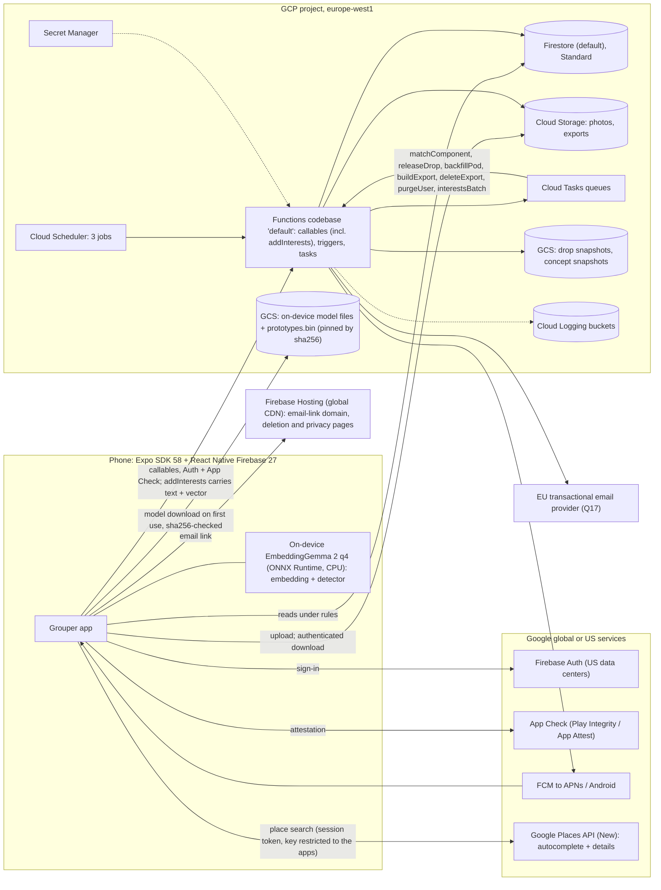

# Grouper: product and technical design

| | |
|---|---|
| Status | Draft for founder review (phase: design doc + scaffold) |
| Date | 2026-11-04 |
| Companions | [PRIVACY.md](./PRIVACY.md) (GDPR design), [COSTS.md](./COSTS.md) (cost overview) |
| Revision | Founder review round 2 (2026-11-04), decisions D1–D16, folded in throughout (§2.1) |
| Market | Denmark (Aarhus, Copenhagen), 18+, Danish + English |

**Evidence tags.** Every number is tagged with its source:

| Tag | Source |
|---|---|
| [EXP] | First embedding calibration experiment (measured in sandbox, EmbeddingGemma-300m ONNX, v1) |
| [CAL] | v1 vs v2 re-calibration with the same test set and code, reproducible in [`research/embedding-calibration/`](../research/embedding-calibration/README.md) |
| [SRV] | EmbeddingGemma server-side serving research (historical since D1; kept for the model facts) |
| [ODV] | On-device EmbeddingGemma 2 runtime research, measured in sandbox on 2026-11-04 (onnxruntime-node 1.24.3 + @huggingface/tokenizers 0.2.0 against the calibration vectors) |
| [PX] | Unit prices fetched 2026-11-02 to 2026-11-04, see [COSTS.md](./COSTS.md) |
| [FBX] | Firebase + Expo SDK 58 infrastructure research |
| [GDPR] | GDPR / Danish data protection analysis |
| [MAT] | Matching algorithm and product rules research |
| [SIM] | Thin-market simulation and n = 20k benchmark of the scaffold's matcher, [`research/thin-market-sim.md`](../research/thin-market-sim.md) (synthetic behaviour) |
| [A] | Architect's assumption, to be validated |

Where reports conflict, the resolution is stated inline and summarized in §2.3. Measured numbers from [CAL] and [EXP] win over estimates; [CAL] supersedes [EXP] for every model-specific threshold.

---

## 1. Summary and glossary

Grouper is "friendship dating" for groups. Users describe themselves with free-form **Interests** in their own words ("madlavning", "on paternity leave", "Fortnite"). Every Thursday evening a batch job (the **Drop**) forms new **Pods** of 4–6 nearby strangers who share an interest. Members accept or decline. Once at least 4 accept, the pod is confirmed, first names (and an optional one-line "about me") are revealed, photos are revealed (in sensitive-themed pods only for members who opt in, §6.1 S6), and the pod uses a **meetup planner** (propose 2–3 options, each a time and a public place picked from Google Places; vote). Around each scheduled meetup a short **meetup chat** opens for the confirmed members, from 24 h before until 24 h after; its messages are deleted about 3 days after the meetup. There is no open-ended chat. Sensitive interests (GDPR Art. 9, e.g. pregnancy, religion) are allowed under one **blanket explicit consent** given at onboarding, and are only ever revealed inside a pod formed around that interest.

The stack is an Expo SDK 58 app on React Native Firebase, with Firestore, Cloud Functions 2nd gen and Cloud Storage in **europe-west1**. **EmbeddingGemma 2 runs on the phone** (ONNX Runtime, CPU): the app embeds every tag and runs the sensitivity detector before anything is sent, and the server stores the client's vector and assigns concepts in a normal callable (D1). There is no server-side model. Estimated cost: about $12/month at 1k MAU and $400–510 at 100k MAU, most of it Google Places and store fees, plus up to about $540 at 100k MAU if the on-device model is downloaded from our own EU bucket (§12, [COSTS.md](./COSTS.md)).

| Term | Meaning |
|---|---|
| **Interest** | A free-form tag (max 40 characters), stored as typed and normalized. |
| **Sensitive interest** | An interest that may reveal Art. 9 data (health incl. pregnancy, beliefs, sexual orientation, politics, ethnic origin, union membership). Stored separately; allowed only for users who gave the blanket Art. 9 consent. |
| **Blanket Art. 9 consent** | One explicit consent, on its own onboarding screen and withdrawable in Settings, that covers all of a user's sensitive interests (D3, PRIVACY.md §3). Without it, sensitive tags are refused and everything else works. |
| **Known-ordinary list** | A shipped, versioned list of about 480 everyday Danish and English hobby words (`packages/core/src/interests/data/known-ordinary.da-en.json`). An exact match switches a detector flag off (§5.2 (5)). |
| **Concept** | An internal cluster of interests that mean the same thing ("cooking", "madlavning"). Has a centroid, a frozen medoid, a sensitivity flag and labels. Never shown as a catalog. |
| **Holding** | A user's link to a concept through one of their interests. A user has at most 20. Sensitivity is decided **per holding**: a holding the user marked "Keep this private" is sensitive even if the tag is ordinary, and a holding of a sensitive tag for which the user chose "This isn't sensitive for me" is ordinary for that user only (§5.2 (5)). |
| **About me** | One optional sentence (≤ 140 characters) on the profile, shown only to confirmed co-members, never used for matching (D4). |
| **Pod** | 4–6 users grouped around one Theme. States: proposed → planning (from confirmation) → scheduled → happened → archived, or dissolved (§4.6). |
| **Theme** | The concept a pod is formed around. Every member holds it and sees it only in their own wording. Shared pod documents carry the concept ID, never a label. |
| **Drop** | The weekly batch (compute Thursday 16:00, release 18:00, Europe/Copenhagen), keyed by ISO week, e.g. `2026-W46`. |
| **Cell** | A geohash-5 cell (about 2.7 × 4.9 km at 56°N [GDPR][MAT]). The only location we store. |
| **Launch area** | A static, versioned list of geohash-5 cells with a stable ID (`aarhus`, `copenhagen`) and status waitlist, beta or live (§6.4). Only users whose home cell lies in a live area are matched. Chips and waitlist counters are per launch area. |
| **Matching component** | Computed per drop only: opted-in cells inside live areas, linked when ≤ 25 km apart. It only partitions the compute into tasks and is never stored on users. |
| **Option** | A proposed meetup time and a public place picked from Google Places, which members vote on. |
| **Attendance** | Per member while a meetup is scheduled: `coming`, `notComing`, `pending` (not answered yet) or `unconfirmed` (no answer by T−3 h). A yes vote for the winning option counts as coming (D5). |
| **Next step card** | The one primary card on the pod screen, derived from state: vote → confirm attendance → chat → give feedback (D13, `podNextStep()`). |
| **Meetup chat** | A pod's short chat around one scheduled meetup: open from 24 h before until 24 h after `meetupAt`, for current confirmed members only; text of up to 500 characters; every message is deleted at `meetupAt` + 72 h (TTL). |

---

## 2. Decisions log and open questions

### 2.1 Founder decisions (interview, 2026-11-04)

| # | Decision | Rationale |
|---|---|---|
| F1 | Groups, not individuals; vocabulary "Interests" and "Pods" | Lower pressure than 1:1; conversation tops out around 4 people [MAT]. |
| F2 | Free-form interest tags; EmbeddingGemma similarity; no curated catalog. Since round 2 the model runs on the phone (F16) | Users speak in their own words (da/en); the model links "madlavning" to "cooking". |
| F3 | The app forms new pods of 4–6 strangers; users accept/decline | No empty-room problem; every member opts in. |
| F4 | In-person, local only, radius around approximate location | Friendships need repeated in-person time (about 50 h to casual friend [MAT]). |
| F5 | Weekly drops, Thursday evening, Europe/Copenhagen | Better global matches, anticipation, cheap batch compute. |
| F6 | Meetup planner plus a short meetup chat for confirmed members, open from 24 h before until 24 h after each scheduled meetup, messages deleted about 3 days after it (A28); public-place safety tips. The founder changed this on 2026-11-04 after the storyboard review; the interview decision was "meetup planner only, no chat". Round 2 removed the quick replies (F29) | On the day, members need to say "running late" or "I'm by the door" without swapping phone numbers. The time box keeps the harassment and moderation surface small: no chat while strangers are still planning, nothing that lives on after the meetup. |
| F7 | Sensitive (Art. 9) interests allowed with explicit consent; never public; revealed only inside a pod formed around that interest; automatic detection plus self-flagging. Since round 2: one blanket consent (F18), no human review (F17) | Headline use cases (pregnancy, faith, recovery) are Art. 9; free text needs automatic detection. |
| F8 | Pod preferences: age range + optional same-gender pod (gender collected only for that) | Comfort and safety with minimal data. |
| F9 | Optional single profile photo, visible only to fellow members after confirmation | Recognition at the meetup without appearance-based matching. |
| F10 | Sign-in: Apple (iOS only, F25), Google, email magic link; no SMS | SMS costs money and needs a phone number. |
| F11 | Denmark first (Aarhus, Copenhagen); Danish + English; i18n-ready; 18+ | Dense home market; meeting strangers justifies 18+. |
| F12 | Free MVP, no monetization | Focus on liquidity and safety first. |
| F13 | Expo/React Native + Firebase; EU data residency; inexpensive infrastructure | One language (TypeScript), pay-per-use. |
| F14 | GDPR compliant; Danish controller; Datatilsynet | Legal requirement; Art. 9 data is core to the product. |
| F15 | This phase delivers a design doc + scaffold for review before features | De-risk architecture and privacy before building. |

**Founder decisions, review round 2 (2026-11-04).** Numbered D1–D16 in the review; F16–F31 here. They supersede anything older in this document.

| # | Review | Decision | Rationale | Sections |
|---|---|---|---|---|
| F16 | D1 | **Embedding on the phone, always.** EmbeddingGemma 2 q4 (same pinned files, STS prompt and thresholds) runs on the device for every tag. The app sends `{text, vector (768), detector result}`; the server **trusts client vectors** (accepted risk, §9). The `embedder` codebase is retired; concept assignment moves into `addInterests` in the default codebase. Model pinning, sha256 list and thresholds live in `packages/core` for both sides | No possibly-Art. 9 text leaves the phone before consent; no model on the server to run, warm or pay for | §5, §7, §9, §10, §11 |
| F17 | D2 | **No human review anywhere.** No review queues, no pre-launch seed review, no reviewer downgrades, no holds waiting for review. Instead: a shipped bilingual known-ordinary list, the detector, the user's "Keep this private" and the user's own "This isn't sensitive for me" (that holding only). Automated pauses stay and every sanction expires on its own; concepts merge only by threshold and alias votes | Zero maintenance for a one-person team | §3.7, §4.4, §5.2, §6.1, PRIVACY.md §13 |
| F18 | D3 | **Blanket explicit Art. 9 consent**, once at onboarding on its own screen, unticked checkbox, specific purposes, withdrawable in Settings. Refusing keeps the app usable: sensitive or self-flagged tags are then refused with a clear message. With consent there is no prompt per tag, only a lock icon. Withdrawal removes every sensitive holding | As many dating apps do; per-tag sheets interrupted onboarding | §3.1, §5.2, PRIVACY.md §3 |
| F19 | D4 | Short tags stay (2–40 characters). New optional **"about me"** sentence (≤ 140 characters; contact details and blocklisted text refused), shown to confirmed co-members only, never used for matching | Helps people recognise each other without changing matching | §3.4, §8.1, §10.1 |
| F20 | D5 | **Attendance:** a yes vote for the winning option counts as "I'm coming". "Still coming?" at T−3 days (only if the meetup is ≥ 4 days after plan lock) and T−24 h; no answer → a second nudge at T−6 h; still none → `unconfirmed` and the others see "<firstName> hasn't confirmed". Unconfirmed does not count as coming; no answer is never a no-show by itself | "No answer counts as coming" hid real drop-outs | §3.6, §4.1, §4.6 |
| F21 | D6 | **Backfill only before the plan locks** (`proposed` or `planning`), never once `scheduled` | A stranger joining after the plan is fixed meets a group that has already planned without them | §4.2, §4.6 |
| F22 | D7 | **One 24 h extension round** when the planning deadline passes without an option at 3 yes votes ("No time works yet — add another option"); only then does a never-met pod dissolve (Keep-loop pods archive) | Fewer pods lost to one quiet weekend | §3.5, §4.6 |
| F23 | D8 | **Places from Google Places (New)** Autocomplete restricted to public place types; options store `placeId`, name, short address, rounded lat/lng, type and a map URL. No free-text place field, no "public place" tick; the server refuses contact details and home-address shapes in a place's text but does not call Places. Places is called from the app with session tokens and a key restricted to the apps | Public places by construction; no home addresses typed into the planner | §3.5, §9, §11, COSTS.md §3.2 |
| F24 | D9 | **"Meet again" has a job:** a mutual "yes" lets the two be matched again after 4 weeks instead of 26; either "no" means never again (an invisible soft block). Pair signals are server-only under HMAC pair keys and erased with either account | The answers were collected but unused | §6.1 H5, §8.2 |
| F25 | D10 | Sign in with Apple on iOS only; Android offers Google and email link | Apple's web flow on Android adds setup for little gain (answers Q9) | §3.1, §11 |
| F26 | D11 | **Add to calendar:** one tap on the plan opens the native add-event sheet, title "Pod meetup", location = place name and address; nothing is stored by us | Fewer forgotten meetups | §3.6, §11 |
| F27 | D12 | **Feedback push the morning after**, 10:00 Europe/Copenhagen, one reminder 3 days later; the window stays 7 days | Nobody wants a survey 2 hours after a meetup | §3.6, §4.1 |
| F28 | D13 | **Pod screen:** one primary "next step" card driven by state (vote → confirm attendance → chat during the window → give feedback), then calm Plan / Chat / Members sections; block and report in each member's sheet | One obvious thing to do at any time | §3.4, §11 |
| F29 | D14 | **No quick replies** in the meetup chat; "Can't make it" lives on the attendance card (`confirmAttendance`) | A message never changes attendance; one place for attendance | §3.6, §10.1 |
| F30 | D15 | **"Who was there?":** every member pre-ticked; the user unticks anyone missing | Faster, and no-shows still need a majority | §3.6 |
| F31 | D16 | **Cost overview** in [COSTS.md](./COSTS.md): every third-party service at 1k–100k MAU and over 24 months | Places and model download change the cost picture | §12 |

### 2.2 Architect decisions beyond the brief (need founder sign-off)

| # | Decision | Why |
|---|---|---|
| A1 | Model: **EmbeddingGemma 2** ONNX **q4**, text-only, pinned `daa72c51…` (v1 300m q4 kept as the calibrated fallback) | Passed the M0 gate [CAL]: merge recall at precision ≥ 0.95 rises 0.26 → 0.42 (paired bootstrap +0.16, 90% CI +0.03 to +0.32), detector no worse, Danish surface-form bias gone, Apache-2.0 instead of the Gemma Terms |
| A2 | 768-d vectors for tags and concepts; 128-d only in the matching profile | Thresholds were measured at 768-d [CAL] |
| A3 | `sentence similarity` prompt for both tags and the detector, so one embedding per tag | For v2 the STS prompt gives fewer detector false flags at 100% recall than `classification` (paired Δ −0.14, CI −0.245 to −0.032) [CAL] |
| A4 | ~~Embedder in its own Functions codebase~~ **Retired by F16 (D1):** the model runs on the phone; `addInterests` is a normal callable in the default codebase | Superseded |
| A5 | Layered sensitivity without human review (F17): lexicon > known-ordinary list > detector, plus "Keep this private" and "This isn't sensitive for me" per holding; never merge across sensitivity | Detector: 100% recall, about 49% false flags (55 of 112 ordinary tags), mostly Danish [CAL]; the list and the user override absorb the false flags that the seed review was meant to catch |
| A6 | Soft themes only through confirmed links | Cosine "related" thresholds fail [EXP] |
| A7 | Clients only read; every write is a callable | One validation layer; simple rules |
| A8 | Compute at 16:00, release at 18:00 | Retry slack |
| A9 | New inputs: meetup language (hard) and availability (6-bit) | Acceptance and planning [MAT] (Q2) |
| A10 | Participate every week by default; auto-pause after 3 declines / 2 ignored | Dense pools without ghost invites |
| A11 | Max 2 active pods per user | Commitment; room for newcomers |
| A12 | Postcode or coarse location → geohash-5 on the device; radius 5/10/15/25 km | Minimisation [GDPR]; cells span up to 5.6 km [MAT] |
| A13 | Never show distances; show the area and the user's own radius | Reveals nothing new |
| A14 | FCM direct, generic payloads; no Expo push, EAS Update, analytics or Crashlytics | One processor; no consent banner [FBX][GDPR] |
| A15 | No Identity Platform; claim `onb` set by a callable | Avoids +$275/month at 100k MAU [FBX] |
| A16 | europe-west1 for everything that can be pinned | About 45% cheaper than eur3 [FBX] |
| A17 | Admin through a CLI (IAM) until M3 | No exposed admin surface |
| A18 | HMAC pod IDs, pair history (26 weeks) and meet-again pair keys (`pairKey(hmac, a, b)`, F24) | Idempotent, no exposed IDs |
| A19 | JPEG only; EXIF stripped on the server; authenticated downloads only; grants removed at every pod exit; `max-age` 1 h; device caches cleared on revocation events; soft delete off | Revocable on the server at once, on devices at the next app open (§9 Photos) |
| A20 | Pod retention from [MAT]: archive after 30 idle days, delete 90 days later | Shorter than [GDPR]'s proposal |
| A21 | Interests 2–40 characters, max 20, max 3 starred, min 3 | Less identifying text |
| A22 | About 150 internal bilingual seed concepts | Counters fragmentation [EXP] |
| A23 | React Native Firebase 27 in the app (the JS SDK 13 only in tests and tools) | Native App Check, FCM and sign-in; JS SDK App Check is web-only [FBX] |
| A24 | Static launch areas (stable IDs, versioned in git) instead of computed regions; per-drop matching components only partition compute | Union-find over occupied cells chains across Jutland, Funen and Zealand (Great Belt link ≈ 18 km), so computed regions cannot express "Aarhus live, Copenhagen waitlist" |
| A25 | Sensitive-theme safeguards against infiltration: eligibility gate, per-account sensitive caps, photo opt-in, "not a genuine member" report with an automatic 28-day hold, automatic anomaly holds (§6.1 S5–S7) | Sign-up is free and unverified (PRIVACY.md R15) |
| A26 | An alpha configuration profile for thin markets (§6.10) | 50–150 testers cannot fill pods under the launch defaults |
| A27 | Erasure ledger for every erasure-relevant event, replayed after any restore | A 7-day restore must not bring back withdrawn Art. 9 data |
| A28 | Meetup chat parameters (approved by the founder on 2026-11-04 with F6): window T−24 h to T+24 h around the scheduled `meetupAt` (opens with "Still coming?"); current members (`memberUids`) only; text 1–500 characters (quick replies removed by F29); written only by `sendMessage`; `expiresAt` = `meetupAt` + 72 h (TTL); before `meetupAt`, contact details need a second tap; 30 messages per user per pod per hour; generic push at most once per member per pod per 10 minutes | Enough for day-of coordination without becoming a social network; strangers are nudged to meet before swapping numbers; nothing outlives the meetup by more than a few days [A] |
| A29 | Attendance check at **T−3 h** (was T−6 h): the T−6 h nudge goes to unanswered members, who become `unconfirmed` at T−3 h, then the check runs (F20) | Gives the nudged members 3 hours to answer before the pod is judged |
| A30 | What answers "Still coming?": a yes vote for the winning option or any `confirmAttendance` call. Only members with neither are nudged and later marked unconfirmed | One rule for the app, the sweeper and the copy |
| A31 | One extension per planning round (confirmation, Keep loop, reschedule, re-plan), reset when a new round starts (`podState.planningExtended`) | F22 applies to every round, but only once each |
| A32 | `addInterests` carries a top-level `modelKey` (`eg2-q4@daa72c5`); the server refuses any other, so a client on another model cannot mix vectors | One concept space; a model change is a coordinated switch (§5.1) |
| A33 | Option places carry a Places `type` from `PUBLIC_PLACE_TYPES`; `proposeOption` checks it. Autocomplete accepts at most 5 `includedPrimaryTypes`, so the app filters predictions against the full list | The server cannot call Places itself, so the type is the public-place proof |
| A34 | The never-match from a meet-again "no" is `recentH[uidH] = '9999-W52'` (`NEVER_WEEK_ID`) on both profiles; no new matcher field | H5 already excludes any pair with a future `recentH` week |
| A35 | Place details stay on the **Essentials** SKU: the name comes from the autocomplete prediction and the map URL is built by `googleMapsPlaceUrl(placeId, name)` | `displayName` and `googleMapsUri` are Pro fields ($17 vs $5 per 1,000) [PX] |
| A36 | The on-device model is downloaded on first use from our EU bucket in europe-west1, checked file by file against core's sha256 values, and kept out of iCloud backup (§5.1). Where it is hosted long-term is Q20 | No new processor; about $0.02 per install [PX] |
| A37 | Rescan with the blanket consent moves a newly flagged holding to `sensitiveInterests` silently (lock icon, no prompt); without the consent the holding becomes `pendingConsent` (§5.2 (8)) | Same rule as adding the tag today |
| A38 | Automatic sanction lengths: report pause 28 days, sensitive-theme hold 28 days (`SENSITIVE_HOLD_DAYS`), no-show suspension 8 weeks at 3 weight in 8 weeks; each one expires on its own (F17) | No human decides; every sanction needs an end [A] |

### 2.3 Conflicts between research reports and how they were resolved

Measured results win over estimates.

| Conflict | Resolution |
|---|---|
| Model and quantization: [SRV] proposed v2 q8; [EXP] calibrated v1 | v2 **q4** (A1), after [CAL] re-ran the calibration on v2. q8 is not better for matching and is about 5× slower per tag on CPU [CAL]; v1 q8 peaks at 1.6 GB [EXP]. |
| Vector size: [SRV] 256-d; [EXP] 768-d | 768-d (A2) |
| Detector prompt: [SRV] STS; [EXP] classification (v1) | STS for v2 (A3) [CAL] |
| Embedder memory: [SRV] 2 GiB; [EXP] 1 GiB | Moot since F16: no server embedder. On the phone, the extra peak RAM is estimated at 350–500 MB [ODV] |
| Node runtime: [SRV] 22; [FBX] 24 | Node 24 (rules tests need 24.12 or newer). nodejs24 is 2nd gen only (https://docs.cloud.google.com/functions/1stgendocs/runtime-support), so the design has no 1st-gen functions (§10.3). transformers.js is used only by the calibration harness and the offline `prototypes.bin` build, not in production. |
| Drop time: [FBX] 18:00; [MAT] 16:00 | Compute at 16:00, release at 18:00 (A8) |
| Distances: [MAT] shows them; [GDPR] never | Never shown (A13) |
| Pod retention: [MAT] vs [GDPR] | [MAT]'s shorter windows (A20) |
| Tag length: [SRV] 60; [MAT] 40 | 40 (A21) |
| Soft themes: [MAT] cos ≥ 0.80; [EXP] shows such thresholds fail | Confirmed links only (A6) |
| Firestore location: [GDPR] eur3 or europe-west1; [FBX] europe-west1 | europe-west1 (A16) |
| Functions free tier: Firebase page 200k CPU-s / 400k GB-s; Cloud Run page 180k / 360k | The lower Cloud Run figures, re-checked on cloud.google.com/run/pricing: per billing account, with 100 ms rounding |
| On-device runtime: ONNX Runtime RN (same graph as calibration) vs react-native-executorch, LiteRT-LM or WASM [ODV] | onnxruntime-react-native 1.24.3 with the native core pinned to ORT 1.30.0, CPU EP: the only option that runs the exact calibrated graph (cosine ≥ 0.9999993 to the calibration vectors on x86). LiteRT-LM is the fallback, at the price of a full re-calibration (§5.1) |
| `tokenizer.json` size: brief 20 MB; measured 32.2 MB (5.5 MB gzipped) [ODV] | 32.2 MB, from the pinned file list in `packages/core` |
| Model download source: our EU bucket (privacy) vs Hugging Face or R2 (cost) [ODV][PX] | EU bucket by default (no new processor); Hugging Face is ruled out (a US processor seeing every IP address); R2 or store asset packs stay open as Q20 |
| Place name and map link: Places `displayName`/`googleMapsUri` (Pro SKU) vs the prediction text and a built URL (Essentials) [PX] | Essentials (A35) |

### 2.4 Open questions for the founder

| # | Question | Default if no answer |
|---|---|---|
| Q1 | ~~EmbeddingGemma v1 or v2?~~ **Answered by the M0 gate [CAL]: v2 q4.** Founder can still veto (v2 is about 4 weeks old). | v2 q4. v1 stays documented as the fallback; switching back means re-embedding with v1's thresholds (§5.1). |
| Q2 | Add meetup language and availability as inputs (A9)? | Yes, both. |
| Q3 | Participation: default every week (A10) or explicit weekly opt-in? | Every week. |
| Q4 | ~~Who reviews flagged tags, and how often?~~ **Answered by F17 (D2): nobody.** The known-ordinary list, the detector and the user's own choices replace review. | — |
| Q5 | Avoid a lone woman or man in mixed pods? (Requires everyone's gender.) | No; revisit after alpha. |
| Q6 | Minimum density before a sensitive concept can be a theme | 12 eligible consenting holders within 25 km of the pod's cells [A] (§6.1 S1). |
| Q7 | Max 2 active pods (A11) and the "Keep pod" loop? | Yes. |
| Q8 | Must first names be real, and photos show a face? | No; a face photo is recommended. |
| Q9 | ~~Sign in with Apple on Android?~~ **Answered by F25 (D10): iOS only.** | — |
| Q10 | Legal entity, privacy lead, lawyer budget | Needed before alpha (PRIVACY.md). |
| Q11 | Launch-area go-live at 200 opted-in users in the area and predicted match rate ≥ 50% for 2 weeks [MAT]? | Yes. The goal lives in one place, `areas/{areaId}.goal`. |
| Q12 | Opt-in "open to meet anyone" fallback theme? | Yes, opt-in only (on by default in the alpha profile, §6.10). |
| Q13 | Skip drops in holiday weeks (e.g. week 52)? | Configurable skip list, empty by default. |
| Q14 | Later: canonicalize tags with an EU-hosted LLM under a DPA [EXP]? | Not in MVP. |
| Q15 | Sensitive-theme eligibility gate (§6.1 S5): account ≥ 14 days old and ≥ 1 attended meetup? This delays a new user's first pregnancy or faith pod by several weeks. | Yes [A]; revisit with alpha data. |
| Q16 | Same-gender pods for non-binary users: "non-binary only" or also "women + non-binary" / "men + non-binary"? | "Same gender" only in MVP; the app tells non-binary users when the pool is too small (`GENDER_POOL`). |
| Q17 | Transactional email provider for inactivity warnings and Art. 34 notices (PRIVACY.md §9) | An EU provider with a DPA, chosen in M1 [A]. |
| Q18 | ~~Run the sensitivity detector on the device?~~ **Answered by F16 (D1): the whole model runs on the device**, for embedding and detection. | — |
| Q19 | **Thin-market levers for the alpha.** The simulation [SIM] says the planned 50–150 testers cannot fill pods: at n = 100 about half the testers get no confirmed pod in 12 weeks. Even n = 300 with 5 seed-theme cohorts reaches only 35% confirmation and a first pod after a median 4.3 weeks, because most proposals have only 4 invitees and need all 4 to accept. Which levers do we pull? (a) recruit ≥ 300 testers in Aarhus into ≤ 5 seed-theme cohorts; (b) invite 5–6 whenever the pool allows; (c) a wider default age range in the alpha; (d) let an alpha pod confirm at 3 accepts (changes F3). | (a) and (b), tested in `tools/sim` before M1; (c) and (d) only with founder sign-off. |
| Q20 | **Where the on-device model is downloaded from.** Our EU bucket costs about $0.021 per install (~$540/month at 100k MAU, ~$2,100 per model change at that size) but adds no processor. Cloudflare R2 has free egress but adds a processor; Play Asset Delivery + Apple Background Assets are free but need two platform code paths (COSTS.md §3.3). | EU bucket until about 10k MAU; decide then with real install numbers. |
| Q21 | Google Maps Platform terms allow caching place IDs indefinitely, but limit how long other Places content (name, address, lat/lng) may be stored. Options are deleted within 30 days of the meetup; `pods.planning.place` lives until the pod is archived. | Verify in M0; if needed, `dailyMaintenance` removes `pods.planning.place` 30 days after the meetup. |
| Q22 | Minimum device for adding interests: the on-device model needs an estimated 350–500 MB of extra RAM [ODV]. Devices that cannot run it cannot add tags (§5.1 fallback). | About 4 GB of RAM; confirm in the M0 device spike. |
| Q23 | Offer "This isn't sensitive for me" also to users **without** the blanket consent, when a tag is refused only because the detector (not the lexicon) flagged it? Core accepts it; the app offers it only on holdings already stored as sensitive. | No: without consent the app offers the Settings path or rewording; revisit with counsel (PRIVACY.md §17). |

---

## 3. User journeys

### 3.1 Onboarding (including consent steps)
1. **Welcome**: the UI language follows the device (da/en, switchable). Copy: "Small groups. Real meetups. 18+."
2. **Sign in**: Apple (iOS only, F25), Google or email magic link. After sign-in the app starts downloading the on-device model in the background (about 180 MB, Wi-Fi by default; on cellular it asks first, §5.1). Firebase Auth stores the provider UID and email. With Google, Firebase Auth also copies the Google display name and photo URL; `completeOnboarding` clears the top-level `displayName` and `photoURL` with Admin `updateUser({displayName: null, photoURL: null})`. The `google.com` entry in `providerData` may keep them, and they are refreshed at each Google sign-in [verify in M0]. That residual is disclosed (PRIVACY.md §9).
3. **Terms and privacy notice**: the user accepts the Terms (contract). The layered privacy notice is information, not consent. Versions are recorded.
4. **Date of birth**, entered on the device.
5. **First name**: visible only to confirmed pod members.
6. **Area**: postcode (default, no permission needed) or approximate location (coarse permission). The device converts either one to geohash-5 with the bundled postcode table (`packages/core/src/geo/dk-postcodes.json`) and discards the postcode and coordinates. The server receives only `gh5`.
   - The app then calls `completeOnboarding` with steps 3–6.
   - The server checks 18+, keeps only `birthYear` [GDPR], resolves the launch area from `gh5`, creates the profile with default preferences, and sets the claim `onb`.
   - **Under 18:** the server deletes the Firebase Auth user at once (`auth.deleteUser`) and stores nothing about the person except 30-day markers in `underageMarkers`, keyed on `HMAC(email)` when the token has an email and on `HMAC(provider, provider uid)` for each federated identity (Apple sign-in usually carries no email). A retry with the same email or sign-in identity inside 30 days gets the same answer without a new date-of-birth check. The marker is disclosed in the privacy notice (PRIVACY.md §11).
7. **Sensitive interests** (its own screen, F18): the blanket Art. 9 consent (PRIVACY.md §3.3). Unticked checkbox; "I agree" stays disabled until it is ticked and then calls `setArt9Consent`; "Not now" carries on without it. The screen says plainly that saying no keeps the app usable and only means interests like these are not saved. The consent can be given or withdrawn later in Settings → Privacy.
8. **Interests**:
   - free text, with a permanent notice about sensitive interests (`interest-notice-*-v2`);
   - launch-area chips (non-sensitive concepts with ≥ 10 holders in the area) to help start;
   - **everything is checked on the phone first** (§5.2 (0)): normalisation, PII patterns, blocklist, the Art. 9 lexicon, the on-device embedding, the detector and the known-ordinary list. The onboarding tags are embedded in one batch;
   - **without the blanket consent**, a tag the phone treats as sensitive, or one the user marks "Keep this private", is refused on the device and never sent: "This interest may say something sensitive about you. We only save interests like this if you agree to sensitive interests (Settings → Privacy)." (`ART9_CONSENT_REQUIRED`), with a link to that setting. Every other tag is added;
   - **with the consent** there is no prompt: the tag is added, the protections apply silently (theme-only use, no chips, labels or explanations, separate storage), and the tag list shows a lock icon. On a locked tag the user can choose **"This isn't sensitive for me"** (§5.2 (5));
   - if the model is not on the device yet, the step shows the download progress; if the device cannot run it (too little memory, download refused, a hash mismatch), adding tags is blocked with a clear message and "Try again" (§5.1);
   - minimum 3 interests, nudged towards 5 [MAT].
9. **Preferences**: age range (default own age ±7, min width 5 years [A]; the alpha profile uses ±10, §6.10), radius (default 10 km, shown as "about"), meetup languages, availability (weekday/Saturday/Sunday × day/evening). Turning on "same-gender pods" opens a gender picker with its own consent checkbox. The consent copy says that members of a same-gender pod will know that everyone in it shares their gender (PRIVACY.md §3.6).
10. **Photo and "about me"** (both optional): "Only people in a confirmed pod with you can see it. In pods about a sensitive interest, you choose per pod whether to show it." "About me" is one sentence of up to 140 characters ("I'm new in Aarhus and like long walks"), shown only to confirmed co-members and never used for matching; contact details and blocklisted words are refused (F19).
11. **Notifications** permission, then the **safety pledge** checkbox.
12. **Done**: in a live launch area, "Your first drop is Thursday at 18:00". In a waitlist area, bucketed progress from `areas/{areaId}` ("Aarhus: 150+ signed up. We open at 200."). Outside every launch area: "Grouper isn't in your area yet."

### 3.2 Weekly drop
- **Timeline:**
  - Monday 10:00: nudge for users on manual participation;
  - Thursday 12:00: opt-in cutoff (manual users opting in for this week). Pausing or skipping takes effect immediately at any time (§10.1 `setParticipation`);
  - Thursday 16:00: compute;
  - Thursday 18:00: release after revalidation (§10.3 `releaseDrop`), with the push "Your weekly drop is here" (never a theme or name). Pushes are staggered over 15 minutes.
- **Home** then shows either a **proposal card** or "No pod this week", with a reason and a tip ("add a few interests", "try 15 km"). If a setting makes the user structurally unmatchable (for example a same-gender pool that is too small), the reason names that setting (§6.7).
- **The card shows:**
  - the theme in the viewer's own wording (lock icon if sensitive);
  - size and area ("near Aarhus C");
  - "everyone lives about 10 km or less from you" (H2 compares cell centroids, so distances are approximate);
  - age span (ordinary themes only);
  - up to 3 non-sensitive interests the viewer also shares (ordinary themes only);
  - the deadline.
- **Sensitive themes:** before confirmation, invitees are not yet members, and some will decline. The card therefore omits the age span and the shared interests (`ALSO_SHARE`), which together could narrow down who the local holders are. The consent text names invitees as recipients of the theme (PRIVACY.md §3.3).
- **The card never shows** names, photos, IDs, gender or who has accepted [MAT].
- **"Why this pod"** renders server reason codes (§6.7).

### 3.3 Accept or decline
- **Accept** calls `respondToPod`; the card then shows "3 of 5 accepted".
- **Decline** takes an optional reason chip, used for aggregate metrics only.
- **Auto-pause:** 3 declines or 2 ignored proposals in a row pause participation, with a prompt [MAT][A].

### 3.4 Confirmation reveal
- At 4 accepts the pod is confirmed and enters `planning` (§4.6). Pending invitees can still join until the accept deadline, up to 6. Late joiners see the current options and can vote; if an option has already locked, they see the plan and confirm attendance.
- Push: "Your pod is confirmed".
- **The pod screen** (F28) starts with **one primary "next step" card**, derived from state by `podNextStep()` (`packages/core/src/pods/nextStep.ts`): vote (planning, until the viewer has voted on every option) → confirm attendance (scheduled, once "Still coming?" has been asked and the viewer has not answered) → chat (while the meetup chat is open) → give feedback (happened, until given). Below it are three calm sections:
  - **Plan:** options and votes, or the locked plan with place, map link and "Add to calendar";
  - **Chat:** the meetup chat entry, when a window exists;
  - **Members:** first names, "about me" sentences and photos. Block and report live in each member's sheet.
- **Members are shown with:**
  - first names and their optional "about me" sentence (F19);
  - photos (through grants). In sensitive-themed pods a member's photo is shown only after that member taps "Show my photo to this pod" (S6);
  - the theme, in the viewer's own wording (from their pod card; the shared pod doc carries no label);
  - "pod interests": non-sensitive concepts held through ordinary (not self-flagged) holdings by ≥ 2 members, not attributed to anyone.
- The safety tips sheet opens, and the 72-hour planning window starts.

### 3.5 Meetup planning and voting
- **Proposing.** The planner asks for 2–3 options (max 3 per pod, max 2 per member) and keeps asking for a second option until one exists. Voting opens with the first. A single option can still win, so a quiet pod is not dissolved for proposing too little. Each option has:
  - a time within 14 days, between 08:00 and 22:00;
  - **a place picked from Google Places** (F23): the user types, the app shows Places (New) Autocomplete predictions filtered to public place types (`PUBLIC_PLACE_TYPES`: cafés, bars, restaurants, libraries, parks, museums, bakeries, book shops and the like), and the chosen place is fetched with Place Details Essentials in the same session. The option stores `{placeId, name, address (short formatted), lat, lng (4 decimals), type, mapUrl}`. There is no free-text field, no "public place" tick and no home-address prompt in the app. The server does not call Places, so it cannot prove that the id, name and address belong together: `placeSchema` refuses contact details, links and street-address shapes in the name, and contact details or a floor and side ("2. tv") in the address (`placeTextProblem`). A modified client could still give a public-looking name to a place that is not one (PRIVACY.md R19); a later option could verify the id with one Place Details call on the server.
- **Voting.** Members vote yes/no on each option.
  - If every current member says yes to one option, it locks early.
  - At the planning deadline, the option with the most yes votes (at least 3) wins; ties go to the earlier time.
  - **No winner → one extension round** (F22): the deadline moves 24 h and the pod sees "No time works yet — add another option" (`pods.planning.extended`). Members can add options (within the usual limits) and vote. Only if the extended deadline also passes without a winner does a pod that has never met dissolve (its members get priority next week); a pod in the Keep loop is archived (§4.6). Each planning round gets one extension.
- **Backfill** can still fill a seat while the pod is planning (F21): if a member leaves or is removed and 3 remain, one backfill round runs if the pod has not used it (§4.2). Once the plan locks, nobody new joins.
- **No chat while planning.** Before a meetup is scheduled, the planner is the only way to talk. The meetup chat opens 24 h before the scheduled time (§3.6).

### 3.6 Meetup and feedback
- **Plan lock** (the pod enters `scheduled`): members who voted yes for the winning option count as **coming**; everyone else is `pending` (F20, `attendanceAtPlanLock`). The plan card offers **"Add to calendar"**: one tap opens the phone's own add-event sheet (`expo-calendar` `createEventInCalendarAsync`) with the title "Pod meetup", the time, and the place name and address as location. Nothing about it is stored by us, and no calendar permission is requested (F26).
- **T−3 days** (only if the meetup is at least 4 days after plan lock): "Still coming?" to every member.
- **T−24 h**: "Still coming?" to every member, plus the safety tips. The **meetup chat** opens at the same moment, with one push, "Your pod chat is open".
- **Answering.** The attendance card (the next-step card) has "I'm coming" and **"Can't make it"**, both calling `confirmAttendance`. A yes vote for the winning option or any `confirmAttendance` call counts as an answer (A30). "Can't make it" ≥ 24 h before costs nothing; later it is a late cancel (§4.4).
- **T−6 h**: a second nudge, only to members who have not answered.
- **T−3 h**: members who still have not answered become **`unconfirmed`**, and the others see "<firstName> hasn't confirmed". Then the **attendance check** runs (A29): only `coming` counts, so unconfirmed members are not counted as coming. If fewer than 3 are coming, the pod gets one 48-hour reschedule round (back to `planning`). If that round produces no winner (after its own extension), or attendance falls below 3 again, the meetup is cancelled and the pod is archived (or dissolved if it never met). With 3 or more coming, the meetup goes ahead. A cancellation that leaves fewer than 3 coming runs the check at once. **No answer is never a no-show by itself**: an unconfirmed member who turns up is simply there.
- **T−2 h**: reminder.
- **T+2 h**: the pod enters `happened`.
- **Next morning, 10:00 Europe/Copenhagen**: the feedback push "How was your meetup?"; **one reminder 3 days later**, also at 10:00 (F27, `feedbackTimers`). Feedback stays open for 7 days from `happened`:
  - **"Who was there?"**: every other member starts ticked; the user unticks anyone who was missing (F30). The app sends `notThere: uid[]`;
  - a private **"Would you meet them again?"** for each person (yes / no / skip). Mutual yes → the two may be matched again after 4 weeks instead of 26; either no → never again, invisibly (F24, §6.1 H5);
  - a 1–5 rating;
  - **Keep pod** / **Not for me**.
- When feedback closes: if at least 3 chose Keep, the pod goes back to `planning` with those members only and a new 72-hour deadline. The others leave the pod (roster, `memberUids` and photo grants are updated). Otherwise it is archived.

**Meetup chat** (`pod/[podId]/chat`, T−24 h to T+24 h; parameters A28):
- **Who.** Current confirmed members only (`memberUids`). Someone who leaves, or is removed by a block (§3.7), loses the chat at once.
- **What.** Text of 1–500 characters. There are no quick replies (F29): a message never changes attendance, and "Can't make it" lives on the attendance card, which calls `confirmAttendance({podId, coming: false})`. If that cancellation leaves fewer than 3 coming, the pod goes back to `planning` (or the meetup is cancelled, §4.6), the chat closes, and the others get the reschedule or cancellation notice.
- **Before you have met.** Until `meetupAt`, a message with a phone number, an email address, an @handle or a link (map links from the `proposeOption` allowlist excepted) is not sent. The app shows "You haven't met yet. It's fine to wait until after." with "Send anyway" and "Edit". "Send anyway" resends with `ackContactWarning: true`. After `meetupAt` there is no warning.
- **Always refused**, with a statement of reasons rendered from the code and nothing stored: CPR-like numbers (`PII_CPR`) and blocklisted text (`BLOCKLIST`).
- **Report.** Every message has "Report" (long press). The report keeps a copy of the message and names its author as the target, so it outlives the message.
- **Notifications.** "New message in your pod", never the text, theme or a name; at most one per member per pod every 10 minutes.
- **Closing.** At T+24 h the chat becomes read-only. Messages are deleted at T+72 h by TTL, so the copy says "deleted about 3 days after the meetup". A return to `planning` (reschedule or re-plan) closes the chat at once; the next scheduled meetup, after a reschedule or in the Keep loop, opens a new window around its own time.

### 3.7 Block and report
Both live in each member's sheet (F28) in a confirmed pod (current or past, while the pod record exists). Report is also available on every chat message.
- **Block**:
  - immediate and two-way;
  - photo grants revoked in both directions;
  - the two are never matched again.
  - **Inside an active pod** (proposed, planning or scheduled, or `happened` while its meetup chat is still open), Firestore rules cannot hide one member's fields or messages from another, so the two cannot stay in the same pod. By default the **blocked** member is removed. The others, including the blocked person, see only the generic "The pod changed" / "A member left". The blocker can choose to leave instead. If the removal takes the pod below its minimum, the normal rules apply (§4.6).
  - If the meetup was already scheduled, the blocked person knows the plan. The blocker is offered "Re-plan the meetup", which reopens planning with a 48-hour deadline and deletes the old options.
  - `blockUser` accepts only a uid that shares or shared a pod with the caller (checked against `podState`). The stored `firstName` is the name the caller saw in that pod's roster; it is empty if the pod was never confirmed.
- **Report**:
  - categories: harassment, safety, no-show, content, suspected under 18, and, in sensitive-themed pods, "not a genuine member" (S7);
  - optional text (max 500 characters), with a warning not to include sensitive details;
  - a reported chat message is copied into the report (its text; its author is the report's target), because the message itself is deleted at T+72 h;
  - the reporter is never revealed;
  - safety reports show "call 112 in an emergency".
- **Automated pauses only** (F17). Each comes with an immediate statement of reasons, is listed on "How matching works", and **expires on its own** (A38):
  - two independent reports within 30 days, or one safety report → paused from drops for 28 days [A];
  - suspected under 18 → paused for 28 days [A]; another such report from a different pod restarts it;
  - the no-show pause and suspension (§4.4);
  - the sensitive-theme hold after a "not a genuine member" report or an anomaly (S7), 28 days.
- **What is lost without human review** (stated in PRIVACY.md §13 and on "How matching works"): nobody reads reports or report text; there are no permanent suspensions or bans, and a confirmed minor is not deleted by us (the pause repeats on new reports); no-show accusations cannot be disputed and resolve by majority only (§4.4); a wrong pause simply runs out. Statements of reasons offer the support address (DSA Arts. 11–12), not a review. **[LAWYER]** whether this meets DSA Arts. 16–18 (PRIVACY.md §17).

### 3.8 Leave pod
From the pod menu. The others see "A member left". Below 3 members the pod is dissolved (never met) or archived (has met) (§4.6). Photo grants for that pod are removed in both directions.

### 3.9 Export data
Settings → Privacy → "Download my data" asks the user to re-authenticate, then calls `exportData`. A background task builds a JSON file, and the user gets a notice when it is ready. The download is authenticated (no public URL). The file is available for 24 h: a Cloud Task deletes it at +24 h, and the Storage lifecycle rule is a backstop that can take up to about another day, so the notice says "deleted within 48 hours". Contents: PRIVACY.md §6.

### 3.10 Delete account
1. Settings → Delete account explains what is deleted, plus the backup (7 days) and Auth (up to 180 days, Google) windows.
2. The user re-authenticates. On iOS with Apple sign-in, the device gets a fresh `authorizationCode` and calls RNFirebase `revokeToken(authorizationCode)` before step 3. This needs the Apple provider's code-flow fields (Services ID, Team ID, key ID, private key) configured in the Firebase console, so no Apple key material lives in our Secret Manager. A failed revocation is retried once and does not block deletion.
3. `deleteAccount` runs; the device then signs out, calls Firestore `terminate()` + `clearPersistence()`, clears the expo-image memory and disk caches, and shows a confirmation.
4. The purge continues in the background (§10).

---

## 4. Product rules

### 4.1 Drop schedule (Europe/Copenhagen; Cloud Scheduler handles DST)

| When | Event | Mechanism |
|---|---|---|
| Mon 10:00 | "In this week?" nudge (manual-participation users) | `hourlySweeper` |
| Thu 12:00 | Opt-in cutoff for this week's drop (pause and skip apply immediately at any time) | `setParticipation` rule |
| Thu 16:00 | Freeze inputs (snapshot to GCS), then one `matchComponent` task per matching component | `dropOrchestrator` cron `0 16 * * 4` |
| Thu 18:00 | Release: revalidate every member, write `podState` and proposal cards, send push (staggered over 15 min) | `releaseDrop` task, scheduled by the orchestrator |
| Sat 18:00 | Accept deadline (+48 h) [MAT] | `hourlySweeper` |
| min(backfill start + 24 h, Sun 18:00); in `planning`: min(start + 24 h, planning deadline) [A] | Backfill deadline (once per pod; only in `proposed` or `planning`, F21) | `hourlySweeper` |
| Planning entry + 72 h (48 h for a reschedule or re-plan round) | Planning deadline | `hourlySweeper` |
| Planning deadline + 24 h (once per round) | Extension round deadline, when the first deadline had no winner (F22, `planningExtensionDeadline`) | `hourlySweeper` |
| Meetup T−3 days (only if the meetup is ≥ 4 days after plan lock) | "Still coming?" to every member (`timers.stillComing3d`) | `hourlySweeper` |
| Meetup T−24 h | "Still coming?" to every member, safety tips; the meetup chat opens with one generic push "Your pod chat is open" (`timers.stillComing24h`) | `hourlySweeper`; `sendMessage` checks the window itself (`isChatOpen`) |
| Meetup T−6 h | Second nudge, only to members who have not answered (`timers.nudge6h`, `membersToNudge`) | `hourlySweeper` |
| Meetup T−3 h | Unanswered → `unconfirmed`; attendance check: fewer than 3 coming → the one reschedule round (`timers.attendanceCheck`, A29) | `hourlySweeper` |
| Meetup T−2 h | Reminder | `hourlySweeper` |
| Meetup T+2 h | → `happened` | `hourlySweeper` |
| Meetup T+24 h | Meetup chat closes (read-only while messages exist) | `sendMessage` window check |
| Day after the meetup, 10:00 | Feedback push (`timers.feedbackPush`, F27) | `hourlySweeper` |
| Meetup T+72 h | Chat messages expire (`expiresAt`); TTL deletes them, usually within another 24 h, so copy says "about 3 days after the meetup" | Firestore TTL |
| Feedback push + 3 days, 10:00 | One feedback reminder, to members who have not given feedback (`timers.feedbackReminder`) | `hourlySweeper` |
| `happened` + 7 days | Feedback closes; meet-again outcomes applied; Keep-loop decision | `hourlySweeper` |

Timers are absolute timestamps in `podState.timers`, computed in Europe/Copenhagen (`meetupTimers(meetupAt, planLockedAt)` and `feedbackTimers(meetupAt)` in `packages/core/src/time`; the 10:00 times are DST-correct, so the reminder is 71, 72 or 73 h after the push). The hourly sweeper runs at :05, so a deadline is processed up to 65 minutes after it passes; copy says "around 18:00", and the 10:00 push arrives around 10:05. No new Scheduler jobs are needed. The full state machine is §4.6.

### 4.2 Pod rules

| Rule | Value | Source |
|---|---|---|
| Pod size | min 4, target 5, max 6 | [MAT] |
| Overbooking | 6th seat when expected attendance of the five (Σ r) < 4.0 (alpha profile: 6 whenever 6 are compatible, §6.10) | [MAT] |
| Confirmation | ≥ 4 accepted | [MAT] |
| Backfill | **Only before the plan locks** (`proposed` or `planning`, never `scheduled` or later; F21, `canBackfill`). Triggered at the accept deadline with exactly 3 accepted, on a decline when accepted + pending < 4, or in `planning` when a leave or removal leaves 3 members [A]. Runs as a `backfillPod` task over the server-only pool of the latest drop's unmatched users (`matchProfiles.lastDrop`, §8.2). Each candidate is claimed in a transaction on `matchProfiles/{uid}` (`weekClaim != weekId`, `activePods < 2`), and all constraints (H1–H6, S1–S7, consent references) are re-checked before inviting. Once per pod; deadline min(start + 24 h, Sun 18:00), in `planning` min(start + 24 h, planning deadline) [A]. A backfilled member who joins during planning can vote at once. | [MAT], F21 |
| New pods per user per drop | ≤ 1, enforced by `matchProfiles.weekClaim` (set at release and at each backfill claim) | [MAT] |
| Active pods per user | ≤ 2 (planning or scheduled); at most 1 of them sensitive-themed (S5) | A11 |
| Re-match block | Not co-members within 26 weeks; not co-proposed within 4 weeks (alpha: 8 and 2 weeks). After a mutual meet-again "yes": 4 weeks after the meetup week. After either "no": never (F24, §6.1 H5) | [MAT], F24 |
| Archive | From `happened` without Keep, a failed Keep-loop or reschedule round, or < 3 members after the pod has met (§4.6); deleted 90 days after archive | [MAT] |
| Dissolved | Not confirmed, no winner in the first planning round after its extension (F22), or < 3 members before the pod has met. Members who accepted get priority next week; the pod is deleted after 30 days | [MAT] |

### 4.3 Limits

| Item | Limit | Source |
|---|---|---|
| Interest length | 2–40 characters after normalization | [MAT], A21 |
| Interests per user | max 20 (sensitive included); min 3 to be matched; nudge to 5 | [MAT] |
| Starred interests | max 3 (s = 1.0 instead of 0.8) | [MAT] |
| Interest adds | `addInterests`: 30 calls/hour, 100 items/day per user; accounts younger than 24 h half that; ≤ 10 items per call | [A] |
| First name | 1–30 characters | [A] |
| About me | 0–140 characters; contact details (`CONTACT_INFO`) and blocklisted text (`BLOCKLIST`) refused, no "send anyway" | F19 |
| Options | 2–3 per pod (the planner asks for 2–3; max 3; brief; a single option can still win, §3.5), ≤ 2 per member ([MAT] allowed 6 per pod), within 14 days, 08–22; the place is a Google Places pick of a public type (F23). The extension round allows options up to the same limits | brief, [MAT] |
| Report text | ≤ 500 characters | [A] |
| Chat message | 1–500 characters after trimming | A28, F29 |
| Chat messages sent | 30 per user per pod per hour | A28 |
| Chat pushes | ≤ 1 per member per pod per 10 minutes | A28 |
| Radius | 5 / 10 / 15 / 25 km (default 10) | A12 |
| Age range | min 18; width ≥ 5 years | [A] |
| Data export | 1 per 24 h | [A] |
| Sensitive interest adds | ≤ 3 per 7 days per account (S5) | [A] |
| Places (in the app) | Autocomplete from the third character, debounced 300 ms; one session token per option; Places API per-day quota caps in the Cloud console (§9) | [PX], [A] |
| Photo uploads | One pending object per uid (fixed name); ≤ 5 processed uploads per uid per day | [A] |

### 4.4 No-show policy [MAT]
- Cancelling ≥ 24 h before the meetup costs nothing. A late cancel counts as 0.5 no-show; a no-show counts as 1.
- A no-show needs a majority of the other responders and no cancellation. "Who was there?" starts with everyone ticked (F30), so a member is a no-show only if most of those who answered unticked them. **There is no dispute** (F17): the majority rule is the only guard against cliques. No answer to "Still coming?" is never a no-show by itself (F20).
- 2 no-show weight within 8 weeks → automated 2-week pause plus a re-commit pledge, with a statement of reasons. 3 within 8 weeks → automated 8-week suspension (A38). Both expire on their own. The windows are computed from `matchProfiles.noShowEvents` (the last 8 dated events, each `{weekId, w}` with w = 1 or 0.5, kept ≤ 26 weeks).
- Users see their own record ("4/4 attended"). Reliability r(u) = (attended + 4)/(attended + noShowW + 5), where noShowW = noShows + 0.5 · lateCancels (lifetime counters). It feeds matching (new users start at 0.8) and is never shown to others.

### 4.5 Safety tips (shown at confirmation and T−24 h)
Options can only name public places (F23); the tips still say: Meet in a public place in daytime or early evening. Arrange your own transport. Tell a friend where you are going. You can leave at any time. Drink responsibly; there is no pressure to drink. Never share your home address. Use Report if something feels wrong; call 112 in an emergency.

### 4.6 Pod state machine

Every transition runs in a transaction on `podState/{podId}` with a `version` compare-and-set, so callables and the sweeper can race safely. Timers are absolute timestamps (Europe/Copenhagen) in `podState.timers`. Any transition that adds or keeps members first drops members whose account is `deleting`, `suspended` or paused.

| State | Entry and entry action | Timer | Exits | Owner | Card / notice |
|---|---|---|---|---|---|
| `proposed` | `releaseDrop` (after revalidation) or a `backfillPod` invite. Creates `podState` and one card per invitee | `acceptBy` = release + 48 h (Sat 18:00). Backfill invitees: min(backfill start + 24 h, Sun 18:00). Decision time = the later of the two | 4th accept → `planning`. A decline that leaves accepted + pending < 4 starts backfill if unused. At `acceptBy` with exactly 3 accepted and backfill unused → backfill. At decision time with < 4 accepted → `dissolved` | `respondToPod`, `backfillPod`, `hourlySweeper` | "3 of 5 accepted"; dissolve notice "This pod didn't come together" |
| `planning` | (a) Confirmation: creates `pods/{podId}` with roster, photo grants (S6 opt-in for sensitive themes), push. (b) Keep loop. (c) Reschedule round. (d) Re-plan after a block. (b)–(d) delete the old options and clear `pods.planning.meetupAt`, which closes any open meetup chat. Every entry resets `planningExtended` to false | `planDeadline` = entry + 72 h; 48 h for (c) and (d). Extension: `planDeadline` + 24 h, once per round | Unanimous yes from every current member → `scheduled`. At `planDeadline` (`planningDeadlineOutcome`): the option with the most yes votes (≥ 3; ties → earlier time; a single option may win) → `scheduled`. No winner and no extension used → **extend** (`planningExtended`, `pods.planning.extended`, F22). No winner after the extension → `dissolved` if the pod has never met, else `archived`. Members < 3 at any time → same rule. Members = 3 and backfill unused → backfill (F21) | `voteOption`, `proposeOption`, `hourlySweeper`, `leavePod`, `blockUser`, `backfillPod` | Next-step card "Vote"; "Pick a time by {deadline}"; extension banner "No time works yet — add another option" |
| `scheduled` | Winning option copied to `pods.planning` (`meetupAt`, `place`); `planLockedAt`; attendance from the votes (`attendanceAtPlanLock`: yes → `coming`, others `pending`) in `podState.members` and `pods.attendance`; timers from `meetupTimers(meetupAt, planLockedAt)` | T−3 d (if lead ≥ 4 days) and T−24 h "Still coming?" (chat opens at T−24 h); T−6 h nudge to `pending`; T−3 h `pending` → `unconfirmed`, then the attendance check; T−2 h reminder; T+2 h → `happened` | Fewer than 3 `coming` at T−3 h or after a cancellation: first time → `planning` (c); second time → `dissolved` / `archived` as above. T+2 h → `happened`. No backfill (F21) | `hourlySweeper`, `confirmAttendance` | Next-step card "Still coming?"; "<firstName> hasn't confirmed"; plan card with "Add to calendar" |
| `happened` | Feedback timers from `feedbackTimers(meetupAt)` | Feedback push next day 10:00, reminder 3 days later at 10:00; `feedbackCloses` = entry + 7 days; the meetup chat stays open until T+24 h | At close: meet-again outcomes are applied (§6.1 H5); ≥ 3 Keep → `planning` (b) with the Keep members only (others leave: roster, `memberUids`, grants). Otherwise → `archived` | `hourlySweeper`, `submitFeedback` | Next-step card "How was it?" |
| `archived` | `archivedAt`; options deleted; every photo grant entry for this pod removed; cards set to `archived` (read-only history) | Delete at `archivedAt` + 90 days | Deletion (recursive; cards and grants entries too) | `hourlySweeper`, `dailyMaintenance` | Past pod |
| `dissolved` | Photo grant entries removed; members who accepted get priority (+1 in f(u)) | Delete after 30 days | Deletion | `hourlySweeper`, `dailyMaintenance` | Notice; card TTL drop + 14 days |

"Has met" means the pod has passed through `happened` at least once.

**Meetup chat window.** The window belongs to the scheduled `meetupAt`, not to a state: `chatWindow(meetupAt)` gives `opensAt` = T−24 h, `closesAt` = T+24 h and `deleteAt` = T+72 h, and `isChatOpen(meetupAt, now)` is `opensAt ≤ now < closesAt` (`packages/core/src/time`). It therefore covers the last day of `scheduled` and the first 22 h of `happened`. `sendMessage` reads the pod's current state and `planning.meetupAt` and refuses with `CHAT_CLOSED` unless the pod is `scheduled` or `happened` and the window is open, so a return to `planning` or a cancellation (archive or dissolve) closes the chat at once. A later meetup (reschedule round or Keep loop) opens a new window around its own `meetupAt`. Existing messages keep their own `expiresAt` and stay readable to current members until TTL deletes them; pod deletion removes any left over (recursive).

---

## 5. Interest system

### 5.1 Model and on-device runtime

Since F16 (D1) the model runs **only on the phone**. The server never loads it; it checks and stores what the app sends. `packages/core/src/interests/model.ts` (`EMBEDDING_MODEL`) is the one source for the model id, revision, the pinned file list with sha256 and sizes, the prompt, the thresholds and the `modelKey`, so the app, the server and the calibration harness cannot drift apart.

| Parameter | Value | Source |
|---|---|---|
| Model | `onnx-community/embeddinggemma-2-ONNX` @ `daa72c51243991dfcaf9f9137d2c573d8f7790c0` (base `google/embeddinggemma-2` @ `f9972ac2…`, byte-identical tokenizer), Apache-2.0 | [CAL] |
| Variant | q4, text-only graph: `onnx/model_q4.onnx` (0.49 MB) + `model_q4.onnx_data` (174.0 MB). Never fp16 or q4f16 (NaN risk) | [CAL] |
| Device files (pinned by sha256 in core) | `model_q4.onnx` `f9eeba97…a477a9`, `model_q4.onnx_data` `c3975f2d…c3df49`, `tokenizer.json` (32.2 MB, BPE, 262,144 tokens) `4d777ef5…828be4`, `tokenizer_config.json`, and `prototypes.bin` (Art. 9 prototypes and hobby anchors, `GPROTO02`, built offline; its hash is added when it is built) | [ODV] |
| Runtime | **onnxruntime-react-native 1.24.3** with its native core pinned to **ORT 1.30.0** on both platforms (the local `plugins/withOrtPinned` forces `onnxruntime-android:1.30.0`, adds `pod 'onnxruntime-c', '1.30.0'` and registers `OnnxruntimePackage`, because the package leaves both unpinned and may miss Android autolinking) | [ODV] |
| Session | `executionProviders: ['cpu']`, `graphOptimizationLevel: 'all'`, `intraOpNumThreads: 2`. CoreML, NNAPI, XNNPACK and QNN do not take MatMulNBits, GatherBlockQuantized or RotaryEmbedding, so the graph would split and the numbers drift | [ODV] |
| Inputs | `input_ids` and `attention_mask` (all ones) from **@huggingface/tokenizers 0.2.0** in JS with BOS/EOS as `tokenizer_config` says; `image_features`, `video_features`, `audio_features` fed as empty `[0, 512]` float32 tensors | [ODV] |
| Output | `sentence_embedding`: 768-d, mean-pooled, projected and L2-normalised in-graph; the app re-normalises defensively (`renormalize`) | [CAL][ODV] |
| Prompt (tags, detector, prototypes) | `task: sentence similarity \| query: {norm}` (`embeddingInput(norm)`) | [CAL] |
| Never use | `task: clustering` (pair AUC 0.786 vs 0.870 for STS) | [CAL] |
| `modelKey` | `eg2-q4@daa72c5`, sent with every `addInterests` call and stored as `tags.modelId`; the server refuses any other value | A32 |
| Same output as calibration? | On x86 with onnxruntime-node 1.24.3: cosine to the calibration vectors min 0.9999993 over all 379 texts, largest component difference 5.3e-7, identical token ids. **Not yet verified on ARM64/iOS**: the dev build ships a golden test (50 calibration texts; every cosine ≥ 0.9999 to its reference, every pairwise score within 0.001, `DEVICE_GOLDEN_TOLERANCE`), run on EAS builds and Firebase Test Lab, and on device whenever the model or ORT version changes | [ODV] |
| Latency per tag | Sandbox: 28.7 ms p50 at 4 threads, 84.5 ms at 1 thread. Mid-range phone estimate: 60–200 ms | [ODV], est. |
| Load | Session create 233 ms warm / 8.8 s cold page cache in the sandbox (estimate 1–4 s on a phone); tokenizer load 1.1 s in V8 (estimate 2–4 s on Hermes) | [ODV], est. |
| Memory | Sandbox process peak 466 MB, tokenizer JS heap about 124 MB. Phone estimate: 350–500 MB extra peak. The app loads the model when the interests screen opens, batches the onboarding tags and releases model and tokenizer when the screen closes. Minimum device about 4 GB RAM (Q22) | [ODV], est. |

**Delivery** (A36). Bundling would push the app past Apple's 200 MB cellular prompt and Play's mobile-data warning and ship the model again with every update [ODV]. Instead:
- after sign-in the app downloads the device files from our **EU bucket in europe-west1** (`grouper-<env>-models`, served gzip-encoded where useful; about 180 MB of transfer), on Wi-Fi by default and only after asking on cellular;
- into `Paths.document/models/eg2-q4-daa72c5/`, excluded from iCloud backup;
- each file is checked with the native `file.digest('SHA-256')` against core's value; the files are kept and loaded only if every hash matches. `InferenceSession.create(path)` loads from the path, so `model_q4.onnx_data` is found next to `model_q4.onnx`;
- the cost is about $0.021 per install from GCS; R2 or store asset packs would be free but add a processor or two platform code paths (Q20, [COSTS.md §3.3](./COSTS.md#33-on-device-model-distribution-d1)). Hugging Face is never contacted by the app.

**Fallbacks:**
1. **Device cannot run the model** (too little memory, download refused, hash mismatch): adding tags is blocked with a clear message and "Try again". The device-side normalisation, PII, blocklist and lexicon checks still run, but nothing is sent without a vector. There is no server-side embedding path.
2. **Runtime fails on target devices** (build, speed or memory in the M0 spike on 2 low-end Android phones, an older and a newer iPhone): an Expo module around LiteRT-LM with `litert-community/embeddinggemma-2-text-270m-litert-lm`. That is a different artifact (int4 QAT), so every threshold is re-calibrated and every client switches at once under a new `modelKey`, with every stored tag re-embedded.
3. **Tokenizer memory too high on Hermes**: a native tokenizer (onnxruntime-extensions or an Expo module around HF `tokenizers-cpp`); CI then checks that token ids are identical to the calibration run.

**v2 scores sit in a narrow, high band** (p05–p95: unrelated pairs 0.78–0.85, same-concept pairs 0.80–0.95) [CAL], so every threshold below is specific to v2 q4/768 and **none of v1's transfer**. **Fallback model:** v1 (`onnx-community/embeddinggemma-300m-ONNX` @ `5090578d…`, Gemma Terms) stays calibrated in [CAL] with merge 0.86, did-you-mean 0.78–0.86 and the `classification` detector prompt, but it was never verified on a device runtime (`EMBEDDING_MODEL_V1.device = null`). `modelKey` on every vector prevents mixing.

### 5.2 Pipeline

```
on the phone
  (0) device               normalizeTag() + PII + blocklist + third-party patterns  → refused on the device
                           embed (EmbeddingGemma 2 q4, STS, 768-d, §5.1); lexicon; detector margin; known-ordinary list
                           decideSensitivity(): sensitive && no blanket consent → refused on the device (NOTHING sent)
  → addInterests({modelKey, items: [{text, vector, detector: {margin, lexiconHit}, selfFlagPrivate?, notSensitiveForMe?}]})
on the server (callable `addInterests`, default codebase)
  (1) normalize            packages/core normalizeTag(), again
  (2) moderation           blocklist + PII + third-party patterns, again  → rejected + reason code (not persisted)
  (3) tag lookup           Firestore getAll(tags/*): an existing tag doc's vector and assignment win
  (4) vector               trusted client vector: modelKey literal; 768 finite values; |‖v‖ − 1| ≤ 1e-3; renormalize
  (5) sensitivity          lexicon = client OR server; margin = max(client, server-from-vector); known-ordinary;
                           consent = users.legal.art9 present → decideSensitivity()
                           refuseNoConsent / refuseThirdParty → rejected (NOTHING persisted, cached or logged)
  (6) concept              nearest concept within the HOLDING's sensitivity partition
  (7) persist              one transaction: tag (client vector), holding, concept sum, matchProfile
  (8) maintenance          weekly: labels, holder counts, snapshot, drift metric; rescans
```

**(0) On the device.** The app runs the same `normalizeTag()`, PII patterns, blocklist, third-party patterns, Art. 9 lexicon and known-ordinary list as the server (`packages/core/src/interests/`), embeds the tag, computes the detector margin against `prototypes.bin` (`decodePrototypes`, `detectorMargin`) and calls `decideSensitivity` with the user's consent state. **Without the blanket consent, a tag that comes out sensitive is refused on the phone and never sent** (`ART9_CONSENT_REQUIRED`), so possibly-Art. 9 text reaches the server only from users who consented (PRIVACY.md §3.8). With the consent nothing is asked; the result only decides where the holding is stored. The onboarding tags are embedded in one batch.

**(3) Tag lookup.** `tagKey = sha256(modelId|768|sts|norm)` (`tagKeyMaterial`); one `getAll()` over the request's texts. If the tag doc exists, its stored vector, sensitivity and assignment are used and the new client vector is not stored, so the first writer's vector stands for that text. Tag docs never hold a uid. There is no in-memory vector LRU any more, because the server computes no vectors.

**(4) Trusted client vectors** (F16, accepted risk). The server cannot recompute an embedding, so it stores the vector the app sent. It checks only what it can: the `modelKey`, the shape and finiteness, the unit norm (within 1e-3, then re-normalised). What a modified client could do, and what limits it, is in §9 ("Trusted client vectors").

**(1) Normalize** (shared by client and server, `packages/core/src/interests/normalize.ts`):
1. NFKC.
2. Trim and collapse whitespace.
3. Remove emoji.
4. `toLowerCase()`.
5. Strip leading/trailing punctuation, but keep `+ # &` (so "C++" and "D&D" survive).
6. Require 2–40 characters. Reject, never truncate.

Never strip diacritics ("får" ≠ "far") [SRV]. Lowercasing is safe: cased vs lowercase cosine averages 0.977 [EXP]. The typed wording (`display`) is kept for the user's own view and for the theme label on the user's own pod card.

**(2) Moderation**, on both sides, before anything is stored:
- **Blocklists.** Da/en (slurs, sexual solicitation, drugs, violence, spam, minors), checked on a leetspeak-folded copy. One list in `packages/core/src/interests/blocklist.ts` serves tags, "about me" and the meetup chat.
- **PII.** Patterns for phone, email, URL, @handle and CPR-like numbers (every 10-digit run is checked, not only the first). Rejected. The meetup chat reuses these patterns and the blocklist through `checkChatText`, with these differences (§3.6): digits of other scripts (Arabic-Indic, Persian, ...) are folded to ASCII first; contact details only warn, and only before the meetup; times and dates ("18.30-21.00", "14.11.2026") are not phone numbers; a handle also counts without a colon ("add me on snap annak92"); and words that are ordinary in a sentence ("escort", "knald") refuse chat text only inside a blocked phrase. "About me" (`checkAboutMe`) refuses contact details outright.
- **Third parties.** Possessive kinship patterns ("min datters…", "my son's…", "min mands…"). If the tag is also sensitive, it is **refused** with reason code `THIRD_PARTY_SENSITIVE` and a rewording hint about the user's own situation ("forælder til et barn med autisme" / "parent of an autistic child"). The user's own consent cannot cover a family member's Art. 9 data (PRIVACY.md §4.3), and "This isn't sensitive for me" is never honoured for such a tag. Counsel must confirm that the reworded form is acceptable. An ordinary third-party tag ("min datters fodbold") gets the warning "only add interests about yourself" and is stored as ordinary.
- **Statements of reasons.** Every rejection carries a reason code. For rejections at input time, the client renders the DSA Art. 17 statement of reasons from the code, and nothing is persisted. Persisted notices (`users/{uid}/notices`, for later decisions such as a removed option or a pause) hold a reason code and non-textual params only, never tag or option text.
- **Abuse similarity** (prototype comparison in shadow mode) is dropped with the server embedder (F16).

**(5) Sensitivity** (`decideSensitivity` in `packages/core/src/interests/sensitivity.ts`, run on the phone and again on the server). Rows 1–4 decide the **tag's** sensitivity (shared, no uid; first match wins). Rows 5–6 act on one **holding**:

| Order | Signal | Effect |
|---|---|---|
| 1 | High-precision lexicon (parties and unions such as 3F, HK, FOA; diagnoses; AA, IVF; religions). The server ORs the client's `lexiconHit` with its own check | tag sensitive (`source: 'lexicon'`) |
| 2 | **Known-ordinary list**: exact match of `norm` against about 480 everyday da/en hobby words (`isKnownOrdinary`) | tag ordinary; switches a detector flag off. Never overrides the lexicon (CI keeps the two disjoint) |
| 3 | Detector margin ≥ −0.03 (v2 q4, STS, 768-d). The server recomputes the margin from the vector when it has the prototypes and keeps the higher of the two (`reconcileDetectorMargin`); a missing or non-finite margin counts as flagged. For a text already in `tags`, the margin for **this holding** is the higher of the stored one and this request's client margin, so a later honest phone can only raise it (§9) | tag sensitive (`source: 'model'`); for a stored ordinary tag that this client flags, the holding is sensitive and uses the tag's `privateAssign` slot |
| 4 | Otherwise | tag ordinary |
| 5 | **"Keep this private"** (`selfFlagPrivate`), at add time or later, always through `addInterests` | holding sensitive (`source: 'self'` for an ordinary tag) |
| 6 | **"This isn't sensitive for me"** (`notSensitiveForMe`) on a sensitive tag; never for a third-party tag | holding ordinary for this user only; nobody else's holding changes |

**Outcome.** A sensitive holding needs the blanket consent (`users.legal.art9`): with it the result is `added`/`madePrivate` with `private: true`; without it `rejected` with `ART9_CONSENT_REQUIRED`, and nothing is stored, cached or logged. An overridden holding comes back as `madeOrdinary`. The app shows the lock icon from `private` and offers "This isn't sensitive for me" on locked holdings (Q23).

**Holding-level sensitivity is the partition key everywhere.**
- A sensitive holding (tag-sensitive or self-flagged) lives in `users/{uid}/sensitiveInterests`, points at the user's blanket-consent grant event (`consentEventId`), and at a concept in the **sensitive** partition. For a self-flagged ordinary tag, step (6) runs a second assignment, restricted to the sensitive partition, and stores the result on the holding. The shared tag doc keeps its ordinary `conceptId` for other users, plus a server-only cache of the sensitive-partition assignment (`privateAssign: {conceptId, refCount}`, no uid) so that repeat self-flags of the same text reuse one sensitive concept.
- **The mirror case:** a holding of a sensitive tag with "This isn't sensitive for me" lives in `users/{uid}/interests` (`notSensitiveForMe: true`) and points at an **ordinary**-partition concept cached on the tag as `ordinaryAssign: {conceptId, refCount}`. The tag itself stays sensitive for everyone else, and rescans leave this holding alone.
- Only ordinary holdings (`users/{uid}/interests`) feed `secondary`, `ALSO_SHARE`, `podInterests`, holder counts, labels and chips. A self-flagged holding therefore never adds to the ordinary concept's counts or label; an overridden holding does (that is what the user chose; PRIVACY.md §4.3).
- **Types enforce this on the holding, not the concept:** `OrdinaryHolding` and `SensitiveHolding` are distinct branded types produced only by the repository layer that reads the two subcollections. `MatchUser.secondary` is built only from `OrdinaryHolding[]` (as `NonSensitiveConceptId[]`), and `MatchUser.themes` from both, with a `consentRef` required on every `SensitiveHolding`.
- **Tests:** an emulator test self-flags "board games" for user A, then asserts that no other user's pod card, no `pods` doc (`podInterests`), no chip, no `holderCount` and no reason code includes A's holding, and that A's holding is matched only as a theme.

**Detector margin** = max cosine to Art. 9 prototypes (108 da/en phrases) − max cosine to hobby anchors (32 phrases) [CAL]. Margin AUC 0.955 (v1: 0.957). The prototype lists live in `packages/core/src/interests/data/` (`art9.da-en.json`, `anchors.json`); `prototypes.bin` is their embedding with the pinned model, built offline and hosted next to the model.

| Margin threshold | Recall (71 sensitive) | Precision | False flags (of 112 ordinary) |
|---|---|---|---|
| **−0.03 (chosen)** | 100% (the last clear sensitive tag sits at −0.024; the 0.006 buffer lifts out-of-bag recall from about 0.976 to about 0.99) | 0.56 | 55 |
| ≥ 95% recall point | ≥ 95% | — | 33 |

All figures [CAL]. False flags fall mostly on Danish hobby words: 64% of Danish vs 16% of English ordinary tags at 100% recall.

**Known gaps:**
- **v1 misses** "Pride parade volunteering" and "diabetes-friendly baking" are in the lexicon regardless of model [EXP].
- **Hardest true positives for v2** are Danish: ufrivilligt barnløs, iftar under ramadanen, døv, bøsse [CAL]. They set the threshold, so the lexicon covers them too.
- **Typical false flags** are ordinary Danish hobby words (korsang, surdejsbrød, vandring, madlavning, brætspil in v1 [EXP]; the same pattern in v2 [CAL]).

**Mitigations without human review** (F17):
- **The known-ordinary list** (`known-ordinary.da-en.json`, version `known-ordinary-2026-11-04.1`, 479 words: 196 Danish, 283 English). Written by hand on 2026-11-04 from everyday hobbies (reading, food and drink, outdoors, sport, games, crafts, music, culture, tech, animals), choosing only words that name an activity and say nothing about health, beliefs, sexuality, politics, ethnic origin or union membership; hobby words next to those topics are left out on purpose (church choir, meditation, mindfulness, veganism, pride, named languages, parenting). No user data was used. CI checks that every entry is normalised, unique, 2–40 characters and free of lexicon, blocklist, PII and third-party matches. At the 100%-recall point of the STS detector, 18 of its 46 false flags in the calibration set are exact list entries; that is an in-sample figure (the list was written knowing typical hobby words), so M0 measures it on a fresh labelled set. It needs no maintenance: a missing word falls back to the detector and the user's own override; adding words is optional; removing one only makes the app more cautious. Bump the version on any change, because stored tags record it (`tags.sens.rulesVersion`).
- **"This isn't sensitive for me"** for the user's own holding (row 6 of the table).
- **No category guessing.** The consent names every Art. 9 category; nothing guesses which one a tag belongs to.
- **Better Danish anchors and prototypes** remain the next detector lever (M0), measured with the calibration gate.

**(6) Concept assignment** runs in the **holding's** partition (`partition = holdingSensitive`; for an overridden holding, the ordinary partition). If the tag doc already exists, its stored assignment is used (the first writer's vector stands for that text); otherwise:

Firestore vector search is flat only and bills one read per 100 index entries scanned (https://firebase.google.com/docs/firestore/pricing, https://docs.cloud.google.com/firestore/native/docs/vector-search). With about 73% fragmentation (§5.3), concepts number about 0.73 × tags, so `findNearest` over all concepts costs about 1,800 reads per new text at 180k concepts (250k tags). That is $11–55/month at 20k–90k new tags per month, growing with new texts × concepts. Two stages:
- **Up to about 20k active concepts (M1–M3):** `findNearest` over `concepts` prefiltered by `sensitive == partition AND status == 'active'`, `DOT_PRODUCT`, limit 3. This needs a composite flat vector index (`sensitive`, `status` + `centroid`; §8 Indexes) [SRV][FBX]. At 20k concepts a new text costs about 200 reads.
- **Above 20k active concepts** (Wednesday maintenance reports the active-concept count and alerts at 15k): an in-memory shortlist. Weekly maintenance writes a snapshot of every active concept as a 256-d int8 vector (truncated, re-normalized, quantized; about 46 MB at 180k concepts) to `gs://grouper-<env>-snapshots/concepts-{gen}.bin`. `addInterests` (which then gets 1 GiB) loads it lazily on the first new text. It then (a) takes the top 20 from the snapshot in the right partition, (b) runs `findNearest` only over concepts created since the snapshot (`gen == currentGen`, a few thousand at most), and (c) rescores the union exactly at 768-d, using the centroids from `getAll` (≤ 25 reads). Thresholds stay at 768-d. Firestore remains the source of truth.

Never run `findNearest` over `tags` on the hot path: that would cost about $124/month at 100k users [SRV]. Merged concepts (`status: 'merged'`) are excluded by the prefilter and the snapshot.

| Tag vs best centroid c* (v2 q4/768) | Action | Basis [CAL] |
|---|---|---|
| Other sensitivity partition | Never compared (prefilter) | Mixed clusters appeared without this (2.2 per run) |
| Non-sensitive, cos ≥ **0.93** and cos to c*'s medoid ≥ 0.91 [A] | Merge | P 0.986 / R 0.378; out-of-bag P 0.955 / R 0.40. Never use < 0.925: precision falls off a cliff (0.892 at 0.92) |
| Non-sensitive, 0.90–0.93 | New concept + candidate link; "Did you mean *cooking*?" if c* has ≥ 10 holders | Band precision 0.66; 38% of new tags get a suggestion; total recall 0.65 if accepted |
| Sensitive, cos ≥ **0.95** [A] | Merge | v1's sensitive margin (+0.04 above its merge threshold) mapped onto v2's band; confirm on the M0 labelled set |
| Otherwise (including sensitive 0.93–0.95) | New concept (medoid = this tag) | Singletons start new: 0.94. There are no merge proposals (F17) |

Other measured points (v2 q4/768) [CAL]:

| Threshold | Precision / recall |
|---|---|
| 0.885 (best F1) | 0.75 / 0.76 |
| 0.92 | 0.89 / 0.47 |
| 0.925 | 0.95 / 0.42 |
| 0.93 | 0.99 / 0.38 |

At 256-d use 0.935 for the same precision.

**Do not lower τ.** Online clustering with v2 collapses at low thresholds: at τ ≤ 0.86 the test set forms only 1–12 clusters, and each 0.01 step between 0.90 and 0.87 merges 23–38 clusters, because tags sit close to a shared direction and a drifting centroid starts attracting everything [CAL]. Never go below 0.90 anywhere, keep the frozen-medoid guard, and watch concepts whose membership grows unusually fast (drift metric, step 8).

**"Did you mean" never blocks.** "Yes" calls `confirmSuggestion`, which re-points the holding and records an alias vote. Once 3 distinct users confirm an alias, that text maps to the concept for everyone (non-sensitive only) [A]. Threshold merges and alias votes are the **only** ways concepts merge (F17).

**(7) Persist** in one Firestore **transaction**, after the `findNearest` reads (vector queries run outside the transaction). The transaction reads `users/{uid}` (status and `legal.art9`), `tags/{tagKey}` and the target concept, then writes:
- `tags` create-if-absent (with the client's vector, `modelId`, and `sens: {sensitive, margin, lexiconHit, knownOrdinary, rulesVersion}`) or update. `refCount` counts ordinary holdings, `privateAssign.refCount` self-flagged ones and `ordinaryAssign.refCount` overridden ones (`FieldValue.increment`);
- the holding (a sensitive one with `consentEventId` = the blanket grant event);
- the concept `sum`, `c128` and centroid, when a new text joins a concept. Read-modify-write is safe inside the transaction, because `sum` is Bytes and cannot use `increment`;
- `matchProfiles` (concept IDs only).

If the tag doc appeared since the lookup (another user added the same text concurrently), the transaction uses that doc's assignment instead of its own. New concept IDs are derived deterministically (§17 deviation: keyed HMAC of `tagKey`, plus `_p` for the private partition), so two racing creators produce the same concept. Contention is low, because a concept's `sum` changes only when a new distinct text joins it, not for each holder. Weekly maintenance recomputes every changed concept's `sum` from its member tags, which removes any drift.

**(8) Maintenance** (`interestsBatch` task, default codebase):
- **Vectors.** Centroid = normalize(Σ member vectors). Σ is stored as `sum`, so removals are O(d), and a 128-d float32 copy `c128` (512 bytes) is kept for matching (§6.4). The medoid is frozen at creation, as a drift guard [EXP]. A tag's vector is in a concept's `sum` only while that partition's count is above 0.
- **Labels and counts (non-sensitive concepts only).** Each locale's label is the most common `norm` among ordinary holders with that language hint. Labels and holder counts (`count()` over `interests`) are recomputed every Wednesday, and per launch area for chips. Outside a confirmed pod, a label is shown only if its concept has ≥ 10 holders [GDPR]. Labels are used for chips and "Did you mean". They are never written to any pod doc.
- **Sensitive concepts have no derived label** and no holder counts outside the matcher. A sensitive theme is always rendered from each viewer's own wording (§6.7).
- **Concept snapshot.** Once the shortlist stage is active (step 6), Wednesday maintenance writes the next `concepts-{gen}.bin` and bumps `gen`. Snapshots older than 14 days are deleted (lifecycle).
- **Drift metric.** Per sensitivity partition, for concepts whose membership changed this week: distance to the medoid and to neighbours in the int8 snapshot, one projected read per changed concept (budget ≤ 10 minutes, benchmarked in M0). It writes a uid-free metric and alerts engineering on runaway growth; nothing is proposed or queued (F17). [A] A concept that trips the alert stops accepting merges (new texts start new concepts) until the next model or threshold change.
- **Erasure.** When all counts reach 0, the tag doc is deleted, its vector is subtracted from the concept `sum`, and empty non-seed concepts are deleted. Rare tags and singleton centroids can be personal or Art. 9 data [SRV][GDPR].
- **Rescan** (`interestsBatch(rescan)`). When the lexicon, the prototypes or the known-ordinary list change, the stored tags are re-classified **from their stored vectors** (no model needed). On a new sensitive result, immediately:
  1. the tag leaves its non-sensitive concept: its vector is subtracted from `sum`, the concept's label and counts are recomputed now (not on Wednesday), and chips that showed it are regenerated. The tag is re-assigned in the sensitive partition;
  2. each ordinary holding of that tag (except those with `notSensitiveForMe`) is removed from `matchProfiles.secondary`, and the `podInterests` of every pod that holder is in are recomputed without it;
  3. **holders with the blanket consent:** the holding moves to `sensitiveInterests` (lock icon, no prompt, A37). **Holders without it:** the holding becomes `pendingConsent`, excluded from everything including the holder's own pod cards; at the next app open they can agree to sensitive interests in Settings, choose "This isn't sensitive for me", or remove it. It is deleted after 14 days. This is storage of possibly-Art. 9 data without a 9(2) basis, so counsel must approve the hold (PRIVACY.md §4.3).

  A tag that becomes ordinary (for example a new known-ordinary word) changes only for **future** adds; existing sensitive holdings stay sensitive under the consent until their holder chooses "This isn't sensitive for me".
- **Model upgrade.** Recalibrate, then every client switches at once under a new `modelKey` and re-embeds its own tags on the device at the next app open; the server re-assigns them, keeping concept IDs where the assignment allows [A]. Tags of users who do not open the app in time are excluded until they do.
- **Seed concepts** (about 150, A22). Bilingual medoids such as "pregnant / gravid" and "på barsel / on parental leave", embedded offline with the pinned model.

### 5.3 Caveats
- The test set is small (211 tags, 68 concepts) and self-labelled, and the thresholds were tuned on the same data. A 500-resample bootstrap puts the v2 merge threshold for P ≥ 0.95 between 0.925 and 0.945 [CAL]; expect real tags to move it.
- **Danish surface-form bias is largely gone in v2.** Unrelated-pair means are 0.817 (da–da) vs 0.816 (en–en); v1 had 0.664 vs 0.597 [CAL]. Look-alikes remain but stay below 0.93 (havearbejde ~ frivilligt arbejde 0.896, sprogcafé ~ strikkecafé 0.904).
- **Translations are much closer:** mean 0.907, weakest 0.822 (v1: 0.783 / 0.621) [CAL]. Seed concepts and alias votes are still useful for the 0.90–0.93 band.
- **Cross-sensitivity look-alikes still score high** in v2: Christiania ~ christian 0.944, kirkekor ~ kirkegænger 0.936, baking ~ diabetes-friendly baking 0.929, yoga ~ graviditetsyoga 0.924 [CAL]. The partition rule (never compare across sensitivity) is what keeps them apart; with it, no cluster leaks.
- **Fragmentation:** at τ = 0.93, 211 tags made about 163 clusters for 68 true concepts (B³ P 0.989 / R 0.451) [CAL]. This could starve thin markets (§16).
- M0 builds a labelled set of ≥ 200 Danish/English pairs plus Art. 9 examples, and the calibration harness becomes a CI gate (§13), together with the on-device golden test (§5.1).
- **Labelled sets never contain user tags.** Everything under `research/embedding-calibration/` (in git, so on GitHub) is synthetic or written by the founder. With no review (F17) there are no reviewed real tags to recalibrate against, so recalibration uses only synthetic and founder-written sets; missed sensitive tags reported by users are added only as paraphrases written by the founder, never as the user's wording.

---

## 6. Matching algorithm

### 6.1 Hard constraints (pairwise `compat(a,b)`) [MAT]

| # | Constraint |
|---|---|
| H1 | Mutual age: each user's age (drop year − birthYear) is inside the other's range |
| H2 | Haversine distance between cell centroids ≤ min(maxKm_a, maxKm_b). Cells span up to 5.6 km, so true distances can exceed the radius by a few km; the UI says "about" (§3.2). A conservative test (centroid distance + both half-diagonals) would make the 5 km radius unusable |
| H3 | If either user wants same-gender pods: both have declared the same gender |
| H4 | No block in either direction; no open report between them |
| H5 | Not co-members in the last 26 weeks; not co-proposed in the last 4 weeks. **Meet again (F24):** after a meetup, if both answered "yes, I'd meet them again" about each other, the pair's co-member window shrinks to 4 weeks after that meetup's week; if either answered "no", the pair is never matched again. Both are written into `recentH` on both profiles (`recentUntilAfterMeetAgain`, `setRecentAfterMeetAgain`; "never" is `NEVER_WEEK_ID`, A34), so the matcher's H5 check needs nothing new. The "no" is a soft block: invisible to both, no H4 entry, no notice, no effect on reports or the blocks list |
| H6 | Share at least one meetup language (A9) |

Pod-level constraints:
- every pair is compatible;
- size 4–6;
- every member holds the theme;
- the AND of availability masks is non-zero;
- each user is in ≤ 1 new pod per drop (`weekClaim`);
- members have fewer than 2 active pods.

Sensitive-interest rules [MAT]:
- **S1.** A sensitive theme needs every member to hold it with explicit consent, plus ≥ 12 eligible consenting holders whose cells lie within 25 km of the pod's centroid cell (Q6). Density is measured locally around the pod, never per launch area or component, so holders 100 km away do not count.
- **S2.** Sensitive **holdings** (tag-sensitive or self-flagged) are used **only** as themes. They never feed secondary scoring, tie-breaks, specificity, explanations, chips or statistics. Types enforce this on the holding (`MatchUser.secondary` is built only from `OrdinaryHolding`, §5.2 (5)).
- **S3.** Defensive filter: drop any sensitive holding without a valid consent reference.
- **S4.** No theme, name or message text in any notification. Chat pushes say only "New message in your pod" or "Your pod chat is open".
- **S5. Eligibility for sensitive themes** (anti-infiltration, PRIVACY.md R15). A user can be placed in a sensitive-themed pod only if all of these hold:
  - the account is ≥ 14 days old (Q15);
  - the user has ≥ 1 attended meetup in any pod, confirmed by ≥ 2 co-members' attendance (alpha: waived for founder-invited testers);
  - there are no open reports against the user, and no sensitive-theme hold (S7);
  - the user has no other active sensitive-themed pod, and ≤ 3 sensitive-themed proposals in the last 12 weeks;
  - the user holds ≤ 5 sensitive interests, has added ≤ 3 in the last 7 days, and has no anomaly hold. Holding sensitive interests far apart (≥ 3 sensitive concepts with pairwise centroid cosine < 0.5) puts the account on an automatic **anomaly hold** (`sensitiveHold: {reason: 'anomaly', since, until}`) for 28 days (`SENSITIVE_HOLD_DAYS`); it is re-checked when the hold ends (F17).
  Ineligible users get the reason code `SENSITIVE_ELIGIBILITY` and the matcher considers their ordinary themes.
- **S6. Photos in sensitive-themed pods** are opt-in per member and per pod ("Show my photo to this pod"). They are never revealed by confirmation alone. First names are revealed at confirmation as usual.
- **S7. "Not a genuine member" report** (sensitive-themed pods only). One such report puts the reported user on a sensitive-theme hold (excluded from S5) for 28 days (`sensitiveHold.until = since + SENSITIVE_HOLD_DAYS`); each further such report restarts it. The matcher ignores a hold once the drop is past `until`. Nobody reviews it (F17). [A] A sign-up velocity signal per launch area (several new accounts adding the same sensitive concept within 7 days) puts those new accounts on the same automatic anomaly hold; it is computed in memory at drop time and never stored in `drops` or any other aggregate. The earlier alerts to the privacy lead are gone.

Per-device limits were considered: App Check proves that a request comes from a genuine app on a genuine device, but it does not give our backend a stable device identifier. Play Integrity "device recall" is evaluated in M2 [A, verify]. The residual risk of a determined attacker with several devices is accepted, mitigated by S5–S7, and disclosed in the consent text (PRIVACY.md §3.3).

User-set constraints are never relaxed. Only system preferences relax, and only for people who have waited.

### 6.2 Scoring [MAT]

```
J = Σ_pods V(P, t)
V(P,t)   = Σ_{u∈P} [ B + wT·q(t)·s(u,t) + wF·f(u) + wR·r(u) + wP·avg_{v∈P\u} pair(u,v) ] − sizePen(|P|)
pair(u,v)= 0.6·sec(u,v) + 0.2·exp(−|age_u−age_v|/6) + 0.2·(1 − d_uv/min(maxKm_u,maxKm_v)) − 0.5·[co-members 8–26 weeks ago]
sec(u,v) = 0.5·relu((cos(p_u,p_v) − τ)/(1 − τ)) + 0.5·min(1, |A_u ∩ A_v|/3)
```

| Symbol | Definition | Default |
|---|---|---|
| `A_u` | the concepts of u's ordinary holdings (≤ 20) | — |
| `p_u` | normalize(Σ `c128` of A_u) | τ ≈ 0.85 [A], **uncalibrated**: v2 cosines between unrelated vectors already sit around 0.78–0.85 [CAL], so τ must be inside that band; set in simulation |
| `s(u,t)` | 1.0 starred, 0.8 held, 0.8·cos for a confirmed soft link (Phase 3) | — |
| `q(t)` | clamp(1 − ln(holders_t)/ln(n), 0.3, 1): specific themes score higher | — |
| `f(u)` | min(weeksWaiting, 4)/4, +1 if their last pod dissolved through no fault of theirs | — |
| `r(u)` | (attended + 4)/(attended + noShowW + 5), noShowW = noShows + 0.5 · lateCancels | new user 0.8 |
| `[co-members 8–26 weeks ago]` | Only reachable after the Phase 3 relaxation of H5 to 8 weeks (not built yet: `recentH` keeps only the until-week, §17). Mutual meet-again pairs become compatible after 4 weeks and are not penalised, because their `recentH` entry has already expired [A]; pair history is not kept beyond 26 weeks, except the never-again entries | — |
| Weights | B = 1, wT = 0.3, wF = 0.3, wR = 0.15, wP = 0.6; sizePen {4: 0.5, 5: 0, 6: 0.2} (alpha: {4: 0.5, 5: 0.1, 6: 0}) | [MAT] |

Because B dominates, a valid pod of 4 always beats leaving people unmatched. `weeksWaiting` is derived from `waitingSinceWeek`, so it needs no counter. Release writes `matchProfiles.lastDrop` for every opted-in user (one write per user per drop), because backfill needs the outcome. The same write prunes expired `recentH` entries. Profiles that are not written in a drop (paused users) are pruned by `dailyMaintenance` through the `recentMinUntil` field (§8.2).

### 6.3 Pseudocode (pure function in `packages/core/src/matching/`) [MAT]

```ts
function matchComponent(users, concepts, p, seed): { pods, unmatched, stats } {
  const U = users.filter(eligible).sort(byId);      // input is the frozen snapshot; never rely on Firestore order
  derive(U);       // age, themes (S1/S3/S5), secondary (ordinary holdings only), p_u, excl set, tie=xxhash32(seed+':'+uid)
  const bucket = indexByThemeAndCell(U);            // conceptId -> cell -> int[]
  const q = specificity(bucket, U.length);
  // Phase 1: seed-and-grow, longest-waiting and hardest-to-place first
  for (const i of order(U, u => [-f(u), feasibleThemeCount(u), tie(u)])) {
    if (assigned(i)) continue;
    let best = null;
    for (const t of topThemes(i, 5)) {                         // by s(i,t)*q(t)
      let C = unassignedHolders(t, cellsWithin(i)).filter(c => compat(i, c));
      if (C.length < p.minSize - 1) continue;
      C = topK(C, 60, c => pair(i, c) + self(c), tie);
      const P = grow(i, t, C);                                 // greedy; keeps AND(avail) ≠ 0
      if (P.length >= p.minSize && (!best || V(P, t) > best.v)) best = { P, t, v: V(P, t) };
    }
    if (best) commit(best);
  }
  // Phase 2: local search; first improvement; valid moves only;
  // stop at Δ ≤ 1e-9, 4 passes or p.moveBudget evaluated moves (default 2e7). Never a wall-clock limit,
  // so a retry on another instance produces the same pods.
  localSearch([insertLeftover, swapInLeftover /* only if f(u) > f(w) */,
               swapBetweenNearbyPods /* 20 nearest */, moveMember], p.moveBudget);
  // Phase 3: unmatched with weeksWaiting ≥ 2: confirmed soft links (non-sensitive only),
  //          H5 co-member window 26 → 8 weeks, opt-in "open to anyone" theme (q = 0.3); Phase 2 again
  assertAllConstraints(pods, U);   // fail closed: throw, write nothing, alert
  return { pods, unmatched: reasonCodes(U), stats };
}
```

`grow` adds the candidate with the best `self(c) + wT·q(t)·s(c,t) + wP·avgPair(c, P)`. It drops candidates as soon as they are incompatible with a new member. It targets 5, or 6 when Σ r < 4.0 [MAT].

### 6.4 Complexity, sharding, runtime [MAT]
- Index build is O(n·k). `compat` is O(1) with hash sets. `pair` is O(128 + k), with no memo.
- **Memory.** The p_u vectors take about 10 MB at n = 20k, but the inputs dominate. A 20k-user component can hold 20–40k distinct concepts. Full concept docs (centroid, medoid, `sum`: about 15–18 KB each) would need 300–700 MB. The matcher therefore never loads full concept docs. The input snapshot (§6.5) carries, per concept, only `{id, c128 (512 B), sensitive, status, mergedInto}`, read with a `select()` projection: about 25 MB for 40k concepts. The 20k profiles with `blockedH`/`recentH` add about 40 MB.
- **Greedy:** O(seeds·T·(b + K·s)), about 3×10⁷ `pair` calls at n = 20k.
- **Local search:** about 10⁷ calls per pass.
- **Estimate:** under 2 minutes at 1 vCPU / 1 GiB, against a 1,800 s limit. To be confirmed by the n = 20k benchmark in M0, with realistic concept and profile doc sizes, recording peak RSS.

**Launch areas** (static, A24):
- `packages/core/src/geo/areas.json` (versioned in git, mirrored to `areas/{areaId}` by the admin CLI) lists each area's stable ID, label, cells (geohash-5, drawn from municipality boundaries plus a margin), status and `goal`.
- A user's `areaId` is set when their cell is set. A cell outside every area gives `areaId: null` ("not here yet").
- Only users in **live** areas are matched. Beta areas run dry-runs. Waitlist areas only count sign-ups. "Aarhus live, Copenhagen waitlist" is a config change.
- Go-live (Q11), chips and the bucketed waitlist counter are per launch area.

**Matching components** (per drop, never persisted on users):
- Union-find over the opted-in cells of all live areas links cells whose centroids are ≤ 25 km apart. 25 km is the maximum radius, so no compatible pair can be split across components.
- `componentId` = the lowest geohash in the component. It is deterministic for the frozen input and used only inside that week's drop (`drops/{weekId}/components/{componentId}`).
- Each component is one task. Launch areas are bounded (a metro area plus margin), so components stay at metro size even when Jutland chains end to end.

**Sharding** (only if a component exceeds about 30k opted-in users; expected for Copenhagen near 100k MAU):
- Shard by geohash-4 prefix. The processing order is rotated by `xxhash32(weekId)`, so no part of the city is systematically last to pick its border partners.
- Each shard pool = home users (who can seed pods) plus a halo of unassigned users within the shard's largest radius (who can only be added).
- **Leftover pass.** After all shards: Phase 1 seeding over all unassigned users of the component, then Phase 2 restricted to `insertLeftover` and `swapInLeftover` with existing pods frozen, within the same move budget.
- Shards run sequentially inside one 1,800 s task. M0 benchmarks a 50k-user component; if it does not fit, shards become separate tasks and the leftover pass a final task.

### 6.5 Determinism and idempotency
- **Frozen inputs.** At 16:00 `dropOrchestrator` reads the opted-in profiles of live areas once and writes one gzipped input snapshot per component to `gs://grouper-<env>-drops/{weekId}/{componentId}.input.json.gz`: profiles plus the projected concepts (§6.4). It records `inputHash = sha256(file)`. Retries read the same file, never live Firestore, so interests, preferences, blocks and deletions that change after 16:00 cannot change the result. They are handled by revalidation at release (§10.3).
- **No RNG state.** Ties break on `xxhash32(weekId:uid)`; all iteration runs over arrays sorted by ID; local search stops on a move budget, not a clock.
- `podId = base32(HMAC-SHA256(POD_ID_KEY, weekId|sortedUids))[0..20]` (A18), computed from the member set in the result, before release revalidation, so a retried release finds the same IDs. Each user is in at most one new pod per drop, so the sorted uids identify the pod.
- **Single result object.** `matchComponent` writes nothing to Firestore except stats. It writes its whole result to `…/{componentId}.result.{inputHash}.json`, then flips one pointer, `drops/{weekId}/components/{componentId}.computed = {inputHash, path}`, with create-if-absent. A retry that finds the pointer stops. A partial attempt leaves at most an unreferenced object, which is never read.
- **Release.** `releaseDrop` reads only the referenced result. It creates each pod's `podState` and cards with `create()` (a retry skips pods that already exist), so no user can end up in two new pods from one drop. `drops/{weekId}/components/{componentId}.status` (computed → released) guards the stages.
- After a successful release, the input and result objects are deleted. A 2-day lifecycle rule is the backstop.

### 6.6 Fairness
- Waiting priority f(u) and seed ordering favour users who were left out.
- Ties use hashed order, not uid order, so there is no systematic bias.
- Photos, inferred traits and reliability are never used for anything except the documented r(u) term.
- Each drop reports match rate by age band, launch area and language, and for users with the same-gender option on as one group. **Gender is not used in metrics**: the gender consent covers same-gender pods only (PRIVACY.md §3.6). An alert fires if any band's match rate falls more than 20 percentage points below the area mean [A].
- **Small-count suppression.** Every aggregate cell in `drops` with fewer than 10 users is stored as `"<10"`, never as the exact count.

### 6.7 "Why this pod" reason codes [MAT]
- **Codes:** `THEME{yourWording}`, `ALSO_SHARE{≤3}` (ordinary themes only), `AREA{label}`, `NEAR_YOU{km}` ("about {km} km or less"), `AGE_SPAN{min,max}` (ordinary themes only), `PRIORITY{weeks}` (that user only), `SOFT_THEME{yourTag, podTheme}`, `OPEN_TO_ANYONE`.
- **`THEME` carries only the viewer's own wording** (their holding's `display`), filled per viewer when their card is written. It never contains other members' wording, a concept label or a count of others.
- **Labels:** always the viewer's own wording. No shared document contains the label of a sensitive concept (enforced by a test over `pods`, `podState` and every card).
- **Never mentioned:** sensitive concepts other than the theme, and reliability.
- **Unmatched reason codes:** `NO_THEME_BUCKET`, `RADIUS`, `AGE`, `GENDER`, `GENDER_POOL` (same-gender pool too small), `LANGUAGE`, `AVAILABILITY`, `MAX_ACTIVE_PODS`, `TOO_FEW_INTERESTS`, `SENSITIVE_ELIGIBILITY`, `SENSITIVE_DENSITY`, `AREA_WAITLIST`, `OUTSIDE_AREAS`. When a user has been unmatched for 3 drops with the same user-set constraint as the cause, Home names the setting ("Your age range is narrow for your area").

### 6.8 Metrics [MAT]
Per drop and launch area, written as aggregates to `drops/{weekId}` (nothing per user; small-count suppression as in §6.6):
- **Funnel:** match rate (proposed ÷ opted in), invite acceptance, confirmation rate, planning success, meetup-happened rate, attendance (target no-shows < 20%; the free-event benchmark is 28%), pairwise would-meet-again.
- **North star:** pod continuation, i.e. a second meetup within 4 weeks.
- **Also:** weeks to first pod (P50/P90), unmatched-reason histogram, reports per 1,000 meetups, runtime.

### 6.9 Simulation harness (`tools/sim`) [MAT]
- **Synthetic city:** Gaussian-mixture locations; Danish age distribution; Zipf interests over about 2k concepts, with da/en variants and about 5% sensitive; radii 5–25 km; 10% same-gender; random blocks.
- **Behaviour:** accept = logistic(score, distance); show-up = r(u); meet-again = f(sec, age closeness) + noise.
- **Runs:** 12 simulated weeks with backfill, history and reliability updates. Weight sweeps maximise match rate × meet-again.
- **Tests:** property tests (fast-check) for no constraint violations, same seed → same output, ≤ 1 pod per user, sizes 4–6 and S1/S2/S5. Golden snapshots catch regressions.
- **Cold start:** the harness estimates how many users a launch area needs. A theme held by 5% of users needs about 400 users on its own [MAT].
- **Thin-market runs** (in CI): n = 100, 200 and 300 over 12 simulated weeks, with both the launch and the alpha profile (§6.10). They report weeks-to-first-pod (P50/P90), the share never matched in 12 weeks ("permanently starved", split by cause: same-gender, sensitive-only, age, language), and confirmation rate. With independent acceptance p, P(≥ 4 of 5 accept) is 34% at p = 0.6 and 53% at p = 0.7; P(≥ 4 of 6) is 54% and 74%. The M1 exit criterion uses these numbers (§15).

### 6.10 Alpha configuration profile (A26)
A named parameter set in `packages/core/src/matching/profiles.ts`, selected per launch area. The launch defaults stay as documented above.

| Parameter | Launch | Alpha |
|---|---|---|
| Recruiting | Open | Cohorts around 4–6 seed themes (e.g. board games, running, new parents, cooking) |
| "Open to anyone" (Q12) | Opt-in | On by default, opt-out |
| Default age range | Own age ±7 | Own age ±10 (min width 5 unchanged) |
| H5 windows | 26 weeks co-member, 4 weeks co-proposed; mutual meet-again 4 weeks | 8 and 2 weeks; mutual meet-again 4 weeks |
| Proposal size | 5, or 6 when Σ r < 4.0 | 6 whenever 6 are compatible |
| Confirmation | ≥ 4 | ≥ 4 (the brief's minimum) |
| S1 density | 12 | 12 (privacy guard, never relaxed) |
| S5 activity gate | ≥ 1 attended meetup | Waived for founder-invited testers; account age still applies |

User-set constraints are still never relaxed. Sensitive themes may be unavailable in the alpha because of S1; the app says so.

---

## 7. Architecture



| Component | Choice | Notes |
|---|---|---|
| Mobile app | Expo SDK 58 (expo 58.0.23, RN 0.88.1), dev builds only | RNFirebase cannot run in Expo Go [FBX] |
| Auth | Firebase Auth (no Identity Platform): Apple (iOS only, F25), Google, email link | Email link 25,000/day on Blaze; runs only in US data centers [FBX] |
| Database | Firestore Standard, (default) DB, europe-west1 | Only the default DB gets free quota; Storage rules can read only (default) [FBX] |
| Functions | 2nd gen, Node 24, firebase-functions 7.4.0, firebase-admin 14.5.0, firebase-tools 15.34.2 | nodejs24 decommission 2028-10-31 [FBX] |
| Main codebase defaults | `region: europe-west1`, `memory: 256MiB`, `cpu: 'gcf_gen1'`, `concurrency: 1`, `maxInstances: 10`, `minInstances: 0` | gcf_gen1 is the cost lever (§12) for rare callables; heavy tasks override to 1 vCPU / 1 GiB |
| Hot callables | `respondToPod`, `voteOption`, `registerPushToken`, `confirmAttendance`: `cpu: 1`, `memory: 512MiB`, `concurrency: 40`, `maxInstances: 20` | Cloud Run allows concurrency > 1 only with ≥ 1 vCPU. One instance absorbs the Thursday 18:00 burst instead of 10 single-request instances. M0 measures gcf_gen1 cold starts; any callable whose P95 cold start exceeds 3 s moves to this profile [A] |
| Interests | `addInterests` is a normal callable in the default codebase (256 MiB, gcf_gen1; 1 GiB once the in-memory concept shortlist exists, §5.2 (6)); `interestsBatch` is a task (rescan, maintenance). No model, no warm-up, no `minInstances` | The `embedder` codebase is retired (F16) |
| On-device model | EmbeddingGemma 2 q4 via onnxruntime-react-native 1.24.3 (native ORT 1.30.0, CPU EP); tokenizer @huggingface/tokenizers 0.2.0; files from `grouper-<env>-models` (europe-west1), sha256-checked (§5.1) | The same graph as the calibration [ODV] |
| Places | Google Places API (New): Autocomplete with session tokens and Place Details Essentials, called **from the app** with an API key restricted to the iOS bundle ID and the Android package + signing certificate, and to the Places API (New) only; per-day quota caps in the Cloud console (§9) | No server proxy, so no extra function and no place query in our logs; Google sees the query and the device IP (PRIVACY.md §9) [PX] |
| Scheduler | 3 jobs: `dropOrchestrator`, `hourlySweeper`, `dailyMaintenance` | 3 free per billing account [FBX] |
| Cloud Tasks | Queues `matchComponent`, `releaseDrop`, `backfillPod`, `buildExport`, `deleteExport`, `purgeUser`, `interestsBatch`, each with an explicit `retryConfig` and `rateLimits`. Long tasks are enqueued with `dispatchDeadlineSeconds: 1800` (the Cloud Tasks default is 10 minutes, the maximum 30) and deterministic task IDs (e.g. `${weekId}-${componentId}`) | 1M ops/month free [FBX] |
| Storage | Bucket `grouper-prod.firebasestorage.app` in europe-west1 (photos, uploads, exports). Server-only buckets `grouper-<env>-drops` (lifecycle 2 days) and `grouper-<env>-snapshots` (14 days); `grouper-<env>-models` holds the pinned model files and `prototypes.bin`, readable by the app (public-read objects or a signed-in Storage rule, decided in M0 [A]) | EU buckets are billed from the first byte; model egress about $0.021 per install [FBX][PX] |
| Hosting | Firebase Hosting: the default domain serves the email-link handler (`/__/auth/links`) and two static pages (account deletion for Google Play, privacy notice) | Global CDN; receives IP addresses and one-time codes (PRIVACY.md §9) |
| Email | An EU transactional email provider with a DPA (Q17), for inactivity warnings and Art. 34 notices only | Firebase Auth emails cannot carry custom messages |
| App Check | RNFirebase provider: Play Integrity, App Attest with DeviceCheck fallback, debug in dev | JS SDK providers are web-only [FBX] |
| Push | `@react-native-firebase/messaging` + Admin `sendEach()` | Generic payloads only [FBX] |
| Secrets | Secret Manager via `defineSecret`: `POD_ID_KEY`, `UID_HMAC_KEY` (domain-separated uses: `uidH`, `interestId`, email and ban hashes) | Apple revocation keys live in the Firebase console's Apple provider, not here (§3.10) |

**Cloud regions:**
- **Pinned to europe-west1:** Firestore, Functions (one codebase, `default`), the model bucket, Cloud Tasks, Scheduler, Storage and the server-only buckets, Artifact Registry, Secret Manager replication (user-managed, europe-west1), and **Cloud Logging buckets**.
- **Logging location.** Cloud Logging creates `_Default` and `_Required` in the `global` location, and a bucket's location cannot be changed afterwards (https://docs.cloud.google.com/logging/docs/default-settings, https://docs.cloud.google.com/logging/docs/region-support). Therefore, **before** `grouper-staging` and `grouper-prod` are created:
  1. create a Cloud Identity Free organization for the company domain (it is also needed for organization policies);
  2. run `gcloud logging settings update --organization=ORG_ID --storage-location=europe-west1`;
  3. set the organization policy `gcp.resourceLocations` to `in:eu-locations`.
  If a project already exists with global buckets, create a user-defined bucket in europe-west1, point the `_Default` sink at it, and disable the `_Default` bucket. `_Required` (Admin Activity and System Event audit logs: principals and resource names, no end-user data) stays global, and this is disclosed.
- **Error Reporting** analyses logs in non-global buckets when the sink is in the same project (Error Reporting release notes, 16 Aug 2024: https://docs.cloud.google.com/error-reporting/docs/release-notes). This is verified in M0 on staging.
- **Not pinnable:** Firebase Auth (US), FCM, App Check, Firebase Hosting and Google Places (global) [FBX][PX]. Their minimisation and transfer basis are covered in PRIVACY.md §9.

---

## 8. Data model

Conventions:
- `Timestamp` is a Firestore timestamp.
- **TTL:** every collection that expires uses one TTL field, `expiresAt`, configured per collection group. TTL deletes typically happen within 24 h, are billed as deletes and do not delete subcollections [FBX].
- **Writes:** "server" means Admin SDK in Functions. Clients write nothing to Firestore.
- **Hashes:** `uidH` = `base32(HMAC-SHA256(UID_HMAC_KEY, 'uid'|uid))[0..20]`. We hold the key, so `uidH` is pseudonymous personal data, not anonymous data.

### 8.1 Client-readable (minimal)

| Path | Key fields | Read | Retention |
|---|---|---|---|
| `users/{uid}` | `firstName: string`, `locale: 'da'\|'en'`, `birthYear: int`, `area: {gh5, label, areaId: string\|null}`, `prefs: {ageMin, ageMax, maxKm: 5\|10\|15\|25, languages: ('da'\|'en')[], availability: int6, sameGenderOnly: bool}`, `gender: 'woman'\|'man'\|'nonbinary'\|null`, `participation: {mode: 'auto'\|'manual', pausedUntil?, pauseReason?, skipWeekId?}`, `photo: {v: int} \| null`, `stats: {attended, noShows, lateCancels}`, `status: 'active'\|'paused'\|'suspended'\|'deleting'`, `lastDrop: {weekId, outcome, reason?}` (the user's own outcome, for display), `legal: {terms, privacy, genderConsentAt?, art9?: {textVersion, textSha256, at}}` (`art9` = the blanket consent, absent when never given or withdrawn, F18), `aboutMe?` (≤ 140 characters, F19; copied into each pod's roster for co-members), `interestCount`, `createdAt`, `lastActiveAt` | owner | until deletion; inactive 12 months → warning (in-app, push and email), deleted 30 days later |
| `users/{uid}/interests/{interestId}` (ordinary holdings) | `display`, `norm`, `conceptId` (ordinary partition; for an overridden sensitive tag, the tag's `ordinaryAssign`), `starred`, `notSensitiveForMe?` ("This isn't sensitive for me", F17), `state: 'active'\|'pendingConsent'`, `pendingUntil?`, `createdAt`. `interestId = base32(HMAC(UID_HMAC_KEY, 'interest'\|uid\|norm))[0..16]`: stable for one user and text, different across users, and not reversible by a dictionary attack without the key | owner | until removed; `pendingConsent` (rescan hit) 14 days |
| `users/{uid}/sensitiveInterests/{interestId}` (sensitive holdings) | `display`, `norm`, `conceptId` (sensitive partition; for a self-flagged ordinary tag, the private assignment), `selfFlagged: bool`, `starred`, `source: 'lexicon'\|'self'\|'model'`, `consentEventId` (required: the blanket consent's grant event), `consentTextVersion`, `consentedAt` | owner | deleted immediately on removal or withdrawal of the blanket consent |
| `users/{uid}/pods/{podId}` (pod card) | `state`, `myStatus: 'invited'\|'accepted'\|'declined'\|'left'`, `themeLabel` (the viewer's own wording), `themeSensitive`, `sizeTarget`, `acceptedCount`, `acceptBy`, `reasons: ReasonCode[]`, `areaLabel`, `ageSpan?` (ordinary themes only), `photoShared?` (S6), `expiresAt?` | owner | declined/dissolved: drop + 14 days (TTL); otherwise deleted with the pod; deleted at once when the user withdraws consent for the theme or deletes the interest |
| `users/{uid}/blocks/{blockedUid}` | `firstName` (as shown in the shared pod's roster, empty if the pod was never confirmed), `podId`, `since` | owner | until unblock or either account is deleted |
| `users/{uid}/notices/{id}` | `type` (statementOfReasons, system), `code`, `params` (IDs, dates and counts only; never tag, option or report text), `createdAt`, `readAt?`, `expiresAt` | owner | 12 months (TTL) |
| `users/{uid}/exports/{exportId}` | `status`, `path?`, `expiresAt` | owner | 1 day (TTL) |
| `pods/{podId}` (shared; only after confirmation) | `state`, `weekId`, `areaLabel`, `theme: {conceptId, sensitive}` (**no label**: each member renders their own `themeLabel`), `memberUids: string[]` (current confirmed members only), `roster: {[uid]: {firstName, photoV: int\|null, aboutMe?}}` (`photoV` is null in sensitive-themed pods until that member opts in, S6; `aboutMe` [A] copied at confirmation and on change, removed when the member leaves), `podInterests: {da: string[], en: string[]}` (≤ 5; concepts held through ordinary holdings by ≥ 2 members), `planning: {deadline, extended?, winningOptionId?, meetupAt?, place?}` (`place` = the winning option's place, F23), `attendance?: {[uid]: 'pending'\|'coming'\|'notComing'\|'unconfirmed'}` (current members, while `scheduled`, F20), `confirmedAt`, `archivedAt?` | uid in `memberUids` | deleted 90 days after archive by `dailyMaintenance` (recursive) |
| `pods/{podId}/options/{optionId}` | `authorUid`, `startsAt`, `place: {placeId, name, address, lat, lng, type, mapUrl}` (lat/lng rounded to 4 decimals; `type` from `PUBLIC_PLACE_TYPES`; `mapUrl` = `googleMapsPlaceUrl(placeId, name)`), `votes: {[uid]: 'yes'\|'no'}`, `createdAt` | pod members (rules `get` on parent) | deleted at archive, at a re-plan, or 30 days after the meetup |
| `pods/{podId}/messages/{messageId}` (meetup chat) | `authorUid`, `text` (trimmed, 1–500 characters), `createdAt`, `expiresAt` (= `meetupAt` + 72 h). Written only by `sendMessage` | pod members (rules `get` on parent) | `expiresAt` (TTL), about 3 days after the meetup; the author's messages are deleted at erasure, and at sensitive withdrawal in pods on that theme; leftovers go with the pod (recursive) |
| `areas/{areaId}` (launch areas) | `label`, `status: 'waitlist'\|'beta'\|'live'`, `optedInBucket: '<50'\|'50+'\|'100+'\|…`, `goal`, `chips: [{conceptId, da, en}]` (≤ 30, non-sensitive, ≥ 10 ordinary holders in the area), `configVersion` | onboarded users | chips and bucket overwritten weekly; the rest from `areas.json` |
| `config/app` | `minAppVersion`, `legalVersions`, `skipWeeks`, `features` (including the kill switches `interests` and `uploads`, §9; `interests` was `embedder`) | anyone | — |

### 8.2 Server-only

| Path | Key fields | Retention |
|---|---|---|
| `matchProfiles/{uid}` | `status`, `areaId`, `gh5`, `birthYear`, `ageMin`, `ageMax`, `maxKm`, `sameGenderOnly`, `gender?`, `languages`, `availability`, `themes: [{c, starred, sens, consentRef?}]`, `themeIds: conceptId[]` (for the backfill query), `secondary: conceptId[]` (ordinary holdings only), `blockedH: string[]` (uidH, both directions; also holds pairs with an open report, removed at resolution unless a block exists), `recentH: {[uidH]: untilWeek}` (26-week co-member / 4-week co-proposed / 4 weeks after a mutual meet-again / `'9999-W52'` never again; releases merge with `mergeRecentUntil`, never overwrite), `recentMinUntil`, `reliability`, `noShowEvents: [{weekId, w}]` (≤ 8, ≤ 26 weeks), `waitingSinceWeek`, `declinesInRow`, `ignoredInRow`, `activePods`, `activeSensitivePods`, `sensitiveProposals: weekId[]` (last 12 weeks), `sensitiveHold: {reason: 'notGenuine'\|'anomaly', since, until} \| null` (until = since + 28 days), `weekClaim?: weekId`, `lastDrop: {weekId, outcome: 'proposed'\|'unmatched'\|'excluded', podId?}`, `createdAt`, `updatedAt` | deleted with the account; `recentH` entries removed after `untilWeek` (at the weekly write, or by `dailyMaintenance` via `recentMinUntil`); never-again entries stay until either account is erased |
| `tags/{tagKey}` | `norm`, `vec: Vector(768)` (the first writer's client vector, F16), `modelId` (= `modelKey`), `sens: {sensitive, margin, lexiconHit, knownOrdinary, rulesVersion}`, `moderation: {status, rulesVersion}`, `conceptId` (the tag's own partition), `assign: {cos, method: 'merge'\|'new'\|'newWithLink'\|'seed'\|'alias'}`, `privateAssign?: {conceptId, refCount}` (sensitive-partition assignment shared by self-flagged holdings; no uid), `ordinaryAssign?: {conceptId, refCount}` (ordinary-partition assignment shared by "This isn't sensitive for me" holdings of a sensitive tag; no uid), `aliasVotes: {[conceptId]: int}`, `refCount` (holdings in the tag's own partition), `langHints: {da, en}`, `pinned?` (seed), `createdAt` | deleted when all three counts reach 0 (unless pinned) |
| `concepts/{conceptId}` | `centroid: Vector(768)` (indexed), `c128: Bytes` (128-d float32), `medoid: Vector(768)`, `sum: Bytes`, `n`, `sensitive: bool`, `labels: {da?, en?}` (non-sensitive only), `holderCount` (non-sensitive only), `status: 'active'\|'merged'`, `mergedInto?`, `gen`, `seed?`, `createdAt`, `updatedAt` | deleted when empty (unless seed) |
| `conceptLinks/{a}__{b}` | `cos`, `status: 'candidate'\|'confirmed'\|'rejected'`, `votes` | with the concepts |
| `podState/{podId}` | `weekId`, `componentId`, `state`, `timers: {acceptBy, backfillUntil?, planDeadline?, meetupAt?, stillComing3d?, stillComing24h?, nudge6h?, attendanceCheck?, feedbackPush?, feedbackReminder?, feedbackCloses?}`, `memberList: uid[]` (everyone ever invited; for erasure queries), `members: {[uid]: {status, invitedAt, respondedAt?, viaBackfill, themeInterestId, reasons, attendance?, attendanceAt?}}`, `hasMet`, `rescheduled`, `planningExtended: bool` (this round used its extension), `planLockedAt?`, `score`, `backfill: {used, until?}`, `version` | with the pod |
| `podFeedback/{podId}_{uid}` | `met`, `attendance: {[uid]: 'came'\|'noShow'}` (resolved from `notThere`, F30), `meetAgain: {[uid]: bool}`, `rating?`, `keep` | with the pod (counters stay in `matchProfiles`); entries about a user are deleted when that user is erased or withdraws from the pod's theme |
| `drops/{weekId}` and `/components/{componentId}` | stage status, `inputHash`, result path, timings, aggregate funnel and reason histograms per launch area (counts only; any cell under 10 stored as `"<10"`) | 24 months [A] |
| `consentEvents/{id}` | `uid` (→ `uidH` after deletion), `scope: 'art9'\|'gender'` (an `art9` event concerns the blanket consent, never a single interest), `action: 'grant'\|'withdraw'\|'superseded'`, `textVersion`, `textSha256`, `locale`, `appVersion`, `method: 'checkbox+button'`, `createdAt`, `redactedAt?`, `expiresAt?` | Append-only except for minimisation on withdrawal and deletion, which sets `redactedAt`. `expiresAt` = withdrawal/deletion + 3 years (TTL) [GDPR] |
| `blocks/{a}_{b}` | `blocker`, `blocked`, `podId`, `createdAt` | until unblock or account deletion |
| `reports/{id}` | `reporterUid` (→ `reporterH` when the reporter is erased), `targetUid` (→ `targetH` when the target is erased; for an option or message, its author), `podId`, `target: {type: 'user'\|'option'\|'message', optionId?, messageId?}`, `message?: {text}` (message reports only: a copy of the reported chat message, so it outlives the message's TTL; its author is `targetUid`), `category`, `text?`, `status`, `decision?` (an automated outcome code; nobody reviews reports, F17), `createdAt`, `resolvedAt?`, `expiresAt` | `expiresAt` = creation + 12 months (backstop for unresolved reports), moved to resolution + 12 months on resolution (TTL) |
| `sanctions/{uid}`, `bans/{HMAC(email)}` | `type: 'pause'\|'suspension'`, `until` (required: every sanction expires, F17), `reasonCode`, `noticeId` / `reasonCode`, `createdAt`, `expiresAt` | sanction: until `until`, deleted with the account; `bans` stays in the schema but nothing writes it in the MVP (a ban needs a human decision) |
| `pairSignals/{pairKey}` (F24) | `uidHs: [uidH, uidH]` (sorted), `answers: {[uidH]: bool}` (each one's "would meet again" about the other), `meetWeek`, `updatedAt`, `expiresAt?`. `pairKey = pairKey(hmac, a, b)` (HMAC over the sorted uids, `PAIR_KEY_LENGTH`), so the doc ID reveals neither person | applied to both `recentH` when feedback closes (§6.1 H5); deleted when either account is erased (query on `uidHs` array-contains) |
| `photoGrants/{owner}_{viewer}` | `pods: string[]`, `createdAt` | a podId is removed at leave, block, Keep-loop exclusion, dissolve, archive, pod deletion, sensitive withdrawal and photo deletion; the doc is deleted when `pods` is empty |
| `pushTokens/{uid}` | `tokens: [{token, platform, updatedAt}]` | stale > 60 days pruned [A]; deleted with the account |
| `rateLimits/{uid}_{bucket}`, `rateLimits/global_{bucket}_{day}` | `count`, `windowStart`, `expiresAt` | 1 day (TTL) |
| `erasureLedger/{id}` | `uidH`, `kind: 'account'\|'interest'\|'consentWithdrawal'\|'gender'\|'photo'\|'block'\|'unblock'`, `ref?` (`interestId`, the other party's `uidH`, or photo version; none for a withdrawal of the blanket consent, which covers every sensitive holding), `at`, `expiresAt` | 35 days (TTL), longer than the 7-day PITR and backup windows [A] |
| `underageMarkers/{HMAC(email) or HMAC(provider, provider uid)}` | `createdAt`, `expiresAt` | 30 days (TTL) |

**Storage paths:**
- `uploads/{uid}/pending.jpg` and `pending_256.jpg`: fixed names, so at most one pending pair per uid. Owner create or overwrite only, ≤ 2 MB, `image/jpeg`. Deleted after processing; lifecycle 1 day as a backstop.
- `photos/{uid}/{v}.jpg` and `{v}_256.jpg`: read by the owner or a grantee; server writes; `cacheControl: private, max-age=3600`. Only the current version exists: `onPhotoUploaded` deletes earlier versions.
- `exports/{uid}/{id}.json`: owner read; deleted by a `deleteExport` task at +24 h; lifecycle 1 day as a backstop.
- `gs://grouper-<env>-drops/{weekId}/…` (server only): drop input and result snapshots; deleted after release; lifecycle 2 days.
- `gs://grouper-<env>-snapshots/` (server only): concept snapshots (14 days).
- `gs://grouper-<env>-models/models/eg2-q4-daa72c5/` (read by the app and by `addInterests` for `prototypes.bin`, written by CI): the pinned device files and `prototypes.bin`; no user data.

**Indexes (`firestore.indexes.json`):**
- Two composite vector indexes on `concepts`: `sensitive` ASC + `status` ASC + `centroid`, and `sensitive` ASC + `status` ASC + `gen` ASC + `centroid`, both `{dimension: 768, flat: {}}` [SRV].
- A collection-group single-field index on `interests.conceptId` and `sensitiveInterests.conceptId` (for merges and rescans).
- `matchProfiles`: composite `themeIds` (array-contains) + `lastDrop.weekId` + `lastDrop.outcome` for the backfill pool; single-field on `recentMinUntil`. `blockedH` (array) and the `recentH` map keys keep their automatic indexes, because erasure queries them.
- `podState.memberList` (array-contains) for erasure and withdrawal.
- `pairSignals.uidHs` (array-contains, automatic) for erasure.
- `fieldOverrides` to disable automatic indexing on `tags.vec`, `concepts.medoid`, `concepts.sum`, `concepts.c128`, `podState.members` and `pods.roster`. Check that the vector index is unaffected [SRV].
- **TTL policies** are `fieldOverrides` entries `{collectionGroup, fieldPath: 'expiresAt', ttl: true, indexes: []}` in the same file, deployed by `firebase deploy --only firestore:indexes` (https://firebase.google.com/docs/reference/firestore/indexes). There is no separate TTL script. Every collection with `expiresAt` in §8.1–8.2 has one, including `messages` (the meetup chat), whose messages must be gone about 3 days after the meetup.

---

## 9. Security model

**Firestore rules (deny by default; no client writes):**

```
rules_version = '2';
service cloud.firestore {
  match /databases/{db}/documents {
    function signedIn()  { return request.auth != null; }
    function onboarded() { return signedIn() && request.auth.token.onb == true; }
    match /users/{uid}/{doc=**} { allow read: if signedIn() && request.auth.uid == uid; }
    match /users/{uid}          { allow read: if signedIn() && request.auth.uid == uid; }
    match /pods/{podId} {
      allow read: if onboarded() && request.auth.uid in resource.data.memberUids;
      match /options/{optionId} {
        allow read: if onboarded() &&
          request.auth.uid in get(/databases/$(db)/documents/pods/$(podId)).data.memberUids;
      }
      match /messages/{messageId} {
        allow read: if onboarded() &&
          request.auth.uid in get(/databases/$(db)/documents/pods/$(podId)).data.memberUids;
      }
    }
    match /areas/{areaId}     { allow read: if onboarded(); }
    match /config/app        { allow read: if true; }
  }
}
```

`memberUids` is filled only at confirmation. Before that, invitees read only their own pod card, so pending members cannot see each other's IDs. Rules cannot hide fields from one member, so anyone who must not see a pod's roster, options, votes or chat messages (a blocked member, a member who withdrew from the theme) is removed from `memberUids` (§3.7, PRIVACY.md §3.5). The chat window is enforced by `sendMessage`, not by rules: members can read existing messages until TTL deletes them.

**Storage rules:**
- `uploads/{uid}/{file}`: create or overwrite only if `request.auth.uid == uid`, the file name is exactly `pending.jpg` or `pending_256.jpg`, `request.resource.size < 2 * 1024 * 1024`, and `contentType == 'image/jpeg'`. The fixed names cap stored uploads at one pending pair per uid.
- `photos/{owner}/{file}`: `get` if owner, or `firestore.exists(/databases/(default)/documents/photoGrants/$(owner + '_' + request.auth.uid))` (one billed read [FBX]).
- `exports/{uid}/{file}`: `get` if owner.
- Everything else is denied.

**Photos:**
- Downloads use an authenticated REST request (`Authorization: Firebase <idToken>` plus the App Check header) through expo-image `headers`. The app never calls `getDownloadURL()`, because token URLs bypass revocation [A, verify in M0].
- Server-written photos carry no download tokens. `cacheControl: private, max-age=3600` (was 7 days), so an HTTP-level cache cannot outlive a revocation by more than an hour.
- `onPhotoUploaded` checks the per-uid daily limit (over the limit it deletes the upload unprocessed), parses the JPEG, drops APP1–APP15 and COM segments (EXIF and GPS), checks the dimensions, writes `photos/{uid}/{v+1}*.jpg`, bumps `users.photo.v` and every roster `photoV` where the photo is shared, deletes all earlier versions, and deletes the upload.
- **Grant lifecycle.** A pod's ID is added to `photoGrants/{owner}_{viewer}` at confirmation (for sensitive-themed pods only after the owner opts in, S6). It is removed in both directions at leave, block, Keep-loop exclusion, dissolve, archive, pod deletion, sensitive withdrawal for that theme, and photo deletion. A grant doc with an empty `pods` list is deleted. Each removal path has a functions test.
- **Device caches.** expo-image uses `cachePolicy: 'memory-disk'` with the cache key `{owner}:{v}`. The app clears the expo-image memory and disk caches (`Image.clearMemoryCache()`, `Image.clearDiskCache()`) on sign-out, on account deletion, and at the first app open after one of its pods leaves the active list (left, dissolved, archived, or a block). On sign-out and deletion it also calls Firestore `terminate()` then `clearPersistence()`, so cached `sensitiveInterests` and pod docs leave the device. Residual window, stated in the notice: a revoked photo or a withdrawn interest can stay in a device cache until that device next opens the app. Meetup-chat messages are never displayed after their `expiresAt`, and the app records the latest `expiresAt` it has cached per pod (SecureStore) and clears the Firestore cache at the first open after it, because a Keep-loop pod stays on the active list for weeks.

**App Check:**
- `enforceAppCheck: true` on every callable, and enforcement on Firestore and Storage before public launch.
- **Replay protection** on `report`, `deleteAccount` and `exportData`: the function sets `consumeAppCheckToken: true`, the client calls with `httpsCallable(functions, 'report', {limitedUseAppCheckTokens: true})` (RNFirebase 27 `HttpsCallableOptions`), and the handler rejects with `failed-precondition/APP_CHECK_REPLAY` when `request.app?.alreadyConsumed` is true. A consumed token is not rejected automatically (https://firebase.google.com/docs/reference/functions/2nd-gen/node/firebase-functions.https.callableoptions). Tests cover the client option and the handler check. `sa-api@` needs the Firebase App Check Token Verifier role.
- **Token TTL 1 h** (shortened from 6–12 h) so that one attested token cannot be replayed from a script for long. Limited-use tokens are not used on `addInterests`, because each one costs a fresh attestation; per-uid limits cover it instead (below). App Attest entitlement `production`. The Play Integrity quota increase (standard tier 10k calls/day, free on request) is requested before about 15k MAU, because a 1 h TTL means about one attestation per active device-hour; the standard tier runs out at about 30–40k DAU [A][PX].

**Auth hardening:** email enumeration protection; one account per email; claim `onb` (boolean, no PII); `deleteAccount` and `exportData` require `auth_time` within 5 minutes (`failed-precondition/RECENT_LOGIN`).

**IAM:**
- The codebase runs as its own service account (`serviceAccount` global option). There are no 1st-gen functions, so no function runs as the App Engine default service account.
- `sa-api@` gets:
  - `roles/datastore.user`;
  - `roles/storage.objectAdmin` on the user bucket and the drops bucket;
  - `roles/cloudtasks.enqueuer`;
  - `roles/iam.serviceAccountUser` on itself (the task functions' identity), because the enqueuer must be able to act as the task's service account (https://firebase.google.com/docs/functions/task-functions);
  - `roles/run.invoker` on the task functions it enqueues;
  - Firebase App Check Token Verifier (for `consumeAppCheckToken`);
  - secret accessor on its two secrets.
- `sa-api@` also gets object read/write on the snapshots bucket. Only CI writes the model bucket; the app reads it (§7 Storage).
- Firestore IAM cannot be scoped to collections, so code review and tests guard that boundary.
- Remove Editor from the default compute service account and, if it exists, the App Engine default service account. Keep the organization policy `iam.automaticIamGrantsForDefaultServiceAccounts` enforced. `deploy.yml` fails if any deployed Cloud Run service runs as a default service account.
- The server **never returns vectors**, only statuses: stored embeddings of sensitive tags are Art. 9 data and can be partly inverted (PRIVACY.md §4.2). Clients cannot read `tags` or `concepts`.

**Admin access:**
- Two named admins in a Google Group, on passkeys or hardware keys [GDPR].
- No service-account keys; CI deploys through Workload Identity Federation.
- Admin work (launch-area status, the restore runbook; there are no review or sanction commands since F17) goes through `tools/admin` with ADC, and each run records a reason.
- Data Access audit logs are on for Firestore and Storage for human principals; function service accounts are exempted.

**Trusted client vectors** (F16, accepted risk). The server stores the vector the app sends, because it has no model to recompute it. App Check makes a modified app harder to run but does not make it impossible. What a modified client could do, and what limits it:

| Manipulation | Effect | What limits it |
|---|---|---|
| Send a vector that looks ordinary for a sensitive text | The detector misses it; the tag is stored as ordinary (`tags.sens.sensitive: false`) | The server repeats the lexicon on the text (it does not need the vector). Sensitivity ratchets upward per holding: a later honest phone that flags the text gets a sensitive holding anyway (in the tag's private slot, §5.2 (5)), or a consent refusal, never a silent ordinary holding. A user who wants to hide their own sensitive interest can already do so by rewording it |
| Be the first to add a text with a wrong vector | The tag stays ordinary at tag level, and the text joins the wrong concept for everyone who later adds it (the first writer's vector stands, §5.2 (3)) | **Residual risk:** later holders whose own phone does **not** flag the text (a phone without the detector result, or one whose margin is below the threshold) follow the poisoned tag-level decision, and rescans re-read the stored (poisoned) vector. The lexicon decides from the text and always wins; the known-ordinary list decides from the text too, but only makes things ordinary. The medoid guard (cos ≥ 0.91) and the 0.93/0.95 thresholds limit what one vector can join; a poisoned text starts its own concept more often than it hijacks one; concept drift metric (§5.2 (8)) |
| Drag a concept's centroid | Odd pods for that concept | One vector per distinct text joins a concept's `sum`; per-uid limits (30 calls/hour, 100 items/day, half for new accounts); frozen medoid |
| Send a vector from another model | Mixed concept space | `modelKey` literal and the unit-norm check refuse it |

[A] A cheap automatic consistency check is possible later: when a second user adds an existing text, compare their vector with the stored one (cosine below 0.999 counts as a uid-free mismatch metric). Not in the scaffold.

**Places API key** (F23). The key is in the app, so it is restricted to the iOS bundle ID and the Android package name + signing-certificate fingerprints, and to the Places API (New) only. Those restrictions can be spoofed by someone who extracts the key, and budgets do not stop spending, so the Places API also gets **per-day quota caps** in the Cloud console (about 3× the expected daily requests [A]) and the budget alerts of §12. The app asks only for Essentials fields (A35). The key is not a secret in the sense of Secret Manager; it is rotated if abuse shows up.

**Rate limits and abuse ceilings:**
- A token bucket per uid in `rateLimits` on every callable that writes (§4.3), with in-memory pre-checks per instance. `addInterests` allows 30 calls/hour and 100 items/day, half for accounts younger than 24 h, because new email-link accounts are free to create. `sendMessage` keeps its bucket per uid and pod (30 per hour), and its 10-minute push throttle per member and pod.
- **Kill switches.** A budget alert on Pub/Sub triggers a small function that sets `config/app.features.interests` and `.uploads` to `false`. `addInterests` and `onPhotoUploaded` check these flags before any work. This is not a billing cut-off. The Places spend is capped by its quota, not by a flag.
- **Worst case.** The $345/month embedder ceiling is gone with the embedder (F16). Each default-codebase function at gcf_gen1 with 10 instances has a ceiling of about $120/month, and each hot callable at 20 × 1 vCPU / 512 MiB about $1,300/month; an alert fires when instance-seconds exceed 3× the 4-week average. Budgets do not stop spending (§12).

---

## 10. Backend API

All callables:
- region europe-west1;
- `enforceAppCheck: true`;
- auth required and `onb` required (except `completeOnboarding`);
- input validated with zod schemas from `packages/core/src/schemas`;
- errors are `HttpsError` with `details.code` (app code) for the client's i18n.

### 10.1 Callables, codebase `default`

| Name | Input | Output | Side effects | Errors |
|---|---|---|---|---|
| `completeOnboarding` | `{firstName, dob: 'YYYY-MM-DD', locale, area: {gh5}, prefs?, legal: {terms, privacy}}` (the postcode is converted on the device and never sent) | `{areaStatus}` | Creates `users` + `matchProfiles` (default prefs, or the alpha profile's defaults if the area uses it); keeps `birthYear` only; resolves `areaId`; clears Google `displayName`/`photoURL` on the Auth user; sets claim `onb`. Under 18: deletes the Auth user and writes `underageMarkers` | `invalid-argument`, `failed-precondition/UNDERAGE`, `already-exists` |
| `updateProfile` | partial `{firstName, locale, area: {gh5}, prefs, gender?, genderConsent?, aboutMe?}` (`aboutMe: ''` clears it) | `{ok}` | Atomic update of `users` + `matchProfiles`; an area change re-resolves `areaId`. `aboutMe` passes `checkAboutMe` (contact details and blocklist refused) and is copied to the roster of the user's confirmed pods (F19); it never reaches `matchProfiles`. Turning off `sameGenderOnly` deletes `gender` everywhere, appends a gender `withdraw` consent event and an erasure-ledger entry | `invalid-argument`, `invalid-argument/CONTACT_INFO\|BLOCKLIST`, `failed-precondition/GENDER_CONSENT` |
| `setParticipation` | `{mode: 'auto'\|'manual'\|'skipNext'\|'pause', until?}` | `{effectiveWeekId}` | `pause` and `skipNext` take effect immediately: before Thu 16:00 the user is left out of the snapshot, and after it release revalidation drops them from unreleased pods (§10.3). Opting in (`auto`, or manual for this week) after Thu 12:00 applies from next week | `invalid-argument` |
| `removeInterest` | `{interestId}` | `{ok}` | Ordinary: deletes the holding; `refCount`−1 (and GC); updates concept `sum`; updates `matchProfiles`; recomputes `podInterests` of the user's active pods; erasure-ledger entry. Sensitive: the full withdrawal effects of PRIVACY.md §3.5 for that holding only (the blanket consent stays) | `not-found` |
| `updateInterest` | `{interestId, starred}` | `{ok}` | Max 3 starred. Making an existing interest private ("Keep this private") or ordinary for oneself ("This isn't sensitive for me") goes through `addInterests` with `selfFlagPrivate` or `notSensitiveForMe` (§10.2), never through this callable | `failed-precondition/STAR_LIMIT` |
| `confirmSuggestion` | `{interestId, conceptId}` | `{ok}` | Re-points an ordinary holding; alias vote | `failed-precondition` |
| `setArt9Consent` | `{consent: {textVersion, textSha256, appVersion, checked: true}}` | `{ok}` | F18. Checks the pair with `isValidArt9ConsentProof` (only `art9-blanket-*` texts); writes one `grant` consent event (`scope: 'art9'`, no interest reference) and `users.legal.art9 = {textVersion, textSha256, at}`. Idempotent for the same text | `invalid-argument`, `failed-precondition/CONSENT` |
| `withdrawArt9Consent` | `{}` | `{removed}` | F18. The full withdrawal for **every** sensitive holding (PRIVACY.md §3.5): holding and tag GC; pod cards; membership of every pod on those themes, archived ones included (`memberUids` and roster first, so `sendMessage` refuses; then options and votes, the user's chat messages, feedback entries about the user; `podState.members`/`memberList` last, so a retry still finds the pods); photo grants for those pods; open invitations; this week's unreleased pods and the backfill pool; `matchProfiles.themes`/`themeIds`; a `withdraw` consent event; `users.legal.art9` removed last; erasure ledger. Replaces `withdrawSensitive` | — |
| `respondToPod` | `{podId, accept: bool, reason?}` | `{state, acceptedCount}` | Transaction on `podState` (§4.6), updates all cards. At 4 accepts: confirm (`pods` doc without a theme label, roster, photo grants except where S6 needs an opt-in, push). On a decline: enqueues `backfillPod` if the rule applies. Updates the decline counters | `not-found`, `failed-precondition/DEADLINE\|NOT_INVITED` |
| `setPhotoSharing` | `{podId, share: bool}` | `{ok}` | S6, sensitive-themed pods: adds or removes this pod in the caller's outgoing grants and sets the roster `photoV` | `failed-precondition/STATE` |
| `leavePod` | `{podId, reason?}` | `{ok}` | Removes the caller from `memberUids`/roster; removes the pod from photo grants in both directions; deletes the caller's open options and votes; dissolves or archives below 3 (§4.6); generic notice | `not-found` |
| `proposeOption` | `{podId, startsAt, place: {placeId, name, address, lat, lng, type, mapUrl}}` | `{optionId}` | Validates the window and limits, and the place shape with `placeSchema`: `type` in `PUBLIC_PLACE_TYPES`, lat/lng rounded to 4 decimals, `mapUrl` exactly `googleMapsPlaceUrl(placeId, name)`. The server does not call Places. Allowed during the extension round (F22) | `failed-precondition/LIMIT\|WINDOW\|STATE`, `invalid-argument` |
| `voteOption` | `{podId, optionId, vote: 'yes'\|'no'\|null}` | `{tally}` | Transaction; locks early when every current member says yes. At lock: `planLockedAt`, attendance from the votes (`attendanceAtPlanLock`) in `podState.members` and `pods.attendance`, timers from `meetupTimers(meetupAt, planLockedAt)` | `failed-precondition/STATE` |
| `confirmAttendance` | `{podId, coming: bool}` | `{ok}` | While `scheduled`: sets `coming` or `notComing` (also from `unconfirmed`) in `podState.members` and `pods.attendance`; late-cancel accounting (`noShowEvents`); a cancellation that leaves fewer than 3 coming runs the attendance check (§4.6). Called by the attendance card's "I'm coming" and "Can't make it" (F20, F29) | `failed-precondition/STATE` |
| `sendMessage` | `{podId, text, ackContactWarning?}` (`text` trimmed, 1–500 characters; no quick replies, F29) | `{messageId}` or `{warnings: ['CONTACT_INFO_BEFORE_MEETUP']}` | The caller must be in `memberUids`, and the pod `scheduled` or `happened` with the window around `planning.meetupAt` open (`isChatOpen`, §4.6). Moderation with `checkChatText` (the core blocklist and PII patterns, as for tags): CPR-like numbers and blocklisted text are refused; before `meetupAt`, a phone number, email, @handle or URL (map hosts allowlisted as for `proposeOption`) stores nothing and returns the warning unless `ackContactWarning` is set. 30 messages per user per pod per hour. Writes `pods/{podId}/messages/{id}` with `expiresAt` = `meetupAt` + 72 h. Generic push "New message in your pod" to the other members, at most one per member per pod per 10 minutes. A message never changes attendance. The text is never logged | `permission-denied/NOT_MEMBER`, `failed-precondition/CHAT_CLOSED`, `failed-precondition/STATE` (account `deleting` or `suspended`), `invalid-argument/BLOCKLIST\|PII_CPR`, `resource-exhausted/RATE_LIMITED` |
| `submitFeedback` | `{podId, met, notThere: uid[] (≤ 5, unique), meetAgain, rating?, keep}` | `{ok}` | Resolves attendance with `attendanceFromNotThere` (everyone else counts as there, F30); reliability counters; meet-again answers to `pairSignals/{pairKey}`: a "no" writes `NEVER_WEEK_ID` into both profiles' `recentH` at once, a mutual "yes" shortens both entries to 4 weeks after the meetup week (F24); Keep-pod loop. No disputes (F17) | `failed-precondition/WINDOW`, `invalid-argument` |
| `blockUser` / `unblockUser` | `{podId, uid, leave?}` / `{uid}` | `{ok}` | The target must share or have shared `podId` with the caller (`podState.memberList`). Writes `blocks`, `blockedH` on both profiles and the owner list (`firstName` only if the caller saw it in that roster); removes grants in both directions; in an active pod, or one whose meetup chat is open, removes the blocked member (or the caller, if `leave`) and offers a re-plan (§3.7); erasure-ledger entry. `unblockUser` also writes a ledger entry | `not-found`, `permission-denied/NOT_CO_MEMBER` |
| `report` | `{target: {type: 'user'\|'option'\|'message', podId, uid?, optionId?, messageId?}, category, text?}` (`uid` for user targets; no `interest` target, because acting on wording needs a reviewer, F17; option and message targets name their author on the server; `notGenuine` only in sensitive-themed pods) | `{reportId}` | `reports` (`expiresAt` +12 months); for a message target, the caller must be a member of the pod, the author becomes `targetUid`, and the message text is copied into the report so it survives the TTL; adds the pair to both profiles' `blockedH` while open (H4); automated pause and sensitive-theme hold rules, each with an end date (§3.7, S7); with no reviewer a report is never resolved by hand: it stays open until it expires (12 months), so the pair stays apart in matching for that time [A]; acknowledgement notice. Replay-protected App Check (§9) | `resource-exhausted`, `failed-precondition/APP_CHECK_REPLAY` |
| `registerPushToken` | `{token, platform}` | `{ok}` | Upserts `pushTokens` | — |
| `deletePhoto` | `{}` | `{ok}` | Deletes every `photos/{uid}/*` version and any pending upload; clears `users.photo` and every roster `photoV`; deletes the caller's outgoing grants; erasure-ledger entry (`photo`) | — |
| `exportData` | `{}` | `{exportId}` | Requires `auth_time` within 5 minutes; replay-protected App Check; enqueues `buildExport` (contents PRIVACY.md §6, including the user's own chat messages that still exist); 1 per 24 h | `resource-exhausted`, `failed-precondition/RECENT_LOGIN\|APP_CHECK_REPLAY` |
| `deleteAccount` | `{}` | `{ok}` | Requires `auth_time` within 5 minutes; replay-protected App Check; `status: deleting`; enqueues `purgeUser`; `auth.deleteUser(uid)`. Apple token revocation happens on the device first (§3.10) | `failed-precondition/RECENT_LOGIN\|APP_CHECK_REPLAY` |

### 10.2 Interests (codebase `default`)

The `embedder` codebase is retired (F16). Interests are handled by one more callable and one task in the default codebase.

| Name | Type | Input → Output | Notes |
|---|---|---|---|
| `addInterests` | callable | `{modelKey: 'eg2-q4@daa72c5', items: [{text, vector: number[768], detector: {margin ∈ [−2, 2], lexiconHit}, selfFlagPrivate?, notSensitiveForMe?}]}` (1–10 items; the two flags exclude each other) → `{results: [{status: 'added'\|'madePrivate'\|'madeOrdinary'\|'rejected'\|'duplicate'\|'limit', private?, interestId?, suggestion?: {conceptId, label}, reasonCode?, warning?}]}` | §5.2 (1)–(7). Checks `features.interests`, the account status and the per-uid limits; reads `users.legal.art9` for the consent. `rejected` with `ART9_CONSENT_REQUIRED` stores nothing. An item whose text matches an existing ordinary holding converts it: with `selfFlagPrivate` (and the consent) it moves the holding to `sensitiveInterests`, assigns it in the sensitive partition, moves the tag's count from `refCount` to `privateAssign.refCount`, moves the concept from `secondary` to `themes`, and recomputes the `podInterests` of the user's active pods (`madePrivate`); with `notSensitiveForMe` on a sensitive holding it does the mirror move to `interests` via `ordinaryAssign` (`madeOrdinary`). Limits carried over from the embedder: 20 interests, 3 sensitive adds per 7 days, `ART9_HOLDINGS_ENABLED`. Logs only uid-free counters and timings, never text or vectors. No warm-up call, no `EMBED_BUDGET` |
| `interestsBatch` | task | `{op: 'rescan'\|'maintenance', cursor?}` | Enqueued with `dispatchDeadlineSeconds: 1800` and a deterministic task ID. Each run stops after about 20 minutes of work and re-enqueues itself with a cursor. `rescan` re-classifies stored tags from their stored vectors (§5.2 (8)); `maintenance` covers labels, counts, `sum` recompute, the concept snapshot and the drift metric. There is no `reembed`: a model change re-embeds on the devices (§5.2 (8)) |

### 10.3 Scheduled, task and event functions (codebase `default`)

| Name | Trigger | What it does |
|---|---|---|
| `dropOrchestrator` | `onSchedule('0 16 * * 4', tz Europe/Copenhagen, retryCount 1)`, 1 vCPU / 1 GiB, 1,800 s | Skips listed weeks. Reads the opted-in profiles of live areas and the active concepts (`select(c128, sensitive, status, mergedInto)`); union-find into matching components; writes one input snapshot per component (create-if-absent, so a retry reuses it, §6.5); enqueues one `matchComponent` task per component (ID `${weekId}-${componentId}`, `dispatchDeadlineSeconds: 1800`), as dry-runs for beta areas; schedules `releaseDrop` for 18:00. Updates `areas/*` chips and buckets |
| `matchComponent` | task, 1 vCPU / 1 GiB, 1,800 s, retry 1, dispatch deadline 1,800 s | Reads the input snapshot; runs `matchComponent()`; writes the result object and flips the `computed` pointer (§6.5); stats to `drops`. Writes nothing on assertion failure |
| `releaseDrop` | task, Thu 18:00, 1 vCPU / 1 GiB, 1,800 s, dispatch deadline 1,800 s | Per component and pod, **revalidates every member against current state**: the account exists with `status: 'active'`; not paused or skipping this week; no new block or report between members (H4); the theme is still held with a valid `consentRef` (for a sensitive theme, while `users.legal.art9` is present); S5 eligibility. Failing members are removed. A pod left below 4 is not proposed, and its remaining members join the backfill pool. Then one batch per pod: `create()` `podState` and the cards, and update each member's `matchProfiles` (`weekClaim`, `lastDrop`, pruned `recentH`) with a `lastUpdateTime` precondition taken from the revalidation read. Every change that revalidation checks (deletion, pause or skip, block, report, consent withdrawal) also writes `matchProfiles/{uid}`, so a concurrent change fails the batch, and the pod is revalidated again. `users/{uid}.lastDrop` is written with `update()`, never `set()`, so a deleted user's subtree is never recreated. Writes `lastDrop` for unmatched users. Sends push in batches of 500, staggered over 15 minutes. Deletes the snapshot objects when done |
| `backfillPod` | task | Only when `canBackfill(state, used)` (`proposed` or `planning`, F21). Queries the pool (`themeIds` array-contains the theme, `lastDrop.weekId == W`, `lastDrop.outcome == 'unmatched'`), filters with H1–H6, S1–S7 and the pod's availability, claims each candidate in a transaction on `matchProfiles/{uid}` (`weekClaim != W`, `activePods < 2`, the sensitive caps), and writes the invitations (§4.2) |
| `hourlySweeper` | `onSchedule('5 * * * *')` | Processes due `podState.timers` (§4.1, §4.6): accept deadline (confirm, backfill or dissolve), backfill deadline, planning deadline (`planningDeadlineOutcome`: schedule, **extend once**, dissolve or archive), "Still coming?" at T−3 d (if set) and T−24 h (T−24 h also sends the one "Your pod chat is open" push), the T−6 h nudge to `membersToNudge`, the T−3 h `markUnconfirmed` + attendance check, the T−2 h reminder, T+2 h → `happened`, the feedback push and its reminder (10:00 local), feedback close with meet-again outcomes and the Keep loop, archive; expired sanctions and sensitive holds lifted; Monday 10:00 nudge. Every podState write includes `planningExtended`. Every transition drops members whose account is deleting, suspended or paused. Idempotent through `podState.version` |
| `dailyMaintenance` | `onSchedule('17 3 * * *')` | Deletes archived pods after 90 days and dissolved pods after 30 (`recursiveDelete`, plus their cards and grant entries); deletes `pendingConsent` holdings after 14 days; prunes expired `recentH` entries (via `recentMinUntil`); inactive-account warnings (in-app, push, email) and deletions. **Auth reconciliation**: pages through Admin `listUsers()` and diffs it against `users` and `erasureLedger`. An Auth user with no `users` doc after 7 days (an abandoned sign-up) is deleted; a `users` doc with no Auth user is enqueued for `purgeUser`. On Wednesdays enqueues `interestsBatch(maintenance)` |
| `buildExport` | task | Assembles the JSON (PRIVACY.md §6, including the user's chat messages that TTL has not yet deleted, found through `podState.memberList`, and the copies of their messages kept in reports about them) into `exports/`; writes a notice; enqueues `deleteExport` for +24 h |
| `deleteExport` | task | Deletes the export object and its doc |
| `purgeUser` | task, retries 5 | PRIVACY.md §6 erasure steps, including the user's chat messages in every pod in `podState.memberList` (the user leaves `memberList` last, so a retry still finds every pod), `aboutMe` with the user doc, and every `pairSignals` doc with the user's `uidH` (the other side's `recentH` entry for the user goes with the other `recentH` cleanup); writes `erasureLedger` |
| `onPhotoUploaded` | `onObjectFinalized` (`uploads/`) | Checks the `uploads` kill switch and the per-uid daily limit; strips EXIF, validates, writes the next version to `photos/`, bumps `users.photo.v` and the shared roster `photoV`, deletes earlier versions and the upload |
| `onBudgetAlert` | Pub/Sub (billing budget topic) | Sets the kill-switch flags `features.interests` and `features.uploads` (§9) |

There is no `auth.user().onDelete` trigger. That trigger exists only in 1st gen, nodejs24 is 2nd gen only, and 2nd-gen blocking functions need Identity Platform (A15). The daily Auth reconciliation replaces it, and also removes abandoned sign-ups.

---

## 11. Client app

**Stack:**

| Area | Choice |
|---|---|
| Framework | Expo SDK 58 (expo 58.0.23, RN 0.88.1, New Architecture), created with `npx create-expo-app --template default@sdk-58`; dev builds via `expo-dev-client` [FBX] |
| Navigation | expo-router (typed routes). `+native-intent.tsx` rewrites incoming email-link URLs to `/auth/complete` |
| Firebase | RNFirebase 27.1.0, modular API: `app`, `auth`, `firestore`, `functions` (region europe-west1), `storage`, `messaging`, `app-check`. Needs `expo-build-properties` `ios.useFrameworks: 'dynamic'`, Android minSdk 24 and Kotlin 2.4.0 [FBX] |
| Auth | `expo-apple-authentication` 58.0.2 (**iOS only**, F25; the Android sign-in screen shows Google and email link; name/email not requested; `revokeToken` before deletion, §3.10). `@react-native-google-signin/google-signin` 17.0.0, requesting the smallest scopes the SDK allows (M0 checks whether the ID token still carries name and picture); test the iOS SPM build in week 1, fall back to `react-native-nitro-google-signin` [FBX]. Email link via `ActionCodeSettings.linkDomain` (Hosting domain, `/__/auth/links`), email kept in `expo-secure-store` [FBX]. Dynamic Links shut down on 25 Aug 2025, so the link needs App Links / Universal Links on the Hosting domain (https://firebase.google.com/docs/auth/web/email-link-auth) |
| Email-link plumbing (per `APP_ENV`) | `app.config.ts` sets `ios.associatedDomains: ['applinks:<projectId>.firebaseapp.com']` (https://firebase.google.com/docs/auth/ios/email-link-auth) and `android.intentFilters: [{action: 'VIEW', autoVerify: true, data: [{scheme: 'https', host: '<projectId>.firebaseapp.com', pathPrefix: '/__/auth/links'}], category: ['BROWSABLE', 'DEFAULT']}]`, with `<projectId>` = `grouper-staging` or `grouper-prod`. Firebase console, per project (M0 checklist): Apple Team ID and bundle ID on the iOS app; SHA-256 fingerprints of the EAS upload key and the Play app-signing key on the Android app; the Hosting domain in Auth authorized domains |
| i18n | `i18next` + `react-i18next` + `expo-localization`; `src/i18n/{da,en}.json`; ICU plurals; Danish default for `da-*` locales. Legal and consent texts live in `packages/core/src/legal` (versioned, hashed) |
| Data | TanStack Query v5 for callables; small hooks that bridge Firestore `onSnapshot` into the query cache; RNFirebase offline cache on, and cleared on sign-out and deletion with `terminate()` + `clearPersistence()` (§9 Photos) |
| Forms | `react-hook-form` + zod resolvers using shared schemas |
| Media and location | `expo-image` (authenticated headers; `cachePolicy: 'memory-disk'`, cache key `{owner}:{v}`, caches cleared on revocation events, §9), `expo-image-manipulator` 58.0.16 (1080 px + 256 px JPEG, quality 0.7 [FBX]), `expo-location` (coarse only: Android `ACCESS_COARSE_LOCATION`, iOS reduced accuracy [GDPR]); postcode → geohash-5 on the device from `dk-postcodes.json` |
| On-device checks and embedding | `packages/core` normalization, PII patterns, blocklist, third-party patterns, Art. 9 lexicon, known-ordinary list and `decideSensitivity` run before `addInterests` (§5.2 (0)). Embedding: `onnxruntime-react-native` 1.24.3 (native ORT pinned to 1.30.0 by `plugins/withOrtPinned`, CPU EP, 2 threads), `@huggingface/tokenizers` 0.2.0, model files fetched with `expo-file-system` 58.0.13 (`File.downloadFileAsync`, native `file.digest('SHA-256')`) into `Paths.document/models/eg2-q4-daa72c5/`, excluded from iCloud backup (§5.1). Loaded when the interests screen opens, released when it closes. The dev build carries the golden test |
| Places | `src/features/places`: a typed `PlacePicker` over a `PlacesService` interface. The real service calls Places API (New) Autocomplete (`includedPrimaryTypes` ≤ 5 per request, so predictions are also filtered against `PUBLIC_PLACE_TYPES` on the device; debounced 300 ms from 3 characters; one session token per option) and then Place Details with an Essentials field mask (`shortFormattedAddress`, `location`, `types`); name from the prediction; `lat`/`lng` through `roundPlaceCoord`; `mapUrl` from `googleMapsPlaceUrl`. A stub service fails loudly until the key exists (F23, A35) |
| Calendar | `expo-calendar` `createEventInCalendarAsync`: the system's add-event sheet, title "Pod meetup" (never the theme, which a synced calendar would carry to other services), location = place name and address, 2 h long. No calendar permission, nothing stored (F26) |
| Builds | EAS free plan (15+15 builds/month) or `eas build --local` [FBX]; no EAS Update in MVP |
| Privacy | `ios.privacyManifests` in `app.config.ts`; no analytics or ads SDKs |

**Screens (expo-router):**

| Route | Purpose |
|---|---|
| `(auth)/*`, `auth/complete` | Sign-in, email-link completion |
| `(onboarding)/*` | Onboarding steps (§3.1), including `sensitive-consent` (the blanket Art. 9 consent screen) before `add-interests` |
| `(tabs)/index` | "This week": drop status, proposal card or no-pod reason, countdown |
| `(tabs)/pods` | Active and past pods |
| `(tabs)/interests` | Add/remove/star interests; "Keep this private"; lock icon on private holdings, with "This isn't sensitive for me" on locked ones; without the blanket consent, sensitive tags are refused with a link to Settings → Privacy; model download progress and the "can't run on this device" state; notices for rescan hits (`pendingConsent`) |
| `(tabs)/me` | Profile, preferences, participation, reliability record, and the setting that blocks matching, if any (§6.7) |
| `pod/[podId]/index` | Proposal → the confirmed pod screen (F28): one primary next-step card from `podNextStep()` (vote / attendance card with "I'm coming" and "Can't make it" / chat / feedback), then Plan, Chat and Members sections; theme (own wording), pod interests, "about me", "<firstName> hasn't confirmed", the extension banner, safety tips; "Show my photo to this pod" in sensitive-themed pods (S6) |
| `pod/[podId]/plan` | Options, votes, propose-option form with the place picker; the locked plan with map link and "Add to calendar" |
| `pod/[podId]/chat` | Meetup chat (§3.6): messages, text field (no quick replies), the "You haven't met yet" warning, Report on each message; read-only outside the window while messages exist |
| `pod/[podId]/feedback` | "Who was there?" (everyone pre-ticked), "Would you meet them again?", rating, Keep pod |
| `pod/[podId]/member/[uid]` | Member sheet: first name, photo, "about me"; block, report |
| `sheets/why-this-pod`, `sheets/report` | Explanations; reporting (a member, an option or a chat message) |
| `settings/*` | Privacy (give or withdraw the blanket Art. 9 consent via `settings/sensitive-consent`, gender consent, export, pause, delete), preferences and "about me", blocked users, notifications |
| `info/how-matching-works`, `info/safety`, `info/sensitive-interests`, `info/legal/[doc]` | Transparency pages (Art. 13/22). "How matching works" lists the inputs, every automated pause with its length, and what has no human review (§3.7, §4.4) |

---

## 12. Cost model

The full overview, with every third-party service, unit prices, sources and dates, the assumed growth curve and months 0–24, is **[COSTS.md](./COSTS.md)** (F31). Summary [PX]:

| USD per month | 1k MAU | 10k MAU | 50k MAU | 100k MAU |
|---|---|---|---|---|
| Google Cloud / Firebase | ~$0.5 | ~$3.5 | ~$23 | ~$55 |
| Google Places (place picker) | $0 | ~$0–13 | ~$120–185 | ~$315–425 |
| Store accounts, domain, EAS | ~$11 | ~$11–30 | ~$30 | ~$30 |
| **Total** | **~$12** | **~$15–47** | **~$170–240** | **~$400–510** |
| On-device model download from our EU bucket (Q20) | +~$5 | +~$54 | +~$270 | +~$540 |

**What changed in round 2** (COSTS.md §2): the server embedder and its $345/month abuse ceiling are gone (F16); Google Places is now the largest running cost (F23); serving the 175 MB model from our bucket costs about $0.021 per install; the EU Storage bucket has no free tier; egress at $0.12/GB is confirmed.

**Usage assumptions** (per MAU per month, [FBX] base plus round-2 drivers [A]): ~300 Firestore reads, ~40 writes and deletes, ~105 function invocations, 50 KB of data, 200 KB of photos stored, 2 MB of photo egress, 0.5 MB of Firestore egress, 0.24 Places sessions, ~6 pushes; matching per [MAT]: about 2 reads per opted-in user per drop plus 1 write (`lastDrop`, §6.2); concepts ≈ 0.73 × distinct tags (§5.3), with vector search billed at 1 read per 100 index entries scanned.

**Cost levers:**
1. CPU sizing: `cpu: 'gcf_gen1'` at 256 MiB for light callables. At 256 MB, 2nd-gen defaults cost 5.3× more per ms [FBX], and billing rounds each request up to 100 ms.
2. No `minInstances` anywhere (a warm 1-vCPU function costs about $8/month [FBX]).
3. Model hosting (Q20): R2 or store asset packs remove the download cost; GCS keeps one processor.
4. Places: Essentials field mask only (A35), debounced autocomplete from 3 characters, per-day quota caps (§9).
5. Thumbnails, the app's disk cache (keyed by owner and version, §9) and JPEG quality 0.7, because photo egress dominates Google Cloud at scale. The server `max-age` is 1 h for revocation; M0 measures whether that raises egress [A].
6. kNN over concepts only, never `findNearest` over tags; the in-memory shortlist once concepts pass 20k.
7. Clients read single aggregated docs (pod cards); at most one rules `get()` per evaluation.
8. No Identity Platform (+$275 at 100k MAU [FBX]); no Vertex endpoints.
9. Pause staging schedules. Free tiers are shared across projects on a billing account.
10. Soft delete off on the user bucket; Artifact Registry cleanup policy [FBX].

**Budget alerts:**
- Production budgets at €10, €25 and €50 [FBX] (raise them once Places traffic is known); staging at €5.
- Alerts go to email and Pub/Sub.
- Budgets do not stop spending [FBX]. An automatic billing kill switch is allowed on staging only. On production, the €25 alert triggers `onBudgetAlert`, which turns off `addInterests` and uploads through feature flags (§9). Places spending is capped by its own per-day quota.

**What gets expensive first:** Google Places from about 7k MAU (when its free caps run out); the model download if it is served from GCS; then photo egress (about $24 at 100k MAU), Firestore reads if listeners become chatty, and Firestore egress.

---

## 13. Environments, CI/CD, testing, observability, backups

**Environments:**

| Env | Project | Use |
|---|---|---|
| local | Emulator Suite (auth 9099, firestore 8080, functions 5001, storage 9199, tasks 9499 [A], UI 4000); Java 21 or newer [FBX] | Daily development, all automated tests |
| staging | `grouper-staging` (Blaze, own budget) | Internal TestFlight / Play internal testing; schedules paused unless testing |
| prod | `grouper-prod` | Production |

The app picks its environment from `APP_ENV` in `app.config.ts`. Per-env `GoogleService-Info.plist` and `google-services.json` are kept as EAS file env vars.

**CI (GitHub Actions, Node 24):**
- **`ci.yml`, on every PR:**
  - typecheck and lint;
  - core unit and property tests;
  - rules tests (`@firebase/rules-unit-testing` 6.0.0, which needs Node 24.12 or newer [FBX]);
  - functions emulator tests;
  - a sim smoke test (n = 2k, 4 weeks) and the thin-market runs (n = 100/200/300, 12 weeks, launch and alpha profiles; §6.9);
  - `addInterests` emulator tests with fixture vectors (consent gate, trusted-vector checks, partitions);
  - the known-ordinary list checks (normalised, no lexicon/blocklist/PII overlap);
  - a log-scrubbing test (below).
- **`calibration.yml`, nightly and on changes to the model config, prototypes, lexicon or known-ordinary list:**
  - pulls the pinned model from the GCS mirror via WIF and runs the labelled set on onnxruntime-node with the same tokenizer as the app, and checks the stored `prototypes.bin` against a rebuild;
  - fails if sensitive recall drops below 100%, merge precision at the configured threshold drops below 0.93, or false flags rise more than 5 points [A].
- **`deploy.yml`:** `main` deploys rules, indexes (including TTL policies) and `functions:default` to staging. Production needs a manual approval. There is no `functions:embedder` any more. After each deploy a check fails the job if any Cloud Run service runs as a default service account (§9).
- **Mobile:** `eas build` (or `--local`) on tags. Store submission is manual. The dev build runs the on-device **golden test** (§5.1) on EAS builds and Firebase Test Lab, and again whenever the model or ORT version changes.

**Testing:**

| Layer | What | Tool |
|---|---|---|
| core | normalization (diacritics, C++, emoji), geohash/haversine, zod schemas (including `sendMessageInput` text-only and trimmed, `addInterestsInput` vector shape and norm, `placeSchema` and its map URL, `submitFeedbackInput.notThere`), `decideSensitivity` (lexicon before the known-ordinary list, user override, never for third-party tags), meetup and feedback timers (DST), attendance and planning outcomes, `podNextStep`, meet-again pair outcomes, scoring, constraints, `chatWindow`/`isChatOpen` boundaries, `checkChatText` (CPR and blocklist always refused, contact details warned only before the meetup, map links allowed) | vitest |
| matching | invariants H1–H6, S1–S7, determinism across retries (same input snapshot → same result, independent of CPU speed), sizes; golden snapshots; n = 20k and 50k benchmarks with realistic doc sizes and peak RSS | fast-check, `tools/sim` |
| rules | owner-only reads, pod-member reads (options and chat messages through the parent's `memberUids`; a removed member loses both), no client writes (messages included), photo grants, exports, fixed upload names; a TTL policy on `expiresAt` for every expiring collection group, `messages` included | rules-unit-testing 6 (peer `firebase` 13.2.0) + emulator |
| functions | each callable's happy path and errors; idempotent sweeper, drop and release retries; **release revalidation** (a user deleted, paused, blocked or withdrawn between 16:00 and 18:00 gets no card and no subtree); **self-flag isolation** (§5.2 (5)); **no sensitive label in any shared doc**; **withdrawal completeness** (after `withdrawArt9Consent` or `removeInterest`, no doc references the uid together with a withdrawn `interestId` or concept, chat messages in pods on that theme included; `users.legal.art9` is gone); **attendance** (yes vote → coming, nudge, unconfirmed, check at T−3 h); **extension round** once per round; **backfill** refused once `scheduled`; **meet-again** writes to both `recentH` and erasure removes `pairSignals`; **grant removal** on each path in §9; `deletePhoto` and photo replacement leave no earlier version; **block in an active pod** removes the blocked member; **meetup chat**: `sendMessage` refuses outside the window (before T−24 h, from T+24 h, after a return to `planning`) and for non-members, warns about contact details before `meetupAt` and stores nothing until `ackContactWarning`, accepts them after `meetupAt`, refuses CPR-like numbers and blocklisted text, enforces 30 per hour per pod, sets `expiresAt` = `meetupAt` + 72 h on every message, and sends pushes without text at most every 10 minutes; App Check replay rejection; **purge completeness**: no doc or object contains the uid or its `uidH`, except the documented pseudonymised records (`consentEvents`, `erasureLedger`, retained `reports`; PRIVACY.md §6 step 8) | emulator, Admin SDK |
| interests | without the blanket consent a sensitive item writes nothing and logs nothing; vectors never returned; wrong `modelKey`, wrong length or non-unit vectors refused; an existing tag doc's vector wins; `notSensitiveForMe` lands in the ordinary partition and never for third-party tags | emulator + fixture vectors |
| device | golden test: 50 calibration texts, cosine ≥ 0.9999 to the reference and pairwise scores within 0.001 | dev build on EAS / Firebase Test Lab |
| logs | captures every log entry in the emulator suite, error paths included (zod failures, thrown errors), and asserts that no tag text, message text, request body, token or IP address appears | vitest + emulator |
| restore | staging drill: restore a PITR copy, replay `erasureLedger`, assert that the replayed erasures hold | runbook, before M1 exit and then quarterly |
| client | components and flows | jest + RN Testing Library; Maestro E2E from M2 |

**Observability:**
- **Logs are pseudonymised, not anonymous.** They are structured JSON carrying `uidH` (an HMAC whose key we hold), never tag text, message text, request bodies, tokens or IP addresses. `addInterests` logs uid-free counters (added, refused for consent, flagged) and latency.
- **Log-scrubbing middleware** (`functions/src/lib/handler.ts`) wraps every handler. It catches every error and logs only the app error code, the zod issue **paths and codes** (never `message` or `received`, which can echo input) and a stack trace with no request data. It then throws an `HttpsError` carrying the code only. No handler logs `request.data`.
- **Cloud Run request logs.** 2nd-gen functions run on Cloud Run, which writes a request log for every call automatically, with `httpRequest.remoteIp` and `userAgent` (https://docs.cloud.google.com/run/docs/logging). An exclusion filter on the `_Default` sink drops them: `logName:"run.googleapis.com%2Frequests"`. Latency and status come from the middleware's own uid-free entry per call. If the exclusion is ever removed, IP logging must be disclosed (6(1)(f), 30 days).
- **Location:** log buckets in europe-west1 (§7 Cloud regions).
- **Log-based metrics:** drop duration and match rate, `matchComponent` assertion failures, refused-for-consent and detector flag rates (only from `addInterests`' uid-free `metric` entries, §5.2 (5)), concept drift metric, callable error rates, function instance-seconds.
- **Alerting:** Cloud Monitoring alerts to email; Error Reporting (verified on a regional bucket in M0).
- **Client:** no crash SDK at launch.
- **Retention:** the `_Default` log bucket keeps 30 days [GDPR].

**Backups:**
- **Firestore:** PITR (7 days) [FBX] plus daily backups with 7-day retention [GDPR]. The restore runbook replays **every** `erasureLedger` entry (account deletions, interest removals, consent withdrawals (blanket and single), gender opt-outs, photo deletions, blocks and unblocks) before traffic resumes. Each kind is replayed by the same server code as the original action. The ledger is kept for 35 days, longer than both windows. A staging restore drill tests this before M1 exit.
- **Storage:** photos are not backed up (users can re-upload), and soft delete is off.
- **Configuration:** everything (rules, indexes and TTL policies, functions, launch areas) is in git.

---

## 14. Repository layout (scaffold)

**One explicit model.** The root is an npm workspace for `apps/*`, `packages/*`, `tools/*` and `tests/*`. The functions source directory, `functions/`, is a **standalone npm project, not a workspace**, with its own `package-lock.json` and real dependencies on `firebase-functions` and `firebase-admin`. (`services/embedder/` was removed with F16.) Cloud Build reinstalls dependencies from the uploaded source folder (the long-standing monorepo issue firebase-tools #653), so the source folder must be installable on its own. With its own lockfile, that install is reproducible, and there are no hoisted `node_modules` to confuse function discovery. `packages/core` is resolved through a tsconfig `paths` alias and **bundled into `dist/index.js` with esbuild**. It never appears in the functions `package.json`. Dependencies that must stay external (`firebase-functions`, `firebase-admin`) are marked external in esbuild.

```
grouper/
├── package.json                    # workspaces: apps/*, packages/*, tools/*, tests/*; engines node >=24.12
├── firebase.json                   # firestore, storage, hosting, emulators, functions: [default]
├── .firebaserc                     # staging / prod aliases
├── firestore.rules
├── firestore.indexes.json          # vector indexes on concepts, fieldOverrides, TTL policies
├── storage.rules
├── hosting/public/                 # delete-account.html, privacy.html (static; email-link handler is built in)
├── apps/mobile/
│   ├── app.config.ts  eas.json  package.json   # associatedDomains + intentFilters per APP_ENV (§11)
│   ├── plugins/withOrtPinned.js    # pins native ORT 1.30.0, registers OnnxruntimePackage (§5.1)
│   ├── app/                        # expo-router routes (§11)
│   └── src/{firebase,features/{interests/embedder,places,pods,consent,...},components,i18n/{da,en}.json,lib}/
├── functions/                      # codebase "default"; standalone npm project (own package-lock.json)
│   ├── package.json                # deps: firebase-functions 7.4.0, firebase-admin 14.5.0
│   ├── esbuild.config.mjs          # bundles src + @grouper/core (tsconfig paths) → dist/index.js
│   └── src/{index.ts,callables/,interests/,scheduled/,tasks/,triggers/,lib/handler.ts}  test/   # interests/: addInterests pipeline (§5.2)
├── packages/core/
│   └── src/{schemas/,types/,interests/{normalize,pii,blocklist,lexicon,sensitivity,assign,model,detector,knownOrdinary}.ts,
│            interests/data/{art9.da-en.json,anchors.json,known-ordinary.da-en.json},chat/{limits,moderation}.ts,
│            pods/{attendance,planning,nextStep}.ts,profile/aboutMe.ts,
│            geo/{geohash,haversine,dk-postcodes.json,areas.json},
│            matching/{matchComponent,components,score,constraints,grow,localSearch,profiles,pairHistory}.ts,
│            time/{weekId,schedule}.ts,ids/podId.ts,legal/{consent-texts.ts,hashes.ts},reasons.ts}
├── tools/sim/                      # simulation harness (§6.9)
├── tools/admin/                    # CLI: launch areas, restore runbook (ledger replay); no review commands (F17)
├── research/embedding-calibration/ # calibration harness and synthetic labelled sets (never user tags)
├── tests/rules/                    # firestore + storage rules tests; a workspace (own package.json)
├── docs/{OVERVIEW.md,DESIGN.md,PRIVACY.md,COSTS.md}
└── .github/workflows/{ci.yml,calibration.yml,deploy.yml}
```

`firebase.json` sketch:
- `"functions": [{"source": "functions", "codebase": "default", "runtime": "nodejs24", "predeploy": ["npm --prefix functions ci", "npm --prefix functions run build"]}]`.
- `"hosting": {"public": "hosting/public", "ignore": ["**/.*"]}`. The default domain also serves `/__/auth/links` for email-link sign-in.
- `ignore` (functions) excludes `src` and `test`.
- CI installs the root workspace with `npm ci` at the root, and the functions project with `npm --prefix functions ci`.
- The offline model tooling (fetch the pinned files from the EU mirror, build `prototypes.bin`, run the calibration gate and the golden vectors) has no home yet since the embedder was removed; `calibration.yml` is a skeleton that fails loudly until it exists (§17).
- `dk-postcodes.json` (postcode → centroid) comes from Danish open address data (DAWA) [A: confirm licence].

---

## 15. Roadmap

| Milestone | Scope | Exit criteria |
|---|---|---|
| **M0 Scaffold** (2–3 weeks) | Cloud Identity organization and EU logging defaults **before** the projects are created (§7); repo layout, emulators, rules + tests, CI, sign-in on iOS (Apple, Google, email link) and Android (Google, email link) dev builds (SPM check in week 1; email-link App Links / Universal Links, Team ID and SHA-256 registration per project), gcf_gen1 cold starts, **model gate Q1**, **on-device runtime spike** (ORT RN with pinned native 1.30.0 on 2 low-end Android phones, an older and a newer iPhone: golden test, Hermes tokenizer heap, cold/warm latency, peak RSS, 16 KB page alignment; Q22), EU model mirror + `prototypes.bin` + offline model tooling, Places key restrictions and quota caps, Maps caching terms (Q21), known-ordinary list measured on a fresh labelled set, labelled da/en set (synthetic), calibration harness, sim harness + n = 20k/50k benchmarks + thin-market runs, DPIA draft, lawyer engaged | Founder signs off on this doc; gate results recorded |
| **M1 Private alpha, Aarhus** (6–8 weeks) | Onboarding with the blanket consent, on-device interests pipeline and model download, `withdrawArt9Consent` and `removeInterest` (then `ART9_HOLDINGS_ENABLED`), drop (dry-run, then live) on the alpha profile (§6.10), accept/decline/backfill, reveal with "about me", next-step pod screen, planner with the Places picker and the extension round, attendance asks and nudges, add to calendar, meetup chat (chat-open push, message reports, erasure and withdrawal steps), feedback push and "Who was there?", meet-again pair signals, block/report with automatic expiry, export, delete, admin CLI, Danish/English copy, privacy notice, transactional email provider (Q17), staging restore drill; ≥ 300 testers concentrated in Aarhus, in ≤ 5 seed-theme cohorts (Q19); the simulation with the scaffold's matcher predicts 35% confirmation and a first pod after a median 4.3 weeks at that size, against 30–37% and 9+ weeks at 100 testers [SIM] | Exit: confirmation rate within 10 points of the sim re-run on the real cohort; weeks-to-first-pod P50 ≤ 5; zero sensitive-data incidents; DPIA signed |
| **M2 Closed beta** (Aarhus live, Copenhagen waitlist) | App Check enforced, store listings and privacy labels, reschedule flow, metrics dashboard from `drops`, Maestro E2E, Play Integrity device recall evaluated (S5–S7) | Launch-area gate (Q11) met in Aarhus |
| **M3 Public launch, Denmark** | Copenhagen live, chips, alias votes, automated DSA statements of reasons verified, budget alerts, Places quota caps and kill switches verified, model hosting decided (Q20), minimal admin web UI; concept shortlist (§5.2 (6)) before 20k concepts | Continuation rate tracked weekly |
| **M4 Iterate** | Weight tuning from `drops` aggregates and simulation (per-user outcome data only after a DPIA update and a 6(1)(f) balancing test, with sensitive themes excluded; PRIVACY.md P19), canonicalization experiment, friend invites, new cities (Odense) as new launch areas | DPO reassessment triggers (PRIVACY.md §8) |

---

## 16. Risks

| Risk | Impact | Mitigation |
|---|---|---|
| Fragmentation of free-form tags and thin markets starve the alpha | Low match rate in Aarhus; the sim shows 69–97% of users unmatched for 12 weeks under the launch profile at n = 100–300 [SIM] | Seed concepts, "did you mean", alias votes, popular chips, "open to anyone", tight launch area, alpha profile and seed-theme cohorts (§6.10), thin-market simulation gate |
| Fake accounts infiltrate sensitive-themed pods | Outing or targeting of holders | S5–S7 (eligibility, caps, photo opt-in, "not a genuine member" reports with automatic 28-day holds, automatic anomaly holds); disclosed residual risk (PRIVACY.md R15). Without review, a determined attacker who waits out the holds is not stopped for good |
| Detector misses a sensitive tag (Russmedia duty) | Unconsented Art. 9 processing | Layered lexicon (on the device and again on the server) + recall-tuned margin + self-flag + rescan; monitored by the CI gate. Interest reports are gone (F17), so a miss is found only by a lexicon or prototype update |
| Detector over-flags ordinary Danish words | With the consent: ordinary hobbies silently become theme-only (fewer matches). Without it: ordinary hobbies are refused | Known-ordinary list (F17); "This isn't sensitive for me" for consenting users; better Danish anchors (M0); the refusal message suggests rewording |
| Wrong non-sensitive merges (look-alikes; centroid drift) | Odd pods | 0.93 threshold (never < 0.925) + medoid guard; drift metric with automatic merge stop [A]; feedback. No merge proposals (F17) |
| Inference of sensitive traits from pods | Art. 9 exposure | S1/S2 (holding-level), local density minimum, no sensitive labels or aggregates, card details withheld before confirmation, generic push |
| Physical harm at meetups | Safety, reputation | 18+, public-place rules, safety tips, report/block, pauses, police referral (DSA Art. 18) |
| Harassment or early exchange of contact details in the meetup chat | Abusive messages; pressure to move to private channels before people have met; numbers collected from strangers | Chat only from T−24 h to T+24 h and only for current members; server-side blocklist and PII checks (CPR-like numbers always refused); contact details before `meetupAt` only after the "You haven't met yet" warning; Report on every message, with a copy kept in the report; block removes the member; 30 messages per user per pod per hour; generic, throttled pushes; deletion at T+72 h (PRIVACY.md R17) |
| EmbeddingGemma 2 is about 4 weeks old | Rework if a regression or licence change appears | Pinned revision; mirrored weights in our EU bucket; v1 calibrated as fallback [CAL]; nightly calibration gate |
| Manipulated client vectors (F16, accepted) | Wrong concepts for a text; a sensitive text stored as ordinary at tag level by its first writer | Server-side lexicon on the text; per-holding upward ratchet with each honest client's margin; `modelKey` and norm checks; first writer's vector per text; medoid guard; per-uid limits; App Check (§9) |
| On-device model too heavy or numerically different on phones | Users who cannot add interests; drifted thresholds | M0 device spike; golden test in CI; minimum device ~4 GB RAM (Q22); LiteRT-LM fallback with re-calibration (§5.1) |
| Places cost or key abuse | Bill shock | Essentials-only fields; debouncing; per-day quota caps; app-restricted key; budget alerts (§9, COSTS.md) |
| No human review of reports (F17) | Harassers and minors are only paused, never removed; disputes cannot be heard; DSA Art. 16–18 position | Automatic pauses that repeat on new reports; block removes the person from shared pods; counsel review (PRIVACY.md §13, §17) |
| Upload or callable cost abuse | Bill shock, denial of service | Per-uid limits; 1 h App Check TTL; kill switches; instance-seconds alert (§9) |
| Firebase Auth US-only; DPF challenged at the CJEU (C-703/25 P) | Transfer basis | Minimal Auth data, SCC fallback, exit plan (PRIVACY.md §9) |
| Matching runtime or memory above estimates | Late drop | Benchmarks in M0 with realistic doc sizes; projected concept fields; 2 h slack; sharding |
| Thresholds drift on real tags (±0.02–0.03) | Quality or privacy | Nightly calibration on synthetic and founder-written sets; no real-tag relabelling is possible without review (§5.3) |
| ~~Founder bottleneck on reviews and reports~~ | — | Removed by F17: nothing waits for a human |
| Self-declared age bypass | Minors on the platform | Auth user deleted on an under-18 answer plus a 30-day retry marker; store age ratings, report category with an automatic 28-day pause that repeats on new reports (no removal without review, F17) |

---

## 17. Scaffold status and reconciliation (M0)

The scaffold implements the structure of §14 and the security-critical paths; feature logic marked for M1 is stubbed. The root [README](../README.md#what-is-stubbed) lists every stub with its section here. Each stub keeps its final name, trigger, options and input validation, then fails loudly (`unimplemented`, `details.code: 'NOT_IMPLEMENTED'`), so nothing pretends to succeed.

**Implemented and tested** (after the round-2 changes): the security rules, `completeOnboarding`, `updateProfile` (with "about me"), `setParticipation`, `sendMessage` (the text-only meetup chat: membership, window, moderation with the contact-info warning, rate limit, `expiresAt`, throttled generic pushes; emulator tests), `addInterests` in the default codebase (pipeline steps (1)–(7) on the client's vector, the blanket-consent gate, "Keep this private", "This isn't sensitive for me", the known-ordinary list, the server-side lexicon and margin), `setArt9Consent`, `withdrawArt9Consent` for a user without sensitive holdings, the `matchComponent` task, `onBudgetAlert`, the matcher (Phases 1–2 partly, Phase 3 "open to anyone"; property tests for every hard constraint, determinism and permutation invariance), the simulator, and `packages/core` for every round-2 rule (attendance, planning outcomes, timers, next step, pair history, places, about me, detector and model contract). The app builds on these: the blanket consent screen, on-device embedding service, interests step, place picker (stub service), next-step pod screen, attendance card, calendar, feedback.

**Stubbed for M1** (README "What is stubbed"): the pod lifecycle after the drop (`respondToPod`, `proposeOption`, `voteOption`, `confirmAttendance`, `submitFeedback`, `hourlySweeper` with the extension round, the T−3 d/T−24 h asks, the T−6 h nudge, the T−3 h check and the feedback pushes), block and report, export and deletion, `interestsBatch`, the holding steps of `withdrawArt9Consent`, `removeInterest`, the offline model tooling (`prototypes.bin`, the calibration gate, the golden vectors) and the admin CLI. No pod reaches `scheduled` until the lifecycle exists, so the chat, attendance and meet-again work end to end only in M1.

**Safety gate.** `ART9_HOLDINGS_ENABLED = false` in `functions/src/interests/config.ts`: until `removeInterest` and the holding steps of `withdrawArt9Consent` exist, `addInterests` answers every sensitive holding with `limit`/`SENSITIVE_UNAVAILABLE`, with or without the blanket consent, and keeps nothing about it, because withdrawing must be as easy as consenting (Art. 7(3)). Users can already give and withdraw the blanket consent itself. A test fails if the gate is on while either is a stub.

Where the code departs from this document it carries a `DESIGN-DEVIATION` comment. The deviations, to fold into the sections above at the next revision:

| Area | Deviation | Section |
|---|---|---|
| Normalization | Also strips invisible format characters (zero-width, bidi overrides, soft hyphens), so they cannot slip a sensitive word past the lexicon | §5.2 (1) |
| Concept IDs | `c_` + hex(HMAC(`UID_HMAC_KEY`, 'concept' \| tagKey (\| 'p')))[0..20] instead of a prefix of the unkeyed tagKey; still deterministic for racing creators, and a private concept's ID no longer reveals the ordinary concept of the same text | §5.2 (7) |
| Under-18 markers | Keyed on `HMAC(email)` and on `HMAC(provider, provider uid)`, because Apple sign-in usually has no email (already folded into §3.1, §8.2 and PRIVACY.md §5, §11) | §3.1 |
| Consent payload | Carries `appVersion`, which PRIVACY.md §3.4 records on every consent event | §10, PRIVACY.md §3.4 |
| `addInterests` | Results may carry `warning: 'THIRD_PARTY'` for ordinary third-party tags; new reason `SENSITIVE_UNAVAILABLE` for the safety gate | §10.2, §5.2 (2) |
| Reason codes | New `NO_FIT_THIS_WEEK`, for users with enough compatible people who were not placed, so blocks and pair history are never revealed as a reason. Stored aggregates fold the sensitive-only reasons into it | §6.7, §6.8 |
| Documents | `users.participation.optInWeekId` (manual weekly opt-in), `prefs.openToAnyone` (Q12), `sensitiveInterests.starred`, pod `theme` as `{kind: 'concept', …} \| {kind: 'openToAnyone'}`, and `matchProfiles` fields `attendedVerified`, `founderInvited`, `openReportCount`, `priority`, `openToAnyone` (inputs S5 and f(u) need) | §8 |
| ~~Missing callable~~ | Obsolete: "Treat as ordinary" after a review is replaced by the user's own "This isn't sensitive for me" through `addInterests` (F17) | §5.2 (5), §10.2 |
| Danish copy | The non-binary addendum of the gender consent has no Danish text in the code yet (now drafted in PRIVACY.md §3.6); the app does not offer that case in Danish until it is added and hash-locked | PRIVACY.md §3.6 |
| Postcodes | DAWA (`api.dataforsyningen.dk`) answers 410 Gone; `dk-postcodes.json` comes from GeoNames DK (CC BY 4.0, 1,154 postcodes, attribution in the file) | §3.1, §14 |
| Launch areas | `areas.json` uses every geohash-5 cell within 20 km of each city centre (95 cells for Aarhus, 96 for Copenhagen) as an approximation; replace with municipality boundaries before go-live | §6.4 |
| Layout | `tests/rules` is a standalone npm project (own lockfile) like `functions/`; the log scrubber lives in `packages/core/src/server/logSafe.ts` and the codebase keeps a thin handler | §13, §14 |
| Roster "about me" | `pods.roster[uid].aboutMe` (§8.1) is not in `podDocSchema` yet; `updateProfile` stores `users.aboutMe` and leaves the roster copy as a TODO for when `respondToPod` writes rosters | §8.1, §10.1 |
| H5 Phase 3 relaxation | Still not built: `recentH` keeps only the until-week, not the co-member week. The meet-again relaxation (F24) does not need it, because it writes the shortened week directly | §6.3 |
| Offline model tooling | `fetch-model`, `build-prototypes` and the calibration run lived in the retired embedder; they have no home yet, so `calibration.yml` is a skeleton that fails at its first step and `prototypes.bin` has no pinned hash in core yet | §5.1, §13 |
| Rules | One `match /users/{uid}/{doc=**}` block covers the profile and every subcollection (a recursive wildcard matches zero segments in rules v2) | §9 |
| Matching task | Keep 1 GiB with `NODE_OPTIONS=--max-old-space-size=512`: at n = 20k the snapshot decode, not matching, sets the 627–812 MB peak; matching itself takes about 2 s [SIM] | §6.4, §10.3 |
| i18n | i18next's CLDR plural keys instead of ICU message syntax | §11 |
| Native modules | `expo-screen-capture` and `expo-image-manipulator` ship no config plugin in SDK 58, so they are not in `plugins` | §11 |
| On-device code | `normalizeTag` uses Unicode property escapes and the schedule uses `Intl.DateTimeFormat` with `timeZone`; both must be verified on Hermes in M0 | §5.2 (0), §11 |

---

Source URLs for every tagged figure are listed in the research reports this document is based on.
